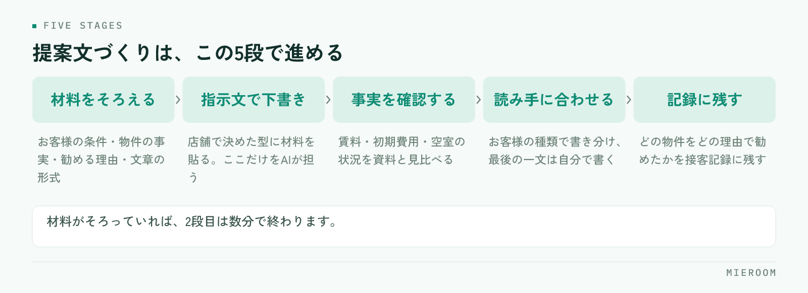

<!--META
{
  "title": "AIで物件の提案文を作る方法｜お客様ごとの提案を速く出す手順と注意点",
  "date": "2026-11-16",
  "category": "DX",
  "excerpt": "AIで物件の提案文を作るときの手順を、渡す材料・指示文の型・人が確かめる項目に分けて整理しました。お客様の種類ごとの書き分け、任せてはいけない部分、よくある失敗の避け方までまとめています。",
  "hook": "速さは、渡す材料で決まります",
  "tags": ["AI活用", "物件提案", "接客", "追客", "賃貸仲介DX"]
}
META-->

AIで物件の提案文を作るときに結果を分けるのは、AIの性能ではなく**渡す材料の作り方**です。お客様の条件と物件の事実を決まった形で渡せば、担当者が書くより速く、しかも読み手に合った下書きが出ます。この記事では、賃貸仲介の店舗で明日から使える手順と、人が必ず確かめる項目を順に整理します。

<h4>この記事の結論</h4>
AIに頼む前に、お客様の条件・物件の事実・断りたくない理由・文章の形式の4つを手元にそろえてください。<strong>材料がそろっていれば指示文は短くて済み</strong>、空室や賃料の確認だけを人が行う形にできます。

## AIで物件の提案文を作るなら、渡す材料で速さが決まる

提案文を作る作業を分けると、考える部分と、書く部分に分かれます。AIが代わりにできるのは書く部分だけです。ですから、考える部分――どのお客様に、どの物件を、どういう理由で勧めるのか――は先に人が決めておく必要があります。

<figure class="fig"><figcaption>AIが担うのは2段目だけです。残りは今までと同じ仕事として残ります。</figcaption></figure>

ここを決めずに「この物件の提案文を作って」と頼むと、物件情報を言い換えただけの文章が出てきます。読んだお客様から見れば、ポータルサイトの説明文と変わりません。逆に、ヒアリングで聞いた条件と、勧める理由を2行書いて渡すだけで、文章の中身が変わります。

実務の流れとしては、材料を集める、指示文で下書きを作る、事実を確認する、お客様に合わせて整える、送って記録に残す、の5段です。このうちAIが担うのは2段目だけで、残りは今までと同じ仕事です。**速くなるのは2段目だけだと分かっていると、期待の置き方を間違えません**。

## 提案文に渡す材料は4つに分かれる

材料は4種類あります。これを接客記録から引けるようにしておくと、提案文の作成は数分の作業になります。

一つ目はお客様の条件です。希望のエリアと駅距離、予算の上限、入居時期、間取り、同居する人数、譲れない条件（ペット、駐車場、在宅勤務の部屋）。ヒアリングで聞いた言葉のまま渡すのが要点です。

二つ目は物件の事実です。賃料と共益費、敷金・礼金、間取りと広さ、築年、駅からの分数、設備、入居可能日。ここは物件資料から写すだけなので、作り込む必要はありません。

三つ目は勧める理由です。なぜこのお客様にこの物件なのか。「予算内で浴室乾燥機が付く数少ない物件」「勤務先まで乗り換えなし」など、担当者の判断を1〜2行で言葉にします。これが提案文の芯になります。

四つ目は文章の形式です。メールかLINEか、何文字くらいか、物件は何件並べるか、最後に何を促すか（来店の予約、内見の候補日）。形式を決めておかないと、長さも結びも毎回変わります。物件そのものの紹介文の書き方は[物件紹介文の書き方](./bukken-shokaibun-kakikata.html)で詳しく扱っています。

## 指示文の型を1つ決めて、店舗で使い回す

指示文（プロンプト）は毎回考える必要はありません。店舗で1つ型を決めて、材料の部分だけ差し替えて使います。

型に入れておく要素は5つです。役割（賃貸仲介の担当者として）、読み手（上のお客様の条件を貼る）、材料（物件の事実を箇条書きで貼る）、守る条件（事実にないことを書かない、断定を避ける、賃料は記載のまま使う）、出力の形（文字数、件数、結びの一文）。

守る条件は、必ず文字で入れてください。これを省くと、設備や周辺環境について資料に無いことが書かれる場合があります。「資料に書かれていないことは書かないでください」「分からない点は（要確認）と残してください」の2文を型に入れておくと、確認すべき箇所が自分で分かる形で返ってきます。

型は紙でもメモアプリでも構いませんが、**全員が同じ型を使うこと**が品質の下限を決めます。担当者ごとに指示文が違うと、文章の硬さや長さがばらつき、店舗としての印象も揃いません。AIを使える場面の全体像は[不動産会社のAI活用](./fudosan-ai-katsuyo-bamen.html)にまとめています。

## 出てきた文章は、この5点を人が確かめる

下書きが出たら、送る前に次の5点を確かめます。慣れれば1分で終わります。

- 賃料・共益費・敷金・礼金が、物件資料と一字一句合っているか
- 空室かどうか、入居可能日が最新の情報か
- 設備や条件に、資料に無いものが足されていないか
- 「必ず」「間違いなく」のような断定的な言い回しが入っていないか
- お客様が挙げた譲れない条件に、文章が答えているか

このうち**最初の2つは、省くと信用を失う項目**です。数字と空室の状況は、AIが知らない情報なので、下書きの中では常に確認対象として扱ってください。

!気をつけたい場面

過去にやりとりした別のお客様の情報を、そのまま指示文に貼らないでください。お名前や勤務先、連絡先は指示文に入れる必要がありません。条件だけを渡せば提案文は作れます。

## お客様の種類ごとに、書き分けを決めておく

同じ物件でも、読み手によって触れるべき点が変わります。種類ごとに書き分けの方針を決めておくと、指示文に1行足すだけで文章の向きが変わります。

| お客様の種類 | 先に触れる点 | 添える情報 |
|---|---|---|
| 初めての一人暮らし | 初期費用の全体像、入居までの流れ | 必要な書類、設備の使い方の説明 |
| 社会人の単身 | 通勤の経路と所要時間、入居可能日 | 内見の候補日、オンラインでの手続き |
| ファミリー | 間取りの使い方、周辺の生活環境 | 駐車場の有無、更新や退去の条件 |
| 法人・社宅 | 契約の形態、入居時期の確実性 | 必要書類、請求の宛先の扱い |
| 転勤・遠方から | 内見できない場合の進め方 | 写真や動画の用意、手続きの順番 |

書き分けの方針は、店舗で1枚にまとめておいてください。新しく入ったスタッフでも、表を見れば同じ水準の提案文を出せます。周辺環境や相場の話を書くときは、資料や公的な情報で確かめられる範囲に留めるのが原則です。

## よくある失敗と、その避け方

**材料を渡さずに頼む**。物件名だけ渡すと、一般的な言い換えが返ってきます。条件・事実・勧める理由を貼ってから頼んでください。

**数字を確認せずに送る**。賃料や初期費用の記載が資料とずれると、後から訂正の連絡が必要になります。送信前に資料と並べて見比べてください。

**物件を並べすぎる**。1通に何件も入れると、どれを勧めているのか伝わりません。件数を型で決めておいてください。

**全員が違う指示文を使う**。文章の長さと硬さがばらつきます。型を1つに決めて共有してください。

**お客様の個人情報をそのまま貼る**。お名前や勤務先は提案文の作成に不要です。条件だけを渡す運用にしてください。

**出てきた文章をそのまま送る**。担当者の言葉が一行も入っていない提案文は、読み手に伝わりません。最後の一文は自分で書き直してください。

**記録に残さない**。どの物件をどの理由で勧めたかが残っていないと、次の提案が前回と重なります。送った内容は接客記録に残してください。

## 自分で進める場合と、ツールに任せる場合の分かれ目

一般論として、判断の基準は3つあります。

一つ目は、提案を出す件数です。1日に数件であれば、指示文の型とヒアリング表を紙で持つだけで足ります。反響の数が増えて、誰にどの提案を出したかを思い出せなくなってきた段階から、記録を仕組みに置く意味が出てきます。

二つ目は、材料をどこから引いてくるかです。条件も物件情報も手元のメモに散っていると、材料を集める時間が文章を書く時間を上回ります。接客記録と物件情報が同じ場所にあるなら、提案文の作成は材料を貼るだけの作業になります。

三つ目は、人数です。担当者が1人なら、頭の中で品質が揃います。複数人で、しかも入れ替わりがあるなら、型と記録を仕組みに置かないと水準が保てません。

迷うときは、提案文を1通作るのに材料を探す時間が何分かかっているかを測ってください。文章を書く時間より探す時間が長いなら、手を入れる先は文章の作り方ではなく、情報の置き場所です。

## よくある質問

AIが作った提案文を、そのままお客様に送ってよいですか？

送る前に人が確認してください。賃料や初期費用の数字、空室の状況、設備の有無はAIが知らない情報なので、資料と見比べる作業が必要です。確認したうえで、最後の一文だけは担当者の言葉に書き直すと、定型文の印象になりません。

どのAIを使えばよいですか？

文章の下書きを作る用途であれば、広く使われている生成AIのいずれでも実務に足ります。選ぶ基準は性能よりも、店舗のスタッフ全員が同じものを使えるか、入力した内容の扱いについて利用規約を確認できるか、の2点です。まず1つに決めて、型を共有することを優先してください。

お客様の情報を入力しても問題ありませんか？

お名前・連絡先・勤務先といった個人が特定できる情報は入力しないでください。提案文を作るのに必要なのは、希望条件・予算・入居時期・譲れない条件といった条件の情報だけです。店舗として入力してよい範囲を文字で決め、全員で共有しておくことをおすすめします。

文章が毎回似てしまいます。どうすればよいですか？

勧める理由が渡されていない場合に起こります。物件の事実だけを渡すと、言い換えの文章しか出せません。「このお客様にこの物件を勧める理由」を1〜2行書いて渡してください。理由が違えば、同じ物件でも文章の組み立てが変わります。

スタッフに使わせるとき、最初に何を決めればよいですか？

指示文の型、入力してよい情報の範囲、送信前に確認する項目の3つです。この3つを1枚にまとめて配れば、使い方の説明はほぼ終わります。細かい使いこなしは、使い始めてから持ち寄って型を直していくほうが早く定着します。

## まとめ：提案文は、材料を置く場所を決めると速くなる

AIで物件の提案文を作る手順は決まっています。お客様の条件・物件の事実・勧める理由・文章の形式の4つをそろえる。店舗で決めた指示文の型に貼る。出てきた下書きの数字と空室を人が確かめる。読み手の種類に合わせて整え、最後の一文を自分で書く。送った内容を接客記録に残す。この形なら、文章を書く時間は短くなり、確認の質は落ちません。

逆に、材料を集める段階で毎回メモを探していると、文章が速く出ても全体の時間は変わりません。提案の速さを決めているのは、AIではなく情報の置き場所です。

ミエルームなら、反響の受付からヒアリングの内容、提案した物件、追客の履歴までが案件ごとに1件のまま残るので、提案文に渡す材料をその場で引き出せます。フォームやメールからの反響は自動で取り込まれ、業者間サイトとの連携や物件コンバータで物件情報も同じ画面にそろうため、材料を探す時間がなくなります。LINE・SMSの自動追客まで同じ案件につながるので、送った提案が次の連絡に生きます。機能の詳細は[機能・事例](../features.html)をご覧ください。資料のご請求やデモアカウントの発行は、この下のボタンからお気軽にどうぞ。
