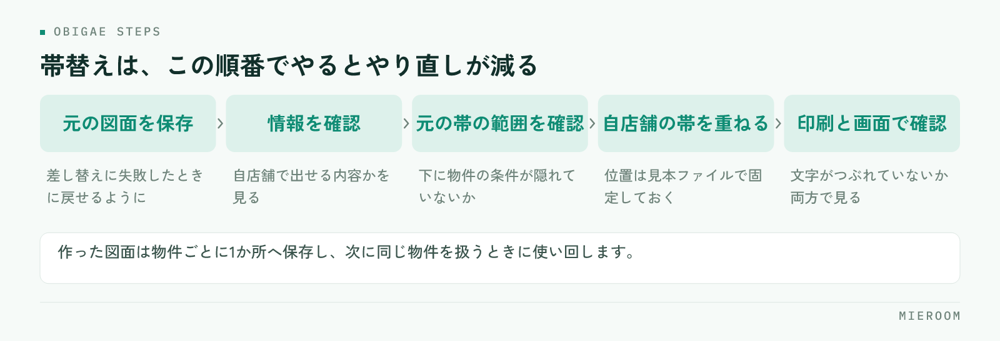

<!--META
{
  "title": "賃貸の募集図面（マイソク）の帯替えを速くする方法｜手作業を減らす手順",
  "date": "2026-11-06",
  "category": "集客・広告",
  "excerpt": "募集図面の帯替えに毎日時間を取られている店舗向けに、速くするための段取りを整理しました。自店舗の帯の中身の決め方、届いた図面の仕分け、手順の固定、1枚あたりの時間を縮める工夫、よくある失敗までまとめています。",
  "hook": "帯替えは、作業の速さより段取りで決まる",
  "tags": ["募集図面", "マイソク", "業務効率化", "物件資料", "賃貸仲介"]
}
META-->

管理会社から届いた募集図面の帯を自社のものに差し替える作業は、1枚あたりは数分でも、1日に何十枚と重なると営業の時間を食います。**帯替えが遅いのは作業が難しいからではなく、毎回判断しながらやっているからです**。何を載せるか、どのファイルを使うか、誰がやるかを先に決めておくだけで、作業時間は読めるようになります。

<h4>この記事の結論</h4>

帯替えを速くする鍵は、ソフトの使い方ではなく段取りです。<strong>自店舗の帯の中身を1つに固定し、届いた図面を形式ごとに仕分ける</strong>——この2つを決めるだけで、1枚あたりの判断が消えて作業が流れます。残った時間のかかる部分だけを、作り直しやツールで片付けてください。

## 帯替えに時間がかかっている本当の原因

帯替えの作業時間を測ってみると、画像を加工している時間よりも、その前後で止まっている時間のほうが長いことがほとんどです。

よくある止まり方は次のようなものです。届いた図面がPDFなのか画像なのか紙なのかで扱いが変わり、毎回どのソフトで開くか考える。帯に載せる文言が担当者ごとに違い、前回のファイルを探して真似する。載せていい情報かどうか迷い、先輩に確認する。元の帯を消したら下の文字が欠けて、やり直す。

つまり、作業そのものは単純なのに、毎回小さな判断が挟まっています。この判断を事前に潰すのが、いちばん効く改善です。逆に、判断が残ったままツールを入れても、ツールの前で止まるだけで時間は変わりません。

## 自店舗の帯の中身を1つに固定する

最初にやるのは、自店舗の帯に載せる項目を決め切ることです。項目が固定されていれば、図面ごとに考える必要がなくなります。

帯に入れる情報は、おおむね次の構成になります。店舗名と所在地、連絡先、営業時間、免許番号、取引態様の表示、担当者欄。これに加えて、自店舗で使う物件番号や、内見の受付方法を入れている店舗もあります。

ここで決めておきたいのは、入れる項目だけでなく「入れない項目」です。担当者の個人携帯を入れるか入れないか、物件ごとの条件を帯に書くか書かないか。入れない項目を決めておかないと、担当者ごとに帯が増えていきます。

✓帯は1種類で足りるか確認する

媒体や用途で複数の帯が必要になる店舗もあります。店頭に貼る分、来店時に渡す分、業者間でやりとりする分。必要なら最初から複数パターンを作り、どの場面でどれを使うかを決めてください。場面ごとに作り分けるより、使い分けを決めるほうが早く済みます。

## 届いた図面を、形式ごとに仕分ける

図面は届き方がばらばらです。扱いを形式ごとに決めておくと、開く前に手順が決まります。

| 届き方 | 扱いやすさ | 向いている作業 | 注意点 |
|---|---|---|---|
| PDF（文字が選べる） | 扱いやすい | 帯の部分だけ差し替える | 元の帯の下に文字が隠れていないか確認 |
| PDF（画像を貼ったもの） | ふつう | 画像として扱い、帯を上に重ねる | 拡大すると文字がつぶれる |
| 画像（JPG・PNG） | ふつう | 帯を上に重ねる | 解像度が低いと印刷で読めない |
| 紙・FAXの原本 | 手間がかかる | 取り込んでから作業する | 傾き・かすれの補正が必要 |

この表を店舗の手順書に貼っておくと、新しく入ったスタッフでも迷いません。

**仕分けで決めておきたいのは、紙やFAXで届いたものの扱いです**。取り込みの手間が大きいので、そのまま使うのか、情報を書き起こして図面を作り直すのかを基準で決めてください。図面自体が読めない場合の作り直しは[間取り図を自分で作る手順](./madorizu-tsukurikata.html)に整理しています。

## 手作業で帯替えをするときの手順を固定する

形式の仕分けができたら、作業そのものの順番を決めます。順番が固定されていれば、やり直しが減ります。

<figure class="fig"><figcaption>飛ばされやすいのは3番目と5番目です。手順の中に確認として組み込んでください。</figcaption></figure>

おすすめの順番は次の通りです。第一に、元の図面を保存しておく。差し替えに失敗したときに戻せるようにします。第二に、載っている情報が自店舗で出せる内容かを確認する。第三に、元の帯の範囲を確認し、下に必要な情報が隠れていないかを見る。第四に、自店舗の帯を重ねる。第五に、印刷と画面の両方で読めるか確認する。

この順番の中で、いちばん飛ばされやすいのが第三と第五です。元の帯の下に物件の条件が書かれていることがあり、消すと情報が欠けます。また、画面では読めても印刷すると文字がつぶれることがあり、お客様に渡してから気づくと作り直しになります。

### 帯の重ね方で迷わないために

帯を重ねる位置は、最初に1枚だけ見本を作り、その位置を基準にしてください。毎回位置を決め直すと、資料がばらついて店舗の印象も揃いません。見本のファイルは誰でも開ける場所に置き、新しい担当者はそれを複製して使う形にします。

## 1枚あたりの時間を縮めるチェックリスト

そのまま確認に使える形で並べます。

- 帯に載せる項目と、載せない項目が文書になっているか
- 帯の見本ファイルが、誰でも開ける場所にあるか
- 届いた図面の形式ごとに、どう扱うかが決まっているか
- 元の図面を保存する場所とファイル名の付け方が決まっているか
- 帯を重ねる位置が、見本で固定されているか
- 印刷して読めるかを確認する手順が入っているか
- 帯替えを誰がやるか（営業か事務か）が決まっているか
- 作った図面の保存先が、物件ごとに1か所にまとまっているか

最後の2つが決まっていない店舗は多く、同じ物件の図面が担当者のパソコンに散らばります。結果として、次に同じ物件を扱うときにもう一度帯替えをすることになります。

## よくある失敗とその避け方

**一つ目は、元の帯の下にあった情報を消してしまう失敗**です。帯を重ねる前に、元の帯の範囲と、その下に何が書かれているかを必ず確認してください。確認を手順の中に入れるのがいちばん確実です。

**二つ目は、表示のきまりを外す失敗**です。取引態様の表示や免許番号、会社名といった必要な記載が、帯を差し替えた際に抜けることがあります。帯の見本に最初から入れておけば、抜けません。

**三つ目は、担当者ごとに帯が違う状態を放置する失敗**です。見た目がばらつくだけでなく、連絡先の表記が古いまま残ることがあります。帯を更新したら、見本ファイルを差し替えて周知してください。

**四つ目は、作った図面を保存せずに毎回作り直す失敗**です。物件ごとに保存先を決めるだけで、二度手間が消えます。紹介文の使い回しについては[物件紹介文の書き方](./bukken-shokaibun-kakikata.html)もあわせてご覧ください。

## 自分で進める場合と、ツールに任せる場合の分かれ目

一般論として、判断の基準は3つです。

一つ目は、1日に扱う枚数です。扱う枚数が少ないうちは、見本ファイルを作って手順を固定するだけで足ります。枚数が増え、担当者が毎日まとまった時間を取られるようになったら、仕組みで片付ける段階です。

二つ目は、帯替えの前後の作業がつながっているかどうかです。帯を替えるだけで終わらず、物件情報を別の管理表に転記し、媒体にも登録しているなら、帯替えだけを速くしても全体の時間は減りません。情報を1か所に入れれば他にも回る形にするほうが効きます。

三つ目は、作業する人が誰かです。営業がやっているなら、その時間は接客に使えた時間です。事務に寄せられるなら、手順の固定だけで十分に回ることもあります。誰の時間を空けたいのかで、打ち手が変わります。

迷うときは、まず1週間、帯替えにかかった時間と枚数を記録してください。記録があれば、手順の見直しで足りるのか、仕組みを変えるべきなのかが数字で判断できます。

## よくある質問

元の帯を消して自社の帯を載せるのは問題ないのでしょうか

管理会社から配布された図面の扱いは、配布元の方針によって異なります。帯替えを前提に配られている場合もあれば、加工を認めていない場合もあります。取引のある管理会社ごとに、どこまで加工してよいかを確認し、店舗の手順書に記録してください。判断がつかない図面は、情報を書き起こして自店舗で作り直す形が安全です。

帯替えは営業と事務のどちらがやるべきですか

手順が固定されていれば事務に寄せられます。固定されていない状態で事務に渡すと、判断のたびに営業へ確認が飛び、かえって時間がかかります。先に帯の中身と手順を決め、そのうえで担当を移してください。

紙やFAXで届いた図面はどうすればいいですか

取り込んで使う場合は、傾きとかすれを直してから帯を重ねます。読めない部分が残る図面は、そのまま使うとお客様への説明でつまずくので、情報を書き起こして作り直したほうが結果的に早いことが多いです。どちらにするかの基準を、文字が読めるかどうかで決めておくと迷いません。

帯のデザインはどこまで作り込むべきですか

読みやすさが最優先です。店舗名と連絡先がすぐ目に入り、必要な記載が欠けていなければ十分です。装飾を増やすと図面本体の情報が読みにくくなるため、余白を確保する方向で整えてください。

図面の保存先はどう決めればいいですか

物件ごとに1か所、が原則です。担当者のパソコンに置くと、担当が替わったときに探せません。物件の情報と一緒に残る場所に置き、ファイル名の付け方も店舗で統一してください。元の図面と帯替え後の図面は、どちらも残します。

## まとめ：帯替えは、決めておけば速くなる

帯替えの時間は、作業の速さよりも段取りで決まります。自店舗の帯の中身を固定し、届いた図面を形式ごとに仕分け、作業の順番と保存先を決める。ここまでやると、1枚あたりの判断が消えて時間が読めるようになります。そのうえで、枚数が多い店舗や前後の作業がつながっている店舗は、仕組みで片付ける段階に進んでください。

ミエルームなら、物件コンバータで物件情報をまとめて取り込み、間取り図の作成も業務管理の中で進められるので、図面に載せる情報を集めるために複数のソフトを開いて行き来する手間が減ります。物件の情報が案件と一緒に残るため、同じ物件を次に扱うときに資料を探し回ることもなくなります。どの機能で何ができるかは[機能・事例のページ](../features.html)にまとめています。資料のご請求やデモアカウントの発行は、この下のボタンからお気軽にどうぞ。
