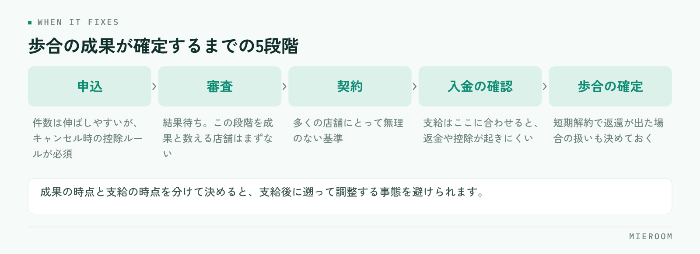

<!--META
{
  "title": "賃貸仲介の歩合給の決め方｜対象にする成果と、キャンセル時の扱い",
  "date": "2026-10-18",
  "category": "組織・育成",
  "excerpt": "賃貸仲介の歩合給を、揉めない形で決めるための考え方を整理しました。申込・契約・入金のどこを対象にするか、固定給との比率、支給のタイミング、キャンセルや解約が出たときの扱いまでまとめています。",
  "hook": "歩合給は、何に払うかを決めれば揉めない",
  "tags": ["歩合給", "給与", "店舗運営", "スタッフ育成", "賃貸仲介"]
}
META-->

歩合給でもめる原因は、金額の高さではありません。**「どの時点の成果に払うのか」が決まっていないこと**です。申込が入った時点で成果と数えるのか、入金を確認してからなのか。この線を先に引いておかないと、キャンセルが出たときに必ず揉めます。

<h4>この記事の結論</h4>
歩合給は、割合より先に対象を決めます。<strong>申込・契約・入金のどこを成果と数えるかを文書にし、キャンセル時の扱いまで同時に決めておく</strong>こと。そのうえで、成果を後から数えられる記録の形を用意してから運用を始めてください。

## 歩合給で揉めるのは、金額ではなく対象が曖昧なとき

スタッフから不満が出る場面は、だいたい共通しています。申込が入ったのにキャンセルになった案件の扱い、途中で担当が替わった案件の扱い、反響を取った人と接客した人が違う案件の扱い。いずれも金額の話ではなく、「これは誰の成果として数えるのか」という話です。

この3つは、運用を始めてから必ず起きます。にもかかわらず、歩合の設計では割合だけが先に決まり、対象の定義が後回しになりがちです。結果として、個別の案件ごとに店長が判断することになり、そのたびに基準がぶれます。

**先に決めるべきは、割合ではなく対象です**。対象とキャンセル時の扱いさえ決まっていれば、割合は後から調整できます。逆の順番で始めると、調整するたびに不満が残ります。

## 何に対して払うかを決める（申込・契約・入金）

成果として数える時点は、おおむね3つに分かれます。どれが正しいというものではなく、店舗の体力と業務の流れで選びます。

| 対象とする時点 | 向いている店舗 | 注意点 |
|---|---|---|
| 申込が入った時点 | 件数を伸ばしたい、立ち上げ期の店舗 | キャンセル時の控除ルールが必須 |
| 契約が完了した時点 | 多くの店舗にとって無理のない基準 | 契約までの期間が長い案件で支給が遅れる |
| 入金を確認した時点 | 資金の出入りを合わせたい店舗 | 後ADの入金が遅い案件で、成果実感が薄れる |

実務で収まりがよいのは、**契約完了を成果の時点とし、支給は入金の確認後に行う形**です。成果の時点と支給の時点を分けて考えると、キャンセルによる返金や控除の処理が起きにくくなります。

申込時点を対象にする場合は、キャンセル時にどう戻すかを同時に決めてください。これを決めずに申込件数で払うと、取り消しのたびに給与の調整が発生します。申込がキャンセルになったときの処理そのものは[申込のキャンセルが出たときの処理](./moushikomi-cancel-shori.html)にまとめています。

## 固定給と歩合の比率をどう考えるか

比率に正解はありませんが、判断の軸は2つです。ひとつは、スタッフが固定給だけで生活できるかどうか。もうひとつは、店舗の粗利に対して歩合の総額が収まるかどうかです。

歩合の比率を上げると、繁忙期の手取りは増えますが、閑散期の落差も大きくなります。落差が大きいほど、閑散期の離職につながります。逆に固定給に寄せすぎると、件数を伸ばした人の納得感が薄れます。

✓粗利を把握してから決める

歩合の比率は、店舗の粗利を把握していないと決められません。売上から広告費・家賃・人件費を引いた残りがいくらなのかが分からないまま比率を決めると、繁忙期に払えない月が出ます。先に損益の構造を確認してください。判断の手順は<a href="./tenpo-soneki-arari-handan.html">店舗の損益と粗利の見方</a>にまとめています。

決めた比率は、見直す時期も一緒に決めておいてください。年度の切り替えや繁忙期明けなど、タイミングを先に共有しておくと、途中での変更が不信につながりません。

## 支給のタイミングと、キャンセル・解約時の扱い

歩合の対象が決まったら、成果が確定するまでの流れを整理します。賃貸仲介の案件は、申込から入金までに複数の段階があります。

<figure class="fig"><figcaption>どの段階を成果と数えるかと、どの段階で支払うかは分けて決めます。</figcaption></figure>

決めておくのは次の4点です。

1. **成果として数える段階**：申込・契約・入金のどれか
2. **支給する月**：成果が確定した月の翌月など、締めとの関係を明記する
3. **キャンセル時の扱い**：成果の取り消しか、次回支給での控除か
4. **解約が早かった場合の扱い**：短期解約で広告料の返還が発生したときの扱い

とくに4つめは抜けやすい項目です。短期解約で返還が発生した案件は、店舗の売上としても減ります。歩合を支給済みの場合にどうするかを、運用前に決めておいてください。**支給後に遡って調整する形は、現場の納得を得にくい**ため、支給のタイミング自体を遅らせる設計のほうが収まります。

## 個人の成果とチームの成果を分ける

賃貸仲介の案件は、一人で完結しないことが多いです。反響に最初に返したのが誰か、内見に行ったのが誰か、契約手続きを進めたのが誰か。すべてが同じ人とは限りません。

決め方は2つあります。ひとつは、案件ごとに主担当を1人決め、その人の成果として数える形。もうひとつは、段階ごとに配分する形です。配分は公平に見えますが、計算が複雑になり、記録も細かく残す必要があります。

- **主担当方式**：記録と計算が簡単。担当の付け替えルールだけ決めておく
- **配分方式**：公平に見えるが、段階ごとの記録が必須。運用負荷が高い
- **店舗全体の達成分**：個人歩合とは別に、店舗の目標達成時の配分を少額置く形

小さな店舗であれば、**主担当方式に、店舗全体の達成分を少し足す形**が無理がありません。個人の成果だけにすると、反響の取り合いや、引き継ぎの消極化が起きます。成績の見方そのものは[スタッフの成績管理の進め方](./staff-seiseki-kanri.html)を参照してください。

## 歩合給の前に、成果を数えられる状態を作る

設計が決まっても、成果を後から数えられなければ運用できません。月末に「この案件は誰の成果か」を思い出しながら集計している状態では、どんな制度を作っても揉めます。

必要な記録は多くありません。案件ごとに、反響の入り口、主担当、申込日、契約日、入金の確認日、そして売上の内訳。この6つが案件単位で残っていれば、どの対象を選んでも集計できます。

✓確定した売上と見込みを分ける

歩合の集計で混ざりやすいのが、入金済みの売上と、まだ入っていない見込みです。この2つが同じ数字に入っていると、支給額の根拠が月によってずれます。案件ごとに入金の状況が分かる形にしておくと、支給のタイミングを入金基準にしても集計が止まりません。

制度は、文書にして全員に配ってください。口頭で伝えた基準は、担当者ごとに違う記憶として残ります。1枚に、対象・支給月・キャンセル時の扱い・担当の決め方を書いておけば、入社時の説明もそのまま使えます。

歩合給の割合は、他店に合わせたほうがよいですか？

他店の水準は採用の参考になりますが、そのまま持ってくると払えない月が出ます。判断の基準は、自店の粗利です。繁忙期と閑散期の両方で、歩合の総額が粗利に収まるかを確認してから決めてください。採用面で見劣りする場合は、歩合の割合だけでなく、固定給の水準や支給の早さ、休日の取りやすさなど、ほかの条件で調整する方法もあります。

途中で担当が替わった案件は、どう数えればよいですか？

主担当方式を取るなら、「いつの時点の担当を主担当とするか」を決めておいてください。申込時点の担当とする、契約手続きをした担当とする、どちらでも構いませんが、案件ごとに判断する形にしないことが大事です。あわせて、引き継いだ側が不利にならないよう、引き継ぎが発生した案件の扱いも書いておくと、引き継ぎを避ける動きが出にくくなります。

決めた制度は、途中で変えてもよいですか？

変更は問題ありませんが、適用の開始時期を明確にしてください。進行中の案件に新しい基準を当てると、必ず不満が出ます。「次の月の申込分から新しい基準」といった線を引き、変更前に決まっていた案件は旧基準で処理するのが無理のない進め方です。労働条件の変更にあたる内容を含む場合は、社会保険労務士など専門家に確認してから進めてください。

## まとめ：対象とキャンセル時の扱いを、先に文書にする

歩合給の決め方は、順番がすべてです。まず申込・契約・入金のどこを成果と数えるかを決め、キャンセルと短期解約の扱いを同時に決める。次に固定給との比率を、自店の粗利から決める。最後に、案件ごとの記録が残る形を用意する。

割合から決めると、個別の案件ごとに判断が必要になり、そのたびに基準がぶれます。**先に対象を決めておけば、割合は後から調整できます**。

[ミエルーム](../index.html)なら、反響の入り口から申込・契約・入金までを案件ごとに1行で記録でき、確定した売上と見込みが分かれて表示されるので、歩合の集計で月末に管理表を突き合わせる作業がなくなります。接客と反響の成績も担当ごとに見えるため、主担当の付け方や制度の見直しも数字を見ながら判断できます。デモアカウントの発行やご相談は、この下のボタンからお気軽にどうぞ。
