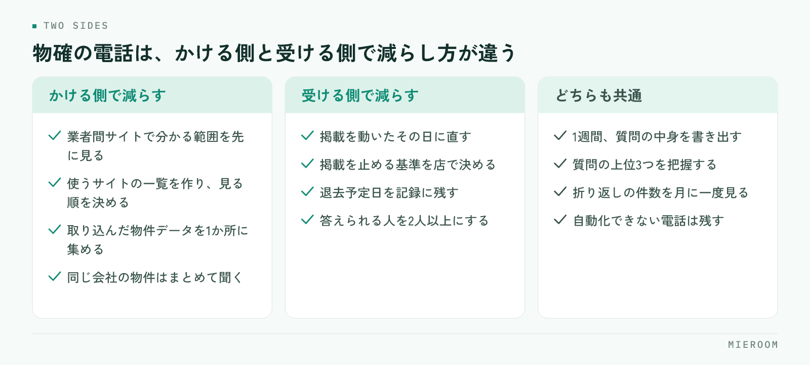

<!--META
{
  "title": "物確（物件確認）の電話を減らす方法｜空室確認を自動化する仕組みと運用",
  "date": "2026-10-31",
  "category": "業務効率化",
  "excerpt": "物確の電話を減らす方法を、かける側と受ける側の両方から整理しました。電話の前に調べられる情報を増やす手順、答える手間を一度で済ませる形、自動化できるところと人が答えるしかないところの線引きまでまとめています。",
  "hook": "物確の電話は、情報の置き場所を決めれば減る",
  "tags": ["物確", "業務効率化", "空室確認", "業者間サイト", "賃貸仲介"]
}
META-->

繁忙期になると、電話が鳴っている時間のほうが長い日が出てきます。内容の多くは物確（物件確認）で、聞かれるのは空いているかどうかという一点です。**物確の電話が減らないのは件数が多いからではなく、聞けば分かる状態のままにしてあるから**です。この記事では、かける側と受ける側の両方から、電話を減らすための具体的な手順を整理します。

<h4>この記事の結論</h4>

物確の電話を減らす方法は、相手を変えることではなく、自店の情報の置き場所を決めることです。<strong>最新の空室状況が1か所にあり、スタッフが電話をかけずにそこを見られる状態を作れば、かける電話も受ける電話も同時に減ります</strong>。自動化できるのは調べる部分で、条件の交渉や申込の意思確認は人が電話で行う部分として残ります。

## 物確の電話が減らない理由と、やりとりの中身の棚卸し

物確の電話は、かける側と受ける側で性質が違います。かける側は「この物件は今も空いているか」を確かめるためにかけ、受ける側は同じ質問に1日に何度も答えています。どちらも減らしたいのに減らないのは、情報が電話の向こうにしかないからです。

<figure class="fig"><figcaption>どちらの側も、情報の置き場所を決めることから始まります。</figcaption></figure>

まずやるべきは、1日の物確のやりとりを書き出すことです。1週間でかまいません。次の項目をメモに残してください。

- どの物件について聞かれたか（または聞いたか）
- 聞かれた内容（空室か、申込が入っているか、条件の変更があるか、鍵の場所か）
- 相手（客付の会社か、管理会社か、オーナーか）
- その場で答えられたか、折り返しになったか

書き出すと、質問の中身が数種類しかないことが分かります。空いているかどうか、申込が入っているか、いつから入居できるか——この3つで大半を占めるのが普通です。**質問が数種類に収まるなら、その答えを置いておける場所を作れば電話は要らなくなります**。

折り返しになった件数も数えてください。折り返しは1件で2回の電話になり、その間に相手が別の物件を案内してしまうこともあります。折り返しが多い場合、情報を持っている人が1人に偏っているサインです。

## かける側で減らす：電話の前に調べられる情報を増やす

かける電話を減らすには、電話の前に確認できる情報を増やすしかありません。順番は次のとおりです。

### 業者間サイトで分かる範囲を先に見る

業者間流通サイトには、空室の状況や募集条件が掲載されています。更新されている物件であれば、電話をかけずに現況が分かります。問題は、どのサイトに何が載っているかをスタッフが把握していないことです。

使っているサイトを一覧にして、どのエリアのどの種別がどのサイトで強いかを書いておいてください。新人が最初にかける先が「電話」ではなく「サイト」になるだけで、件数は変わります。業者間サイトからの物件探しは[業者間サイトでの物件検索](./gyoshakan-site-bukken-kensaku.html)に整理しています。

### 取り込んだ物件データを社内の1か所に集める

サイトで調べた内容を各自のメモに留めると、翌日また同じ物件を調べ直すことになります。取り込んだ物件データを社内の1か所に集め、そこを見れば分かる状態を作ってください。物件データの取り込み方は[物件データの取り込み](./bukken-data-torikomi.html)にまとめています。

### それでも電話が必要な場合の聞き方を決める

電話をかけるときは、まとめてかけてください。1物件ごとにかけるのではなく、同じ会社の物件を集めて一度の電話で聞く。聞く内容もあらかじめ決めておき、空室・申込・入居可能日・条件の4点を毎回同じ順で聞くようにします。相手も答えやすく、聞き漏らしも減ります。

## 受ける側で減らす：答える手間を一度で済ませる形にする

管理物件を持っている店舗では、受ける電話のほうが負担になります。減らす方法は、答えを先に出しておくことです。

✓更新されていない情報は、電話を増やします

業者間サイトの掲載が古いままだと、相手は掲載を信用せず電話で確かめるようになります。掲載を直す手間と、電話に答える手間は、どちらが大きいかを比べてください。多くの場合、掲載を直すほうが一度で済みます。

やることは3つです。

1. **業者間サイトの掲載を、動いたその日に直す**。申込が入ったら掲載を止める、条件が変わったら書き換える。この2つだけでも問い合わせの中身が変わります
2. **止める判断の基準を決める**。申込が入った時点で止めるのか、審査が通ってから止めるのかを店で決めておきます。人によって扱いが違うと、掲載が信用されなくなります
3. **答えられる人を増やす**。空室状況が1人の頭の中にあると、その人が外出中は全部が折り返しになります。誰でも同じ画面を見て答えられる形にしてください

掲載の取り下げの判断は[掲載物件の取り下げ](./keisai-bukken-torisage.html)にも整理していますので、基準を決めるときの参考にしてください。

## 自動化できるところと、人が答えるしかないところ

物確を「自動化する」と言うとき、実際に自動化できるのは調べる部分だけです。線引きを先にしておくと、入れるべき仕組みが決まります。

| やりとりの中身 | 自動化できるか | 現実的な進め方 |
|---|---|---|
| 空いているかどうか | できる | 掲載と社内の物件データを最新にし、見れば分かる形にする |
| 申込が入っているか | できる | 申込管理の記録を社内で共有し、入った時点で掲載を止める |
| いつから入居できるか | 一部できる | 退去予定日が分かっている分は記録に載せる。未定は人が答える |
| 募集条件（賃料・初期費用） | できる | 掲載情報を最新にする。変更日を記録する |
| 条件の交渉（賃料・フリーレント） | できない | オーナーの意向が必要なため、人が確認して答える |
| 申込の意思確認・審査の見込み | できない | 相手の事情を聞く必要があるため電話で行う |
| 鍵の場所・内見の段取り | 一部できる | 保管場所を記録に載せる。貸出の可否は人が判断する |

この表のうち、上の4つが電話の大半を占めます。つまり、調べられる部分を最新にするだけで、電話の件数はかなり動きます。**残る電話は、人が判断しなければならない内容だけになり、その分は電話で受けたほうが早い**という形に落ち着きます。

## 物確を見直すチェックリスト

そのまま使える形にしています。できていない項目から手を付けてください。

- 1週間、物確のやりとりの中身を書き出した
- 質問の種類を数え、上位3つを把握した
- 使っている業者間サイトを一覧にした
- エリア・種別ごとに、どのサイトを先に見るかを決めた
- 調べた物件データを社内の1か所に集める形にした
- 自店の管理物件の掲載を、いつ誰が直すか決めた
- 申込が入ったときに掲載を止める基準を決めた
- 退去予定日が分かった時点で記録に残す運用にした
- 鍵の保管場所を記録に載せた
- 空室状況を答えられるスタッフが2人以上いる
- 折り返しになった件数を月に一度見ている

全部を一度にやる必要はありません。上から3つを1週間、次の3つを翌週、という進め方で十分です。

## よくある失敗とその避け方

**電話を取らない方針にする**。かかってくる電話を減らそうとして取次を絞ると、紹介してもらえる件数も減ります。減らすのは電話の必要性で、電話そのものではありません。

**掲載を止めずに「埋まりました」と答え続ける**。掲載が残っていると問い合わせは続きます。答える時間を毎回使うより、掲載を止める作業を習慣にしたほうが短く済みます。

**ツールを入れただけで運用を決めない**。物件データを取り込める仕組みを入れても、誰がいつ更新するかを決めなければ、古いデータを見て電話することになります。入れる前に更新の担当と頻度を決めてください。

**空室状況を1人が管理する**。その人が休むと全部が止まります。情報の置き場所を共有にして、少なくとも2人が答えられる形にしてください。

**聞かれた内容を記録しない**。何を聞かれているか分からないままでは、どこを自動化すべきか決められません。書き出す1週間を先に作ってください。

**自動化できない部分まで仕組みで解決しようとする**。条件の交渉や申込の意思確認は、人が話すほうが早く正確です。線引きを決めずに全部を効率化しようとすると、かえって手間が増えます。

## 自分で進める場合と、ツールや専門家に任せる場合の分かれ目

分かれ目になるのは、管理している物件の数と、情報を更新する人が決まっているかどうかです。

自分で進めやすいのは、扱う物件数が限られていて、掲載を直す担当が決まっている場合です。この規模なら、業者間サイトの掲載を動いたその日に直し、空室の一覧を共有のファイルに置くだけで、電話はかなり減ります。仕組みを入れる前に、まずこの形で運用が続くかを確かめてください。

ツールに任せたほうが早いのは、扱う物件数が多く、掲載するサイトが複数ある場合です。同じ内容を何か所にも入力する作業が発生していると、どこかが古くなり、その古い情報が電話を呼びます。また、申込の状況と掲載の状態が別の場所で管理されていて、突き合わせに時間がかかっている場合も、記録を1か所にまとめたほうが無理がありません。

判断の順番としては、1週間の書き出しをして、質問の上位3つが「調べれば分かる内容」で占められているかを見てください。占められているなら、情報の置き場所を整える施策が効きます。そうでなく交渉や判断の電話が多いなら、仕組みより人の割り振りを見直すほうが先です。

## よくある質問

物確の電話を完全になくすことはできますか？

できません。条件の交渉、申込の意思確認、内見の段取りのように、相手の事情を聞きながら決める内容は電話のほうが早く確実です。目標は件数をゼロにすることではなく、調べれば分かる質問の電話をなくし、判断が必要な電話だけを残すことです。残った電話には落ち着いて対応できるようになります。

業者間サイトの掲載を毎日直す時間が取れません。

全物件を毎日見直す必要はありません。動いた物件だけを、動いたその日に直してください。申込が入った、審査が通った、条件が変わった——このきっかけのときだけ触る運用にすれば、1件あたりの作業は短く済みます。きっかけを決めておくことが、頻度を決めることより大事です。

電話で聞いたほうが早いという考えのスタッフがいます。

1件だけを見れば電話のほうが早いことはあります。説明するときは、その電話を受けている側の時間も合わせて考えてもらってください。自店が受ける物確の件数を書き出して共有すると、立場が逆のときの負担が伝わります。禁止するより、サイトで調べる手順を1枚にして渡すほうが定着します。

管理物件が少ないので、受ける物確はほとんどありません。

その場合はかける側の見直しだけで十分です。使っている業者間サイトの一覧を作り、調べた物件データを社内の1か所に集めるところから始めてください。同じ物件を別のスタッフが調べ直す重複がなくなるだけでも、1日の電話は変わります。

空室情報はどのくらいの頻度で更新すればよいですか？

頻度を決めるより、更新するきっかけを決めるほうが続きます。申込が入ったとき、審査の結果が出たとき、退去予定日が分かったとき、条件が変わったとき。この4つのタイミングで必ず触る、という形にしてください。定期的な見直しは月に一度、取り下げ漏れを確認する程度で足ります。

## まとめ：電話を減らすのは、情報の置き場所を決めることから

物確の電話を減らす方法は、相手との付き合い方を変えることではありません。空いているか、申込が入っているか、いつから入れるか——この3つの答えが社内の1か所にあり、誰でも見られる状態を作ることです。

かける側は電話の前に調べる手順を決める。受ける側は動いたその日に掲載を直す。どちらも難しい作業ではありませんが、担当ときっかけを決めないと続きません。まず1週間の書き出しから始めてください。何を聞かれているかが分かれば、どこを直せばよいかも決まります。

[ミエルーム](../features.html)なら、業者間サイト連携と物件コンバータで物件情報を社内に取り込んで1か所にまとめられ、申込・入金管理で申込が入った案件を案件ごとに記録できるので、掲載を止める判断も同じ画面から行えます。空室状況を1人の記憶に頼らず、誰でも同じ内容を答えられるようになるので、折り返しの電話と調べ直す時間がなくなります。Excelデータのインポートと初期設定の代行にも対応しており、最短即日でスタートできます。デモアカウントの発行やご相談は、この下のボタンからお気軽にどうぞ。
