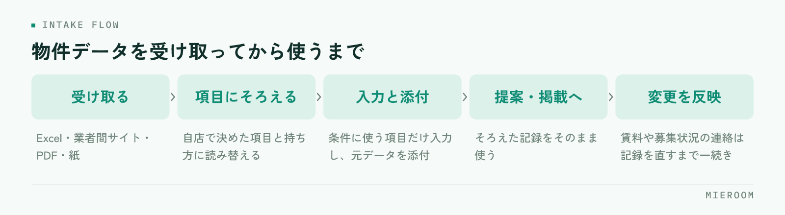

<!--META
{
  "title": "物件データの取り込みを楽にする手順｜届いたExcelや図面を自店の形にそろえる",
  "date": "2026-10-26",
  "category": "DX",
  "excerpt": "管理会社や業者間サイトから届く物件データを、打ち直さずに使える形にそろえる手順をまとめました。自店で持つ項目の決め方、届く経路ごとの扱い方、取り込んだあとの更新の進め方まで整理しています。",
  "hook": "届いた物件データを、打ち直さずに使う",
  "tags": ["物件データ", "Excel", "DX", "業務効率化", "賃貸仲介"]
}
META-->

管理会社からはExcel、業者間サイトからは画面のコピー、別の会社からはPDFの図面だけ。賃貸仲介の店舗に届く物件データは、**届く形がそろっていないまま毎日増えていきます**。そのうえで自店の管理表に打ち直しているため、物件が増えるほど入力の時間も間違いも増えていきます。

  <h4>この記事の結論</h4>
  
打ち直しを減らす順番は、ツールを探すことではなく「自店で持つ項目を決めること」から始まります。<strong>項目が決まっていないデータは、どんな形で届いても毎回判断が必要になります</strong>。項目をそろえてから、届く経路ごとに取り込み方を決めるのが現実的な進め方です。

## 届いた形がそろっていないと、毎回判断が必要になる

同じ物件の情報でも、送り主によって並び方と呼び方が変わります。賃料と管理費が1つの欄にまとまっているもの、敷金が「1ヶ月」と書かれているものと金額で書かれているもの、設備が文章でつながっているもの。

打ち直す作業が重いのは、入力の量ではなく、この**変換の判断を1件ごとにやり直しているから**です。担当者が違えば判断も変わるため、同じ物件が店内で2通りの形で残ることもあります。

さらに、届いたファイルがメールの中にしか無い状態だと、後から見返すときに探す時間がかかります。元データがどこにあるか分からない物件は、条件を確認するたびに送り主へ聞き直すことになります。

## 先に決めるのは、自店で持つ項目

取り込みを楽にする最初の作業は、ファイルを触ることではありません。**自店で必ず持つ項目を一度決めること**です。

<figure class="fig"><figcaption>直す場所を1か所にしておくと、変更の反映で漏れが出ません。</figcaption></figure>

最低限そろえるのは、次のあたりです。

- 所在地と物件名、部屋番号
- 賃料、管理費・共益費、敷金・礼金（金額で持つか、月数で持つか決める）
- 面積、間取り、築年
- 入居可能時期と、現況（空室・居住中）
- 元付・管理会社と、連絡の窓口
- 元データの置き場所（ファイルかURL）

ここで決めるべきなのは、項目の名前だけではなく**持ち方**です。敷金を「1ヶ月」で持つのか金額で持つのかを決めておけば、届いたデータがどちらの形でも、変換の判断は一度で済みます。

図面や写真をどこに置くかも、このときに決めます。物件の記録から辿れない図面は、無いのと同じ扱いになります。

## 届く経路ごとに、できる取り込み方が違う

経路によって、手の入れ方が変わります。全部を同じ手順で扱おうとすると、どこかで必ず止まります。

| 届く形 | 取り込み方 | 手がかかるところ |
|---|---|---|
| Excel・CSV | 列の対応を一度決めて読み込む | 送り主ごとに列の並びが違う |
| 業者間サイトの画面 | 必要な項目だけ転記、URLを残す | 画面が変わると手順も変わる |
| PDFの図面・物件概要 | 項目だけ入力し、本体は添付で持つ | 文字が画像になっていると拾えない |
| FAX・紙 | 項目だけ入力し、画像にして添付 | そのままでは検索できない |

**力を入れる価値があるのは、同じ送り主から繰り返し届くもの**です。月に何件も届く管理会社のExcelは、列の対応を一度決めれば以後ずっと効きます。年に1件しか来ない形式のために手順を作る必要はありません。

## Excelで届いたデータは、列の対応を先に決める

Excelが届いたときに毎回やっているのは、どの列が自店のどの項目にあたるかの読み替えです。これを送り主ごとに1回だけ決めて、メモとして残します。

手順はこの順番です。

1. 届いたファイルの列と、自店の項目を1対1で並べる
2. 対応しない列（先方の社内メモなど）は使わないと決める
3. 単位や表記が違う項目（敷金の月数と金額、面積の単位）の変換の形を決める
4. 次に同じ送り主から届いたときは、そのメモのとおりに読み込む

2回目以降は判断が要らなくなるので、作業は確認だけになります。**同じ送り主のファイルを毎回ゼロから読み替えているうちは、何件やっても速くなりません**。

一度そろえた物件データは、掲載や提案にそのまま回せます。掲載先へ出すときの進め方は[物件入稿の作業を短くする手順](./bukken-nyuko-tejun.html)に、探して提案するまでの流れは[物件検索・提案を速くする方法](./gyoshakan-site-bukken-kensaku.html)に分けて書いています。

  
✓全部を取り込まなくてよい

  
届いたデータの全項目を自店の形に入れる必要はありません。検索や提案で使う項目だけを入力し、それ以外は元のファイルを添付して残せば足ります。項目を増やすほど、入力も更新も重くなります。

## 図面やPDFは、どこまで入力するかを決めておく

PDFや紙で届くものは、文字として取り出せないことが多いため、全部を入力しようとすると手が止まります。ここは割り切りが必要です。

入力するのは、**探すときに条件として使う項目だけ**にします。所在地、賃料、面積、間取り、入居可能時期。これだけ入っていれば、条件での絞り込みはできます。

設備の細かい記載や、注意書き、申込時の条件は、元のファイルを添付しておけば提案の場で開けます。無理に打ち込むより、元が見られる状態のほうが正確です。

紙やFAXで届いたものは、スキャンか撮影で画像にして、物件の記録に添付します。机の上に紙で置いたままにすると、担当者以外には存在が分かりません。

## 取り込んだあとは、更新のほうが漏れる

最初の取り込みは意識して行うので、意外と漏れません。漏れるのは、そのあとの変更です。

賃料の変更、申込が入って募集停止、入居可能時期の変更。元付からの連絡はメールや電話で来るため、記録を直さないまま提案に使ってしまうことがあります。

防ぎ方は2つです。1つは、**直す場所を1か所にすること**。自店の記録を直せば、掲載や提案に使う情報もそこを見る形にしておきます。もう1つは、変更の連絡が来たときに「記録を直す」までを一続きの作業にすることです。

  
✓古い情報のほうが、手間は大きい

  
募集が終わった物件を案内してしまうと、お客様への謝罪と再提案が発生します。入力の手間を惜しんで記録を直さないほうが、結果として時間を使うことになります。

## よくある失敗

取り込みの仕組みづくりでつまずく形は、だいたい次の3つです。

1つ目は、**先に項目を決めずにファイルから手をつけること**です。届いたExcelの並びのまま取り込むと、送り主ごとに違う形のデータが並び、あとで検索できなくなります。

2つ目は、全部の経路を同じ手順でそろえようとすることです。紙やPDFまでExcelと同じ扱いにしようとすると、作業が止まります。経路ごとに、どこまでやるかを分けてください。

3つ目は、元データを残さないことです。項目だけ入力して元のファイルを捨てると、条件を確認したいときに送り主へ聞き直すことになります。

Excelの形式が送り主ごとに違うのですが、そろえてもらうべきですか？

送り主に形式の変更をお願いするのは現実的ではないことが多いため、自店側で読み替えの対応を決めておくほうが早く済みます。届く形はそのままで構いません。重要なのは、同じ送り主から届くファイルについて、どの列が自店のどの項目にあたるかを一度決めて残しておくことです。

物件数が少ない店舗でも、取り込みの手順を決める意味はありますか？

件数が少ないうちは手入力でも回りますが、項目の持ち方だけは早い段階で決めておく価値があります。あとから項目をそろえ直す作業は、既にある物件の分だけ発生するためです。件数が少ないときに決めておけば、増えてからの作業が軽くなります。

紙やFAXで届く物件は、どう扱えばよいですか？

スキャンか撮影で画像にして、物件の記録に添付する形をおすすめします。入力するのは検索の条件に使う項目だけで十分です。紙のまま保管すると、担当者が不在のときに他のスタッフが探せず、問い合わせへの回答が遅れます。画像にしておけば、少なくとも「どこにあるか」は決まります。

## まとめ：打ち直しを減らすのは、項目を決めることから

届く物件データの形はそろいません。そろえられるのは、受け取る側の形だけです。自店で持つ項目と持ち方を決め、経路ごとにどこまで入力するかを分け、繰り返し届くものだけ読み替えの対応を決める。この順番で進めると、件数が増えても入力は増えません。

更新の反映は、直す場所を1か所にして、連絡が来たときに記録を直すまでを一続きにします。**入力の速さを上げるのではなく、同じ情報を打ち込む回数を減らすのが要点です**。

[ミエルーム](../index.html)なら、他社フォーマットの物件データを変換して取り込む物件コンバータと、業者間サイトとの連携で、届いたデータの打ち直しを減らせます。Excelで持っている既存の物件データのインポートと初期設定の代行にも対応しているため、今の管理表から移すところも含めてそろえられます。物件の記録と提案・掲載が同じ場所でつながるので、賃料や募集状況が変わったときに直す場所を探さずに済みます。デモアカウントの発行やご相談は、この下のボタンからお気軽にどうぞ。
