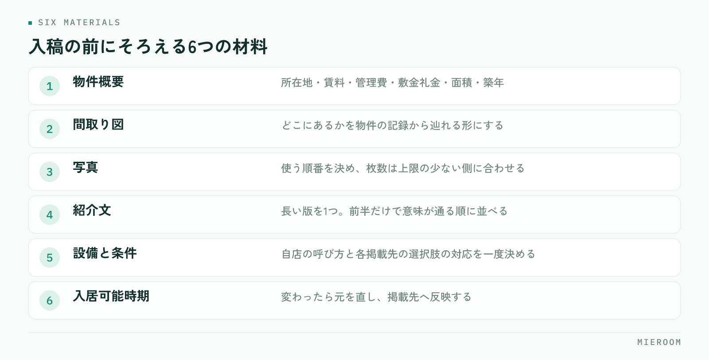

<!--META
{
  "title": "物件入稿の作業を短くする手順｜複数ポータルの重複入力と更新漏れをなくす",
  "date": "2026-10-24",
  "category": "集客・広告",
  "excerpt": "複数のポータルサイトへ物件を出す入稿作業の時間を短くする手順をまとめました。物件情報の元をどこに置くか、掲載先ごとに違う項目の整理、新規より漏れやすい更新の進め方、担当と頻度の決め方まで整理しています。",
  "hook": "入稿が長いのは、打ち直しているから",
  "tags": ["物件入稿", "ポータルサイト", "業務効率化", "掲載管理", "賃貸仲介"]
}
META-->

物件を1件お預かりしてから掲載が出るまでに、どれくらい時間がかかっているでしょうか。掲載先が3つあれば、同じ物件の入力を3回繰り返している店舗も少なくありません。**入稿の時間が長いのは、作業が遅いからではなく、同じ内容を掲載先ごとに打ち直しているからです**。

<h4>この記事の結論</h4>
入稿を短くする方法は、入力を速くすることではありません。<strong>物件情報の「元」を1か所に持ち、掲載先ごとに違う部分だけを足す形に変えること</strong>です。この形にしておくと、新規の入稿も、賃料改定や成約にともなう更新も、元を直すだけで済みます。

## 入稿の時間が長くなるのは、打ち直しているから

入稿作業の中身を分けると、物件情報を集める時間、入力する時間、掲載を確認する時間の3つになります。このうち削れるのは、入力の時間です。

掲載先が複数あると、同じ住所、同じ賃料、同じ設備を、画面を変えて何度も入れることになります。しかも打ち直すたびに、どこかで数字が1つずれます。

**作業を短くする入口は、入力の速さではなく、入力の回数です**。1回入れた内容を他の掲載先でも使える形にしておくと、2件目以降は差分だけの作業になります。掲載を止めるときの手順は[掲載物件の取り下げ](./keisai-bukken-torisage.html)にまとめています。

## 先に決めるのは、物件情報の「元」をどこに置くか

元になる物件情報が、担当者のパソコンの中や、受け取ったメールの添付ファイルに散っている状態だと、入稿のたびに探す時間が発生します。

決めるのは次の2点だけです。

- 物件1件の情報は、どこを見れば全部そろうのか
- 元を直したとき、誰がどの掲載先に反映するのか

1つめが決まっていない店舗では、2人目が同じ物件を入稿するときに、また元付け業者へ図面を依頼することになります。2つめが決まっていないと、元だけ新しくなって掲載が古いままになります。

元の置き場所は、物件ごとに1行で見られる形が扱いやすいです。住所と賃料だけでなく、図面や写真がどこにあるかまで同じ行から辿れると、探す時間がなくなります。

## 入稿のたびに探している材料を、物件ごとに1か所へ

入稿の画面を開いてから手が止まるのは、必要な材料が足りていないときです。何が必要になるかは毎回同じなので、先にそろえてから画面を開くほうが速く終わります。

<figure class="fig"><figcaption>紹介文と写真は作り置きできるため、入稿の場で考えずに済みます。</figcaption></figure>

そろえる材料は、物件概要（所在地・賃料・管理費・敷金礼金・面積・築年）、間取り図、写真、紹介文、設備と条件、入居可能時期の6つです。このうち紹介文と写真は、作り置きしておける部分です。

写真の撮り方は[物件写真の撮り方](./bukken-shashin-torikata.html)、紹介文は[物件紹介文の書き方](./bukken-shokaibun-kakikata.html)にまとめています。先に型を決めておくと、入稿の場で文章を考える時間がなくなります。

✓紹介文は、掲載先ごとに書き直さない

文字数の上限は掲載先によって違いますが、毎回書き直す必要はありません。長い版を1つ作り、前半だけで意味が通る順番に並べておけば、短い枠には前半をそのまま使えます。短い版から長い版を作るより手数が少なく済みます。

## 掲載先ごとに違うのは、そう多くない

複数のポータルサイトに出していると、全部が別物のように感じられます。実際に違うのは、項目のうちの一部です。

| 項目 | 掲載先による違い | 決めておくこと |
|---|---|---|
| 物件概要（所在地・賃料・面積） | ほぼ同じ | 元を1か所に持ち、そこから渡す |
| 紹介文 | 文字数の上限が違う | 長い版を1つ作り、前半で意味が通る順に並べる |
| 写真 | 枚数と並び順の指定が違う | 使う順番を決め、枚数は上限の少ない側に合わせる |
| 設備・条件 | 選択肢の名前と粒度が違う | 自店の呼び方と各掲載先の選択肢の対応を1度だけ決める |
| 募集の状態 | 更新の反映の早さが違う | 成約時に止める順番を決める |

いちばん手間になるのが、設備・条件の対応づけです。ここは物件ごとに考えるものではないので、一度対応表を作ってしまえば、次からは選ぶだけになります。入稿のたびに悩んでいる店舗ほど、この1度の整理で時間が戻ります。

## 新規の入稿より、更新のほうが漏れる

入稿の手順を決めている店舗でも、漏れが出るのは更新のほうです。新規は「出す」という作業として認識されますが、更新はきっかけが外から来るため、作業として残りません。

更新が必要になる場面は、だいたい次の4つです。

1. 賃料や初期費用が変わったとき
2. 募集条件（ペット可・保証会社の指定など）が変わったとき
3. 写真や図面を差し替えたとき
4. 申込が入ったとき、成約したとき

このうち3つめと4つめは、気づいた人がその場で動けば終わります。問題は1つめと2つめで、元付け業者からの連絡が担当者個人に届くため、掲載先への反映が本人の記憶に残るかどうかで決まってしまいます。

!条件変更の連絡は、口頭で受けない

賃料や条件の変更を電話で受けたまま掲載を直さずにいると、古い条件で反響が入り、問い合わせの段階で説明し直すことになります。受けた内容を物件の記録に残す決めごとにして、記録を直した人が掲載先も直す形にしてください。

## 担当と頻度を決めると、棚卸しが要らなくなる

掲載情報の正しさを保つ方法は2つあります。変わったその日に直すか、週に1度まとめて見直すかです。

現実には両方が必要です。申込や成約のように反響の質に直結するものは当日、賃料や設備の細かい差は週1回の確認で拾う形が回しやすいです。

決めるのは、当日やることと週1回やることの線引き、そして誰がやるかです。入稿そのものは分担してよいのですが、**掲載が今どうなっているかを見る役は1人に決めてください**。全員で見る形にすると、誰も見ていない状態になります。

週1回の確認では、掲載中の物件一覧と、店舗で持っている物件の一覧を突き合わせます。片方にしかない物件が、出し忘れか、下げ忘れです。

## よくある失敗を、先に知っておく

入稿の形を変えるときに起きやすい失敗は、だいたい決まっています。先に知っておくと避けられます。

- 同じ物件を2人が別々に入稿し、同じ内容が重複して掲載される
- 図面だけ新しくなり、概要の数字が古いまま残る
- 業者間向けの情報（元付けの連絡先や手数料の条件）を一般向けの紹介文に混ぜる
- Excelから転記する途中で、賃料の桁や面積の小数がずれる
- 成約した物件の掲載が残り、問い合わせが入ってから気づく

3つめは、気づかれにくい割に影響が大きい失敗です。業者間向けと一般向けで分けて持つのではなく、1つの元から「出す範囲」を決めて渡す形にしておくと、混ざりません。

掲載先を減らしたほうが、作業は楽になりますか？

作業は減りますが、反響も減ります。先に見るのは、掲載先ごとにどれくらい反響が来ているかです。反響がほとんど来ていない掲載先であれば、作業量とあわせて見直す判断ができます。一方で、入稿の手間が理由で減らすのは順番が逆です。元を1か所に持つ形にすれば、掲載先が増えても作業は比例して増えません。まず形を変えてから、掲載先の数を判断してください。

入稿は担当者ごとに分けるべきですか、1人に集めるべきですか？

入稿する作業は分けてかまいません。繁忙期に1人に集めると、その人が休んだ日に掲載が止まります。ただし、掲載が今どうなっているかを確認する役は1人に決めてください。作業を分担しても、全体を見る人がいれば出し忘れと下げ忘れは拾えます。確認の役が複数いる形は、結果として誰も見ない状態になりやすいです。

写真や図面が元付けから来ないときはどうしていますか？

足りない状態でも出せる範囲で先に掲載し、材料がそろった時点で差し替える進め方が現実的です。ただし、どの物件で何が足りていないかを記録に残しておくことが前提になります。残っていないと、図面のない物件がそのまま掲載され続けます。依頼した日と、誰に依頼したかを物件の記録に書いておけば、催促の判断もできます。

## まとめ：入力の速さではなく、入力の回数を減らす

入稿の時間を短くする方法は、物件情報の元を1か所に持ち、掲載先ごとに違う部分だけを足す形にすることです。設備や条件の対応づけは一度決めてしまえば、次からは選ぶだけになります。

そして、新規より更新のほうが漏れます。当日やることと週1回やることを分け、掲載の状態を見る役を1人決めておいてください。

[ミエルーム](../index.html)なら、物件コンバータで物件データを取り込んで変換できるほか、業者間サイトとの連携や間取り作成にも対応しているので、同じ内容を掲載先ごとに打ち直す作業を減らせます。反響も媒体ごとに記録して分析できるため、どの掲載先に手をかける価値があるかを数字で判断できます。既存のExcelデータのインポートと初期設定の代行にも対応しています。デモアカウントの発行やご相談は、この下のボタンからお気軽にどうぞ。
