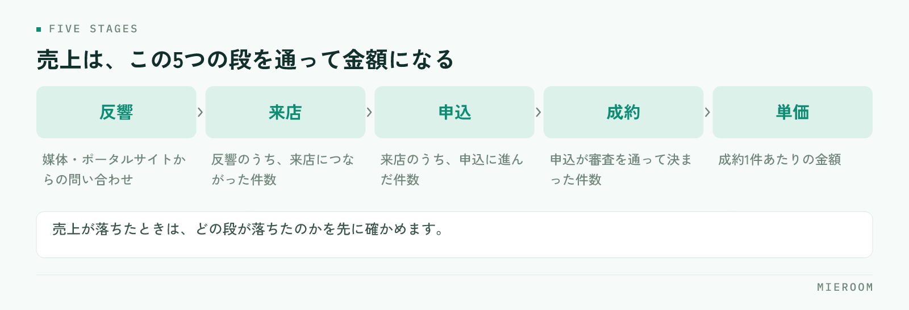

<!--META
{
  "title": "賃貸仲介のKPIの決め方｜反響・来店・成約・単価のどこを追うか",
  "date": "2026-11-07",
  "category": "売上管理",
  "excerpt": "賃貸仲介の店舗でKPIを決めるときの考え方を、追う順番で整理しました。反響から成約・単価までのつながり、いま止まっている場所の見つけ方、定義の固め方、集計を続ける仕組み、そのまま使えるチェックリストとよくある失敗までまとめています。",
  "hook": "KPIは止まっている段だけを追う",
  "tags": ["KPI", "売上管理", "反響管理", "来店率", "賃貸仲介"]
}
META-->

KPIを決めようとして、追う数字を並べたところで止まっていませんか。項目を増やすと集計が続かず、結局は月末の売上だけを見る運用に戻ります。**賃貸仲介のKPIは、全部を追うのではなく、いま店舗が止まっている段だけを追うのが正しい形です**。この記事では、どの段を選ぶか、どう定義を固めるか、どうやって集計を続けるかを順に整理します。

<h4>この記事の結論</h4>

賃貸仲介の数字は、反響・来店・申込・成約・単価という段でつながっています。<strong>KPIは、この中でいちばん落ちている段を1つか2つだけ選んで追ってください</strong>。全部を並べると集計が続かず、定義が店舗内でずれたまま数字だけが残ります。追う段を絞れば、翌週の動きが決まります。

## 賃貸仲介のKPIは、追う数字を絞らないと機能しない

KPIを決める相談でいちばん多いのは、「何を見ればいいか分からない」ではなく「見る項目が多すぎて続かない」という状態です。反響数、来店数、来店率、申込数、成約数、成約率、平均単価、担当別の成績、媒体別の反響——並べれば全部が大事に見えます。

ただ、追う項目の数と、集計が続く確率は反比例します。項目が多いほど入力の手間が増え、繁忙期に真っ先に止まります。そして、止まった月の数字が抜けると、前月との比較ができなくなり、見る意味そのものが失われます。

KPIの役割は、店舗の状態を全部記録することではありません。来週どこに手を打つかを決めるための、判断材料です。判断に使わない数字は、集めても集計の手間だけが残ります。まずは「この数字が悪かったら、何を変えるか」が言える項目だけに絞ってください。言えない項目は、いまのKPIから外して構いません。

## 反響・来店・申込・成約・単価という5つの段

賃貸仲介の売上は、いくつかの段を通って最後の金額になります。この順番を意識すると、どこが落ちているかが分かります。

<figure class="fig"><figcaption>どの段も、前の段の数が上限です。落ちている段を見つけると打ち手が決まります。</figcaption></figure>

媒体やポータルサイトから反響が入り、その中から来店につながり、来店したお客様の中から申込に進み、申込が審査を通って成約になり、成約1件あたりの単価が売上になります。どの段も、前の段の数が上限です。来店が増えなければ申込は増えず、申込が増えなければ成約は増えません。

ここで大切なのは、売上が落ちたときに「売上を上げよう」と言っても何も動かない、ということです。動かすのは段のどれかです。反響が減っているのか、反響はあるが来店につながっていないのか、来店はしているが決まっていないのか、決まっているが単価が下がっているのか。段で見ると、打ち手が具体的になります。媒体ごとの費用と成果の見方は[媒体ごとのROIの見方](./media-roi.html)に整理しています。

## どの段を追うかは、いま止まっている場所で決まる

追う段を選ぶには、直近数か月の数字を段ごとに並べて、前の段からの落ち方を見ます。絶対値ではなく、前の段との関係で見るのが要点です。

| 落ちている段 | 現れ方 | 先に見るところ |
|---|---|---|
| 反響 | 反響そのものが減っている | 掲載数・掲載内容・写真・募集条件 |
| 来店 | 反響はあるが来店が増えない | 一次対応の速さ、追客の方法、案内の提案 |
| 申込 | 来店はあるが申込に進まない | ヒアリングの内容、提案した物件数 |
| 成約 | 申込は出るが成約に至らない | 審査の進め方、申込書の不備、キャンセル理由 |
| 単価 | 件数は変わらないが売上が下がった | 成約した物件の賃料帯、付帯収益の取り方 |

この表のどこに当たるかが決まったら、その段のKPIを主に1つ、補助に1つだけ置きます。たとえば来店が落ちているなら、追うのは反響から来店につながった件数と、一次対応までの時間です。ほかの段の数字は、記録はしても毎週は見ません。反響から来店につなげる動きは[反響から来店率を上げる方法](./hankyo-raiten-ritsu-ageru.html)にまとめています。

## KPIの定義を店舗の中で固定する

KPIが機能しない原因のうち、もっとも多いのが定義のずれです。同じ「反響」という言葉を、担当者ごとに違う意味で使っている状態では、数字が動いた理由が分かりません。

決めておく必要があるのは、次のような境目です。問い合わせの電話は反響に数えるか、物件確認の電話は除くか。同じお客様から複数の物件について問い合わせがあったら1件か複数件か。来店は、予約して来た場合と飛び込みを分けるか。申込は、申込書を受け取った時点か、申込金を受け取った時点か。成約は、契約書を交わした時点か、入金が済んだ時点か。

✓定義は紙1枚に書いて貼る

決めた定義は、口頭の取り決めにせず1枚にまとめてください。入力する人が変わったとき、新人が入ったとき、繁忙期に応援が入ったときに、定義は静かにずれます。数字が前月と大きく違ったら、やり方が変わったのか、数え方が変わったのかを先に確認してください。

もう一つ決めておきたいのは、数え直しのルールです。キャンセルが出た案件を、成約から引くのか、別に記録するのか。ここを決めておかないと、月末に数字が合わなくなります。

## 誰がいつ入れるかを決める

定義が決まっても、入力のタイミングが決まっていないと集計は続きません。KPIが止まる原因は、やる気ではなく、入力が業務の流れから外れていることです。

入力は、業務が終わった時点で1回だけにします。反響は受けた直後、来店は接客が終わった直後、申込は申込書を受け取った時点。あとでまとめて入れる形にすると、繁忙期にまとめきれず、記憶で埋めることになります。記憶で埋めた数字は、翌月の判断には使えません。

誰が入れるかも、段ごとに1人に決めてください。反響は電話を受けた人、来店は接客した担当、申込と入金は事務——このように持ち主がはっきりしていると、抜けたときに誰に聞けばよいか分かります。全員が入れられる状態は、誰も入れない状態になりがちです。

集計のタイミングは、週に1回と月に1回の2段で十分です。週は段ごとの件数だけを見て、来週の動きを1つ決める。月は単価と担当別を含めて見て、翌月の目標を置く。これ以上細かくすると、見るための時間が業務を圧迫します。

### KPIを決めるときのチェックリスト

- 追う段を1つか2つに絞ったか（全部を毎週見ない）
- その数字が悪かったときに何を変えるかを、言葉にできるか
- 反響・来店・申込・成約の数え方の境目を決めたか
- キャンセルが出た案件の扱いを決めたか
- 段ごとに、入力する人を1人に決めたか
- 入力するタイミングを業務の直後にそろえたか
- 週に見る項目と、月に見る項目を分けたか
- 前月・前年同月と並べて見られる形で残しているか
- 担当別に分けて見るとき、評価の使い方を先に説明したか
- 定義を書いた1枚を、入力する人が見られる場所に置いたか

## よくある失敗とその避け方

同じつまずき方が繰り返されます。避け方まで含めて挙げます。

**一つ目は、項目を増やしすぎて集計が止まる**ケースです。最初に10項目を決めると、二か月目には誰も入れていません。避けるには、最初は段ごとの件数だけにして、必要になった項目だけを足してください。

**二つ目は、定義を決めずに数字を集める**ケースです。数字は集まりますが、増減の理由が分からないため打ち手につながりません。先に境目を決めてから集め始めてください。

**三つ目は、担当別の数字を評価だけに使う**ケースです。数字が評価のためだけに使われると、入力が甘くなります。まず改善点を一緒に見るための材料として使い、評価に使う範囲は先に伝えてください。担当別の見方は[スタッフの成績管理の進め方](./staff-seiseki-kanri.html)にまとめています。

**四つ目は、月末にしか見ない**ケースです。月末に分かっても、その月はもう動かせません。週に一度、段ごとの件数だけでも見てください。

## 自分たちで進める場合と、ツールに任せる場合の分かれ目

一般論として、判断の基準は3つあります。

一つ目は、入力する人の数です。入力する人が1〜2人で、案件も表計算ソフトで追える範囲なら、自分たちで表を作るほうが早く、思ったとおりの形にできます。人数が増え、同時に開いて編集するようになると、表計算ソフトでは上書きや行ずれが起きます。

二つ目は、集計に毎月どれだけ時間がかかっているかです。段ごとの件数を出すために複数のファイルを突き合わせているなら、その作業は仕組みに任せたほうが、見る時間に回せます。逆に、入力の時点で1か所にまとまっているなら、集計はさほど負担になりません。

三つ目は、続いているかどうかです。やり方としては正しくても、繁忙期に止まるのであれば、入力が業務の流れから外れています。業務の記録がそのままKPIになる形にできているかが分かれ目です。記録と集計が別の作業になっているうちは、人を増やしても止まります。

## よくある質問

KPIは、まず何から決めればよいですか。

直近数か月の反響・来店・申込・成約の件数を並べて、前の段からの落ち方がいちばん大きい段を探してください。そこを主なKPIにし、補助として一次対応までの時間など動かせる項目を1つ足します。最初から全部の段を追う必要はありません。追う段は、状況が変われば入れ替えて構いません。

来店率や成約率のような割合は、目標値を決めたほうがよいですか。

他店や業界の数字を目標に置くより、自店舗の前月・前年同月と比べる形から始めるのが実務的です。物件の構成や媒体の使い方で前提が変わるため、外の数字と比べても打ち手が出ません。自店舗の推移で見て、落ちた月に何が違ったかを確かめるほうが具体的に動けます。

表計算ソフトでKPIを管理しても大丈夫ですか。

案件数が少なく、入力する人が限られていれば回ります。段ごとに列を作り、入力した日付を残しておけば推移も追えます。限界が出るのは、複数人が同時に編集するようになったとき、反響と接客と申込を別のファイルで管理し始めたときです。突き合わせに時間がかかり始めたら、見直しの時期です。

担当別のKPIは、どこまで共有すべきですか。

数字そのものは共有して構いませんが、使い方を先に伝えてください。評価のためだけに出すと入力が甘くなり、数字の信頼が落ちます。来店から申込に進んだ件数など、本人が動かせる段を一緒に見て、次に何を変えるかを決める材料として使うと機能します。

KPIの集計を自動化したいのですが、何から始めればよいですか。

まず、どの段の数字を見たいかと、入力のタイミングを決めてください。そのうえで、入力した業務の記録がそのまま集計に反映される形にします。ミエルームは反響管理・接客管理・申込管理を同じ案件の記録として扱い、接客・反響成績の可視化と反響分析で段ごとの数字を表示します。デモアカウントを発行していますので、自店舗の先月の数字で確かめていただけます。

## まとめ：追う段を絞れば、KPIは続く

賃貸仲介のKPIで大事なのは、項目の多さではありません。反響・来店・申込・成約・単価のどこが落ちているかを見て、その段だけを追う。定義の境目を決めて1枚に残す。入力する人とタイミングを業務の直後にそろえる。週に件数、月に単価と担当別を見る。この形であれば、繁忙期でも止まりません。

逆に、全部の段を毎週追いかける形にすると、二か月目には集計が止まります。見ない数字を減らすことが、KPIを続けるいちばんの近道です。

ミエルームなら、反響の受付から接客・申込・入金までを同じ案件の記録として残せるので、段ごとの件数を別のファイルで突き合わせる必要がなくなります。接客・反響成績の可視化と反響分析で、反響から来店・申込へのつながりや媒体ごとの成果をそのまま表示でき、確定売上と見込みも分かれて見えるため単価の変化にも気づけます。入力は業務の直後に1回で済むので、月末にKPIを作り直す作業がなくなり、週の頭に次の打ち手を決める時間に回せます。ミエルームでできることは[製品ページ](../index.html)にまとめています。資料のご請求やデモアカウントの発行は、この下のボタンからお気軽にどうぞ。
