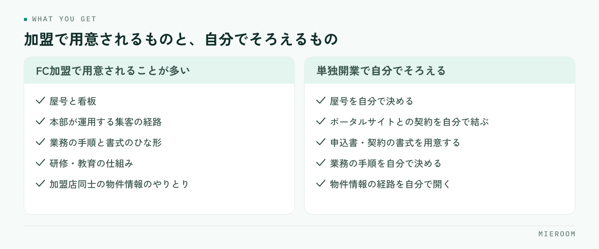

<!--META
{
  "title": "賃貸仲介で独立するならFCか単独か｜開業前に比べておくこと",
  "date": "2026-11-10",
  "category": "DX",
  "excerpt": "賃貸仲介で独立するときに、フランチャイズ加盟と単独開業のどちらを選ぶかを判断するための整理です。加盟で用意されるものと自分でそろえるもの、開業前に比べておく項目、お金と手間の出方の違い、判断材料の集め方とよくある失敗までまとめています。",
  "hook": "加盟か単独かは、何を自分で用意するかで決まる",
  "tags": ["開業", "独立", "フランチャイズ", "DX", "賃貸仲介"]
}
META-->

賃貸仲介で独立するとき、フランチャイズ（FC）に加盟するか単独で開業するかは、最初に決める分かれ道です。どちらが優れているという話ではありません。**決め手になるのは、看板・集客・仕組み・教育のうち、どこを自分で用意できるかです**。この記事では、加盟で用意されるものと自分でそろえるものを並べ、開業前に比べておく項目を順に整理します。

<h4>この記事の結論</h4>

FCか単独かを「費用が高いか安いか」で決めると、開業してから噛み合いません。<strong>見るべきは、開業時にそろわないものを誰がそろえるのかという点だけ</strong>です。看板・集客経路・業務の仕組み・教育のうち、自分で用意できるものが多ければ単独が成り立ち、足りないものが多ければ加盟で埋める判断になります。

## FCか単独かは、何を自分で用意するかの違い

独立の相談で最初に出てくるのが「加盟したほうが楽ですか」という質問です。答えは、何がそろっていないかによって変わります。

開業した日から必要になるものは、意外と多岐にわたります。店舗の看板と屋号、お客様が問い合わせを送ってくる経路、物件情報を集める手段、申込から契約までの書式、入金と売上の記録、スタッフを採用したときに渡せる手順書。これらは店を開けただけでは手に入りません。

FC加盟は、このうちのいくつかをあらかじめ用意された形で受け取る選択です。単独開業は、同じものを自分で組み立てる選択です。どちらも最後は自店舗の営業力で結果が決まるので、**選ぶときに比べるのは「用意されるものの中身」と「自分でそろえる手間」の差です**。開業準備の全体像は[不動産開業の準備チェックリスト](./fudosan-kaigyo-junbi-checklist.html)にまとめています。

## FC加盟で用意されるもの、単独でそろえるもの

一般論として、加盟で用意されるものと、単独で自分がそろえるものは次のように分かれます。加盟の内容は本部によって幅があるので、ここに挙げたものがすべて含まれるとは限りません。

<figure class="fig"><figcaption>加盟の内容は本部によって幅があります。含まれる範囲は項目ごとに確かめてください。</figcaption></figure>

加盟側で用意されることが多いのは、屋号と看板、本部が運用する集客の経路、業務の手順や書式のひな形、研修や教育の仕組み、加盟店同士の物件情報のやりとりです。開業の初日から名前が知られている状態で始められるのが、大きな違いになります。

単独側で自分でそろえるのは、同じ項目のすべてです。屋号を自分で決め、ポータルサイトとの契約を自分で結び、申込書や契約の書式を用意し、業務の手順を自分で決め、物件情報の経路を自分で開きます。手間はかかりますが、取り扱う範囲や進め方を自分で決められます。

どちらを選んでも、反響に返信するのは自店舗です。来店の対応も、申込の処理も、入金の確認も自分たちの仕事として残ります。ここを取り違えて「加盟すれば集客が解決する」と考えると、開業後に差が埋まりません。

## 開業前に比べておく項目

加盟を検討するなら、次の項目を1枚にまとめてから比べてください。本部ごとに条件が違うので、同じ枠に入れて並べることが大切です。

| 比べる項目 | 加盟を検討するときに確かめること | 単独を選ぶときに自分で決めること |
|---|---|---|
| 屋号と看板 | 使える範囲、退会後の扱い | 屋号の決め方、商標の確認 |
| 集客の経路 | 本部経由の反響がどう配分されるか | ポータルサイトとの契約、自社サイトの用意 |
| 物件情報 | 加盟店間でのやりとりの仕組み | 業者間サイトや元付業者との関係づくり |
| 業務の書式 | 申込書・契約書のひな形の提供範囲 | 書式の作成と、法令に沿っているかの確認 |
| 教育 | 研修の内容と頻度、誰が受けられるか | 手順書の作成、採用時に渡すものの準備 |
| 支払いの形 | 加盟時と毎月の支払いの中身、期間の縛り | ポータルサイト・システム・広告の契約先ごとの支払い |
| 出退店の条件 | 商圏の扱い、途中でやめるときの手続き | いつでも自分の判断で変えられる範囲 |

とくに見落としやすいのは、出退店の条件です。開業の検討中は始めることに意識が向きますが、商圏の扱いや、やめるときの手続き、看板を外した後に顧客との関係をどう続けられるかは、先に確認しておくべき項目です。

✓比べ方の基本

本部の説明資料は、項目の立て方がそれぞれ違います。そのまま読み比べると判断できないので、上の表のような自分の枠を先に作り、空いた欄を質問して埋めてください。埋まらない欄が多い相手は、開業後も同じ調子になります。

## お金と手間の出方は、時期で見ると違いが分かる

金額そのものは本部や地域で違うので、ここでは出方の違いだけを整理します。

加盟を選ぶ場合、開業の時点でまとまった支払いが発生し、その後も毎月の支払いが続く形が一般的です。代わりに、看板・集客の経路・書式・研修があらかじめそろっているので、開業の準備にかける自分の時間は短くなります。言い換えると、お金で時間を買う形になります。

単独を選ぶ場合、開業時の支払いは契約先ごとに分かれます。ポータルサイト、業務のシステム、広告、書式の整備。それぞれを自分で選び、必要なものだけを契約します。毎月の支払いは自分で調整できますが、選ぶ作業と組み立てる作業に自分の時間がかかります。

開業してから効いてくるのは、変えやすさです。単独は、使うポータルサイトや業務の仕組みを後から入れ替えられます。加盟は、決まった形で進む分だけ迷いが少なくなります。どちらが合うかは、自分の店で何を試したいかによって変わります。

## 開業前に集めておく判断の材料

比べる前に、材料を集めます。次の項目がそろうと、どちらが成り立つかが具体的な作業として見えてきます。

- 開業予定の地域で、月にどれくらいの反響が見込めるかを、ポータルサイトの担当者に確認している
- 自分が持っている元付業者・管理会社とのつながりを、名前で挙げられる
- 開業時の人数（自分1人か、スタッフを入れるか）を決めている
- 申込から契約・入金までの流れを、自分で紙に書ける
- 使う予定のポータルサイトと、その契約条件を調べている
- 業務の記録（反響・接客・申込・売上）を何で管理するかを決めている
- 加盟を検討する本部を2つ以上挙げ、同じ項目で質問している
- 加盟した場合の退会の条件と、商圏の扱いを確認している
- 開業後6か月間の支払いを、月ごとに書き出している

このうち、業務の記録をどうするかは加盟・単独のどちらでも必要になります。1人で始める場合に何をそろえるかは[ひとりで不動産を開業するときのツール](./hitori-fudosan-kaigyo-tool.html)に整理しています。

## よくある失敗と、その避け方

**加盟すれば集客が解決すると考える**。本部経由の反響があっても、返信して来店につなげるのは自店舗です。反響の対応の形は、どちらを選んでも自分で決める必要があります。

**支払いの総額だけで比べる**。含まれるものが違えば総額は比べられません。看板・集客・書式・研修・システムのどれが含まれるのかを、項目ごとに並べてください。

**退会の条件を聞かないまま決める**。商圏の扱い、途中でやめるときの手続き、看板を外した後のことは、始める前にしか聞けません。

**本部を1つしか見ない**。条件の良し悪しは、2つ以上を同じ項目で比べないと判断できません。説明を受けた1社だけで決めると、比べる基準そのものを持てません。

**業務の記録を後回しにする**。開業の準備では看板や物件に目が向きますが、反響・接客・申込・売上の記録は開業初日から発生します。後から整えると、最初の数か月の記録が残らないままになります。

**自分の時間を数に入れない**。単独は支払いを抑えられますが、選ぶ作業と組み立てる作業に時間がかかります。その時間を接客に使えたかどうかも、判断の材料に入れてください。

## 自分で進める場合と、ツールや専門家に任せる場合の分かれ目

一般論として、判断の基準は3つです。

一つ目は、業務の形を自分で決められるかどうかです。申込から入金までの流れや、反響の受け方を自分で紙に書ける状態なら、必要なものを自分で選んで組み立てられます。書けない段階なら、形が用意されている側を選ぶか、整理を手伝ってくれる相手を先に見つけるほうが早く進みます。

二つ目は、記録を続けられるかどうかです。開業の直後は件数が少ないので、手元の表計算ソフトでも回ります。問題が出るのは、スタッフが増えて同じファイルを複数人が触るようになったとき、そしてポータルサイトからの反響が手入力でさばけなくなったときです。この時期が近いと分かっているなら、最初から仕組みの側で記録を受ける形にしたほうが、移し替えの手間がかかりません。

三つ目は、数字を見て判断する習慣があるかどうかです。反響の件数、来店、申込、確定した売上。これらが毎月同じ形で出てくる状態を自分で作れるなら、しばらくは今の形で進められます。毎月集計に時間を取られているなら、そこは任せる判断が合います。

迷うときは、開業の初日から発生する作業を書き出してみてください。看板や集客より先に、記録と確認の作業が毎日続くことが見えてきます。

## よくある質問

加盟と単独で、お客様から見た印象は変わりますか。

知られている屋号は、最初の接点では安心につながります。ただし、来店後の対応や物件の提案で判断されるのはどちらも同じです。屋号の違いで埋められるのは入口の部分だけなので、接客の形は自分の店として用意する前提で考えてください。

単独で開業すると、物件情報が集まらないのではと不安です。

業者間サイトや元付業者とのつながりで集める形になります。開業前から関係のある管理会社や元付業者がいるかどうかで、立ち上がりの速さが変わります。つながりが少ない状態で始めるなら、どこから情報を取るのかを開業前に具体的に決めておいてください。

最初は加盟して、あとで単独に移ることはできますか。

契約の条件によります。退会の手続き、商圏の扱い、屋号を外した後の顧客との関係をどう続けられるかが契約に書かれているので、加盟する前に確認してください。移る可能性があるなら、業務の記録を自分の手元に残せる形にしておくことも大切です。

開業の時点で、業務のシステムまで決める必要がありますか。

反響・接客・申込・売上の記録は開業初日から発生するので、何で記録するかは決めておいてください。最初から大きな仕組みを入れる必要はありませんが、後から移せる形にしておくと、件数が増えたときに作り直しになりません。ミエルームはExcelデータのインポートと初期設定の代行に対応しているので、表計算ソフトから始めて後で移すこともできます。

1人で開業する場合、どちらが向いていますか。

人数では決まりません。1人でも、元付業者とのつながりと集客の経路を自分で用意できるなら単独が成り立ちます。逆に人数がいても、業務の形と教育の仕組みがない状態なら、用意されている側を選ぶ理由があります。判断は人数ではなく、そろっていないものの数で考えてください。

## まとめ：そろっていないものの数で決める

賃貸仲介で独立するときのFCか単独かという判断は、看板・集客の経路・業務の書式・教育・物件情報のうち、自分で用意できるものがいくつあるかで決まります。自分でそろえられるものが多ければ単独が成り立ち、足りないものが多ければ加盟で埋める判断になります。

比べるときは、本部の資料をそのまま読まず、自分の枠を作って空欄を質問で埋めてください。そのうえで、退会の条件と商圏の扱いを先に確認する。これだけで、開業後に噛み合わないという事態はかなり避けられます。

ミエルームなら、加盟・単独のどちらで始めても必要になる反響管理・接客管理・申込管理表・売上管理を1つの場所で記録でき、フォーム自動取込とメール自動取込で届いた反響がそのまま入るので、開業直後の少ない人数でも打ち直しの作業が増えません。確定売上と見込みが分かれて表示されるため、毎月の集計に時間を取られずに次の打ち手を決められます。記録のつながりは[ミエルームのご紹介](../index.html)にまとめています。資料のご請求やデモアカウントの発行は、この下のボタンからお気軽にどうぞ。
