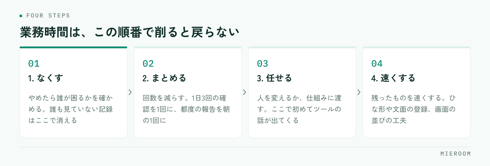

<!--META
{
  "title": "賃貸仲介の業務時間を減らす方法｜1日の作業を棚卸しして削る順番",
  "date": "2026-11-14",
  "category": "業務効率化",
  "excerpt": "賃貸仲介の店舗で業務時間を減らすために、1日の作業を棚卸しする手順と、なくす・まとめる・任せる・速くするの順に削る考え方をまとめました。時間を取りやすい作業ごとの削り方と、よくある失敗の避け方も整理しています。",
  "hook": "1日の作業を棚卸しして、削る順番を決める",
  "tags": ["業務効率化", "業務時間", "残業削減", "賃貸仲介", "店舗運営"]
}
META-->

残業を減らしたいと思っても、どの作業から手を付けるかが決まっていないと、結局は全員が少しずつ早く動く話になって終わります。業務時間を減らすときに先に決めるのは速さではなく、**その作業を本当に続ける必要があるか**です。そこを通さずに効率化へ進むと、やめてよかった作業が速くなるだけになります。

<h4>この記事の結論</h4>
業務時間を減らす手順は、1日の作業を3日分書き出して棚卸しし、<strong>なくす・まとめる・任せる・速くする</strong>の順に削ることです。この順番を守らないと、やめられた作業に手間をかけて仕組みを作ることになります。削った時間の使い道は、削る前に決めてください。

## 業務時間が減らないのは、1つずつ速くしようとするから

店舗で効率化の話をすると、たいていは個々の作業を速くする方向に向かいます。入力を速くする、電話を短くする、資料の作り方を工夫する。どれも間違いではありませんが、効果が小さく、続きません。

理由は2つあります。ひとつは、速くなった分が実感に届かないことです。1件3分の作業が2分になっても、1日の終わりには差が見えません。もうひとつは、速くする工夫は人に依存することです。慣れた人がやれば速いという形で終わり、人が入れ替わると元に戻ります。

時間が大きく減るのは、作業が1つ消えたときか、まとめて1回になったときです。毎日やっていた集計を週1回にする、二重に付けていた記録を1つにする、確認の電話を1回にする。こうした変化は、人が入れ替わっても戻りません。

だから最初に考えるのは「どうやって速くするか」ではなく「この作業は要るか」です。要ると決まったものについてだけ、まとめる・任せる・速くするを検討します。

## まず、1日の作業を3日分だけ書き出す

棚卸しは長くやる必要がありません。平日3日分で、傾向は十分に見えます。方法は、スタッフ全員に次の形でメモを取ってもらうだけです。

**15分単位で、何をしていたかを一言ずつ**。「反響の返信」「物件の入力」「内見同行」「申込書の不備確認」「管理会社へ電話」。正確さより、空欄を作らないことを優先します。

集めたメモは、作業の名前ごとにまとめて合計時間を出します。ここで見るのは2つです。ひとつは**合計時間の長い作業の順番**。もうひとつは、同じ作業が1日に何回も細かく出てきていないかです。

細かく散っている作業は、合計すると長いのに、本人の自覚が薄い部分です。物件の確認電話、反響への一次返信、社内への報告がここに入りやすくなります。合計時間の長い作業と、散っている作業の2つが、削る候補になります。

一日・一週間・一か月で何をやるかの全体像を決めたい場合は、[賃貸仲介の店長がやること](./tencho-shigoto-dandori.html)に整理しています。棚卸しは、その中の「毎日」の中身を確かめる作業です。

## 削る順番は、なくす・まとめる・任せる・速くする

候補が挙がったら、作業ごとにこの順番で検討します。前の段で解決できるなら、後ろの段は考えなくて済みます。

<figure class="fig"><figcaption>前の段で解決できるなら、後ろの段は考えなくて済みます。順番を飛ばすと無駄が出ます。</figcaption></figure>

**なくす**。その作業をやめたら誰が困るかを確かめます。誰も見ていない日報、使われていない集計表、念のためのコピー。やめられるものは、ここで消えます。

**まとめる**。回数を減らします。1日3回の確認を1回に、都度の報告を朝の1回に、個別の入力をまとめ入力に。回数が減ると、切り替えにかかる時間も一緒に減ります。

**任せる**。人を変えるか、仕組みに渡します。店長がやっている集計をスタッフに渡す、手で集めている反響を自動の取込に渡す。ここで初めて、ツールの話が出てきます。

**速くする**。残ったものを速くします。ひな形を用意する、よく使う文面を登録する、画面の並びを変える。最後に来るのは、効果が小さいからではなく、前の3つを飛ばすと無駄になるからです。

✓順番を守る理由

やめられる作業に自動化の設定をしてしまうと、設定を作る手間と、動き続ける仕組みの管理が残ります。先に「なくす」を通すだけで、作る対象が減ります。

## 賃貸仲介で時間を取りやすい作業と、削り方

棚卸しをすると、店舗が違っても似た作業が上位に来ます。代表的なものと、どの段で削れるかを並べます。

| 時間を取りやすい作業 | 削る段 | 具体的な進め方 |
|---|---|---|
| 反響の一次返信 | まとめる・任せる | 経路ごとの文面を用意し、自動返信で受付を伝えてから個別の連絡に入る |
| 物件情報の入力・更新 | 任せる | 業者間サイトや元データからの取込に渡し、手入力は差分だけにする |
| 物件の空き確認の電話 | なくす・まとめる | 先に業者間サイトで確認し、電話は条件交渉が必要な案件だけに絞る |
| 申込書の不備の確認と差し戻し | なくす | 入力の時点で必須項目を決め、不備が出ない形にする |
| 月末の売上集計 | 任せる | 案件を記録した時点で集計に反映される形にし、転記をなくす |
| 社内への報告・日報 | なくす・まとめる | 誰が何の判断に使うかを確認し、使われていない項目を落とす |

この表で効果が大きいのは、**不備の確認と差し戻し**です。1件あたりの時間は短くても、やり直しが発生するため、相手の都合を待つ時間が加わります。入口の項目を決めて不備が出ない形にすると、待ち時間ごと消えます。

ツールを使って削る場合の選び方は、[賃貸仲介の業務改善に使えるツール](./chintai-gyomu-kaizen-tool.html)にまとめています。

## 削った時間の使い道を、削る前に決める

時間が空いたあと、使い道が決まっていないと、別の作業が自然に入ってきます。そうなると業務時間は元に戻り、効率化をやった実感だけが残りません。

決め方は単純です。棚卸しの表を見ながら、**増やしたい作業を1つだけ挙げる**。賃貸仲介の店舗なら、追客の連絡、来店前のヒアリング、内見の準備、スタッフへの同行あたりが候補になります。1つに絞るのは、2つ以上だとどちらにも回らないからです。

そのうえで、空いた時間帯に何をするかを時間で決めます。「午前の1時間は前月の反響の追客に使う」のように、作業と時間帯をひも付けると残ります。

### 棚卸しから運用までのチェックリスト

- 平日3日分、15分単位の作業メモを全員から集めた
- 作業名ごとに合計時間を出し、長いものと散っているものを選んだ
- 候補ごとに、なくす・まとめる・任せる・速くするの順で検討した
- やめる作業について、誰が困るかを確認したうえでやめた
- 回数を減らす作業は、いつやるかを曜日と時刻で決めた
- 仕組みに渡す作業は、渡したあとに誰が確認するかを決めた
- 空いた時間で増やす作業を1つ決め、時間帯をひも付けた
- 1か月後に同じ棚卸しをやり直す日を、先に予定に入れた

## よくある失敗とその避け方

**全部の作業を一度に見直す**。候補が10個以上になると、どれも途中で止まります。合計時間の長い上位3つに絞って、1か月回してください。

**速くする工夫から始める**。文面の登録や画面の工夫は効果が見えやすいので先に手が出ますが、やめられる作業にそれをやると二重の手間になります。順番を通してください。

**棚卸しを店長だけでやる**。店長の見立てと実際の時間配分はずれます。特に細かく散っている作業は、本人のメモでしか見えません。全員から集めてください。

**やめる判断を現場に丸投げする**。「要らないと思うものはやめていい」と言うだけでは、誰もやめません。やめる作業は店長が名前を挙げて決め、やめたことを共有します。

**仕組みに渡して確認をやめる**。自動の取込や自動返信に渡した作業は、誰かが週に一度は結果を見る必要があります。渡したあとの確認役を決めていないと、抜けに気づくのが遅れます。

**1回で終わらせる**。業務は季節で変わります。繁忙期と閑散期では上位に来る作業が入れ替わるため、半年に1回は棚卸しをやり直す形にしてください。

## 自分で進める場合と、ツールに任せる場合の分かれ目

ここは一般論として、判断の基準だけを整理します。どちらが良いという話ではなく、作業の性質で分かれます。

自分たちの運用の見直しで足りるのは、回数や担当を変えれば減る作業です。確認の電話をまとめる、報告の項目を落とす、やる曜日を決める。こうしたものは、決めれば翌日から変わります。費用もかかりません。

ツールに任せたほうがよいのは、件数に比例して増える作業と、転記が発生する作業です。反響の取込、物件データの取込、売上の集計、案件の進み具合の把握。これらは人が速くしても件数が増えれば元に戻るため、仕組みに渡さないと解決しません。入力の時点で不備を防ぐ仕掛けも、運用の約束だけでは守られにくい部分です。

分かれ目をひとつに挙げるなら、**その作業が件数に比例して増えるかどうか**です。比例して増えるものは仕組みに渡し、増えないものは運用の決め事で削る。この切り分けができていれば、ツールを入れたのに時間が減らないという結果になりません。渡したあとに結果を確認する役割は、店側に残ります。

## よくある質問

棚卸しのメモを取る時間そのものが負担になりませんか？

15分単位で一言ずつにすると、1日あたり数分で済みます。正確に測ることが目的ではなく、どの作業が上位に来るかを知るための作業です。3日で十分なので、繁忙期を避けた普通の週に行ってください。

スタッフが「今の作業は全部必要」と言う場合はどうしますか？

必要かどうかではなく、誰が何の判断に使っているかを確認してください。日報や集計表の項目ごとに、見ている人と使っている場面を挙げてもらうと、挙がらない項目が出てきます。そこから落とします。

残業を減らすと、売上が落ちませんか？

削る対象を間違えなければ、落ちる理由はありません。削るのは記録・転記・確認といった、客に接していない作業です。接客や追客に使う時間は増やす側に置きます。だから使い道を先に決める手順にしています。

人数が少ない店舗でも棚卸しの意味はありますか？

あります。人数が少ない店舗ほど、一人が複数の役割を持つため作業が散ります。散っている作業を見つける効果は、人数が少ないほど大きくなります。一人で店を回している場合も、3日分のメモは取れます。

ツールを入れる前に、どこまで運用を整えるべきですか？

やめる作業を決めるところまでは、先に済ませてください。入力の項目や記録の単位は、ツールを入れてから決めても構いません。むしろ現場で使いながら決めたほうが、実際に使われる形になります。

## まとめ：削る順番を決めれば、時間は戻らない形で減る

業務時間を減らす手順は、速くする工夫を探すことではありません。平日3日分の作業を棚卸しし、合計時間の長いものと散っているものを選び、なくす・まとめる・任せる・速くするの順に検討する。この順番を通すと、やめられる作業に手間をかけずに済み、仕組みに渡すべき作業がはっきりします。空いた時間で増やす作業を1つ決めておけば、減った時間が別の作業で埋まることもありません。

ミエルームなら、この記事で「件数に比例して増える」と挙げた作業に対して、フォームとメールからの反響自動取込、物件コンバータと業者間サイト連携による物件データの取込、LINE・SMSでの自動追客、申込から入金・後ADまでを案件ごとに1行で記録する申込・入金管理、記録した時点で確定売上と見込みに分かれて出る売上管理までを1つの画面でつなげます。転記と月末の集計がなくなり、申込の不備や止まっている案件も画面で分かるので、接客と追客に回せる時間が残ります。機能の一覧と実際の画面は[ミエルームの機能・事例](../features.html)でご覧いただけます。資料のご請求やデモアカウントの発行は、この下のボタンからお気軽にどうぞ。
