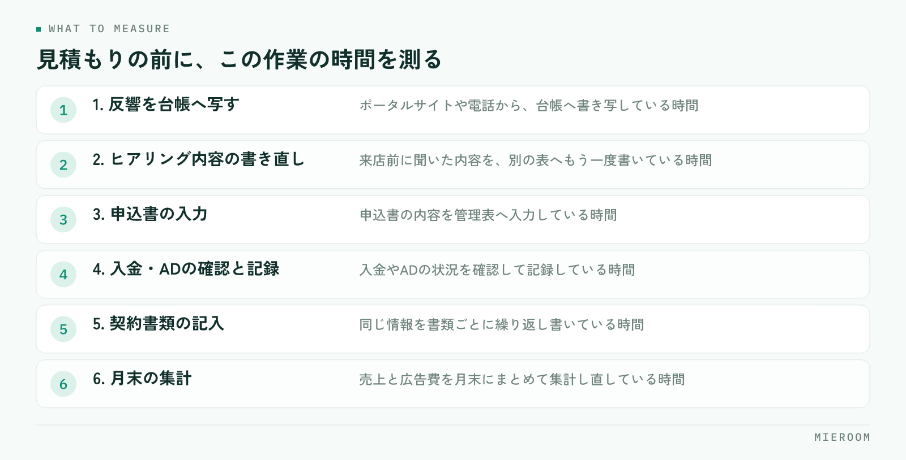

<!--META
{
  "title": "賃貸仲介の業務システムにかける費用の考え方｜月額と削れる時間で判断する",
  "date": "2026-11-12",
  "category": "DX",
  "excerpt": "賃貸仲介の店舗が業務システムにいくらまでかけてよいかを、月額と削れる時間の両面から整理しました。費用を導入時・毎月・やめるときに分けて見る方法、時間の測り方、見積もりで確かめる項目、効果が出ない使い方までまとめています。",
  "hook": "月額ではなく、削れる時間で費用を判断する",
  "tags": ["業務システム", "費用", "DX", "業務効率化", "賃貸仲介"]
}
META-->

業務システムの導入を検討すると、まず目に入るのは月額です。しかし月額だけを並べて安い順に選ぶと、入れたのに使われない、という結果になりやすいものです。判断の基準は、**その金額で店舗のどの作業が何分減るか**に置いてください。

<h4>この記事の結論</h4>
業務システムの費用は、月額の大小ではなく<strong>削れる作業時間と、店舗の人件費のバランス</strong>で判断します。そのためには、見積もりを集める前に「今どの作業に毎月どれだけ時間を使っているか」を測る必要があります。測っていない状態では、どの金額が高いのか安いのかも決まりません。

## 業務システムの費用は、月額だけでは判断できない

月額の数字は比べやすいので、どうしてもそこに目が行きます。ですが同じ月額でも、使える機能の範囲、入れられるデータの量、使える人数、サポートの内容は会社ごとに違います。並べた数字が同じ条件を指していないので、安い順に並べ替えても意味を持ちません。

もう一つの理由は、システムの費用が「払った額」ではなく「払った額と、空いた時間の差」で効いてくることです。月額を半分に抑えても、入力の手間が今と変わらなければ、店舗にとっての負担は減っていません。逆に、月額が上がっても月末の集計や転記が消えるなら、その時間はほかの仕事に回せます。

ですから判断の順番は決まっています。先に今の作業時間を測り、次に見積もりを取る。この順番を逆にすると、機能の説明を聞いて「便利そうだ」で決めることになります。ツール導入の進め方そのものは[仲介業務の改善にツールを入れる手順](./fudosan-chukai-gyomu-kaizen-tool-donyu.html)にまとめています。

## 費用は「導入のとき」「毎月」「やめるとき」に分かれる

費用の比較でつまずく原因は、総額だけを見ることです。中身は3つに分かれ、それぞれ確かめる場所が違います。

| 費用の種類 | 何に対してかかるか | 見積もりで確かめること |
|---|---|---|
| 導入のときの費用 | 初期設定、既存データの取り込み、操作の説明 | データの移行は依頼に含まれるか、自分たちで入れるのか |
| 毎月の費用 | 利用料、使う人数の分、オプション機能 | 人数が増えたらどう変わるか。どの機能が別料金か |
| やめるときの費用 | 解約の手続き、データの取り出し | 入れたデータを取り出せる形か。最低契約期間があるか |

見落としやすいのは、導入のときの費用とやめるときの条件です。導入のときは、既存のExcelや紙の情報を誰が入れるのかで、現場の負担が大きく変わります。自分たちで入れる前提なら、その作業時間も費用として数えてください。

やめるときの条件は、契約前にしか聞けません。最低契約期間、解約を申し出る期限、そして入れたデータを取り出せる形かどうか。この3つを先に確かめておくと、合わなかったときに動けます。

## 見積もりの前に、削れる時間を測る

測るといっても、全部の作業を記録する必要はありません。賃貸仲介の店舗で時間が消えやすい作業は、だいたい決まっています。次の作業について、1週間だけ「誰が、何回、1回あたり何分」を手元の紙に書いてください。

<figure class="fig"><figcaption>1週間だけ「誰が、何回、1回あたり何分」を記録すれば判断の材料になります。</figcaption></figure>

- 反響をポータルサイトや電話から台帳へ写す作業
- 来店前に聞いた内容を、別の表へ書き直す作業
- 申込書の内容を管理表へ入力する作業
- 入金やADの状況を確認して記録する作業
- 契約書類に同じ情報を繰り返し書く作業
- 月末に売上と広告費を集計し直す作業

測るのは、同じ情報を2回以上書いている作業と、月末にまとめてやっている作業です。この2種類は、仕組みで消える可能性が高い部分です。1週間分が取れれば、月あたりの時間はそこから見当が付きます。

数えた時間に店舗の人件費を当てれば、毎月どれだけの金額が入力作業に使われているかが出ます。その金額と、検討しているシステムの月額を並べたとき、はじめて高い・安いの判断ができる状態になります。

ここで大切なのは、**測った結果を担当者ごとに分けて残すこと**です。全体の合計だけだと、どの作業を先に手放すべきかが決まりません。スタッフごとに見ると、特定の人に集まっている作業が見えてきます。必要な機能の整理は[店舗に必要な機能の考え方](./tenpo-muke-tool-hitsuyo-kino.html)も参考になります。

## 月額の上限は、どう決めるか

上限を決めるときの考え方は2つあります。

一つは、削れる時間の人件費から決める方法です。入力や集計に使っている時間のうち、仕組みで消える部分を見積もり、その人件費を上限の目安にします。消える時間の人件費より月額が低ければ、金額の面では成り立っています。この方法は分かりやすい反面、実際に時間が消えるかどうかは運用次第なので、見積もりは控えめにしてください。

もう一つは、店舗の粗利に対する比率で枠を決める方法です。広告費や家賃と同じように、業務システムの費用も毎月出ていく固定費です。粗利に対してどこまでを固定費に充てるかを先に決めておけば、機能の説明に引っ張られずに判断できます。

どちらの方法でも、**枠を決めてから機能を見る**という順番は変えないでください。先に機能を見ると、必要かどうか分からない機能まで含めた見積もりを基準にしてしまいます。オプション機能は、入れないで始めてから必要になったときに足す形でも構いません。

## 見積もりで必ず確かめる項目

同じ条件を渡さずに集めた見積もりは、金額を並べても比較になりません。次の項目を同じ文面で聞いてください。

- 月額に含まれる機能の範囲と、別料金になる機能
- 使う人数の数え方（店舗単位か、1人ずつか）
- 初期設定と、既存データの取り込みを誰がやるか
- 操作の説明の有無と、その回数
- 最低契約期間と、解約を申し出る期限
- 契約が終わったあと、入れたデータを取り出せる形か
- 使い方が分からないときの問い合わせ先と、返答までの目安
- 複数店舗に増えたときの費用の変わり方
- 試してから決められるか（デモ画面を自分で触れるか）

このうち先に確かめたいのは、データの取り込みと取り出しの2つです。入れるときに手間がかかるシステムは、導入そのものが止まります。取り出せないシステムは、合わなかったときに乗り換えの判断ができません。

## 効果が出ない費用の使い方

**月額の安い順に選ぶ**。含まれる範囲が違えば金額は比べられません。同じ条件を渡し、項目ごとに比べてください。

**今の作業時間を測らずに導入する**。前がどれだけかかっていたか分からなければ、効果も判断できません。1週間の記録だけでも先に取ってください。

**全部の機能を一度に使い始める**。同時に変えると、どれが効いたのか分かりません。時間が消える作業から1つずつ移してください。

**入力の担当を決めないまま始める**。誰が入れるかが曖昧なシステムは、紙やExcelが並行して残ります。最初に担当と入力の期限を決めてください。

**既存のデータを後回しにする**。過去の情報が入っていないと、現場は古い台帳を見続けます。取り込みの段取りを導入の計画に入れてください。

**オプションを最初から全部付ける**。必要かどうかは使ってから分かります。基本の範囲で始め、足りない部分を足す形が無駄になりません。

## 自分で進める場合と、ツールに任せる場合の分かれ目

一般論として、判断の基準は3つあります。

一つ目は、記録する人数です。1人か2人で回している店舗なら、Excelと紙でも情報は共有できます。扱う人が増えて、同じ情報を別の場所に書く場面が出てきたら、仕組みを入れる段階です。人が増えるたびに「どこを見ればよいか」の説明が必要になっている状態は、その合図です。

二つ目は、数字を見たいタイミングです。月末にまとめて集計できればよいなら、表計算で続けられます。月の途中で売上や反響の状況を見て動きたいなら、日々の入力がそのまま集計に反映される形が必要になります。

三つ目は、作業が特定の人に集まっているかどうかです。その人が休んだ日に業務が止まるなら、記録の置き場所を変えるほうが安全です。属人化は、やり方が悪いのではなく、情報の置き場所が個人の手元にあることから起きます。

迷うときは、1週間の作業時間を測るところから始めてください。測った結果を見ると、仕組みが要る部分と、今のやり方で十分な部分が具体的な作業として分かれます。

## よくある質問

店舗が1つで、スタッフも少ない場合は導入しないほうがよいですか？

人数の少なさは理由になりません。判断の基準は、同じ情報を2回以上書いている作業があるか、月末の集計に時間を取られているかです。該当するなら、人数が少ない店舗でも手間は減ります。逆に、台帳が1つで共有に困っていないなら、急いで変える必要はありません。

無料で使えるツールと比べて、費用をかける意味はありますか？

比べる軸は金額ではなく、業務に合う形で記録が残るかどうかです。無料の表計算でも記録はできますが、入力の形式を自分たちで保つ必要があり、人が増えると崩れやすくなります。入力の形が決まっていて、入れた情報がそのまま集計や分析に回る形かどうかで判断してください。

導入してから効果を確かめるには、何を見ればよいですか？

導入前に測った作業時間を、同じ方法でもう一度測ってください。見るのは、入力の回数と、月末の集計にかかった時間です。あわせて、紙やExcelが並行して残っていないかも確かめます。並行して残っている作業があるなら、そこが定着していない部分です。

繁忙期に導入を始めても大丈夫ですか？

初期設定とデータの取り込みに手が要るので、繁忙期の真ん中から全部を始めるのは避けたほうが進みます。始めるなら、反響の記録のように毎日発生する1つの作業だけを移し、残りは落ち着いてから足す形にしてください。繁忙期前の準備は<a href="./hanbouki-mae-junbi-checklist.html">繁忙期前の準備チェックリスト</a>にまとめています。

既存のExcelのデータは引き継げますか？

取り込みに対応しているかどうかは、検討の段階で必ず確かめてください。対応していても、列の並びや項目名を整える作業は発生します。見積もりを取るときに、整える作業をどちらがやるのかまで決めておくと、導入の予定が崩れません。

## まとめ：枠を決めてから、機能を見る

業務システムにかける費用の考え方は、順番で決まります。今の作業時間を1週間だけ測る。費用を導入のとき・毎月・やめるときの3つに分けて見積もりを取る。削れる時間の人件費か、粗利に対する比率で月額の枠を決める。そのうえで機能を見て、基本の範囲から始める。この順番なら、金額の大小に引っ張られずに判断できます。

逆に、月額の安い順に選び、作業時間を測らず、入力の担当を決めないまま始めると、費用は出ているのに紙とExcelが残ったままになります。費用の判断は、機能の比較より前の段階で決まります。

ミエルームなら、この記事で挙げた「同じ情報を何度も書く」「月末に売上を集計し直す」という手間に対して、反響管理・接客管理・申込管理表・売上管理を1つの画面でつなぎ、日々の入力がそのまま確定売上と見込みの集計に反映される形で記録できます。フォームやメールからの反響の自動取込にも対応しているので、入力そのものの回数を減らせます。既存のExcelデータの取り込みと初期設定の代行、デモアカウントの発行、最短即日スタートにも対応しており、他社システムとの違いは[業務管理システムの比較](../compare.html)に出典付きで整理しています。資料のご請求やデモアカウントの発行は、この下のボタンからお気軽にどうぞ。
