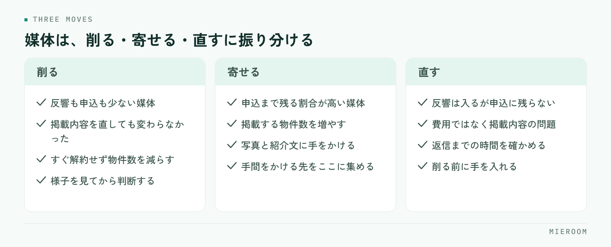

<!--META
{
  "title": "賃貸仲介の広告費の見直し方｜反響が出ている媒体を見極める手順",
  "date": "2026-11-19",
  "category": "集客・広告",
  "excerpt": "ポータルや広告の掲載費を、どこを削りどこに寄せるか判断するための手順をまとめました。媒体ごとに反響を分けて数える方法、来店と申込まで残った数の見方、削る・寄せる・直すの判断基準、減らす前に確かめること、よくある失敗までを順番に整理しています。",
  "hook": "経路ごとに数えれば、削る先が見える",
  "tags": ["広告費", "ポータルサイト", "反響管理", "費用対効果", "賃貸仲介"]
}
META-->

広告費を見直したいという相談で最初に行き詰まるのは、金額の話ではありません。**どの媒体から来たお客様が申込まで残ったのかが分からない**ことが原因です。数が分からないまま減らせば、効いていた媒体を切ってしまうこともあります。この記事では、媒体ごとの成績を数えて、削る先と寄せる先を決めるまでの手順を整理します。

<h4>この記事の結論</h4>
広告費の見直しは、<strong>媒体ごとに反響から申込までを分けて数える</strong>ところから始めてください。見るのは反響の数ではなく、来店と申込まで残った数です。そのうえで削る・寄せる・掲載内容を直すの3つに分けて判断すると、勘で減らさずに済みます。

## 広告費の見直しは、媒体ごとに反響を分けて数えることから始まる

多くの店舗で、反響の合計件数は把握されています。一方で、その件数を媒体ごとに分けた記録が残っていないことが珍しくありません。合計だけを見ていると、全体が増えたか減ったかしか分からず、掲載費をどこから削るかの判断にはつながりません。

まず、お金が出ている先を書き出してください。主要なポータルサイト、自社サイト、業者間サイト、SNSや動画、看板や店頭、紹介やリピート。有料のものと無料のものを混ぜて並べるのが要点です。無料の経路から申込が出ているなら、その経路を強くするほうが先になります。

次に、数える期間を決めます。賃貸仲介は季節の波が大きいため、**1か月だけ見て判断するのは危険**です。少なくとも繁忙期とそれ以外の両方を含む期間で並べてください。期間がそろっていない数字を比べると、媒体の良し悪しではなく季節の差を見ていることになります。

## 見るのは反響の数ではなく、来店と申込まで残った数

媒体の評価を反響の件数だけで行うと、判断を誤ります。問い合わせが多く入っても、連絡がつかない、条件が合わない、他県からの冷やかしが多いという経路があります。逆に件数が少なくても、入ったお客様がほぼ来店して申込まで進む経路もあります。

そこで、媒体ごとに4つの段を数えてください。**反響の数、連絡がついた数、来店した数、申込に至った数**です。この4つが並ぶと、どこで落ちているのかが経路ごとに違うことが見えてきます。

| 反響の数 | 申込まで残る数 | 読み方 | 次の手 |
|---|---|---|---|
| 多い | 多い | 主力の経路になっている | 掲載を広げる・物件を増やす |
| 多い | 少ない | 問い合わせの質か、対応の速さに課題 | 返信の速さと掲載内容を見直す |
| 少ない | 多い | 費用に対して効率がよい | 寄せる候補。掲載数を増やして試す |
| 少ない | 少ない | 現状では効いていない | 掲載内容を直してから判断する |

数が多い経路ほど手が回らず、連絡が遅れて落ちていることがあります。その場合に掲載を減らすと、本来取れた申込まで減ります。**落ちている段を直すのが先で、掲載費の判断は後**という順番を守ってください。

## 経路を取り違えないための記録のとり方

媒体ごとに数えると決めても、記録のとり方が曖昧だと数字がそろいません。店舗でよく起きるのは、電話で入った反響の経路が空欄のまま残ることと、同じお客様が複数の媒体から問い合わせたときに二重で数えられることです。

決めておく項目は4つです。

- 電話を受けたときに**どこで見たかを必ず聞く**こと。聞き方を文言で決め、受話器の近くに貼っておく
- フォームやメールから入った反響は、**どの媒体から来たかを自動で残す**形にすること。手で書き写すと抜けます
- 同じお客様から複数の媒体で問い合わせが来た場合、**最初に入った経路を採用する**と決めておくこと
- 来店したお客様が店頭や紹介だった場合も、経路として記録すること。有料媒体だけを数えると比較になりません

反響の受け取り方そのものを整えたい場合は、[賃貸仲介の反響管理のやり方](./hankyo-kanri-hoho.html)に手順をまとめています。記録が残る形になっていれば、月末に集計する作業自体がほとんど必要なくなります。

## 削る・寄せる・直すの3つに分けて判断する

数がそろったら、媒体を1つずつ3つのどれかに振り分けてください。全部を同時に動かすと、何が効いたのか分からなくなります。

<figure class="fig"><figcaption>次の期間で動かすのは1つか2つまでにします。同時に変えると原因が特定できません。</figcaption></figure>

**削る**のは、反響も申込も少なく、掲載内容を直しても変わらなかった媒体です。すぐに解約せず、まず掲載する物件数を減らして様子を見る形が安全です。**寄せる**のは、申込まで残る割合が高い媒体です。掲載数を増やし、写真や紹介文に手をかける先をここに集めます。**直す**のは、反響は入るが申込まで残らない媒体です。ここは費用の問題ではなく、掲載内容と対応の速さの問題なので、削る対象に入れる前に手を入れます。

振り分けたら、**次の期間で動かすのは1つか2つまで**にしてください。同時に3つ以上変えると、反響が減ったときの原因が特定できません。賃貸仲介の広告費の見直しは、一度で正解を出す作業ではなく、動かして数を見る作業の繰り返しです。

✓振り分けの前に確かめること

その媒体で掲載していた物件が、たまたま募集の少ない時期と重なっていなかったかを確認してください。物件の数と性質がそろっていない期間の比較は、媒体の成績として読めません。

## 掲載を減らす前に、確かめることと直せること

掲載費を減らす判断の前に、確かめる項目があります。順番に見てください。

1つ目は、**掲載している物件の性質**です。単身向けとファミリー向け、駅近と郊外では、反響の入りやすい媒体が違います。ある媒体の成績が悪いように見えても、その媒体に向かない物件ばかり載せていた可能性があります。2つ目は、**掲載されている内容**です。写真の枚数が少ない、間取り図が古い、紹介文が条件の羅列になっている状態では、どの媒体でも反響は入りません。3つ目は、**反響への返信までの時間**です。返信が遅い期間が続いていたなら、媒体の評価ではなく店舗の運用の評価を見ていることになります。

この3つを直してから数え直すと、順位が入れ替わることがあります。掲載内容を手直しして反響を増やす進め方は、[ポータルサイトからの反響を増やす](./portal-hankyo-fuyasu.html)にまとめています。先に直せるものを直し、それでも変わらない媒体を削る。この順番にすると、戻せない判断を避けられます。

## 毎月回すチェックリストと、よくある失敗

広告費の見直しは、年に一度の大仕事にすると実行されません。毎月同じ項目を見る形にしてください。

- 媒体ごとの反響の数が、先月と比べて大きく動いていないか
- 反響のうち、経路が空欄のものが増えていないか
- 媒体ごとの来店数と申込数を、同じ表で並べられているか
- 掲載している物件の数が、媒体ごとに偏っていないか
- 掲載が止まっている物件（成約済みなのに残っている、期限切れ）がないか
- 前の月に動かした1つの変更について、結果を確かめたか
- 無料の経路（紹介・店頭・自社サイト）からの申込を数えているか

この7項目なら、数字が残っていれば短時間で終わります。終わらないとすれば、集計に時間がかかっているということなので、記録の残り方を先に直したほうが早く進みます。

### よくある失敗と、その避け方

!よくある失敗

<strong>繁忙期の直前に掲載を削る</strong>…判断の材料がそろう前に減らすと、取れたはずの反響を失います。動かすのは繁忙期が終わってからにしてください。 <strong>反響の件数だけで媒体を評価する</strong>…件数が多くても申込に残らない経路があります。来店と申込まで数えてください。 <strong>経路を聞かずに記録している</strong>…空欄が増えると、どの媒体の成績も確かめられなくなります。聞き方を決めて貼っておくのが確実です。 <strong>同時に複数の媒体を動かす</strong>…結果が出ても原因が分かりません。1つか2つに絞ってください。 <strong>無料の経路を数えていない</strong>…紹介や店頭からの申込を数えていないと、有料媒体の評価が実際より高く見えます。

この5つのうち、最も多いのは経路の記録が残っていないことです。数える仕組みがないまま金額だけを見比べても、根拠のある判断にはなりません。

## 自分で進める場合と、ツールや専門家に任せる場合の分かれ目

一般論として、判断の基準は3つあります。

一つ目は、記録が自動で残るかどうかです。反響の経路が手入力でも、件数が少なければ表で足りています。問い合わせが日に何件も入り、担当者が複数いる状態になると、手入力の抜けが集計を壊します。この段階からは、入ってきた時点で経路が残る仕組みが必要になります。

二つ目は、集計にかかっている時間です。媒体ごとの数を出すのに月末の半日を使っているなら、見直しそのものが続きません。毎月見る前提に立つと、集計は数分で終わる状態が条件になります。

三つ目は、見る範囲です。1店舗で担当者が数人なら、店長が全体を把握できます。店舗が増え、媒体ごとの掲載を店舗別に分けている状態では、同じ基準で並べた表がないと比較になりません。店舗をまたいで同じ形で数えられるかどうかが、分かれ目になります。

迷う場合は、まず1か月だけ経路を手で記録して数えてみてください。そこで出た数字が判断に使えるなら表で続け、集計に時間がかかりすぎるようなら仕組みを変える。この順番なら、必要のない入れ替えを避けられます。

## よくある質問

どのくらいの期間を見れば、媒体の成績を判断できますか？

賃貸仲介は季節の波が大きいため、繁忙期とそれ以外の両方を含む期間で並べるのが基本です。短い期間だけを見ると、媒体の差ではなく季節の差を読んでしまいます。判断に迷う場合は、前年の同じ時期と並べて見ると、季節の影響を除いた形で比べられます。

反響が多いのに申込が少ない媒体は、解約すべきですか？

先に対応の速さと掲載内容を確かめてください。返信が遅れている、写真が少ない、条件が実際と違うといった状態なら、媒体の問題ではありません。直したうえで数え直し、それでも変わらない場合に掲載数を減らす判断に進むのが安全です。

電話の反響で、経路を聞き忘れてしまいます。

聞き方の文言を決めて、受話器の近くに貼っておくのが最も効きます。「恐れ入ります、どちらで物件をご覧になりましたか」のように短く固定してください。聞けなかった場合も空欄のままにせず、不明として記録すると、どのくらい取りこぼしているかが分かります。

無料の経路は、どう評価すればよいですか？

有料媒体と同じ表に並べて数えてください。紹介や店頭、自社サイトからの申込が多いなら、そこを強くする手当てのほうが費用をかけずに効きます。無料の経路を数えていないと、有料媒体の貢献が実際より大きく見え、削る判断が遅れます。

店舗が複数あります。媒体の評価は店舗ごとに分けるべきですか？

分けてください。エリアと扱う物件の性質が違えば、効く媒体も変わります。ただし数え方の項目は全店舗でそろえてください。項目が違うと比較ができず、どの店舗の進め方を広げるべきかの判断ができなくなります。

## まとめ：数え方を決めれば、広告費の判断は迷わない

賃貸仲介の広告費の見直しは、順番が決まっています。お金が出ている先を有料も無料も含めて書き出す。媒体ごとに反響・連絡がついた数・来店・申込の4段を数える。経路の記録が残る形を決める。削る・寄せる・直すの3つに振り分け、動かすのは1つか2つに絞る。減らす前に物件の性質と掲載内容、返信の速さを確かめる。毎月同じ7項目を見る。この形にすると、金額を眺めて勘で減らす作業から抜けられます。

逆に、合計件数しか残っていない状態では、どの媒体を削っても根拠が示せません。広告費の判断を分けているのは交渉の上手さではなく、数えられる形になっているかどうかです。

ミエルームなら、フォームやメールから入った反響が経路の情報を持ったまま案件として残り、反響分析で媒体ごとの件数と来店・申込までの流れをそのまま見られます。接客管理と申込・入金管理まで同じ案件でつながっているので、どの媒体から入ったお客様が確定売上まで残ったのかを月末に突き合わせる作業がなくなります。LINE・SMSの自動追客も同じ案件に紐づくため、反響の多い媒体で連絡が遅れて落ちることを防げます。機能の詳細は[機能・事例](../features.html)をご覧ください。資料のご請求やデモアカウントの発行は、この下のボタンからお気軽にどうぞ。
