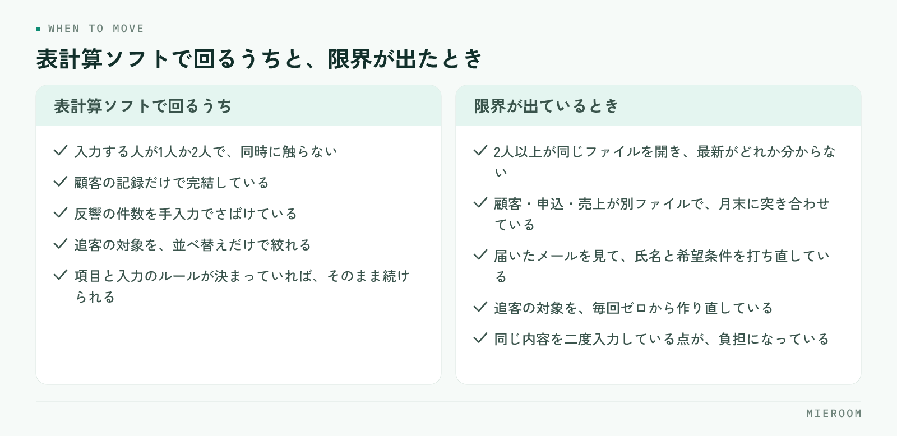

<!--META
{
  "title": "賃貸仲介の顧客管理表（Excel）の項目設計と、システムに移すタイミング",
  "date": "2026-11-08",
  "category": "業務効率化",
  "excerpt": "賃貸仲介の店舗でExcelの顧客管理表を作るときの項目設計を、使い道と入力タイミングから整理しました。最低限そろえる項目、追客のために足す項目、入力ルールの決め方、Excelで限界が出るサイン、チェックリストとよくある失敗までまとめています。",
  "hook": "顧客管理表は、項目を増やす前に順番を決める",
  "tags": ["顧客管理", "Excel", "業務効率化", "追客", "賃貸仲介"]
}
META-->

顧客管理表を作ろうとして、まず列を並べたところで止まっていませんか。思いつく項目を足していくと、入力する人が追いつかず、半分が空欄の表だけが残ります。**賃貸仲介の顧客管理表は、項目の多さではなく、何に使う項目なのかを決めてから作るのが正しい順番です**。この記事では、最低限そろえる項目、追客のために足す項目、入力のルール、そして表を卒業する時期の見分け方を順に整理します。

<h4>この記事の結論</h4>

顧客管理表の項目は、使い道で決まります。<strong>「誰がいつ入力するか」が言えない項目は、作っても埋まりません</strong>。まずは本人を特定する項目・希望条件・接客の進み具合・次にやることの4種類だけで始め、追客に使う項目を後から足してください。突き合わせに時間がかかり始めたら、表の限界が来ています。

## 顧客管理表は、項目を増やすほど使われなくなる

顧客管理表がうまくいかない理由は、ほとんどが同じです。項目が多すぎて、入力が業務の邪魔になっているからです。

よくあるのは、ポータルサイトから届く反響メールに書いてある情報を、全部そのまま列にしてしまう形です。項目としては意味がありますが、接客の直後に20列は埋まりません。結果として、埋まるのは名前と電話番号だけになり、表を見ても次に何をすべきか分かりません。

項目を決めるときの基準は一つです。**その項目を見て、誰かが何かを決めるかどうか**です。見るだけで終わる項目は、記録としては正しくても管理表には不要です。逆に、次の連絡日のように見た人の行動が変わる項目は、少し面倒でも必ず入れてください。

## 最低限そろえる項目と、その使い道

まず、この範囲だけで店舗は回ります。項目ごとに、何に使うか、いつ入力するかまで決めておきます。

| 項目 | 何に使うか | 入力するタイミング |
|---|---|---|
| 受付日 | 反響からの経過日数を見る | 反響を受けた直後 |
| 氏名・連絡先 | 連絡を取る | 反響を受けた直後 |
| 反響の経路 | どの媒体から来たかを把握する | 反響を受けた直後 |
| 希望条件（エリア・家賃・間取り） | 物件を探す、紹介の判断 | 一次対応のとき |
| 入居希望時期 | 追客の優先順位を決める | 一次対応のとき |
| 状況 | いまどの段階かを全員が分かる | 進んだ直後 |
| 担当者 | 誰が持っている案件かを決める | 割り振ったとき |
| 次にやること・次回連絡日 | 翌日以降の動きを決める | 連絡するたび |

8項目です。このうち迷いやすいのは「状況」です。段の名前を店舗で決めておかないと、人によって書き方が変わります。反響受付・連絡済み・来店予約・来店済み・申込・成約・終了のように、言葉と順番を1枚に書いて共有してください。

「次にやること」と「次回連絡日」を分けているのは理由があります。日付だけだと、その日に何をするのかが思い出せません。逆に内容だけだと、いつやるかが決まりません。両方そろって初めて、翌朝の動きが決まります。

## 追客のために足す項目

最低限の項目が埋まるようになってから、追客に使う項目を足します。先に足すと、どちらも埋まらなくなります。

足す価値があるのは次の3つです。一つ目は、紹介した物件の記録です。何を見せて、どれが響かなかったかが残っていないと、次の提案が前回と似たものになります。物件名を並べるだけで足ります。

二つ目は、断られた理由です。家賃が高い、エリアが合わない、時期がまだ、他社で決めた——この区分が残っていれば、時期がまだの人だけを後から掘り起こせます。追客の対象を選ぶ作業が、表の並べ替えだけで終わるようになります。

三つ目は、連絡の手段と反応です。電話が繋がらない人にかけ続けるより、メールやメッセージに切り替えたほうが早い場合があります。どの手段で反応があったかを1列残しておくと、二度目以降の連絡が無駄になりません。

✓自由記入欄は1つだけにする

備考のような自由記入の列を複数作ると、同じ内容が別の列に書かれて探せなくなります。自由に書く欄は1つに限り、そこに書いた内容のうち繰り返し出てくるものだけを、後から正式な項目に昇格させてください。

## 入力のルールを決める

項目が決まっても、入力のルールがないと表は崩れます。決めることは3つです。

誰が入力するか。原則は、お客様と話した本人です。他の人がまとめて入力する形にすると、内容が薄くなり、入力待ちの時間も生まれます。

いつ入力するか。業務の直後に決めてください。「その日の終わりにまとめて」は、繁忙期に真っ先に崩れます。接客が終わって席に戻ったら状況と次回連絡日だけ更新する、という単位まで小さくするのが続け方です。

どこまで書くか。文章の長さを決めておきます。次にやることは一行、断られた理由は決めた区分から選ぶ。書き方が自由だと、人によって量が変わり、読むのに時間がかかります。

そのまま使えるチェックリストとして、表を作ったあとに次の項目を確認してください。

- 項目ごとに「誰が・いつ入力するか」が言えるか
- 状況の段の名前と順番が1枚にまとまっていて、全員が同じ言葉を使っているか
- 次にやることと次回連絡日が、別の列として分かれているか
- 自由記入の欄が1つだけになっているか
- 断られた理由が、選ぶ形（区分）になっているか
- 1人の顧客が1行に収まっているか（同じ人が複数行に分かれていないか）
- 空欄が続いている列がないか。あれば、その項目は使われていない
- 誰が開いても、翌日やることが分かる状態になっているか

## Excelで限界が出るサイン

表計算ソフトで作った顧客管理表は、案件数が少なく、入力する人が限られていれば十分に機能します。限界が出るのは、次のような場面です。

<figure class="fig"><figcaption>右側がひとつでも当てはまったら、見直しの時期です。項目設計は先に固めておいてください。</figcaption></figure>

同時に編集するようになったとき。2人以上が同じファイルを開くと、上書きや保存の待ちが発生します。最新がどれか分からなくなった時点で、記録としての信頼が落ちます。

反響と接客と申込を別のファイルで管理し始めたとき。顧客管理表、申込管理表、売上の集計表が別々にあると、月末に突き合わせる作業が発生します。この突き合わせに時間がかかり始めたら、見直しの時期です。

反響の取り込みが手入力のままのとき。ポータルサイトから届くメールを見て、氏名と希望条件を打ち直す作業は、件数が増えるほど効く負担になります。一次対応が遅れる原因にもなります。

追客の対象を絞る作業が、毎回ゼロからになるとき。断られた理由や次回連絡日が入っていても、絞り込みを手で作り直しているなら、仕組みにしたほうが早い段階です。

移すときに何が変わるかは[Excel管理からの卒業](./excel-to-saas.html)に、選ぶときの条件は[賃貸仲介の顧客管理（CRM）の選び方](./chintai-crm-erabikata.html)に整理しています。

## よくある失敗とその避け方

**項目を先に全部作る**。入力されない列が増え、表を見ても判断できなくなります。8項目で始めて、足りないものだけを足してください。

**状況の言葉を決めていない**。「追客中」と「連絡済み」が同じ意味で使われ、並べ替えても実態が分かりません。段の名前と順番を先に固定します。

**1人の顧客が複数行に分かれる**。問い合わせごとに行を作ると、同じ人が何行にもなり、履歴が追えません。顧客で1行、やり取りは列か別シートに持たせます。

**次回連絡日を入れていない**。入れていない案件は、必ず放置されます。連絡したら次を入れる、を入力の単位に組み込んでください。

**担当者が空欄のまま**。誰のものでもない案件になり、全員が触らなくなります。反響を受けた時点で割り振ります。

**過去の行を削除する**。終了した案件を消すと、掘り起こしの材料がなくなります。終了として残し、表示だけ分ければ足ります。

## 自分で進める場合と、ツールに任せる場合の分かれ目

一般論として、判断の基準は3つです。

一つ目は、入力する人の数です。1人か2人で、同じ時間に触らない運用なら、表計算ソフトで十分に回ります。3人以上が同じ時間に触るようになったら、ファイルの持ち方そのものが問題になります。

二つ目は、別の表との突き合わせが発生しているかどうかです。顧客の記録だけで完結しているなら、表のままで構いません。申込や入金、売上の集計と行き来して数字を合わせているなら、記録を1か所にまとめたほうが早くなります。

三つ目は、手入力の量です。反響メールの内容を打ち直す、同じ内容を複数の表に書く、追客の対象を毎回作り直す。この手作業が業務時間の中で目立ってきたら、仕組みに寄せる時期です。

迷うときは、項目設計だけ先に固めてしまうのが損の少ない進め方です。項目と入力のルールが決まっていれば、表のまま続けることもできますし、後からツールに移すときも、そのまま持っていけます。逆に、項目が曖昧なままツールを変えても、同じ状態が場所を変えて再現されるだけです。

## よくある質問

顧客管理表の項目は、何列くらいが適切ですか。

始めるときは8列程度で足ります。受付日、氏名・連絡先、反響の経路、希望条件、入居希望時期、状況、担当者、次にやること・次回連絡日です。これが毎日埋まるようになってから、紹介した物件や断られた理由を足してください。最初から20列を作ると、埋まるのは名前と電話番号だけになります。

テンプレートを探していますが、そのまま使えますか。

項目の見本としては役に立ちますが、そのままでは使いにくいことが多いです。状況の段の名前や、断られた理由の区分は、店舗の運用に合わせて書き換える必要があります。列の参考にとどめ、入力のタイミングと言葉は自店舗で決めてください。

顧客管理表と申込管理表は、分けるべきですか。

初めは分かれていても構いませんが、同じ案件を両方に書いている状態が続くなら、まとめる検討をしてください。分かれていること自体ではなく、同じ内容を二度入力している点が負担になります。申込管理表の作り方は<a href="./moushikomi-kanrihyo-tsukurikata.html">賃貸仲介の申込管理表の作り方</a>に整理しています。

過去の顧客データは、どこまで残すべきですか。

終了した案件も残してください。時期がまだという理由で見送った方は、半年後や一年後の掘り起こしの対象になります。削除するのではなく、状況を終了にして、通常の一覧から外して表示する形が実務的です。個人情報の扱いは、保管期間と閲覧できる人を店舗で決めておいてください。

表計算ソフトからシステムに移すとき、入力済みのデータは引き継げますか。

引き継げます。ミエルームはExcelデータのインポートと初期設定の代行に対応しており、最短即日からのスタートが可能です。移す前に、項目名と状況の言葉を整えておくと、移行後の手直しが少なくなります。デモアカウントを発行していますので、いまの表の項目がどう収まるかを先に確かめていただけます。

## まとめ：項目は使い道から決めると埋まる

顧客管理表で大事なのは、列の数ではありません。本人を特定する項目・希望条件・接客の進み具合・次にやることの4種類から始め、それぞれに「誰がいつ入力するか」を決める。状況の言葉を1枚に固定する。自由記入は1つに限る。この形であれば、繁忙期でも空欄になりません。

逆に、思いつく項目を先に並べる形にすると、二か月目には名前と電話番号だけの表に戻ります。見ない項目を減らすことが、顧客管理表を続けるいちばんの近道です。

ミエルームなら、反響の受付から接客・申込・入金までを同じ案件の1行として記録できるので、顧客管理表と申込管理表を別に持って突き合わせる作業がなくなります。フォーム自動取込とメール自動取込で反響の内容がそのまま入るため、氏名や希望条件を打ち直す手間も消え、LINE・SMS自動追客で次回連絡の取りこぼしも減ります。入力は業務の直後に1回で済むので、翌朝の動きを表の並べ替えから作り直す時間がなくなります。他のシステムとの違いは[比較ページ](../compare.html)にまとめています。資料のご請求やデモアカウントの発行は、この下のボタンからお気軽にどうぞ。
