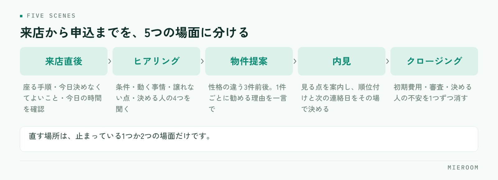

<!--META
{
  "title": "賃貸仲介の成約率を上げる接客の流れ｜来店から申込までの5つの場面",
  "date": "2026-11-17",
  "category": "組織・育成",
  "excerpt": "来店はあるのに申込につながらないときの接客の流れを、来店直後・ヒアリング・物件提案・内見・クロージングの5つの場面に分けて整理しました。各場面で決めておく言葉と確認項目、よくある失敗の避け方までまとめています。",
  "hook": "落ちている場面を先に特定する",
  "tags": ["接客", "成約率", "店舗運営", "スタッフ育成", "賃貸仲介"]
}
META-->

来店はあるのに申込が増えないとき、原因は担当者の話し方ではなく**接客の流れのどこかに決まっていない場面がある**ことです。接客を5つの場面に分け、どこで落ちているかを特定すれば、直す場所は1つか2つに絞られます。この記事では、来店から申込までの流れを場面ごとに分解し、店舗で決めておくことを順に整理します。

<h4>この記事の結論</h4>
成約率は、接客全体をうまくすることでは上がりません。<strong>5つの場面のどこで落ちているかを先に特定し、その場面だけを決め直す</strong>のが最短です。落ちている場面は、来店から申込までの記録を並べれば見えてきます。

## 賃貸仲介の成約率は、接客の流れを場面で分けると見えてくる

成約率が上がらないという相談のとき、店舗でまず出てくるのは「決め切る力が弱い」という話です。けれども、申込に至らなかった接客を並べていくと、最後の押しで落ちているケースはそれほど多くありません。多いのは、ヒアリングで条件を聞き切っていない、提案した物件が条件から外れている、内見で次に進む約束をしていない、といった**途中の場面**です。

<figure class="fig"><figcaption>場面ごとに次へ進んだかを記録すると、どこで止まっているかが数えられます。</figcaption></figure>

接客を5つの場面に分けると、落ちている場所が特定できます。来店直後、ヒアリング、物件提案、内見、クロージング。この順番で、それぞれ「次の場面へ進んだか」を記録すると、どこで止まっているかが数えられます。

| 場面 | 止まっているサイン | 直す対象 |
|---|---|---|
| 来店直後 | 座ってからの会話が続かない | 最初の3分の進め方 |
| ヒアリング | 提案した物件を断られる理由がばらばら | 聞く項目の抜け |
| 物件提案 | 内見まで進まない | 提案の件数と理由の伝え方 |
| 内見 | 内見したのに連絡が途絶える | 内見後の約束の取り方 |
| クロージング | 検討しますで終わる | 不安の残り方と手続きの説明 |

全部を直そうとすると何も変わりません。先に数えて、1つか2つに絞ってください。

## 来店直後の3分で、相談しやすい状態をつくる

来店直後の目的は、物件を見せることではありません。**この人に話していいと思ってもらうこと**です。ここが固いまま進むと、ヒアリングで本当の条件が出てきません。

決めておくことは3つです。1つ目は座る場所と飲み物を出すまでの手順。迷わず案内できる形にしておきます。2つ目は最初に伝える内容で、「今日お部屋が決まらなくても大丈夫です」「まずご希望を伺ってから、ご紹介できるものをお出しします」と、この場で決める必要はないことを先に伝えます。3つ目は今日の時間の確認です。「このあとのご予定はどのくらい余裕がありますか」と聞いておけば、内見まで進めるかどうかがその時点で分かります。

反響から来店した人の場合は、問い合わせのあった物件の状況を先に伝えてください。すでに申込が入っているなら、座ってすぐに言う。後回しにすると、その後の提案が全部言い訳のように聞こえます。

## ヒアリングは、聞く項目を決めて抜けを防ぐ

提案が外れる原因は、ほとんどがヒアリングの抜けです。経験のある担当者は頭の中に項目を持っていますが、新人は持っていません。そこで、**店舗として聞く項目を一覧にしておく**必要があります。

聞く内容は大きく4つに分かれます。条件（エリア、賃料の上限、間取り、入居の希望時期）、事情（転勤・進学・同棲・更新のタイミングなど、なぜ動くのか）、譲れない点と譲れる点、そして決める人（本人だけで決められるのか、家族や会社の承認が必要か）。このうち抜けやすいのは**事情と決める人**です。急いでいるのか様子を見ているのかで、提案の出し方が変わります。

| 聞く内容 | 抜けたときに起きること |
|---|---|
| 賃料の上限と初期費用の考え方 | 提案が予算から外れ、やり直しになる |
| 入居の希望時期 | 空室の時期が合わず、内見が無駄になる |
| 動く事情 | 急ぎ具合が分からず、追客の間隔を外す |
| 譲れない点 | 条件を広げた提案が全部断られる |
| 決める人 | 本人が納得しても申込に進まない |

項目の作り方は[来店時のヒアリング項目](./raiten-hearing-koumoku.html)で詳しく整理しています。

## 物件提案は、件数と「勧める理由」を決めておく

提案で起きがちなのは、条件に合うものを全部見せてしまうことです。数が多いと比べきれず、お客様は決められません。逆に1件だけだと、それが合わなかった時点で接客が終わります。

店舗で決めるのは2つです。1つは出す件数の目安で、3件前後に絞り、それぞれ性格の違うものを混ぜます。条件にぴったりのもの、賃料が少し安い代わりに何かを譲るもの、少し高い代わりに希望を満たすもの。**選ぶ軸を見せるのが目的**です。もう1つは、1件ごとに勧める理由を一言で言えるようにしておくこと。「ご希望の駅から2駅ですが、徒歩が短くなります」のように、ヒアリングで聞いた内容とつなげます。

断られたときは、理由を聞いて記録してください。断りの理由が集まると、ヒアリングのどこが抜けていたかが分かります。物件の紹介文の書き方は[物件紹介文の書き方](./bukken-shokaibun-kakikata.html)にまとめています。

## 内見では、終わり方を先に決めておく

内見まで進んだのに連絡が途絶えるのは、**内見の終わり方を決めていない**からです。見終わって「ご検討ください」と別れると、その後は追いかける仕事になります。

内見の前に、順番と所要時間を伝えます。何件を何時までに回るか、戻ってから店で話す時間があるか。これを先に言っておくと、戻って話す流れが自然に作れます。各物件では、見るべき点を案内してください。日当たりと窓の向き、水回りの状態、収納の広さ、共用部の管理の様子、周辺の夜の雰囲気。お客様は見るべき場所が分からないので、案内しないと印象だけが残ります。

終わり方として決めておくのは3つです。良かった順に順位を付けてもらう、気になる点をその場で全部出してもらう、そして次に連絡する日と内容を約束する。「明日の夕方までに、ご質問のあった管理会社の確認結果をお送りします」のように**次の接点を具体的にする**ところまでを内見の工程に入れます。内見前の準備は[内見の準備と案内](./naiken-junbi-annai.html)で整理しています。

## クロージングで不安を消し、よくある失敗を仕組みで防ぐ

### 残っている不安を1つずつ消す

「検討します」で終わる接客は、押しが弱いのではなく、不安が残ったままです。その不安が何かを聞かないまま押すと、連絡が取れなくなります。

残りやすい不安は決まっています。初期費用の総額がはっきりしない、審査に通るか分からない、同居人や家族の了解が取れていない、他に良い物件が出るかもしれない、手続きの流れが分からない。これを1つずつ確認して、答えられるものはその場で答え、確認が必要なものは**いつまでに返すかを約束する**。

初期費用は、口頭ではなく書いたものを渡してください。項目ごとの内訳と、支払う時期が分かる形です。審査は、どこが見るのか、どのくらいで結果が出るのかを説明します。内訳の説明の仕方は[初期費用の内訳の説明](./shokihiyo-uchiwake-setsumei.html)にまとめています。

申込に進むときは、次に必要なものを紙かメッセージで渡します。必要書類、記入してもらう内容、入金の時期。ここが口頭だけだと、書類が揃わずに時間が空き、その間に気持ちが変わります。

### よくある失敗と、その避け方

!この5つは、店舗の仕組みで防げます

<strong>接客の良し悪しを感覚で評価する</strong>…どの場面で落ちたかを記録していないと、直す場所が決まりません。場面ごとに進んだかどうかだけ残してください。 <strong>ヒアリング項目が担当者の頭の中にある</strong>…新人が同じ接客をできません。一覧にして、来店票に印刷します。 <strong>提案件数を決めていない</strong>…多すぎると比べられず、少なすぎると終わります。性格の違う3件前後に絞ります。 <strong>内見後の約束をしていない</strong>…追客が追いかける仕事になります。次の連絡日と内容をその場で決めます。 <strong>断られた理由を記録していない</strong>…同じ外れ方を繰り返します。断りの理由は、ヒアリングの改善材料です。

記録は、細かく書く必要はありません。場面ごとに進んだかと、断られた理由を一言。これだけで、翌月に見直す材料になります。

## 自分で進める場合と、ツールに任せる場合の分かれ目

一般論として、判断の基準は3つあります。

一つ目は、接客の記録が残っているかどうかです。来店から申込までの経過が担当者の記憶とメモだけにあるなら、どの場面で落ちているかを数えられません。紙の来店票でも構いませんが、集計して見返すところまでやるなら、記録と集計が同じ場所にある形のほうが続きます。

二つ目は、担当者の人数です。1〜2人なら、朝礼で状況を共有すれば足ります。人数が増え、反響の受付と接客の担当が分かれてくると、聞いた内容が引き継がれないことが起き始めます。そこが起きてからが、仕組みを入れる時期です。

三つ目は、見直しの頻度です。月に一度でも場面ごとの数を見て決め直す習慣があるなら、形式は何でも機能します。逆に、集計に手間がかかって数か月見ていないなら、集計を自動で出す形にしないと習慣は戻りません。

迷う場合は、まず1か月だけ手で数えてみてください。どの場面で落ちているかが分かれば、仕組みを入れるべき範囲も自然に決まります。

## よくある質問

場面ごとの記録は、何を残せばいいですか？

来店したか、ヒアリングを終えたか、物件を提案したか、内見したか、申込に至ったか。この5つに進んだかどうかだけで十分です。加えて、進まなかった場面での理由を一言。細かく書こうとすると続かないので、選ぶだけで残る形にしてください。月末に並べると、落ちている場面がはっきりします。

新人の接客を、どこから教えるべきですか？

ヒアリングからです。来店直後の案内は手順を覚えれば回り、提案と内見は先輩の同席で学べますが、ヒアリングの抜けは本人には分かりません。聞く項目の一覧を渡し、最初のうちは聞き終えた内容を先輩が見る形にしてください。抜けが減れば、提案が外れる回数が自然に減ります。育成の順番は社内で決めておくと迷いません。

内見の件数は、多いほうがいいのでしょうか？

件数より、比べる軸がはっきりしているかが大切です。性格の違う物件を3件前後見てもらうと、何を優先したいのかがお客様自身にも見えてきます。似た条件のものを多く回ると、記憶が混ざって決められなくなります。移動の時間も考えて、戻ってから話す時間を残せる件数にしてください。

「検討します」と言われたとき、その場で何を聞けばいいですか？

迷っている点を聞きます。「今の時点で、気になっているのはどのあたりですか」と尋ね、出てきたものを1つずつ確認してください。答えられるものはその場で答え、確認が必要なものはいつまでに返すかを約束します。何も出てこない場合は、決める人が別にいるか、物件自体が条件から外れている可能性があります。

店舗全体の成約率を見るだけでは足りませんか？

全体の数字は、上がったか下がったかしか分かりません。どこを直すかを決めるには、場面ごとの数と、担当者ごとの違いが必要です。同じ店でも、ヒアリングで止まる人と内見後に止まる人がいて、打つ手が違います。全体の数字は結果の確認に使い、改善の判断は場面ごとの数で行ってください。

## まとめ：成約率は、落ちている場面を特定してから直す

接客の流れを5つの場面に分けると、やることが決まります。来店直後は相談しやすい状態をつくり、ヒアリングは項目を一覧にして抜けを防ぐ。提案は性格の違う3件前後に絞り、1件ごとに勧める理由を言えるようにする。内見は終わり方と次の連絡を先に決める。クロージングでは残っている不安を1つずつ消す。そして、場面ごとに進んだかどうかを記録して、月に一度数える。

逆に、接客全体をうまくしようとすると、何も変わりません。落ちている場面は店舗ごとに違い、直す場所は1つか2つしかないからです。

ミエルームなら、反響の受付から来店、ヒアリングの内容、提案した物件、内見、申込までが案件ごとに1件のままつながって残るので、どの場面で止まったかを数える作業が記録の副産物になります。接客・反響成績の可視化で担当者ごとの違いも見えるため、朝礼で感覚を話し合う時間が、場面を特定して決め直す時間に変わります。機能の詳細は[ミエルームの製品トップ](../index.html)をご覧ください。資料のご請求やデモアカウントの発行は、この下のボタンからお気軽にどうぞ。
