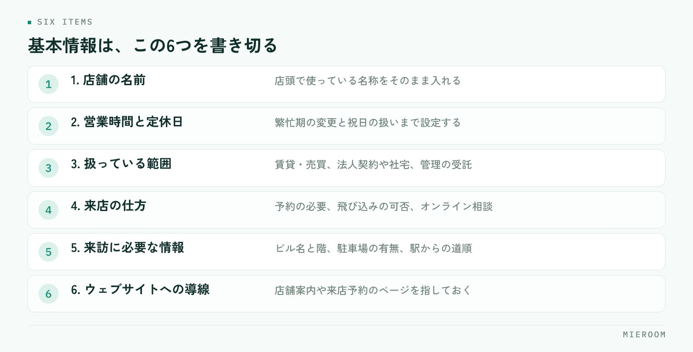

<!--META
{
  "title": "賃貸仲介店舗のGoogleビジネスプロフィール運用｜地図検索から来店につなげる手順",
  "date": "2026-11-21",
  "category": "集客・広告",
  "excerpt": "賃貸仲介の店舗がGoogleビジネスプロフィールを運用し、地図検索から来店・問い合わせにつなげるまでの手順をまとめました。最初に埋める基本情報、写真と投稿の出し方、口コミへの対応ルール、地図から来た反響の受け方、毎月の確認項目とよくある失敗までを順番に整理しています。",
  "hook": "地図検索からの来店は、運用で増やせる",
  "tags": ["Googleビジネスプロフィール", "MEO", "口コミ対応", "店舗集客", "賃貸仲介"]
}
META-->

賃貸仲介の集客はポータルサイトが中心ですが、「この駅の近くの不動産屋」と地図で探してから店舗に連絡する人も一定数います。結論から申し上げると、**地図検索から来る人はポータル経由の反響よりも来店に近い段階にいるため、受け入れる情報を整えておくだけで取りこぼしが減ります**。この記事では、Googleビジネスプロフィール（*Google Business Profile*）の基本情報の埋め方から、口コミへの対応、地図から来た反響の受け方までを手順として整理します。

<h4>この記事の結論</h4>
地図検索の対策は順位を上げる作業ではなく、<strong>探している人の質問に先に答えておく作業</strong>です。営業時間・取り扱い・来店の仕方・駐車場の有無を書き切り、写真と投稿で店舗の中身を見せ、口コミへの返信を店舗のルールにする。この4つが揃えば、地図から来た問い合わせがそのまま来店につながります。

## 地図検索から来る人は、すでに来店を決めかけている

ポータルサイトから入る反響と、地図検索から入る反響は、お客様の状態が違います。ポータルは物件を見て問い合わせるため、反響の時点ではまだ物件を比べている段階です。地図検索は「店に相談しに行こう」と考えてから探しているため、店舗そのものを選んでいます。

この違いは、聞かれることにも出ます。地図から連絡してくる方は、物件の空室状況よりも先に、今日行けるのか、予約は必要か、駐車場はあるか、どんな物件を扱っているのかを確かめます。

| | ポータル経由の反響 | 地図検索経由の反響 |
|---|---|---|
| お客様の状態 | 物件を比べている | 相談する店舗を選んでいる |
| 最初の関心 | その物件の空室状況 | 行けるかどうか、扱いの範囲 |
| 入り方 | 問い合わせフォーム・メール | 電話・ルート検索・ウェブサイトの導線 |
| 取りこぼしの原因 | 返信までの時間 | 営業時間や来店方法が書かれていない |

**地図検索で取りこぼすのは、返信の速さではなく情報の不足**です。営業時間が古いまま、定休日が書かれていない、電話番号だけで予約の案内がない。この状態だと、調べた人は別の店舗を見に行きます。ポータル側の反響を増やす手順は[ポータルサイトの反響を増やす方法](./portal-hankyo-fuyasu.html)にまとめています。

## 最初に埋める基本情報の6項目

登録そのものは終わっていても、中身が埋まっていない店舗は少なくありません。まず次の6つを書き切ってください。順番は、探している人が確かめる順です。

<figure class="fig"><figcaption>店舗の宣伝ではなく、行くかどうかを決めるための情報です。この順番で埋めてください。</figcaption></figure>

一つ目は、店舗の名前です。実際に店頭で使っている名称をそのまま入れます。二つ目は、営業時間と定休日です。繁忙期に営業時間を変える店舗は、その時期に必ず直します。祝日の扱いも設定しておきます。

三つ目は、扱っている範囲です。賃貸だけか売買も扱うか、法人契約や社宅に対応するか、管理も受けているか。四つ目は、来店の仕方です。予約が必要なのか、飛び込みでも対応できるのか、オンラインでの相談ができるのか。

五つ目は、来訪に必要な情報です。ビル名と階、駐車場の有無と台数、最寄り駅からの道順。車で来る方が多い地域では、駐車場の記載があるかどうかで行き先が変わります。六つ目は、ウェブサイトへの導線です。自社サイトの中でも、店舗の案内や来店予約のページを指しておきます。

**この6つは店舗の宣伝ではなく、行くかどうかを決めるための情報**です。理念や強みを書くより先に、ここを埋めてください。

## 写真と投稿で、店舗の中身を見せる

地図検索の結果で最初に見られるのは写真です。入りづらそうに見えるかどうかが、ここで決まります。

載せたいのは4種類です。外観は、道から見たときの見え方が分かる角度で撮ります。看板と入口が写っていると、迷わずに着けます。内観は、相談するカウンターと席が分かるもの。接客する場所が見えると、入る心理的な抵抗が下がります。

三つ目はスタッフの様子です。顔を出すかどうかは店舗の方針で決めて構いませんが、人がいる雰囲気が伝わる写真は効果があります。四つ目は、店内から見える情報です。物件情報を貼り出した掲示や、相談に使う資料が並んでいる様子など、何をしてもらえる場所なのかが分かるものです。

投稿の機能は、使うなら内容を決めてから始めます。続かない原因は、何を書くか決めていないことです。賃貸仲介であれば、繁忙期の営業時間の案内、取り扱いを始めた地域、来店予約の方法、オンライン相談の案内のように、来店の判断に関わる情報に絞ると書く材料が尽きません。物件そのものの宣伝を並べるより、店舗の使い方を伝えるほうが向いています。写真の撮り方は[賃貸物件の写真の撮り方](./bukken-shashin-torikata.html)の考え方がそのまま使えます。

## 口コミへの対応を店舗のルールにする

口コミは、賃貸仲介では評価が分かれやすい領域です。契約に至らなかった方や、審査が通らなかった方が書き込むこともあります。担当者ごとに対応が変わらないよう、店舗のルールとして決めておいてください。

決めることは4つです。誰が返信するか、いつまでに返信するか、どこまで書くか、書かないことは何か。返信は店長か店舗責任者がまとめて行う形にすると、文面の調子が揃います。

書かないことを先に決めるのが重要です。お客様の個人情報、物件名、審査の内容、やり取りの詳細は書きません。事実関係に食い違いがある場合も、口コミの返信欄で反論しないでください。見ているのは書いた本人ではなく、これから相談しようとしている人です。

!口コミを集めるときの注意

来店されたお客様に口コミをお願いすること自体は問題ありませんが、見返りを渡して書いてもらう、スタッフが身内に書かせる、内容を指定して依頼するといった集め方はしないでください。プラットフォームの規約に反するほか、文面が揃いすぎて読む人に見抜かれます。お願いするのは、契約が無事に終わったタイミングで一言添える程度に留めるのが安全です。

良い評価だけを狙うより、低い評価が付いたときに落ち着いた返信が並んでいる状態のほうが、読む人の判断材料になります。

## 地図から来た問い合わせを取りこぼさない受け方

情報を整えると、電話と来店が増えます。ここで記録が残らないと、何が効いたのか分からないまま運用することになります。

受け方の手順を決めてください。電話が鳴ったら、どこで店舗を見つけたかを一言聞く。地図検索だったことが分かれば、その経路を記録に残します。聞くのは「どちらでお知りになりましたか」の一言で足ります。

次に、その場で来店の約束まで進めます。地図から連絡してくる方は来店の意思が強いため、希望条件を細かく聞く前に、日時を押さえるほうが成約に近づきます。条件のヒアリングは来店時に行えば十分です。

記録は、ポータル経由の反響と同じ台帳に入れてください。経路の欄に地図検索と残しておけば、月ごとにどの経路から何件来ているかが並びます。別の表に分けると、比べるときに集計し直す手間が生まれます。反響から来店までの進め方は[反響からの来店率を上げる方法](./hankyo-raiten-ritsu-ageru.html)に整理しています。

## 毎月の確認項目と、よくある失敗

地図検索の運用は、一度整えたら終わりではありません。情報が古くなると、調べた人が来られなくなります。月に一度、次の項目を確かめてください。

- 営業時間と定休日が実際の運用と合っているか
- 繁忙期や年末年始の特別な営業時間を設定したか
- 電話番号と住所の表記が、自社サイトや名刺と一致しているか
- 新しい写真を1枚以上足したか
- 未返信の口コミが残っていないか
- 掲載されている情報に、自分以外が勝手に変更を加えていないか
- 地図検索経由の電話・来店が、反響の台帳に記録されているか
- 自社サイトへの導線が、いまも開けるページを指しているか

よくある失敗は4つあります。一つ目は、登録して放置することです。営業時間が古いままの店舗は、調べた人に「閉まっているかもしれない」と思われます。

二つ目は、店舗名に地域名やうたい文句を足すことです。実際の店頭表記と違う名前は、プラットフォームの規約の面でも、来店した人の混乱の面でも避けてください。三つ目は、口コミの返信を担当者ごとの判断に任せることです。感情的な返信が1件あるだけで、他の返信も同じ目で読まれます。

四つ目は、記録を残さないことです。**地図経由の反響を台帳に入れていないと、増えたのか減ったのかが分からず、続けるかどうかの判断ができません**。

## 自分で進める場合と、ツールや専門家に任せる場合の分かれ目

地図検索の運用は、店舗で始められる作業です。分かれ目になるのは3つです。

一つ目は、更新を続ける手が店舗にあるかどうかです。基本情報を埋める作業は一度で終わりますが、写真の追加と口コミの返信は続く作業です。月に一度、決まった日に見る担当者を置けるなら、店舗で回せます。繁忙期にその時間が消えるなら、外に任せる前提で考えるほうが現実的です。

二つ目は、複数店舗を持っているかどうかです。店舗が増えると、情報の表記を揃える作業と、口コミの対応の質を揃える作業が発生します。店舗ごとに運用が分かれていくなら、まとめて管理する形に寄せたほうが手間が減ります。

三つ目は、記録を見て判断したいかどうかです。地図経由の反響を他の経路と並べて見たいのであれば、受けた反響が同じ台帳に入る仕組みが必要です。台帳が分かれていると、どの経路に手をかけるべきかが見えません。

迷うときは、今月その作業に使える時間が何時間あるかを数えてみてください。基本情報を埋めるところまでは、どの店舗でも自力で終わります。続ける部分と記録する部分のどちらかが止まりそうなら、その範囲だけを仕組みや外部の手に預ける判断が有効です。

## よくある質問

Googleビジネスプロフィールを整えると、すぐに来店が増えますか？

すぐに変わるのは来店数ではなく、調べた人が判断できるようになる点です。営業時間・来店方法・駐車場が書かれていれば、迷って離れる人が減ります。効果を見るときは、順位ではなく、地図経由の電話と来店が台帳に何件記録されたかで確かめてください。

口コミに事実と違うことを書かれた場合はどうすればよいですか？

返信欄で反論しないでください。規約に反する内容であればプラットフォームに削除を申し立てる手段があります。それ以外の場合は、事実関係に触れずに、来店いただいた点への感謝と、改善に向けた姿勢を短く書くに留めます。読んでいるのは次に相談しようとしている人です。

店舗名に「〇〇駅前」や「賃貸」と入れてもよいですか？

実際に店頭や登記で使っている名称であれば問題ありませんが、検索で見つかりやすくするために後から足した語は避けてください。プラットフォームの規約に抵触するほか、来店した方が別の店舗だと感じる原因になります。地域や取り扱いは、名前ではなく説明や情報の欄に書いてください。

写真は何を優先して載せればよいですか？

外観が最優先です。道から見たときの見え方が分かる角度で、看板と入口が写っているものを載せてください。次に相談カウンターの写った内観です。物件の写真を並べるよりも、店舗がどんな場所かが分かる写真のほうが、来店の判断に効きます。

複数店舗ある場合、情報はどう揃えればよいですか？

書く項目と並び順を本部で決めて、各店舗が同じ形で埋めるのが確実です。営業時間・取り扱い・来店方法・駐車場の4つは必ず全店舗で埋めてください。口コミの返信も、誰が返すかと書かないことを共通のルールにしておくと、店舗ごとの差が出ません。

## まとめ：情報を書き切れば、地図から来た人は店舗に着く

賃貸仲介店舗のGoogleビジネスプロフィール運用は、順番が決まっています。営業時間・取り扱い・来店の仕方・来訪に必要な情報の6項目を書き切る。外観と内観の写真を載せ、投稿は来店の判断に関わる内容に絞る。口コミは、誰がいつまでに返すかと、書かないことを店舗のルールにする。地図から来た電話は、経路を一言聞いて反響の台帳に残す。月に一度、営業時間と未返信の口コミを確かめる。この形にすると、調べた人が迷わず店舗に着きます。

逆に、登録しただけで放置していると、営業時間が古いまま調べられ、行けるかどうか分からない店舗として見送られます。地図検索で効くのは見せ方の工夫より、質問に先に答えてあるかどうかです。

ミエルームなら、地図検索から入った電話や来店も、ポータル経由の反響と同じ反響管理の中に経路を付けて記録できます。反響分析で経路別の件数と来店・申込への残り方がそのまま見られるため、どの入口に手をかけるべきかを月末に表を作り直さずに判断できます。MEO・AIO対策はオプションとして提供しており、店舗の情報整理から継続的な運用まで任せることもできます。機能の詳細は[機能・事例](../features.html)をご覧ください。資料のご請求やデモアカウントの発行は、この下のボタンからお気軽にどうぞ。
