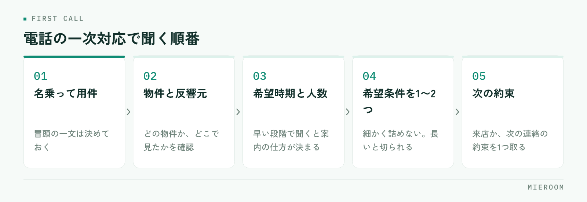

<!--META
{
  "title": "賃貸仲介の電話対応マニュアルの作り方｜一次対応で聞く項目と記録の残し方",
  "date": "2026-10-23",
  "category": "業務効率化",
  "excerpt": "賃貸仲介の店舗で、電話の一次対応を誰が出ても同じ形にするためのマニュアルの作り方をまとめました。最初に聞く項目の固定、物件が埋まっていたときの受け方、取次と不在時のルール、通話内容を記録に戻すところまで整理しています。",
  "hook": "電話の一次対応は、人ではなく型で揃える",
  "tags": ["反響管理", "電話対応", "マニュアル", "新人育成", "賃貸仲介"]
}
META-->

ポータルサイトを見た方からの電話は、誰が受けても同じ内容になっているでしょうか。実際には、出た人によって聞く項目も受け方も変わりがちです。**電話対応マニュアルで決めるべきなのは、話し方の見本ではなく、最初の数十秒で必ず聞く項目と、通話のあとに記録として何を残すかです**。

<h4>この記事の結論</h4>
電話対応マニュアルは、文例集ではなく決めごとの一覧として作ります。<strong>固定するのは「必ず聞く項目」「物件が埋まっていたときの受け方」「取次と不在時のルール」「記録に残す内容」の4つ</strong>です。この4つが揃っていれば、新人が最初に電話を取っても来店の約束まで進められます。

## 電話の一次対応で決まるのは、来店の約束まで進むかどうか

問い合わせの電話は、物件の空室確認から始まることがほとんどです。ここで「空いています」「埋まっています」だけを答えて終わると、その反響はその時点で消えます。

一次対応の目的は、物件の在否を伝えることではなく、来店か次の連絡の約束まで進めることです。そのためには、相手の希望条件を少しでも聞き出しておく必要があります。

この部分を各担当者の経験に任せていると、店舗全体の来店率は受けた人によって変わります。**慣れている担当者が持っている聞き方を、項目として書き出すのがマニュアルの役割**です。反響そのものの管理方法は[反響管理の方法](./hankyo-kanri-hoho.html)にまとめています。

## マニュアルに書くのは「話し方」ではなく「決めごと」

電話対応マニュアルを作ろうとすると、挨拶や言葉遣いの文例集になりやすいところです。ただ、現場で迷うのはそこではありません。

迷うのは、物件が埋まっていたときに何を案内するか、担当者が不在のときにどこまで答えるか、聞いた内容をどこに書くか、といった判断です。文例は読めば真似できますが、判断は決めておかないと人によって変わります。

書き出す対象は次の4つに絞ります。

- 必ず聞く項目（順番も含めて固定する）
- 物件が埋まっていたときの受け方
- 取次と、担当者が不在のときのルール
- 通話のあとに記録として残す内容

挨拶や名乗り方は、冒頭の一文を決めておけば足ります。分量を増やすほど読まれなくなるため、判断が必要な場面に絞って書くほうが使われます。

## 最初に聞く項目を、順番まで固定する

一次対応で聞く項目は、多くする必要はありません。相手が答えやすい順に並べておくことが大切です。

<figure class="fig"><figcaption>条件を詰めるのは来店時。電話では方向が分かる程度にとどめます。</figcaption></figure>

名乗って用件を確認する。問い合わせの物件と、どこで見たか（反響元）を確認する。入居の希望時期と、人数・用途を聞く。希望の条件を1つか2つ聞く。来店か次の連絡の約束を取る。最後に名前と連絡先を確認する。

希望時期を早い段階で聞いておくと、そのあとの案内の仕方が決まります。すぐに動く方なら来店の日程を、時期が先の方なら次の連絡の時期を提案する形に分かれます。

条件の聞き取りを長くしすぎないことも大切です。電話で細かく詰めようとすると、相手の負担になって切られます。詳しく聞くのは来店時で、電話では方向が分かる程度で十分です。来店時に聞く項目は[来店時のヒアリング項目](./raiten-hearing-koumoku.html)で整理しています。

## 物件が埋まっていたときの受け方を決めておく

一次対応で差が出るのが、問い合わせの物件がすでに決まっていた場合です。ここを決めていないと、「申し訳ありません、埋まってしまいました」で終わります。

決めておくのは、代わりに案内する物件の探し方と、伝える順番です。

| 相手の状況 | 一次対応で伝えること | 次の約束 |
|---|---|---|
| その物件を特に気に入っていた | 似た条件の物件が他にあること | 条件を聞いて、物件を送る約束 |
| 条件で探している途中 | 条件に合う物件が他にもあること | 来店して複数見てもらう提案 |
| 入居時期が先 | 今の時期の募集状況 | 希望時期の前に連絡する約束 |
| 設備や間取りの条件が細かい | その条件での募集の出方 | 条件を登録して、出たら連絡する約束 |

共通しているのは、電話を切る前に次の約束を1つ取ることです。約束がないまま切ると、その反響は記録に残っても追えません。

✓代わりの物件は、電話中に1件だけ挙げる

埋まっていた物件の代わりに複数の物件を電話で並べても、相手は覚えられません。近い条件の物件を1件だけ口頭で挙げ、残りは「ほかにもあるので送ります」と伝えて、あとで送る形にします。送る約束が、次の接点になります。

## 取次と、不在時のルールを先に決める

担当者がついている方からの電話は、取次の判断が必要になります。ここを決めていないと、保留のまま待たせたり、折り返しの約束が二重になったりします。

決めておくのは次の3点です。

1. 担当者が在席しているときは、誰が取っても取次ぐ（内容を聞き直さない）
2. 不在のときは、用件だけを聞いて折り返しの時間を伝える（在否の理由は伝えない）
3. 急ぎの用件は、その場で分かることだけ答えて、残りを折り返しにする

2つめの「折り返しの時間を伝える」が抜けやすい部分です。「戻り次第」と伝えると、相手は待ち続けます。時間が分からない場合でも、「本日の夕方までに」など範囲で伝える形にしておきます。

また、不在時に受けた用件は口頭で伝えないルールにしてください。伝え漏れは、口で伝えた場合に起きます。

## 通話の内容を記録に戻すところまでを含める

マニュアルが電話を切るところで終わっていると、聞いた内容が担当者のメモ帳に残ります。これでは、その担当者が休んだ日に話が止まります。

記録に残す項目は、電話で聞いた項目とほぼ同じです。反響元、問い合わせ物件、希望時期、希望条件、次の約束、受けた日時と受けた人。この6つが揃っていれば、別の担当者が引き継げます。

!紙のメモを経由させると、半分は転記されない

電話中にメモ用紙に書き、あとで台帳に転記する形にすると、忙しい日は転記が飛びます。通話中か、通話の直後に、記録する場所へ直接入れる形にしてください。記録する項目を少なくしておくことが、この形を続ける条件になります。

受けた日時と受けた人を残しておくと、折り返しの重複も防げます。引き継ぎのときに残す内容は[担当引き継ぎの記録](./tantou-hikitsugi-kiroku.html)でも触れています。

## 新人に渡せる形にするには、1枚にまとめる

作ったマニュアルが冊子になっていると、電話を取りながら見られません。新人が電話口で使えるのは、手元に置ける1枚です。

1枚に入れるのは、聞く項目の順番、物件が埋まっていたときの受け方、取次のルール、記録する項目の4つだけ。それぞれ箇条書きで、見出しを太字にしておけば電話中でも目で追えます。

そのうえで、最初の数回はロールプレイをしてから電話に出てもらいます。項目を読み上げる練習ではなく、相手が条件を言わなかったときにどう聞き直すかを試す形にすると、実際の電話でも止まりません。新人の育て方の順番は[新人育成の順番](./shinjin-ikusei-junban.html)にまとめています。

電話で聞く項目は、多いほうがよいのではないですか？

一次対応では増やさないほうが結果につながります。電話で細かく条件を詰めようとすると、相手の負担になって話が終わってしまいます。電話で必要なのは、来店か次の連絡の約束を取れる程度の情報です。希望時期と、条件を1つか2つ。詳しい条件の聞き取りは来店時に行う前提で分けておくと、電話の時間が短くなり、約束まで進みやすくなります。

電話に出る人を決めておいたほうがよいですか？

担当を固定するより、誰が出ても同じ項目を聞ける形にしておくことをおすすめします。繁忙期は、決めた人が必ず出られるとは限りません。固定すると、その人が出られない時間帯の対応が崩れます。聞く項目と記録の形を揃えておけば、出た人がそのまま一次対応を終えられます。そのうえで、担当がついている方からの電話だけ取次ぐルールにする形が現実的です。

電話の内容を記録する時間が取れません。どうすればよいですか？

記録する項目を減らしてください。反響元、問い合わせ物件、希望時期、希望条件、次の約束、受けた日時と受けた人の6つに絞れば、通話の直後に入れられる分量になります。項目が多いマニュアルは、忙しい日に記録そのものが飛びます。また、紙のメモからの転記をなくし、記録する場所へ直接入れる形にすると、二度手間の分だけ時間が戻ります。

## まとめ：電話対応は、文例ではなく決めごとで揃う

電話対応マニュアルで決めるのは、必ず聞く項目、物件が埋まっていたときの受け方、取次と不在時のルール、記録に残す内容の4つです。話し方の文例を増やすより、この4つを1枚にまとめたほうが現場で使われます。

そして、聞いた内容が記録に戻るところまでを含めて作ることが条件です。記録に残らない一次対応は、受けた人の頭の中にしか残りません。

[ミエルーム](../index.html)なら、電話で聞いた反響元・問い合わせ物件・希望時期・希望条件を案件ごとに1行で記録でき、受けた日時と担当も同じ画面に残るので、折り返しが重複したり、担当が休んだ日に話が止まったりすることがなくなります。接客・反響の成績も同じ記録から見えるため、一次対応の形を変えた結果を店舗単位で確かめられます。デモアカウントの発行やご相談は、この下のボタンからお気軽にどうぞ。
