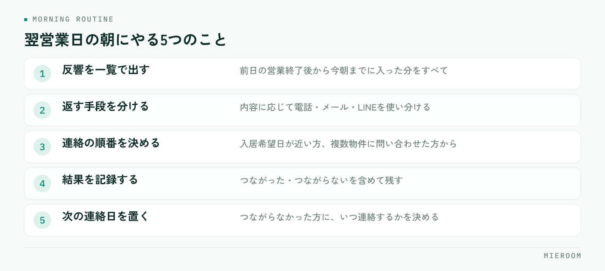

<!--META
{
  "title": "営業時間外に入った反響の拾い方｜翌営業日までの連絡と取りこぼしの防ぎ方",
  "date": "2026-10-28",
  "category": "集客・広告",
  "excerpt": "夜間や定休日に入った問い合わせを取りこぼさないための進め方をまとめました。自動返信に入れる項目、翌営業日の朝にやる順番、定休日と連休の扱い、時間外の反響を数える方法まで整理しています。",
  "hook": "営業時間外の反響は、翌朝の形で決まる",
  "tags": ["反響対応", "営業時間外", "問い合わせ", "集客", "賃貸仲介"]
}
META-->

ポータルサイトからの問い合わせは、店が開いている時間に合わせて入るわけではありません。仕事終わりの夜、休みの日、引っ越しを考え始めた深夜。**時間外に入った反響をどう扱うかは、返信の速さよりも、翌営業日の朝の動き方で決まります**。

  <h4>この記事の結論</h4>
  
営業時間外の反響で取りこぼしが起きるのは、夜に返せないからではありません。<strong>翌朝に誰が、どの順番で、何を見るかが決まっていないから</strong>です。自動返信で「いつ連絡するか」を伝え、翌朝の最初の30分を反響対応に固定するだけで、放置される反響はほとんど無くなります。

## 反響は、店が開いている時間だけには入らない

賃貸を探しているお客様の多くは、働きながら部屋を探しています。物件をじっくり見るのは帰宅後や休日になり、問い合わせもその時間に入ります。店舗が営業している平日の昼間は、お客様にとっていちばん問い合わせしづらい時間帯です。

つまり、営業時間外の反響は例外ではなく、通常の流れの一部です。にもかかわらず、対応の段取りは営業時間内を前提に組まれていることが多くあります。

ここで起きるのが、翌朝の取りこぼしです。夜のうちに入った反響が、朝の来店対応や電話に押されて後回しになり、気づいたときには他店で内見が決まっている。返信が遅れたというより、**朝の時点で反響が見える場所に出ていない**ことが原因です。反響そのものの残し方は[反響の管理方法](./hankyo-kanri-hoho.html)に整理しています。

## 取りこぼしは「返信の速さ」ではなく「翌朝の順番」で決まる

夜間の反響に対して、スタッフが自宅から返信する運用を取っている店舗もあります。ただ、これを続けると担当者の負担が偏り、休みの日に連絡が取れる人とそうでない人の差が出ます。長く続く形にはなりません。

現実的なのは、夜のうちに自動で一次返信を出し、人が動くのは翌営業日の朝に寄せる形です。お客様が気にしているのは即座に返事が来ることではなく、**自分の問い合わせが届いているかどうか、いつ連絡が来るのか**です。ここが分かっていれば、翌朝の連絡でも十分に間に合います。

逆に、何の反応もないまま一晩が過ぎると、お客様は届いていないと判断して別の店舗に問い合わせます。差がつくのは返信の速さではなく、届いたことを伝えているかどうかです。反響への初動の考え方は[反響対応のスピード](./lead-response-speed.html)でも触れています。

## 自動返信に入れる項目を決める

自動返信は、送っていること自体より中身で差が出ます。定型文のまま使うのではなく、次の項目を入れてください。

| 入れる項目 | 書き方 | なぜ必要か |
|---|---|---|
| 届いたことの確認 | 問い合わせを受け付けた旨を1文で | 届いていない不安を消す |
| いつ連絡するか | 「翌営業日の午前中にご連絡します」 | 待てばよいと分かる |
| 店舗の営業時間と定休日 | 曜日と時間をそのまま記載 | 連絡が取れる時間が分かる |
| 問い合わせた物件名 | お客様が選んだ物件を再掲 | 複数問い合わせても取り違えない |
| 急ぐ場合の連絡手段 | 電話番号やLINEなど、店舗で受けられるもの | 内見を急ぐ方を逃さない |

とくに2つめが効きます。「後ほどご連絡します」では、いつまで待てばよいか分かりません。時間を書くほうが、待っていただける確率は上がります。

## 翌営業日の朝にやる順番を固定する

朝の動きが毎日違うと、反響の確認は必ず後回しになります。開店後の最初の時間を、反響対応に固定してください。

<figure class="fig"><figcaption>最後の「次の連絡日を決める」を外すと、その反響はそこで止まります。</figcaption></figure>

1. 前日の営業終了後から今朝までに入った反響を、すべて一覧で出す
2. 問い合わせの内容で、電話・メール・LINEのどれで返すかを分ける
3. 入居希望日が近い方、複数物件に問い合わせている方から連絡する
4. 連絡した結果を、つながった・つながらないを含めて記録する
5. つながらなかった方に、次にいつ連絡するかを決める

5つめを決めずに終えると、その反響はそのまま止まります。つながらなかった時点で次の連絡日を置いておけば、追いかけが続きます。

  
✓朝いちばんの電話は時間帯を選ぶ

  
出勤前の時間帯に電話をかけると、出られないことが多くなります。夜間に入った反響でも、電話は9時以降、メールやLINEは朝のうちに送る、というように手段で分けると、つながる率が変わります。

## 定休日と連休は、別の扱いにする

1日空くだけの夜間と、2日以上連絡が取れない定休日・連休では、対応を変える必要があります。

定休日の自動返信には、次の営業日を具体的に書いてください。「定休日のため」とだけ書くと、いつ連絡が来るのか分かりません。年末年始や夏季休業のように連休が長くなるときは、休業前から自動返信の文面を切り替えておきます。

もうひとつ、連休明けは反響が溜まります。通常の朝と同じ段取りでは終わりません。連休明けの午前中は来店対応を入れず、反響の連絡に充てる日として先に決めておくと、取りこぼしが減ります。シフトを組む段階で、連休明けの朝に人を厚くしておくのが現実的です。

## 時間外の反響を数えておく

対応の形を決めたら、その結果を数字で見てください。見るのは次の3つです。

- 営業時間外に入った反響の件数（曜日別・時間帯別）
- そのうち、翌営業日に連絡がついた件数
- 連絡がつかないまま終わった件数

これを数か月続けると、自店の反響がどの時間帯に集中しているかが見えてきます。夜の遅い時間に偏っているなら自動返信の文面を厚くする、土日の夜が多いなら月曜の朝の人員を見直す、というように、手の打ち方が具体的になります。

感覚で「夜の問い合わせは多い」と話すより、曜日と時間帯で出したほうが、スタッフにも伝わります。**数えていない取りこぼしは、無かったことになります**。

夜間の問い合わせに、その場で返信したほうが有利ですか？

返信できる体制があるなら有利に働きます。ただし、特定のスタッフの負担で成り立っている場合は長続きせず、その人が休むと止まります。自動返信で受付と連絡予定を伝え、翌朝に人が確実に連絡する形のほうが、店舗としては安定します。深夜に無理をして返すより、翌朝の最初の時間を空けておくほうが効果があります。

自動返信を送ると、機械的な印象になりませんか？

文面次第です。問い合わせた物件名を入れる、連絡する時間を書く、店舗の営業時間を添えるといった具体的な情報が入っていれば、受け取る側は「届いた」と判断できます。印象が悪くなるのは、何も入っていない定型文を送ったときです。送らずに一晩放置するほうが、印象への影響は大きくなります。

定休日に入った反響は、翌営業日のいつ連絡すべきですか？

開店後の午前中が基本です。定休日が明けた日は来店や電話も重なるため、開店直後の時間を反響対応に充てると決めておいてください。あわせて、自動返信に次の営業日を書いておけば、お客様もその日を待ってくださいます。連休明けは件数が増えるので、その日は来店予約を詰め込みすぎない組み方が有効です。

## まとめ：翌朝の30分を先に決めておく

営業時間外の反響で差がつくのは、夜のうちに返せるかどうかではありません。届いたことと連絡する時間を自動返信で伝え、翌営業日の朝に見る順番を固定する。この2つだけで、放置される反響は大きく減ります。

そのうえで、時間外に入った件数と連絡がついた件数を数えておけば、自店の反響がどこに集中しているかが分かり、シフトや文面の見直しにつながります。**取りこぼしは、仕組みの問題であって担当者の気合いの問題ではありません**。

[ミエルーム](../index.html)なら、ポータルサイトからの反響をフォーム自動取込・メール自動取込で営業時間外もそのまま反響管理に取り込めるので、翌朝は入った反響を一覧で見るところから始められます。LINE・SMSの自動追客でつながらなかった方への連絡も止まらず、反響分析で曜日や時間帯ごとの傾向も確認できます。朝いちばんにメールの受信箱をさかのぼる作業が無くなり、誰が出勤しても同じ順番で反響を拾えるようになります。デモアカウントの発行やご相談は、この下のボタンからお気軽にどうぞ。
