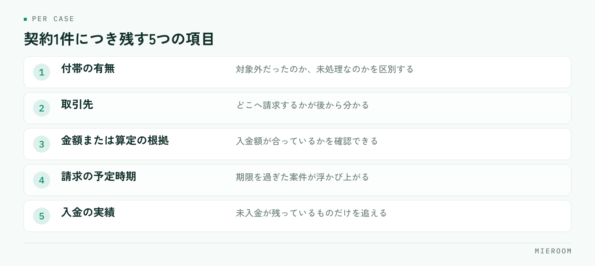

<!--META
{
  "title": "賃貸仲介の付帯収益の管理｜保険や保証会社の手数料を取りこぼさない",
  "date": "2026-10-25",
  "category": "売上管理",
  "excerpt": "仲介手数料以外の収益は、案件ごとに記録していないと取りこぼしに気づけません。付帯収益になるものの洗い出し方、漏れが起きる場面、案件ごとに残す項目、確定と見込みの分け方までを整理しました。",
  "hook": "手数料の取りこぼしは、記録の形で防ぐ",
  "tags": ["売上管理", "付帯収益", "請求漏れ", "店舗運営", "賃貸仲介"]
}
META-->

賃貸仲介の店舗で見落とされやすいのが、仲介手数料以外の収益です。保険や保証会社の手数料、鍵交換やクリーニングの手配分。**一件ごとの金額が小さいため、抜けても誰も気づかないまま決算まで進みます**。防ぐ方法は、記録の形を変えることです。

<h4>この記事の結論</h4>
付帯収益の取りこぼしは、気をつけることでは防げません。<strong>案件ごとに「どの付帯があるか」を契約時点で記録し、入金まで追える形にすること</strong>が唯一の対策です。合計の売上だけを見ていると、抜けている分は最後まで見えません。

## 付帯収益は、抜けても誰も気づかない

仲介手数料は、抜ければすぐ分かります。契約した案件に対して入金がなければ、お客様との間で話になるからです。

付帯収益はそうなりません。保険の手数料が入らなくても、お客様からは何も言われません。保証会社からの手数料も、鍵交換の手配分も同じです。相手は保険会社や取引先で、入金の時期も契約日とずれます。**請求も入金も「気づいた人が動く」形になっているため、担当が忙しい月にそのまま流れます**。

もう一つ厄介なのが、金額の小ささです。一件あたりでは大きくないので、抜けても月の売上はそれらしい数字になります。おかしいと思う材料がないまま期が終わり、翌期も同じ形が続きます。

## 何が付帯収益になるかを、店舗で一度書き出す

対策の最初は、洗い出しです。自店で収益が発生するものを、取引先ごとに全部書き出してください。扱いのある店舗で挙がるのは、おおむね次のあたりです。

- 火災保険（損害保険）の代理店手数料
- 家賃保証会社からの事務手数料
- 鍵交換やシリンダー交換の手配分
- 室内クリーニング・消臭施工などの手配分
- インターネット回線や引越しの紹介分
- 入居者向けサポートサービスの取扱分

このうち何を扱っているかは店舗によって違います。重要なのは、**扱っているものを全部挙げ、それぞれ「誰が・いつ請求し、いつ入るか」を1行で書けるようにすること**です。書けないものが出てきたら、そこが取りこぼしている場所です。

✓資格が必要なものを分けておく

保険の募集は、損害保険募集人の登録を受けた人でなければ行えません。誰が募集できるかを店舗で明確にしておくと、担当者の異動や退職のときに手続きが止まりません。洗い出しの段階で、資格が必要なものに印を付けておくと管理しやすくなります。

## 漏れが起きるのは、この3つの場面

実務で抜けるのは、だいたい決まった場面です。

1つ目は**契約時に話が出なかった場合**です。お客様が保険を自分で手配する、鍵交換を希望しない。そうした判断は現場で起きますが、どこにも記録が残らないと、あとから「本来あったはずの付帯がない」のか「そもそも対象外だった」のかが分かりません。

2つ目は**担当者が変わった場合**です。契約した担当と、入居後の対応をする担当が違うとき、請求の予定だけが引き継がれません。担当の引き継ぎで残す項目は[担当引き継ぎの記録](./tantou-hikitsugi-kiroku.html)に整理しています。

3つ目は**繁忙期**です。件数が増える時期に、締めの作業だけが後ろに回ります。3月の契約の付帯分を5月に探す形になると、資料を見つけるところから始まります。

## 案件ごとに残す項目を固定する

取りこぼしを防ぐには、案件に紐づけて残すしかありません。契約1件につき、次の項目が埋まる形にしてください。

<figure class="fig"><figcaption>対象外だった案件も記録すると、追わなくてよいものが確定します。</figcaption></figure>

| 残す項目 | 何のために残すか |
|---|---|
| 付帯の有無 | 対象外だったのか、未処理なのかを区別する |
| 取引先 | どこへ請求するかが後から分かる |
| 金額または算定の根拠 | 入金額が合っているかを確認できる |
| 請求の予定時期 | 期限を過ぎた案件が浮かび上がる |
| 入金の実績 | 未入金が残っているものだけを追える |

ポイントは、1行目の「付帯の有無」です。**対象外だったことを記録しておかないと、確認するたびに同じ案件を調べ直すことになります**。お客様が自分で保険に入った案件は、その旨が残っていれば、それ以上触る必要がなくなります。

## 確定した分と、見込みの分を分けて見る

付帯収益は、契約した時点では見込みです。入金されて初めて確定します。この2つを同じ欄に入れると、月の売上が実態より大きく見えます。

分けて持つと、見るべきものが自然に決まります。見込みのまま請求予定日を過ぎているものが、追うべき案件です。合計だけを見ていると、この並びが作れません。

月末の集計そのものを軽くする考え方は[月末の売上集計を自動化する](./getsumatsu-uriage-shukei-jidoka.html)、後ADの入金を追う形は[後ADの入金管理表](./go-ad-nyukin-kanrihyo.html)にまとめています。付帯収益も、入金の時期が契約とずれるという点では後ADと同じ構造です。

!合計だけを追わない

「今月の付帯収益はいくらだったか」を追っても、取りこぼしは見えません。合計が前月と似ていれば、抜けていても違和感が出ないからです。見るのは合計ではなく、請求予定日を過ぎて入金がない案件の一覧です。

## Excelで管理するときに詰まるところ

最初はExcelで足ります。契約の一覧に付帯の列を足し、請求予定日と入金日を入れるだけで、取りこぼしはかなり減ります。

詰まるのは次の段階です。付帯の種類が増えると列が横に伸び、1件が1行で収まらなくなります。取引先ごとにシートを分ければ、今度は案件との突き合わせが手作業になります。担当者が同時に開けないため、入力は締めの直前にまとめて行われ、結局は記憶から書く形に戻ります。

紙とExcelが混在した状態からの移し方は[紙とExcelが混在した状態からの移行](./kami-excel-konzai-ikou.html)にまとめています。付帯収益だけを別で管理しようとすると二重入力になるため、**案件の記録そのものに付帯の欄を持たせる形**を先に考えてください。

付帯収益は毎月いくらを目標にすべきですか？

金額の目標を先に置くより、取りこぼしをゼロにするほうが先です。扱いのある付帯について、対象だった案件のうち処理済みの件数がどれだけあるかを見てください。ここが埋まっていない状態で目標を立てると、現場は新しい提案を増やす方向に動きます。先に漏れを止めてから、提案の話に進むほうが無理がありません。

お客様が自分で保険に入る場合、記録は不要ですか？

記録してください。対象外だったことが残っていないと、確認のたびに同じ案件を調べ直すことになります。「自己手配」と1つ入れておけば、未処理の一覧から外れます。記録の目的は売上を作ることではなく、追わなくてよい案件を確定させることです。

担当者ごとの成績に付帯収益を入れるべきですか？

入れる場合は、仲介手数料と分けて見える形にしてください。合算すると、どちらで伸びたのかが分からなくなります。また、付帯の提案は案内の内容によって機会そのものが変わるため、件数だけで比べると不公平が出ます。成績の見方は[スタッフごとの成績管理](./staff-seiseki-kanri.html)に整理しています。

## まとめ：記録の形を変えないと、取りこぼしは止まらない

付帯収益の管理は、担当者の注意力で解決する話ではありません。扱っているものを洗い出し、案件ごとに「付帯の有無・取引先・金額の根拠・請求予定・入金実績」を残す。これだけで、追うべき案件が自動的に浮かびます。

見るのは合計ではなく、請求予定日を過ぎて入金がない案件です。そして確定した分と見込みの分を分ける。**取りこぼしは、見える形にした瞬間に止まります**。

[ミエルーム](../index.html)なら、申込・入金管理の中で案件ごとに入金を記録でき、一部入金や分割入金もそのまま残せます。確定売上と見込みが分かれて表示されるため、入金がまだの案件だけを見る形が最初から作れます。契約の記録と別にExcelを持つ必要がなくなり、月末に突き合わせる作業もなくなります。いまお使いのExcelデータのインポートと初期設定の代行にも対応し、最短即日から始められます。デモアカウントの発行やご相談は、この下のボタンからお気軽にどうぞ。
