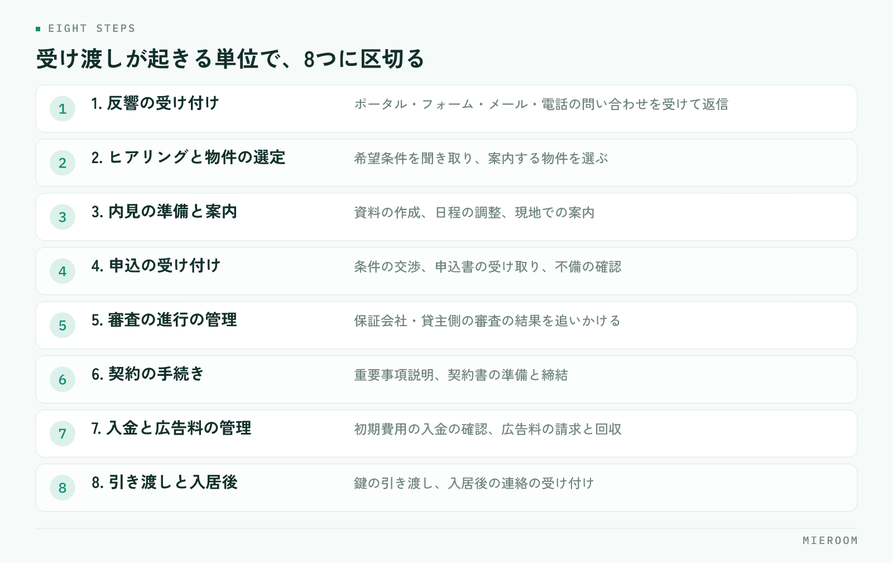

<!--META
{
  "title": "賃貸仲介の業務分担の決め方｜一貫担当と分業の分かれ目",
  "date": "2026-11-26",
  "category": "組織・育成",
  "excerpt": "賃貸仲介の店舗で役割分担を見直すときの決め方を整理しました。仕事を8つの工程に分けた棚卸し、一貫担当と分業で起きることの違い、決める前に確かめる4つ、受け渡しで残す情報、崩れないためのチェックリストまでをまとめています。",
  "hook": "反響から申込まで、誰がどこまで持つか",
  "tags": ["組織づくり", "役割分担", "店舗運営", "繁忙期", "賃貸仲介"]
}
META-->

人が増えたのに、以前より回らない。繁忙期は全員が全部をやるしかなく、お客様をお待たせしてしまう。賃貸仲介の店舗で、人数が3人を超えたあたりから出てくるご相談です。結論から申し上げると、**分担が決まらないのは、仕事を工程に分けないまま人に割り当てている**ためです。この記事では、分担の決め方を順番で整理します。

<h4>この記事の結論</h4>
業務分担は、人に割り当てる前に仕事を工程へ分けるところから始めます。判断の軸は<strong>反響の量とスタッフの経験</strong>の2つで、どちらも足りない店舗が分業にすると引き継ぎの手間だけが増えます。分けるなら、受け渡しの場所と残す情報を先に決めてください。

## 分担で迷うのは、繁忙期と閑散期で合う形が違うから

賃貸仲介の店舗の分担が決まりにくいのは、年間を通じて同じ形が最適にならないためです。

閑散期は、反響の数が落ち着いています。一人のスタッフが反響の受け付けから案内、申込、契約まで通して担当しても、無理なく回ります。むしろ通したほうが、お客様の希望の変化を取りこぼさずに済みます。

一方、繁忙期は反響が一気に増えます。案内に出ている間に新しい反響が入り、電話が鳴り、申込書の不備の確認が重なります。一人で全部を持つ形のままだと、案内中は反響対応が止まり、事務作業は夜に回ります。

ここで「では分業にしよう」と決めても、繁忙期が終われば反響は減り、受け渡しの手間だけが残ります。つまり、どちらかが正解という話ではありません。**自店が今どちらの状態にあるかを決めてから、分担の形を選ぶ**のが順番です。

もう一つ、形が決まらない理由があります。分担の話が人の話から始まることです。誰が何をやるかの前に、何という仕事があるのかを並べていないため、割り当てた後に「これは誰の担当か」が毎回出てきます。先にやるのは棚卸しです。店長自身の仕事の整理は[店長の仕事の段取り](./tencho-shigoto-dandori.html)にも分けて書いています。

## 賃貸仲介の仕事を8つの工程に分けて棚卸しする

分担を考える前に、店舗で発生している仕事を工程に分けます。細かく分けすぎると運用できないので、受け渡しが起きる単位で区切ります。

<figure class="fig"><figcaption>今それぞれを誰がやっているかを書き込むと、担当のない工程が見えます。</figcaption></figure>

この8つを紙に書き出し、今それぞれを誰がやっているかを書き込みます。ここで、一人に偏っている工程と、誰の担当でもない工程が見えます。実務で問題になりやすいのは後者です。申込書の不備の確認や、審査の結果待ちの追いかけは、担当が決まっていないまま「気づいた人がやる」で回っていることがよくあります。

### 棚卸しのときに一緒に書くこと

- その工程が1件あたりどのくらい時間を取るか（おおよそで構いません）
- お客様をお待たせする工程かどうか
- その工程を担当できるスタッフが何人いるか
- 止まったときに誰が気づく仕組みがあるか

4つ目が空欄の工程は、分担を変える前に対処が要ります。担当を分けると、止まっても他の人に見えなくなるためです。

## 一貫担当と分業で、それぞれ何が起きるか

どちらの形にも、必ず付いてくる現象があります。先に知っておくと、形を選んだあとに慌てずに済みます。

| 見る点 | 一貫担当（1人が通して持つ） | 分業（工程ごとに担当を置く） |
|---|---|---|
| お客様から見た分かりやすさ | 窓口が1人で、経緯を繰り返し話さなくてよい | 担当が変わるため、引き継ぎが甘いと同じ話を繰り返す |
| 対応の速さ | 担当が案内に出ていると止まる | 入口の対応が止まりにくい |
| スタッフの育ち方 | 全工程を覚えるので早く一人前になる | 担当の工程は速くなるが、全体が見えにくい |
| 繁忙期の耐える力 | 一人の持ち件数が上限に達すると詰まる | 工程ごとに人を足せるので伸ばしやすい |
| 必要な記録の量 | 担当の頭の中で足りてしまう | 受け渡しのための記録が必須になる |
| 不在・退職のとき | 経緯が追えず、引き継ぎに時間がかかる | 工程ごとに代わりが立てやすい |

表の最後の2行が、分業にするときの条件です。分業は記録の量が増える形なので、記録が残る仕組みがないまま分けると、受け渡しのたびに口頭で確認する時間が発生します。**分業の成否を決めるのは人の配置ではなく、記録が残っているかどうか**です。

逆に、一貫担当の弱点は属人化です。担当が休んだ日に問い合わせが来ると、ほかのスタッフが答えられません。一貫担当を続けるなら、最低限の記録だけは共有の場所に残す運用にしておきます。

## 分担を決める前に確かめる4つと、繁忙期だけ分けるという選び方

形を選ぶ前に、次の4つを確かめます。

一つ目は、反響の量です。一人あたりの対応件数が、案内に出ている時間に食われて落ちているなら、入口だけでも分ける価値があります。逆に反響が少ない時期に分けると、手が空く担当が出ます。

二つ目は、スタッフの経験です。全員が全工程をこなせる店舗は、繁忙期だけ分業に切り替えられます。経験が浅いスタッフが多い場合は、工程を分けて1つずつ覚えてもらう形が現実的です。

三つ目は、店舗の数です。複数店舗なら、事務の工程をまとめて1か所で持つ形が取れます。1店舗なら工程の分け方で調整します。

四つ目は、お客様をお待たせしてよい時間です。反響への返信は早いほど結果につながるため、ここは分けて速さを確保する判断をしやすい工程です。

✓通年で変えなくてよい

分担は年間で1つに固定しなくて構いません。<strong>閑散期は一貫担当、繁忙期は入口と事務だけ分ける</strong>という形が、賃貸仲介では取りやすい運用です。切り替える時期と、そのとき誰が何を持つかを先に決めておけば、繁忙期に入ってから相談する必要がなくなります。

切り替えを前提にする場合、決めておくのは3つだけです。いつから切り替えるか、切り替えたとき各自が持つ工程、戻すのはいつか。これを紙にしておくと、毎年同じ議論をしなくなります。

## 分けるなら、受け渡しの場所と残す情報を先に決める

分業で失敗する場所は、ほぼ受け渡しに集まります。渡したつもりで渡っていない、渡したが情報が足りない、どちらの担当か分からず止まる。この3つです。

防ぐには、工程と工程のつなぎ目ごとに次の2つを決めます。どこに書けば渡したことになるのか。何が書かれていれば受け取った側が動けるのか。

### 受け渡しで最低限残す情報

- 希望条件（賃料の上限、エリア、入居の時期、人数、譲れない条件）
- これまでに案内した物件と、その反応
- お客様に伝えた内容と、約束した次の連絡の時期
- 審査や書類で、今止まっている項目
- 連絡の取りやすい時間帯と、連絡の手段

この5つが案件ごとに1か所にそろっていれば、担当が変わっても同じ話を繰り返さずに進められます。逆に、どれか欠けているまま渡すと、受け取った側がお客様に聞き直すことになり、お客様の側から見た店舗の印象が落ちます。ヒアリングの項目の整え方は[来店時のヒアリング項目](./raiten-hearing-koumoku.html)にまとめています。

受け渡しの場所は、1案件につき1か所にします。管理表とメモ帳と口頭が混ざると、どこが最新か分からなくなります。

## 決めたあとに崩れないためのチェックリストと、よくある失敗

分担を決めても、数週間で元に戻ることがあります。戻る原因は決まっているので、次の項目で確かめます。

- 工程の一覧があり、それぞれの担当が書かれているか
- 誰の担当でもない工程が残っていないか
- 受け渡しの場所が1案件1か所に決まっているか
- 受け渡しで残す情報が項目として決まっているか
- 工程が止まったときに気づく人が決まっているか
- 担当が休んだ日の代わりが決まっているか
- 繁忙期に切り替える形と、切り替える時期が決まっているか
- 分担の内容を、新しく入ったスタッフに渡せる形で書いてあるか
- 月に一度、分担が実態と合っているかを見直す場があるか

### よくある失敗と、その避け方

**人に合わせて分担を決める**。得意な人に寄せると、その人が休んだ日に止まります。先に工程を決め、そこに人を当てる順番にします。

**受け渡しを口頭で済ませる**。忙しい日に限って抜けます。書く場所を決めておけば、渡し忘れが残った記録で分かります。

**分けすぎて全体を見る人がいなくなる**。工程ごとに担当を置くと、案件全体がどこで止まっているかを見る人が不在になります。案件の全体を見る役は、必ず1人置きます。

**成果の見え方を変えないまま分業にする**。反響の対応を担当した人と、申込まで進めた人が別になるのに、評価が成約の件数だけだと不公平が出ます。工程ごとの貢献が見える形を先に用意します。成績の見方は[スタッフの成績管理](./staff-seiseki-kanri.html)に整理しています。

**繁忙期に入ってから分担を変える**。混む時期に新しい運用を始めると、覚える手間が重なります。変えるのは閑散期で、繁忙期は決めた形を回すだけにします。

## 自分で進める場合と、ツールに任せる場合の分かれ目

分担の見直しは、紙と表計算でも進められます。分かれ目は次の3点です。

1つ目は、案件の数です。同時に動いている案件が担当者の頭の中で把握できる範囲なら、口頭の確認でも回ります。数が増えて「あの件はどうなったか」を毎日聞くようになったら、記録の置き場所を仕組みにする段階です。

2つ目は、受け渡しの回数です。工程を分けるほど受け渡しは増えます。回数が増えてから記録の形を決めると、過去の案件だけ情報が足りない状態が残ります。分ける前に形を決められるかどうかが分かれ目です。

3つ目は、止まった案件に気づけるかどうかです。人の目で気づける件数には上限があります。審査待ちや書類待ちのまま日数が経った案件を探す作業が毎週発生しているなら、一覧で見える形にしたほうが早くなります。

判断の目安は、分担を変えたあとに増える確認作業の量です。口頭で吸収できる範囲なら、運用の工夫で足ります。確認のために手が止まるようになったら、記録を置く場所から整えます。

## よくある質問

スタッフが2人の店舗でも分担を決めたほうがよいですか？

工程を分けて割り当てる必要はありませんが、棚卸しだけは行う価値があります。2人でも、誰の担当でもない工程は必ず出ます。申込書の不備の確認や審査の追いかけを、どちらが見るか決めておくだけで、抜けが減ります。形としては一貫担当のまま、止まったときに気づく役だけを決める運用が合います。

分業にすると、お客様が「担当が変わった」と不安に思いませんか？

引き継ぎの質で決まります。受け取った側が、希望条件と案内済みの物件、前の担当が約束した内容を把握していれば、不安にはなりにくいものです。逆に、同じ質問を繰り返したり、約束を知らずに別の案を出したりすると、担当の数に関係なく信用を落とします。引き継ぐときは、誰が引き継いだかをお客様に先に伝えてください。

繁忙期だけ分けると、スタッフが混乱しませんか？

切り替える時期と、そのとき誰が何を持つかを先に紙にしておけば、混乱は小さく収まります。混乱が起きるのは、繁忙期に入ってから相談して決める場合です。閑散期のうちに一度だけ練習として分けて回してみると、本番で迷う場所が事前に分かります。

新しく入ったスタッフには、どの工程から任せるのがよいですか？

お客様をお待たせしない工程で、やり直しがきく工程から任せるのが基本です。物件資料の作成や、反響の一次受け付けの定型の返信は、形が決まっているため早く覚えられます。条件の交渉や申込の判断は、経緯の把握が必要なので後になります。覚える順番は店舗の反響の経路によって変わるので、工程の一覧を見ながら決めてください。

分担を決めても守られないときは、どうすればよいですか？

守れない工程に理由があることが多いので、まずその工程の手間を確かめてください。受け渡しのために転記が必要だったり、書く場所が複数あったりすると、忙しい日に飛ばされます。決めたことを徹底する前に、手間そのものを減らせないかを見るほうが早く定着します。

## まとめ：人に割り当てる前に、仕事を工程に分ける

業務分担を決める順番は決まっています。まず店舗の仕事を受け渡しが起きる単位で工程に分け、今の担当を書き込む。誰の担当でもない工程を見つける。反響の量とスタッフの経験、店舗の数、お客様をお待たせしてよい時間を確かめる。一貫担当と分業のどちらに寄せるかを決め、分けるなら受け渡しの場所と残す情報を先に決める。繁忙期だけ切り替える形も選べます。

逆に、人の得意不得意から分担を決めると、その人が休んだ日に止まり、退職のときに経緯が追えなくなります。分担は、人を割り振る作業ではなく、仕事の形を決める作業です。

ミエルームなら、反響の受け付けから接客、申込、入金までを案件ごとに1行で記録できるため、担当を分けても、希望条件や案内した物件、今止まっている項目を担当者に聞かずに確かめられます。フォームとメールからの反響は自動で取り込まれるので、入口の担当が転記する手間もかかりません。接客と反響の成績は工程ごとに見えるため、分業にしたあとの貢献も評価に反映できます。受け渡しのたびに確認する時間と、止まった案件を探す作業がなくなります。機能の詳細は[ミエルームの機能一覧](../features.html)をご覧ください。資料のご請求やデモアカウントの発行は、この下のボタンからお気軽にどうぞ。
