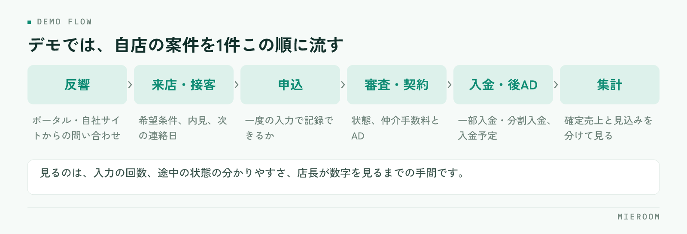

<!--META
{
  "title": "業務管理システムのデモで確かめること｜賃貸仲介の店舗が見るべき場面",
  "date": "2026-11-28",
  "category": "DX",
  "excerpt": "賃貸仲介の店舗が業務管理システムのデモや説明の場で何を確かめればよいかを、反響から来店・接客、申込から入金・後AD、店長が数字を見る場面に分けて整理しました。デモの前に用意するもののチェックリストと、よくある失敗もまとめています。",
  "hook": "機能の数ではなく、自店の1日を流して見る",
  "tags": ["業務管理システム", "システム選定", "デモ", "店舗運営", "賃貸仲介"]
}
META-->

業務管理システムを比べるとき、デモや説明の場は「よさそうだった」という印象だけで終わりがちです。けれども導入してから困るのは、画面の見た目ではなく、自店の仕事の流れに合うかどうかです。**業務管理システムのデモで確かめるべきなのは、機能の数ではなく自店の1日の流れ**です。この記事では、賃貸仲介の店舗がデモで見るべき場面と、確かめる項目を整理します。

<h4>この記事の結論</h4>
デモの前に自店の業務を場面ごとに書き出し、<strong>反響から入金・後ADまでの実際の案件を1件流してもらう</strong>形で確かめると、導入後のずれが減ります。見るのは機能の有無より、入力の回数、途中の状態の分かりやすさ、店長が数字を見るまでの手間です。

## デモは「機能の数」ではなく「自店の1日」で見る

デモの場では、多くの場合、システムの機能が順番に紹介されます。反響の管理、顧客の管理、申込の管理、売上の集計と、一つひとつは便利に見えます。ところが、機能が揃っていることと、自店の仕事が楽になることは同じではありません。

<figure class="fig"><figcaption>機能ごとの説明では見えない、場面と場面の受け渡しを確かめます。</figcaption></figure>

賃貸仲介の店舗の仕事は、一件の案件が反響から始まり、来店、内見、申込、審査、契約、入金、後ADの回収へと流れていきます。困るのはたいてい、この流れの**受け渡しの部分**です。反響の情報を接客の記録に移すとき、申込の内容を売上の表に写すとき、入金を確認して後ADの残りを追うとき。機能ごとのデモでは、この受け渡しが見えません。

そこでデモでは、機能の紹介を一通り聞いたあとに、自店でよくある案件を1件、最初から最後まで流してもらうよう頼みます。どこで何回入力するのか、同じ情報を二度打つ場面があるか、途中の状態がひと目で分かるか。この3点を見るだけでも、印象ではなく自店の基準で比べられるようになります。

どんな機能が必要かを先に整理したい場合は、[賃貸仲介の店舗向けツールに必要な機能](./tenpo-muke-tool-hitsuyo-kino.html)もあわせてご覧ください。

## デモの前に用意するもの（チェックリスト）

デモで確かめる内容は、デモの前の準備でほぼ決まります。何も用意せずに臨むと、説明する側の進め方に沿って話が進み、自店にとって大事な場面を見ないまま終わります。次の項目を、デモの前に手元にそろえておきます。

- 自店の業務を、反響・来店・接客・申込・契約・入金・後ADの場面ごとに書き出したメモ
- 今使っているExcelや紙の管理表（申込管理表、反響の一覧、売上の集計表など）の見本
- 最近の案件から、流してもらいたい例を1〜2件（個人名は伏せる）
- 今の管理で「二度打ちしている」「探すのに時間がかかる」と感じている作業の一覧
- 店長・オーナーが毎日・毎週・毎月見ている数字の一覧
- 誰が入力し、誰が見るのか（スタッフ、事務、店長、オーナー）の分担
- 移したい過去のデータの範囲（いつからの、どの表か）
- デモに同席してもらう人（実際に毎日入力するスタッフを1人入れる）

特に、実際に毎日入力するスタッフの同席は大切です。店長やオーナーだけで見ると、集計や一覧の画面に目が行き、入力の手間を見落としがちです。入力する人が「これなら続けられる」と感じるかどうかが、導入後に定着するかどうかを左右します。

## 反響から来店・接客までの場面で確かめること

反響の場面で確かめたいのは、ポータルサイトや自社サイトからの問い合わせが、どのような手順でシステムに入るかです。問い合わせのメールを見て手で打ち込むのか、フォームやメールの内容が取り込まれるのかで、繁忙期の手間が大きく変わります。

デモでは次の点を見ます。

- 問い合わせが入ってから、担当者が対応を始めるまでに、何回の操作が必要か
- 同じお客様から別の物件で問い合わせがあったとき、重ならずに1人として扱えるか
- 返信したか、来店の約束が取れたかといった途中の状態が、一覧でひと目で分かるか
- 担当者が休みの日に、別のスタッフが続きを引き継げるだけの記録が残るか

接客の場面では、来店したお客様の希望条件や内見した物件、次に連絡する日をどこに残すかを確かめます。接客の記録が反響の記録とつながっていれば、「どの媒体から来たお客様が申込まで進んだか」を後から追えます。ここがつながっていないと、反響の数と成約の数は分かっても、その間で何が起きたかが分かりません。

追客の連絡を自動で送る仕組みがある場合は、送る内容を店舗で決められるか、送ったことが記録に残るかも見ておきます。

## 申込から入金・後ADまでの場面で確かめること

申込から先の場面は、デモで最も時間をかけてほしい部分です。売上に直結するうえ、月をまたいで状態が変わるため、管理の仕組みの差がはっきり出ます。確かめる項目を表にまとめます。

| 場面 | デモで確かめること | 見落としやすい点 |
|---|---|---|
| 申込 | 申込の内容を一度の入力で記録できるか | 反響・接客の記録から引き継げるか |
| 審査 | 審査中・承認・否決などの状態を持てるか | キャンセルになった案件の扱い |
| 契約 | 仲介手数料と広告料（AD）を案件ごとに記録できるか | 契約日と入金日が別の月になる場合 |
| 入金 | 一部入金や分割入金を記録できるか | 入金が済んだ分と残りの分を分けて見られるか |
| 後AD | 入金予定を案件ごとに残し、未回収を一覧で追えるか | 回収の漏れに気づける仕組みがあるか |
| 集計 | 確定売上と見込みを分けて表示できるか | 月末に手で突き合わせる作業が残らないか |

デモで実際に案件を流してもらうときは、あえて少し複雑な例を選びます。申込は今月、契約は来月、後ADの入金はさらに先、という案件です。この例で、一件の案件が月をまたいでも同じ場所で追えるか、途中で別の表に書き写す場面がないかを見ます。

単純な例だけを見ると、どのシステムも同じように見えます。自店で実際に手間がかかっている例を流すことで、違いが見えてきます。

## 店長・オーナーが数字を見る場面で確かめること

入力の場面と同じくらい大切なのが、店長やオーナーが数字を見る場面です。システムを入れる目的の一つは、月末に集計表を作る時間をなくし、月の途中で手を打てるようにすることだからです。

デモでは、店長が毎朝・毎週見ている数字を伝えて、それがどの画面で、何回の操作で見られるかを確かめます。見るポイントは次のとおりです。

- 反響の数、来店の数、申込の数が、媒体ごと・担当者ごとに分けて見られるか
- 担当者ごとの接客や反響対応の成績が、本人にも分かる形で見られるか
- 確定した売上と、手続きが進んでいる見込みの売上が分かれているか
- 店舗が複数ある場合、店舗ごとと全体の両方で見られるか
- 見たい数字を出すために、別のファイルに書き出して加工する必要がないか

最後の点は特に大切です。画面で見られる数字が限られていて、結局はデータを書き出して表計算で加工しているのであれば、集計の手間はあまり減りません。今の集計表を見本として持っていき、同じ数字がそのまま出せるかを確かめます。

## デモの確認でよくある失敗と、その避け方

デモでの確認には、つまずきやすいところがあります。代表的なものと避け方をまとめます。

**説明の流れに任せて、自店の例を流さない**。用意された説明は、そのシステムの得意な場面から順に進むのが自然です。それ自体は問題ありませんが、自店の例を流す時間を最初にお願いしておかないと、確かめたい場面を見ないまま終わります。デモの日程を決める段階で、流してほしい案件の例を伝えておきます。

**入力する人を同席させない**。前の章で触れたとおり、毎日入力するスタッフの感覚は、店長やオーナーとは違います。導入後に「入力が面倒で続かない」とならないよう、デモの段階から入ってもらいます。

**データの移行を後回しにする**。今のExcelの申込管理表や顧客の一覧をどう移すかを確かめないまま導入を決めると、移行の段階で想定外の手間が出ます。どの表を、いつからの分まで、誰が移すのかをデモの場で聞いておきます。移行の順番は[業務システムの乗り換え手順](./system-norikae-data-ikou.html)で詳しく整理しています。

**比べる軸を決めずに複数のデモを見る**。複数のシステムを見ると、後から見たものの印象が強く残ります。見る前に、この記事で挙げた場面ごとの項目を表にしておき、デモのたびに同じ表へ書き込むと、公平に比べられます。

**使い始めるまでの段取りを聞かない**。機能がよくても、初期設定に時間がかかって繁忙期に間に合わなければ意味がありません。いつから使い始められるか、初期設定を誰が行うかを確かめておきます。

## 自分で進める場合と、ツールに任せる場合の分かれ目

デモの前に考えておきたいのは、そもそもシステムを入れるべきか、今の表計算の管理を工夫して続けるべきかという点です。判断の基準は、店舗の規模よりも、受け渡しの手間がどれだけ発生しているかにあります。

表計算での管理を続けやすいのは、店舗が1つで、入力する人と数字を見る人がほぼ同じであり、案件が月をまたいで追いかける必要があまり無い場合です。管理表の項目をそろえ、入力のルールを決めるだけで、十分に回ることがあります。

ツールに任せたほうがよいのは、次のような場合です。反響・接客・申込・入金の記録が別々の表に分かれていて、同じ情報を何度も書き写しているとき。後ADの回収や一部入金など、月をまたいで状態が変わる案件が多いとき。スタッフが増えて、担当者ごとの成績や店舗ごとの数字を分けて見たいとき。そして、月末の集計に毎回まとまった時間がかかっているときです。

分かれ目は、**表を直す手間よりも、表と表をつなぐ手間が大きくなったかどうか**です。つなぐ手間が大きくなっているなら、デモで確かめるべき項目もはっきりしているはずです。

## よくある質問

デモは何社くらい見ればよいですか？

数に決まりはありませんが、見るたびに同じ確認表へ書き込める範囲に絞るのがおすすめです。比べる軸を決めずに多くのデモを見ると、印象の比較になりがちです。まず自店の場面ごとの確認項目を作り、それに合いそうなものから見ていきます。

デモで実際の案件のデータを見せても大丈夫ですか？

お客様の氏名や連絡先などの個人情報は伏せ、案件の流れ（申込日、契約日、入金の状況など）が分かる形にして伝えます。流れが再現できれば、確かめたいことは十分に確認できます。

デモアカウントを発行してもらった場合、何を試せばよいですか？

説明の場で見た操作を、自店のスタッフが自分で再現できるかを試します。特に、反響の登録から申込・入金の記録までを、説明なしで操作できるかが大切です。操作に迷った場面は、導入後の教え方を考えるときの材料になります。

今のExcelのデータは、そのまま移せるものですか？

システムによって対応が違います。デモの場で、今使っている管理表の見本を見せ、どの項目がどこに入るのか、取り込みや初期設定を誰が行うのかを確かめておきます。移す範囲を先に決めておくと、話が早く進みます。

繁忙期の直前に導入を決めても間に合いますか？

使い始めるまでの段取りによります。初期設定とデータの移行にかかる手間、スタッフが操作に慣れるまでの時間を考えると、繁忙期より前に余裕を持って決めるほうが安心です。デモの場で、使い始めるまでの流れを具体的に聞いておきます。

## まとめ：デモでは、自店の案件を1件流して確かめる

業務管理システムのデモで確かめるべきなのは、機能の数ではなく、自店の1日の流れに合うかどうかです。デモの前に場面ごとの業務を書き出し、管理表の見本と案件の例を用意し、毎日入力するスタッフにも同席してもらう。デモでは、反響から入金・後ADまでの案件を1件流してもらい、入力の回数、途中の状態の分かりやすさ、店長が数字を見るまでの手間を確かめます。

ミエルームなら、フォームやメールからの反響の自動取込に始まり、接客、申込から入金・後ADまでを案件ごとに1行で記録でき、一部入金や分割入金、確定売上と見込みの分離にも対応しているため、この記事で挙げた「月をまたぐ案件」をそのまま流して確かめられます。接客・反響成績の可視化で店長が見たい数字も同じ場所に出るので、表と表をつなぐ作業や月末の突き合わせがなくなります。デモアカウントを発行できるので、お手元の案件の例を実際に入力して試せます。Excelデータのインポートと初期設定の代行にも対応し、最短即日から使い始められます。機能の詳細は[機能・事例のページ](../features.html)にまとめています。資料のご請求やデモアカウントの発行は、この下のボタンからお気軽にどうぞ。
