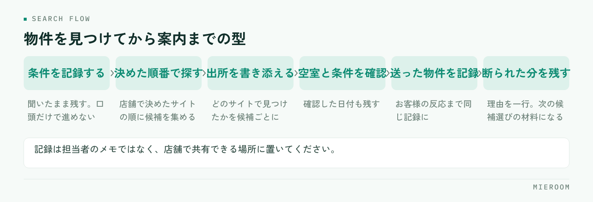

<!--META
{
  "title": "業者間流通サイトの使い分け｜賃貸仲介の店舗が物件探しを速くする組み合わせ方",
  "date": "2026-11-03",
  "category": "業務効率化",
  "excerpt": "複数の業者間流通サイトを使っている店舗に向けて、サイトごとに役割を決めて探す順番を固定する考え方を整理しました。物件を見つけてから案内までの手順、使い分けを見直すチェックリスト、よくある失敗の避け方までまとめています。",
  "hook": "探す順番を決めると物件探しは速くなる",
  "tags": ["業者間流通サイト", "物件探し", "業務効率化", "賃貸仲介", "店舗運営"]
}
META-->

業者間流通サイトはどこの店舗でも複数を併用しています。それぞれ入っている物件が違うので、一つに絞るわけにもいきません。ただ、同じ条件を何度も入力し直したり、同じ物件を別のサイトで二度見つけたりしていると、探す時間だけが増えていきます。**業者間流通サイトの使い分けで効くのは、どのサイトが優れているかを決めることではなく、探す順番を店舗で固定することです**。この記事では、役割の分け方と手順の型を整理します。

<h4>この記事の結論</h4>

複数の業者間流通サイトを併用している店舗で時間がかかっているのは、検索の回数ではなく「どこから探すか」が人によって違うことが原因です。<strong>サイトごとに役割を決め、探す順番を店舗の型として固定すると、同じ物件を二度探す時間がなくなります</strong>。見つけた物件をどこに記録するかまで決めておくことが条件になります。

## 業者間流通サイトを複数使うと、どこで時間がかかるか

時間がかかっている場所は、検索そのものではありません。検索の前と後ろです。

まず前。お客様の条件を聞いたあと、どのサイトから見るかがスタッフごとに違います。自分が使い慣れたサイトから入るため、同じお客様の条件でも担当によって出てくる候補が変わります。別の担当が引き継ぐと、もう一度最初から探し直すことになります。

次に後ろ。見つけた物件の情報が、どこにも残らないまま進みます。お客様に送った物件、空室の確認を取った物件、断られた物件——これが担当者の記憶とメールの履歴に散っていると、翌日に同じ物件をもう一度確認することになります。

さらに、同じ物件が複数のサイトに載っていることも時間を取ります。一度確認した物件を、別のサイトで別の表記で見つけて、また問い合わせてしまう。管理会社から見れば同じ問い合わせが二度来ている状態です。

共通しているのは、サイトの使い方の問題ではなく、店舗の中に順番と記録の決めごとがないことです。サイトを増やしても減らしても、ここが決まっていなければ時間は縮みません。

## 使い分けの軸は「網羅性・速さ・確認のしやすさ」の3つ

どのサイトをどう使うかを決めるとき、比べる軸を3つに絞ってください。細かく比べ始めると決まらなくなります。

**網羅性**は、その地域の物件がどれだけ載っているかです。探し始めの段階で候補を広く見たいときに頼るサイトを、ここで決めます。

**速さ**は、条件を入れてから候補が出てくるまでの手間です。検索条件の保存ができるか、よく使う条件をすぐ呼び出せるか。来店中のお客様の前で動かすときは、この軸が効きます。

**確認のしやすさ**は、空室状況や募集条件が最新かどうかを判断しやすいかです。更新日が見えるか、問い合わせ先がすぐ分かるか。案内の直前に確かめるときに頼る先を、ここで決めます。

同じサイトが3つすべてで一番になることはまずありません。だからこそ役割を分ける意味があります。なお、どのサイトがどの軸で強いかは地域と時期によって変わるので、他店の評判ではなく自店の商圏で確かめてください。検索条件の作り方自体は[業者間サイトでの物件検索を速くする](./gyoshakan-site-bukken-kensaku.html)に整理しています。

## サイトごとに役割を決めて、探す順番を固定する

3つの軸で見たら、サイトに役割を割り当てます。優劣ではなく、どの場面で開くかを決める作業です。

| 場面 | 使うサイトの役割 | 決めておくこと |
|---|---|---|
| 条件を聞いた直後、候補を広く見る | 網羅性を重視するサイト | 最初に開くサイトを1つに決める |
| 来店中、お客様の前で絞る | 速さを重視するサイト | よく使う検索条件を保存しておく |
| 案内の前日・当日に確かめる | 確認のしやすさを重視するサイト | 誰が、いつ確認するか |
| 条件に合う物件が出てこないとき | 補助的に見るサイト | どこまで広げたら打ち切るか |

役割が決まったら、順番として店舗に掲示してください。「まずAで広く見て、絞る段階でBを開き、案内前にCで確かめる」という一文で足ります。この一文があるだけで、担当が変わっても候補の出し方がそろいます。

新人が入ったときの説明もこの順番で行えます。サイトごとの操作を覚えるより、どの場面でどこを開くかを先に覚えるほうが、早く一人で探せるようになります。

## 物件を見つけてから案内までの手順を型にする

探す順番と同じくらい効くのが、見つけたあとの手順です。ここが決まっていないと、確認の重複と連絡漏れが残ります。

<figure class="fig"><figcaption>どの段階でも、次に誰が何をするかが記録に残っていることが条件です。</figcaption></figure>

次の流れを店舗の型にしてください。どの段階でも、次に誰が何をするかが記録に残っていることが条件です。

1. 条件を聞いたら、そのまま記録に残す（口頭だけで進めない）
2. 決めた順番でサイトを開き、候補を集める
3. 候補ごとに、どのサイトで見つけたかを書き添える
4. 空室と募集条件を確認し、確認した日を残す
5. お客様に送った物件と、反応を記録する
6. 断られた物件には理由を一行だけ添えて残す

4から6が残っていれば、翌日に同じ物件を確認し直すことがなくなります。6は特に効きます。断られた理由が残っていれば、次に出す候補の精度が上がり、同じ条件の物件を繰り返し提案することもなくなります。

記録の置き場所は、担当者のメモではなく店舗で共有できる場所にしてください。引き継ぎのときに探さなくて済む形になっていれば、形式は問いません。物件データの扱いは[物件データの取り込みを楽にする](./bukken-data-torikomi.html)も合わせてご覧ください。

## 使い分けを見直すチェックリスト

いまの使い分けが機能しているかを、次の項目で確かめてください。当てはまらない項目が、手をつける場所です。

- 条件を聞いたあと、最初に開くサイトが店舗で1つに決まっている
- よく使う検索条件が保存されていて、呼び出せる状態になっている
- 案内の前に空室を確認する担当とタイミングが決まっている
- 見つけた物件に、どのサイトで見つけたかが書き添えられている
- 確認を取った日付が記録に残っている
- お客様に送った物件が、担当以外にも分かる場所にある
- 断られた物件と理由が残っている
- 同じ物件を別のサイトで二度問い合わせていないか、月に一度は振り返っている
- 契約していて使っていないサイトがないか、年に一度は確認している
- 新人に、サイトの操作ではなく開く順番から説明している

全部を一度に整えなくても構いません。上から3つが埋まるだけで、担当による候補の差はかなり縮まります。

✓振り返りのやり方

月に一度、その月に成約した案件をいくつか選んで、最初に候補として出した物件がどのサイトで見つかったかを数えてみてください。ほとんど使われていないサイトと、毎回最初に当たるサイトが見えてきます。契約の見直しの材料にもなります。

## よくある失敗とその避け方

- **サイトを増やして解決しようとする**：候補が出てこない原因が条件の設定にある場合、サイトを足しても同じ結果になります。まず条件を広げて試してください
- **担当ごとの使い方に任せる**：慣れた人は速く探せますが、引き継ぎで止まります。順番を決めることは、慣れた人の速さを下げる話ではなく、他の人が同じ候補にたどり着ける状態を作る話です
- **確認した日付を残さない**：空室状況は変わります。いつ確認したかが残っていないと、案内の直前にもう一度確認することになります
- **断られた物件を消す**：理由とともに残しておけば、次の候補を選ぶ材料になります。消してしまうと同じ物件をまた出してしまいます
- **使っていないサイトの契約を放置する**：役割を割り当てられなかったサイトは、そのまま使われません。年に一度、実際に使っているかを確認してください
- **お客様に送った物件を担当者のメールだけに残す**：担当が休んだ日に問い合わせが来ると、何を送ったか分かりません。店舗で見える場所に残してください
- **順番を決めて共有しない**：決めただけでは変わりません。掲示するか、朝礼で一度読み上げるところまでやってください

## 自分で進める場合と、ツールに任せる場合の分かれ目

分かれ目になるのは、記録を同じ場所に集められるかどうかです。

自分たちで進めやすいのは、探す順番を決めて共有簿や共有の表に記録していく形です。店舗が1つで、物件を探す人が数人なら、紙や表でも回ります。まず順番を決めて1か月やってみると、どこで止まるかが見えます。この段階で仕組みを探し始めるより、型を作るほうが先に効きます。

ツールに任せたほうが早いのは、物件の情報とお客様の反応を同じ画面で見たい場合、担当が複数いて引き継ぎが頻繁に起きる場合、そして反響や接客の記録と物件の記録を突き合わせたい場合です。記録する場所が分かれていると、入力の手間が増えて記録そのものが続かなくなります。店舗が2つ以上になると、表の共有では追いつかなくなることが多いところです。

判断の順番としては、まず探す順番を決めて記録を1か所にまとめてみる。それが続かない理由が「入力の場所が分かれているから」だと分かった時点で、仕組みを検討する——この進め方なら、入れたのに使われない状態を避けられます。

## よくある質問

業者間流通サイトは、何社くらい契約すればよいですか？

数で決めるものではありません。網羅性・速さ・確認のしやすさの3つの場面に、それぞれ開くサイトが決まっていれば足ります。結果として同じサイトが2つの役割を兼ねることもあります。逆に、どの場面でも開かないサイトがあれば、その契約は見直しの対象です。自店の商圏でどこに物件が集まっているかで決めてください。

同じ物件を別のサイトで見つけてしまい、二度問い合わせてしまいます。

候補を記録するときに、物件名と所在地のほかに「どのサイトで見つけたか」と「確認した日」を残してください。表記が違っても、所在地と間取りで気づけるようになります。管理会社に二度同じ問い合わせをすることは、店舗の信用にも関わるので、記録の置き場所を1か所にまとめることが一番効きます。

スタッフによって探し方が違うのを、どう直せばよいでしょうか。

やり方を禁じるのではなく、最初に開くサイトだけを店舗で決めてください。そこから先の進め方は人によって差があってよいところです。最初が同じなら、担当が変わっても候補の出発点がそろいます。決めたことは掲示するか、新人への説明の最初に置いてください。

見つけた物件の情報を、お客様への案内までどうつなげばよいですか？

候補を集めた段階で、送った物件と反応を同じ記録に書き足す形にしてください。別の表に移し替えると、移す作業そのものが抜けます。ミエルームの場合は、反響管理と接客管理が同じ場所にあるので、問い合わせの内容と送った物件、反応を一つの案件として追えます。

物件のデータを毎回入力し直すのが手間です。

同じ情報を二度入力している箇所を書き出すところから始めてください。手間の大きさが見えます。ミエルームには物件コンバータと業者間サイト連携があり、フォームやメールからの反響の自動取込にも対応しているので、転記のために手を動かす場所を減らせます。デモアカウントの発行は受け付けていますので、実際の画面でご確認いただけます。

## まとめ：どのサイトが良いかより、開く順番を決める

業者間流通サイトの使い分けは、サイトを比べて優劣をつける作業ではありません。網羅性・速さ・確認のしやすさの3つの場面に、それぞれ開くサイトを割り当て、その順番を店舗で固定する。これだけで、担当による候補の差と、同じ物件を二度探す時間がなくなります。

そのうえで、見つけた物件に「どのサイトで見つけたか」「いつ確認したか」「送った結果どうだったか」を残してください。この3つが残っていれば、引き継ぎでも止まらず、同じ条件の提案を繰り返すこともなくなります。

ミエルームなら、反響管理・接客管理・申込管理が同じ場所にあるので、問い合わせの内容から送った物件、反応、申込までを一つの案件として追えます。物件コンバータと業者間サイト連携、フォーム・メールの自動取込があるため、サイトから拾った情報を記録用に打ち直す手間もなくなり、担当が休んだ日でも何を送ったかが店舗で分かる状態になります。Excelデータのインポートと初期設定の代行に対応しているので、いまの共有表からの切り替えもそのまま進められます。機能の詳細は[機能・事例](../features.html)に整理しています。資料のご請求やデモアカウントの発行は、この下のボタンからお気軽にどうぞ。
