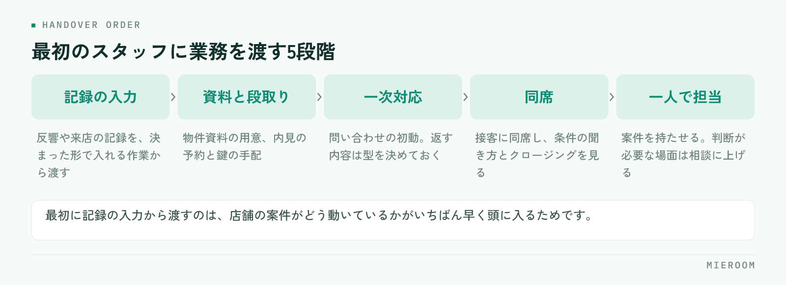

<!--META
{
  "title": "一人店舗が初めてスタッフを雇うとき｜判断の目安と任せる順番",
  "date": "2026-10-16",
  "category": "組織・育成",
  "excerpt": "賃貸仲介の一人店舗が初めてスタッフを採用するときの判断の目安と、入社後に任せる順番をまとめました。接客担当と事務担当のどちらを先に採るか、初日までに用意するもの、よくある失敗まで整理しています。",
  "hook": "採用の時機は、売上ではなく手の止まり方で決まる",
  "tags": ["採用", "店舗運営", "組織づくり", "一人店舗", "賃貸仲介"]
}
META-->

一人で店舗を回していると、反響が増えた月に必ず同じことを考えます。人を雇うべきか、まだ一人で持ちこたえるか。**判断の材料になるのは売上の金額ではなく、取りこぼしが起きている場所です**。どこで手が止まっているかが分かれば、採る時機と、何を任せるかが同時に決まります。

<h4>この記事の結論</h4>
採用は「忙しくなったら」ではなく「自分がいないと止まる仕事が増えたら」が目安です。<strong>最初の1人を接客に入れるか事務に入れるかは、取りこぼしが反響段階で起きているか、申込以降で起きているかで決まります</strong>。任せる順番を先に決めてから募集してください。

## 採用を考えるのは、忙しくなったときではなく手が止まったとき

一人店舗で判断を誤りやすいのが、「忙しさ」を基準にすることです。繁忙期は誰でも忙しくなります。忙しさが戻る時期に採用を決めると、閑散期に手が余ります。

見るのは忙しさではなく、**自分が動けないときに止まる仕事がどれだけあるか**です。内見に出ている1時間に反響の返信が止まる。申込の対応中に電話が取れない。この「止まっている時間」が毎日あるなら、取りこぼしが常態化しています。

もう一つの目安は、自分が休めないことです。体調を崩した日に店の機能が全部止まる状態は、売上の問題ではなく運営の問題です。一人で回す限界は、売上の額より先に、この2点で見えてきます。

✓先に減らせる作業がないか確認する

止まっている時間の中身が、物件情報の転記や管理表の突き合わせといった作業なら、採用より先に作業そのものを削れる可能性があります。人を増やしてから、その人に同じ手作業を引き継ぐ形になると、辞めたときに元に戻ります。

## 雇う前に、自分の一日を3つに分けて書き出す

募集を出す前に、自分の1日の作業を3つに分けて書き出してください。分け方は、**自分しかできないこと／教えれば任せられること／そもそも減らせること**の3つです。

自分しかできないことは、条件のヒアリング、クロージング、家主や管理会社との交渉といった判断が必要な業務です。教えれば任せられることは、物件資料の用意、内見の段取り、申込書の不備確認、入金の記録などです。減らせることは、同じ内容を複数の場所に手で入力している作業です。

この3つを書き出すと、募集要項に書く仕事の中身が決まります。「賃貸仲介の業務全般」で募集すると、入社後に何から教えるかが決まっていないため、最初の1か月が流れます。

## 最初の1人は、接客担当か事務担当か

最初の採用でいちばん迷うのがここです。判断は、取りこぼしが起きている段階で決めてください。

| 判断の材料 | 接客担当を先に採る | 事務・業務担当を先に採る |
|---|---|---|
| 向いている状態 | 反響や来店に対応しきれず、返信や案内が遅れている | 申込以降の書類・入金・報告に時間が取られている |
| 任せること | 一次対応、物件提案の準備、内見の同行や案内 | 申込書の不備確認、入金の記録、資料作成、掲載の更新 |
| 立ち上がりの早さ | 時間がかかる。物件知識と条件の読み方が必要 | 比較的早い。手順が決まっている業務から渡せる |
| 注意点 | 教える時間を確保しないと、接客の質が揃わない | 判断が必要な場面で止まるため、確認の窓口を決めておく |

反響への返信が遅れて来店につながっていないなら接客側、申込から入金までの処理で夜が潰れているなら事務側です。**どちらを採る場合も、店長が最後まで持つ業務を先に決めておく**ことが条件になります。全部を渡そうとすると、結果的にどちらも中途半端になります。

## 入社後に任せる順番を決めておく

入社初日から接客に入れる形は、ほとんどの店舗でうまくいきません。渡す順番を決めておくと、本人も店側も迷いません。

<figure class="fig"><figcaption>初日から接客に入れる形は、ほとんどの店舗でうまくいきません。</figcaption></figure>

1. **記録の入力**：反響や来店の記録を、決まった形で入れる作業から渡します
2. **資料と段取り**：物件資料の用意、内見の予約と鍵の手配
3. **一次対応**：問い合わせの初動。返す内容は型を決めておく
4. **同席**：接客に同席して、条件の聞き方とクロージングを見る
5. **一人で担当**：案件を持たせる。判断が必要な場面は相談に上げる

順番の考え方は[新人育成の順番](./shinjin-ikusei-junban.html)で詳しくまとめています。最初に記録の入力から渡す理由は、店舗の案件がどう動いているかが、入力を通していちばん早く頭に入るためです。

## 初日までに用意しておくもの

採用が決まってから初日までに、次の4つを用意しておいてください。どれも当日に用意しようとすると、初日の半分が準備で消えます。

- **作業の手順書**：完璧なものは不要です。渡す業務の手順だけを箇条書きで
- **使うツールの権限**：当日に見られる状態にしておく。パスワードの共有方法も決めておく
- **聞く相手の決め方**：誰に、どのタイミングで聞くかを決めておく
- **最初の1か月に渡す業務の順番**：上の5段階のうち、どこまで進めるかを決める

✓手順書は完成させてから渡さない

最初から整った手順書を作ろうとすると、いつまでも募集に進めません。渡す業務の分だけ書いて、入った人が詰まった箇所を足していく形にしてください。詰まった場所がそのまま手順書の抜けなので、本人に追記してもらうと早く育ちます。

## よくある失敗：教える時間を見込んでいない

一人店舗の採用でもっとも多い失敗は、**教える時間を業務時間に入れていないこと**です。採用した月は、自分の作業時間が増えます。ここを見込まずに繁忙期の直前に採用すると、教える時間が取れず、本人は何をすればよいか分からないまま時間が過ぎます。

次に多いのが、口頭だけで教える形です。忙しい日に伝えたことは、翌週には残っていません。記録として残らない引き継ぎは、同じ説明を何度も繰り返すことになります。

もう一つは、任せた業務の結果を見ていないことです。渡したあとに確認する項目を決めていないと、間違った手順のまま進み、あとでまとめて直すことになります。店長側が何をいつ見るかは、[店長の仕事の段取り](./tencho-shigoto-dandori.html)の考え方をそのまま使えます。

未経験者と経験者、どちらを採るべきですか？

どちらが正解と決まっているわけではなく、教える時間を取れるかどうかで選んでください。未経験者は手順から教える必要があるため、最初の数か月は店長側の時間を使います。一方で、自店の手順をそのまま身につけてもらえます。経験者は立ち上がりが早い反面、前職のやり方との違いを最初にすり合わせる必要があります。どちらの場合も、記録の形と判断を上げる範囲を先に伝えておくと行き違いが減ります。

パートやアルバイトからでも大丈夫ですか？

事務・業務側を任せる前提であれば、短時間勤務から始める形は現実的です。申込書の不備確認、入金の記録、掲載情報の更新などは、時間を区切っても渡せる業務です。ただし接客を任せる予定がある場合は、来店が集中する時間帯に勤務できるかを先に確認してください。繁忙期の土日に出られない条件のまま接客担当として採ると、いちばん人手が必要な時間に体制が変わらないことになります。

採用した人が辞めてしまったときに備えることはありますか？

業務が人に紐づかない形にしておくことです。顧客とのやりとり、申込の進捗、入金の状況が本人の手元のメモや個人のメールにしか無い状態だと、退職時にそこで情報が切れます。案件ごとに記録が残っていれば、引き継ぎは残っている記録を読むところから始められます。これは退職に備えるためだけでなく、入ってすぐの人が過去の経緯を自分で追えるようになるため、育成の速さにも効きます。

## まとめ：採る前に、渡す仕事と見る項目を決める

初めての採用で決めておくことは3つです。取りこぼしが起きている段階から接客か事務かを選ぶこと、任せる業務の順番を5段階で決めること、教える時間を業務時間に入れておくこと。この3つが決まっていれば、入社後の1か月が流れません。

そして**募集を出す前に、自分の1日を3つに分けて書き出す**作業を飛ばさないでください。ここが曖昧なまま人を増やすと、忙しさは変わらないまま人件費だけが増えます。

[ミエルーム](../index.html)なら、反響・接客・申込から入金までの記録が案件ごとに1か所に残るので、入ったばかりの人でも過去の経緯を自分で読んで追えます。勤怠や給与もあわせて扱えるため、教えることと管理することが別々の作業に分かれません。口頭での引き継ぎと確認の往復が減り、店長が接客と判断に時間を使えるようになります。デモアカウントの発行やご相談は、この下のボタンからお気軽にどうぞ。
