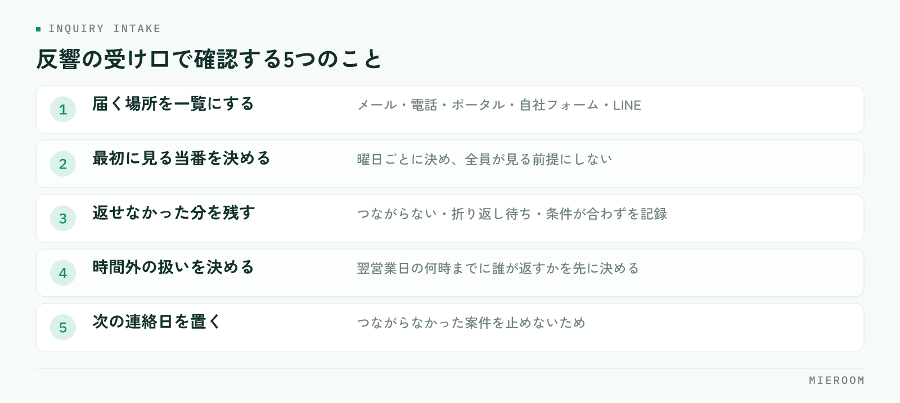

<!--META
{
  "title": "繁忙期前に賃貸仲介の店舗がやっておく準備｜11月・12月のチェックリスト",
  "date": "2026-10-30",
  "category": "組織・育成",
  "excerpt": "繁忙期前の11月・12月にやっておく準備を、業務の棚卸しから書類フォーマットの差し替え、問い合わせの受け口の整備までチェックリストで整理しました。1〜3月に入ってからでは手を付けられない項目を先に片づける手順をまとめています。",
  "hook": "繁忙期の成果は、11月と12月で決まる",
  "tags": ["繁忙期", "店舗運営", "準備", "業務改善", "賃貸仲介"]
}
META-->

1〜3月に入ってから業務の形を変えようとしても、まず手が空きません。繁忙期に起きる取りこぼしは、たいてい繁忙期そのものではなく、**その前に決めておくべきことが決まっていなかったことが原因**です。この記事では、11月と12月にやっておく準備を、そのまま使えるチェックリストの形で整理します。

  <h4>この記事の結論</h4>
  
繁忙期前にやるべきことは、人を増やすことより先に、記録の形と判断の基準を決めておくことです。<strong>誰が見ても同じように書ける記録と、迷わず決められる基準があれば、人数が同じでも処理できる件数は変わります</strong>。11月は棚卸し、12月は受け入れ体制に充ててください。

## 繁忙期の結果は、11月と12月の準備で決まる

繁忙期の反省として挙がるのは、追客が追いつかなかった、申込書の不備で契約がずれた、誰がどの案件を見ているか分からなくなった、といった内容です。どれも忙しさが原因に見えますが、実際には処理の仕方が決まっていなかったことが表に出ただけです。

件数が平常時の数倍になると、判断の回数も同じだけ増えます。1件ごとに「これはどう処理するのか」を考える余地がなくなるため、決まっていないものはその場の判断になり、人によって扱いが変わります。これが後から手戻りになります。

逆に、11月と12月のうちに処理の形が決まっていれば、繁忙期は決めたとおりに流すだけになります。人員とシフトの組み方は[繁忙期のシフトと人員計画](./hanbouki-shift-jinin-keikaku.html)に整理していますので、体制の話はそちらをあわせてご覧ください。

## 11月にやること：業務の棚卸しと、書類の差し替え

11月は、まだ時間が取れる時期です。ここでやるのは「今の形を見直す」作業で、繁忙期に入ると手を付けられなくなるものを優先します。

まず業務の棚卸しです。反響が入ってから契約・入金までの流れを紙に書き出し、どこで誰の手が止まるかを洗い出します。前年の繁忙期に起きたトラブルを思い出して、その原因がどの工程にあったかを当てていくと早く進みます。

次に書類とフォーマットです。申込書、重要事項説明書の雛形、入居者への案内、社内の引き継ぎシート——前年のまま使っているものがあれば、内容が今の運用と合っているかを確認します。制度や様式の変更があった場合、繁忙期に入ってから差し替えると、古い書式で受け付けた案件が混在します。

  
✓前年の不備を1枚にまとめる

  
前年の繁忙期に起きた記入漏れ・確認漏れを思い出せる範囲で書き出し、1枚にまとめてください。同じ項目が繰り返し出てくるなら、それは個人の注意不足ではなく様式の問題です。項目の並びを変える、記入例を添える、必須欄を囲むといった修正を、11月のうちに済ませます。

## 12月にやること：数字の基準と、受け入れ体制

12月は、年末の対応と並行しながら、繁忙期の判断基準を決める時期です。

決めておきたいのは、目標の数字と、その追い方です。前年の実績を店舗別・担当別に並べ、どの段階で何件必要かを逆算しておくと、繁忙期に入ってから集計し直す必要がなくなります。目標の立て方そのものは[繁忙期の売上目標の立て方](./hanbouki-uriage-mokuhyo.html)で手順を追っています。

もう一つは受け入れ体制です。新しく入るスタッフやアルバイトがいる場合、繁忙期の最初の週に教えることを決めておきます。全部を教える時間はないので、1週目は反響の受け方と記録の残し方だけに絞り、物件知識は現場で積む形にしたほうが立ち上がりが早くなります。

年末年始の営業日程も、12月前半に決めて掲示と各媒体に反映してください。問い合わせが入る時期と、店が閉まる日が重なると、そのまま他店へ流れます。

## 問い合わせの受け口を、繁忙期の量に耐える形にする

繁忙期に最も崩れやすいのが、反響の受け口です。平常時なら手作業で回っていたものが、件数が増えた途端に取りこぼしに変わります。

<figure class="fig"><figcaption>届く場所が分散していると、見ていない場所が必ず出ます。</figcaption></figure>

確認するのは次の3点です。1つ目は、どの媒体から入った反響がどこに届くか。メール、電話、ポータルの管理画面、自社フォーム、LINE——届く場所が分散していると、見ていない場所が必ず出ます。2つ目は、届いた反響を誰が最初に見るか。当番を決めておかないと、全員が見ている前提で誰も見ていない状態になります。

3つ目は、返せなかった反響をどこに残すか。つながらなかった、折り返しを待っている、条件が合わなかった——この状態を記録に残さないと、繁忙期が終わったときに何件あったのかも分かりません。

**営業時間外に入った反響の扱いも、先に決めてください**。翌営業日の朝に誰が何時までに返すかを決めておくだけで、週明けの取りこぼしは減ります。

## 繁忙期前チェックリスト

11月と12月に分けて、着手の順に並べました。印刷して、終わったものから消していく形で使ってください。

**11月**

- 反響から入金までの流れを紙に書き出し、手が止まる工程を特定した
- 前年の繁忙期に起きた不備を1枚にまとめた
- 申込書・案内文・引き継ぎシートの内容が今の運用と合っているか確認した
- 様式の修正（項目の並び、記入例、必須欄）を済ませた
- 物件資料のフォーマットをそろえた
- 店内の備品と消耗品を、ピーク時の量で見直した

**12月**

- 前年実績を店舗別・担当別に並べ、必要件数を逆算した
- 週単位で追う数字を決め、見る場所を1か所にした
- 新しく入るスタッフに1週目で教えることを決めた
- 年末年始の営業日程を決め、掲示と各媒体に反映した
- 反響がどの媒体からどこに届くかを一覧にした
- 反響を最初に見る当番を曜日ごとに決めた
- 返せなかった反響の残し方を決めた
- 営業時間外に入った反響を、翌営業日の何時までに返すか決めた

## よくある失敗とその避け方

- **人を増やすことから考える**：記録の形が決まっていないまま人を増やすと、引き継ぎの手間が増えて逆に遅くなります。先に処理の形を決めてください
- **ツールの導入を1月に始める**：操作に慣れる時間が必要です。繁忙期に使うものは12月のうちに触り始めます
- **棚卸しを頭の中だけで済ませる**：書き出さないと、工程の抜けに気づけません。紙1枚でも必ず形にします
- **目標を店舗合計だけで置く**：合計の数字は現場の動きに変わりません。担当別・週別まで分解します
- **年末年始の日程を12月後半に決める**：媒体への反映が間に合わず、問い合わせが入ったまま閉まった状態になります
- **前年の反省を人の問題として片づける**：同じ不備が複数人で起きているなら、様式か手順の問題です

> 繁忙期にやれることは、繁忙期前に決めたことの実行だけです。

## 自分で進める場合と、ツールや専門家に任せる場合の分かれ目

分かれ目になるのは、店舗の規模ではなく、記録が1か所に集まっているかどうかです。

自分たちで進めやすいのは、スタッフが数人で、反響から契約までを同じ人が見届けられる場合です。この規模なら、紙やExcelでも状況は把握できます。棚卸しと様式の見直しを11月に済ませ、12月に当番と基準を決めれば、繁忙期は回せます。

任せたほうが早いのは、反響の入り口が複数あって集約に時間がかかる場合、担当が複数いて案件の進み具合が本人にしか分からない場合、月末に数字を集計し直す作業が発生している場合です。件数が増えると、この集約と集計の時間がそのまま取りこぼしに変わります。

判断の順番としては、まず11月の棚卸しで「転記や集計に使っている時間」を数えてみてください。その時間が繁忙期に数倍になると考えて、許容できるかどうかで決めるのが現実的です。

## よくある質問

11月から準備を始めるのでは遅いですか？

様式の見直しと基準の決定であれば、11月からでも間に合います。間に合わなくなるのは、新しい仕組みを入れて全員が操作に慣れるまでの時間が必要な場合です。その場合は11月中に触り始め、12月の平常業務で実際に使ってみる形にしてください。1月から使い始める計画は避けたほうがよいです。

前年の数字が担当別に残っていない場合はどうすればよいですか？

店舗合計だけでも、月別に並べれば繁忙期の山の形は分かります。まずそれで必要件数を置き、今期は担当別に記録を残す形に変えてください。来期の計画からは分解できるようになります。残っていないことを理由に目標を置かないほうが、現場は動きにくくなります。

繁忙期に新しいやり方を入れても、現場が覚えられないのではないですか？

繁忙期の最中に変えるのは避けてください。変えるのは12月までです。ただし、記録の残し方を1つだけ決める、当番を決めるといった「やることを減らす変更」は、繁忙期に入ってからでも受け入れられます。増える変更は前に、減る変更は途中でも、という切り分けで考えると判断しやすくなります。

繁忙期が終わってから見直すほうが落ち着いてできませんか？

終わった直後の見直しは有効です。記憶が新しいうちに何が詰まったかを書き出せます。ただし、そこで出た課題を次の繁忙期の前に実行しないと、同じことが繰り返されます。4月に書き出し、11月に実行する。この2回をセットにしてください。

## まとめ：決めるのは11月と12月、繁忙期は流すだけ

繁忙期の取りこぼしは、忙しさではなく、決まっていなかったことから生まれます。11月に業務の棚卸しと書類の差し替え、12月に数字の基準と受け入れ体制。この順で進めれば、1〜3月は決めたとおりに流す時期になります。

全部を完璧にする必要はありません。チェックリストのうち、前年に実際に困った項目から手を付けてください。1つ減らすだけでも、ピーク時の負担は変わります。

[ミエルーム](../index.html)なら、フォーム自動取込とメール自動取込で複数の媒体から入った反響を1か所に集められ、反響管理と接客管理で誰がどの案件をどこまで進めているかが日々の画面で分かります。申込から入金までも案件ごとに記録できるので、繁忙期の最中に管理表を突き合わせたり、月末に数字を集計し直したりする作業がなくなります。デモアカウントの発行やご相談は、この下のボタンからお気軽にどうぞ。
