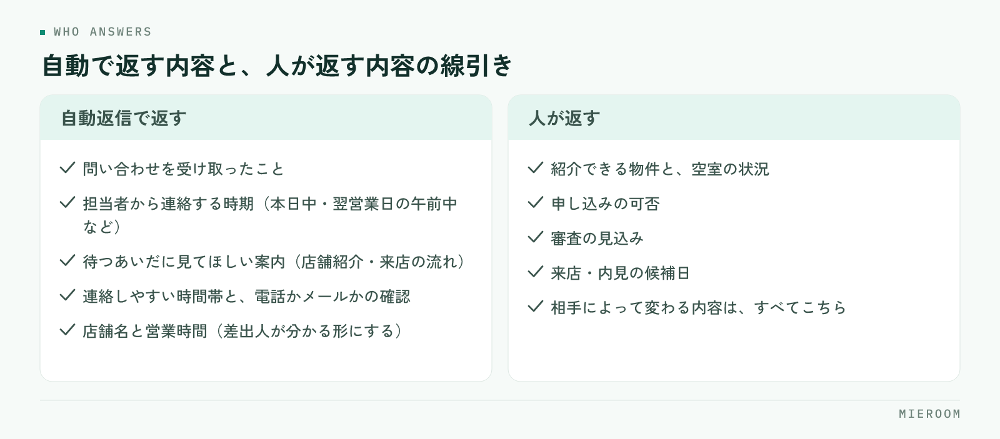

<!--META
{
  "title": "反響メールの自動返信の作り方｜すぐ返す内容と、人が返す内容の分け方",
  "date": "2026-11-09",
  "category": "集客・広告",
  "excerpt": "賃貸仲介の反響メールに自動返信を置くときの作り方を整理しました。自動で返す内容と人が返す内容の分け方、文面に入れる要素、時間帯と経路ごとの出し分け、置いたあとに人がやることの型、チェックリストとよくある失敗までまとめています。",
  "hook": "自動返信は、人の返信を速くするために置く",
  "tags": ["反響対応", "自動返信", "集客・広告", "追客", "賃貸仲介"]
}
META-->

反響メールへの返信が遅れる店舗は、文面を持っていないわけではありません。接客中で手が空かない、誰が返すか決まっていない、営業時間外に届いている。遅れる理由はこの3つに集まります。**自動返信は、人の返信を速くするために置くものです**。この記事では、自動で返す内容と人が返す内容の線引きから、文面の要素、時間帯ごとの出し分け、置いたあとの運用までを順に整理します。

<h4>この記事の結論</h4>

自動返信に物件の提案を入れようとすると、いつまでも完成しません。<strong>自動返信の役目は、受け取ったことと次に連絡する時期を伝えて、相手を待たせないことだけ</strong>です。条件の確認や物件の紹介は人が返す。この線を引くと、文面は短く済み、置いたその日から効きます。

## 反響への返信が遅れるのは、文面がないからではない

反響対応の相談で「返信の例文が欲しい」と言われることがありますが、例文を配っても返信は速くなりません。問い合わせを送った人が最初に知りたいのは、物件の詳細より前に、自分のメールが届いたかどうかです。

ポータルサイトから問い合わせを送った人は、たいてい同時に数社へ送っています。そのうち、まず反応があった会社とやりとりが始まります。ここで差がつくのは文面の質ではなく、何も返ってこない時間の長さです。接客中の1時間、昼休みの1時間、閉店後の夜。この空白のあいだに、ほかの会社から返信が届きます。

つまり直すべきは文章力ではなく、空白を埋める仕組みです。自動返信を置く目的は、ここだけに絞ってください。**空白をゼロにしてから、人の返信の中身を上げていく**という順番になります。返信の速さが接客にどう影響するかは[反響の初動5分](./lead-response-speed.html)にも整理しています。

## 自動返信で返す内容と、人が返す内容を分ける

自動返信がうまくいかない原因はほぼ一つで、自動で返す範囲を広げすぎることです。希望条件を聞き返したり、空室状況を案内したりしようとすると、例外が無限に出てきて公開できません。

<figure class="fig"><figcaption>相手が誰であっても同じ文章で成り立つ内容だけを自動にします。</figcaption></figure>

線引きは単純です。**相手が誰であっても同じ文章で成り立つ内容だけを自動にする**。受け取った事実、いつ連絡するか、その間に見てほしいもの、連絡がつきやすい時間の確認。この4つは誰にでも同じ文で成り立ちます。

逆に、紹介できる物件、申し込みの可否、審査の見込み、来店の日時は、相手によって変わります。ここを自動で返すと、実際と違う内容が届いて、あとで訂正する手間が増えます。訂正の連絡は、遅れた返信よりも印象が悪くなります。

✓判断の基準

その一文を、今日届いた反響の全員に送って問題がないかどうかで決めてください。1件でも「この人には当てはまらない」と思う内容なら、自動返信には入れず、人の返信に回します。

## 自動返信の文面に入れる要素

文面は短いほうが読まれます。入れる要素は次の範囲で足ります。

まず冒頭で、問い合わせを受け取ったことを書きます。次に、担当者から改めて連絡することと、その時期を書きます。「本日中」「翌営業日の午前中」のように、相手が待てる形にします。ここが「追ってご連絡します」だけだと、待っていいのか分からないので、ほかを探し始めます。

三つ目に、待っているあいだに見てもらえるものを添えます。店舗の案内ページや、来店の流れをまとめたページで構いません。四つ目に、連絡がつきやすい時間帯と、電話とメールのどちらがよいかを尋ねる一文を入れます。これがあるだけで、折り返しのすれ違いが減ります。

最後に、店舗の名前と営業時間を書きます。差出人が誰か分からないメールは、迷惑メールと見分けがつきません。署名に電話番号を入れるかどうかは、受けられる体制があるかで決めてください。鳴っても出られない番号を載せると、かえって印象を損ねます。

## 時間帯と経路で、文面を分ける

自動返信は1種類で始めて構いませんが、営業時間内と時間外は分けたほうが効きます。同じ文面だと、閉店後に届いた人に「本日中にご連絡します」と返ってしまいます。

| 届いた時間・経路 | 自動返信で伝えること | 人が動く時期 |
|---|---|---|
| 営業時間内 | 受け取ったこと、担当者から本日中に連絡すること | 接客の合間、遅くとも閉店前 |
| 営業時間外（夜） | 受け取ったこと、翌営業日の午前中に連絡すること | 翌朝、開店直後にまとめて |
| 定休日・連休中 | 受け取ったこと、次の営業日に連絡すること | 営業再開の朝いちばん |
| 電話の不在着信 | 折り返す時間帯を伝える（SMSなど） | 当日の手が空いた時点 |
| 自社サイトのフォーム | 受け取ったこと、連絡の時期、来店の流れの案内 | 営業時間内なら当日 |

経路ごとに分ける意味は、送ってきた人の状況が違うからです。ポータルサイトから来た人は複数社に送っていることが多く、自社サイトのフォームから来た人は店舗を名指しで選んでいます。後者には、来店までの流れまで案内しておくと話が早く進みます。営業時間外の拾い方は[営業時間外に入った反響の拾い方](./eigyo-jikangai-hankyo.html)にまとめています。

## 自動返信を置いたあとに、人がやることの型

自動返信は、人の返信を省くためのものではありません。置いたあとに人がやることを決めておかないと、「自動で返ったから大丈夫」という空気になり、本来の返信が遅れます。

決めることは3つです。誰が見るか、いつ見るか、何を見て終わりにするかです。

誰が見るかは、時間帯で分けるのが現実的です。日中は手の空いている人、朝は開店準備の担当、閉店前は最後に残る人。担当者ごとに割り振ると、その人が外に出ているあいだ止まります。いつ見るかは、開店直後・昼過ぎ・閉店前のように回数で決めます。何を見て終わりにするかは、未対応の反響が画面から消えるかどうかで判断します。記録の付け方は[賃貸仲介の反響管理の方法](./hankyo-kanri-hoho.html)に整理しています。

人の返信は、長く書く必要はありません。氏名を呼び、希望条件のうち1つに触れ、来店か内見の候補日を2つ出す。この形で十分に進みます。文面の作り方は[賃貸仲介の追客メール例文](./tsuikyaku-mail-reibun.html)が参考になります。

## 自動返信のチェックリストと、よくある失敗

置く前に、次の項目を確かめてください。

- 営業時間内と時間外で、文面が分かれている
- 連絡する時期が書いてある（「追ってご連絡します」で終わっていない）
- 定休日と連休のときの文面を決めてある
- 差出人の表示が、店舗名として読める形になっている
- 返信先のアドレスが、受信を見ているアドレスになっている
- 自動返信が迷惑メールに入らないか、自分の携帯で受け取って確かめた
- 自動返信が返ったあと、誰がいつ人の返信を出すか決まっている
- 未対応の反響が一覧で分かる場所がある

よくある失敗は、この6つです。

**自動返信に物件の紹介を入れようとする**。相手ごとに変わる内容なので、完成しないまま置かれないか、実際と違う案内が届きます。提案は人の返信に回してください。

**連絡の時期を書かない**。待てる形になっていないと、相手はほかを探し始めます。時期を書くことが、自動返信でいちばん効く部分です。

**返信先が誰も見ていないアドレスになっている**。自動返信に返信してきた人の連絡が、どこにも届かない状態になります。置いたあとに必ず自分で返信して確かめてください。

**定休日の文面を作っていない**。連休のあいだ「本日中にご連絡します」が返り続けます。休みの前に切り替える手順を決めておきます。

**自動返信を置いたことで安心する**。人の返信が遅れれば、結果は何も変わりません。自動返信は空白を埋めるだけで、話を進めるのは人です。

**文面を一度作って見直さない**。営業時間や定休日、案内ページのURLが変わっても古い文面が送られ続けます。営業時間を変えたときの確認項目に入れてください。

## 自分で進める場合と、ツールに任せる場合の分かれ目

一般論として、判断の基準は3つです。

一つ目は、反響が届く経路の数です。経路が1つで、受信を見る人も1人なら、メールソフトの自動返信機能だけで足ります。経路が増えて、どの経路から来た反響なのかを手で見分けている状態になると、仕組みの側で分ける必要が出てきます。

二つ目は、転記が発生しているかどうかです。自動返信が返るようになっても、届いたメールを見て氏名や希望条件を管理表に打ち直しているなら、速くなったのは最初の1通だけです。この打ち直しが毎日続いているなら、取り込みから記録までをつなげる検討の時期です。取り込みの仕組みは[ポータルの反響メールを自動で取り込む仕組み](./hankyo-mail-jido-torikomi.html)にまとめています。

三つ目は、未対応が見える形になっているかどうかです。自動返信で空白は埋まりますが、人の返信が止まっている反響を拾えるかどうかは別の話です。受信箱を上から見て思い出す運用だと、繁忙期に抜けます。未対応が一覧で分かる状態を自分たちで作れるなら、しばらくは今の形で進められます。作れないなら、そこを任せる判断が合います。

迷うときは、まず自動返信を1種類だけ置いて、人の返信がどれだけ速くなったかを見てください。置いても変わらないなら、問題は文面ではなく、誰がいつ見るかの決め方にあります。

## よくある質問

自動返信は、問い合わせを送った人に嫌がられませんか。

自動と分かる内容であれば問題になりません。むしろ、何も返ってこない時間のほうが不安を与えます。避けたいのは、人が書いたように見せかけて物件の提案まで入れることです。受け取ったことと連絡の時期に絞れば、自動であることが伝わっても失礼にはなりません。

ポータルサイト側にも自動返信の機能があります。重ねて送っても大丈夫ですか。

同じ内容が二重に届くと、どちらを見ればよいか分かりません。先にポータルサイト側の設定を確認し、そちらで足りているなら自店舗からは送らない形にしてください。ポータルサイト側が汎用の文面しか出せない場合は、自店舗の案内を含む自動返信に切り替えるほうが伝わります。

自動返信の時期は、「本日中」と書いて間に合わないことがあります。

間に合わない時期を書かないでください。接客が立て込む曜日があるなら「翌営業日の午前中まで」に広げたほうが、結果として信用を落としません。書いた時期を守れる範囲に設定し、守れる日が増えてから短くしていく順番が確実です。

LINEやSMSでも自動返信は必要ですか。

経路として使っているなら必要です。メールより早く見られるので、受け取ったことを伝える効果は大きくなります。ミエルームはLINE・SMS自動追客に対応しており、反響の記録と同じ場所から配信の設計ができます。文面はメールと同じ4つの要素で足ります。

自動返信を置く前に、反響の記録の仕組みを整えるべきですか。

順番は自動返信が先で構いません。文面を置くだけなら当日からできるので、空白を埋める効果を先に取ってください。そのうえで、未対応が見えない・転記が続くという問題が残るなら、記録の仕組みを見直します。ミエルームはExcelデータのインポートと初期設定の代行に対応しているので、いまの管理表のまま移すこともできます。

## まとめ：自動返信は、空白を埋めるために置く

反響メールの自動返信で決めるのは、文章のうまさではありません。自動で返すのは、受け取ったこと・連絡する時期・待つあいだに見てほしいもの・連絡しやすい時間の確認の4つだけ。物件の提案と日程の調整は人が返す。営業時間内と時間外で文面を分け、置いたあとに誰がいつ人の返信を出すかを決める。ここまでやれば、返信までの空白はなくなります。

逆に、自動返信に提案まで詰め込もうとすると公開できず、置いただけで満足すると人の返信は遅れたままです。自動返信は入口を開けるだけで、話を進めるのは人だと割り切ってください。

ミエルームなら、フォーム自動取込とメール自動取込で届いた反響がそのまま反響管理に入るので、自動返信を返したあとの氏名や希望条件の打ち直しがなくなります。誰が未対応なのかが一覧で分かり、LINE・SMS自動追客で次の連絡も取りこぼしにくくなるため、接客が立て込む日でも返信の空白が広がりません。反響から接客・申込までの記録のつながりは[機能・事例](../features.html)にまとめています。資料のご請求やデモアカウントの発行は、この下のボタンからお気軽にどうぞ。
