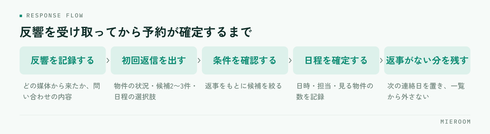

<!--META
{
  "title": "反響からの来店率を上げる方法｜初回返信から予約確定までの型",
  "date": "2026-11-01",
  "category": "集客・広告",
  "excerpt": "反響は来ているのに来店につながらない状態を、初回返信の中身と予約確定までの進め方に分けて整理しました。日程が決まらないときの対応、来店率を上げるチェックリスト、よくある失敗の避け方までまとめています。",
  "hook": "来店率は初回返信の中身と次の約束で決まる",
  "tags": ["反響管理", "来店率", "初回返信", "来店予約", "賃貸仲介"]
}
META-->

ポータルからの反響は毎日入っているのに、来店の予約が埋まらない。広告費を増やす話になる前に、見ておきたい場所があります。**反響からの来店率を左右するのは反響の数ではなく、初回返信の中身と、その返信で次の約束まで置けているか**です。この記事では、反響を受け取ってから来店の予約が確定するまでを型にして整理します。

<h4>この記事の結論</h4>

反響が来店につながらないのは、返信が遅いからだけではありません。<strong>物件の回答だけを返して次の約束を置かない返信が、いちばん多く来店を落としています</strong>。初回返信に候補の提示と日程の選択肢を入れ、断られたときの次の連絡日まで決めておけば、同じ反響数でも来店は変わります。

## 反響が来店につながらないのは、どこで落ちているか

まず、落ちている場所を分けて見てください。反響から来店までの間には、つながらなかった、返信したが返事がない、日程の相談で止まった、予約は取れたが当日に来なかった——という段階があり、どこで落ちているかで打ち手が変わります。

多い順に挙げると、まず**返信したあと返事が来ないまま終わる案件**です。問い合わせた本人は複数店に同じ内容を送っているため、最初に具体的な話をくれた店に動きます。次が日程の相談で止まる案件、その次が予約後のキャンセルです。

落ちている場所を把握するには、1週間だけ記録を取ってください。反響の件数、返信した件数、返事が来た件数、予約が取れた件数の4つだけで十分です。多くの店で、返信はほぼ全件できているのに返事が来た件数が大きく減ります。この落差が、返信の中身を見直す理由になります。

返信の速さそのものについては[反響の初動5分。返信スピードが成約率を左右する理由。](./lead-response-speed.html)で扱っています。速さを整えたうえで中身を見直すと、効果が重なります。

## 初回返信の中身で、来店の見込みは決まる

問い合わせの多くは「この物件は空いていますか」という形で届きます。ここに空室状況だけを答えて返すと、やりとりが一度で終わります。相手は答えを受け取っただけで、次に何をすればよいか分からないままです。

初回返信に入れるのは次の4つです。

1. 問い合わせのあった物件の状況（空室か、申込が入っているか）
2. 条件が近い物件を2〜3件（同じ条件で探している前提で選ぶ）
3. 来店して見られること（内見できる物件の数、当日の流れ）
4. 日程の選択肢（2〜3の候補を具体的な日時で）

このうち抜けやすいのは4つ目です。「ご都合のよい日をお知らせください」と書くと、相手が日程を考えて返信する手間が残ります。候補を出すと、選ぶだけで済みます。

✓申込が入っていた場合でも、返信は同じ形にする

問い合わせの物件が埋まっていたとき、その事実だけを返すと問い合わせはそこで終わります。条件が近い物件を並べ、見られる日程の候補まで置いてください。物件が一度埋まっただけで、探している条件は変わっていません。

## 反響を受け取ってから予約が確定するまでの型

やりとりの形を店で決めておくと、担当者によって来店率が変わる状態がなくなります。下の流れを基準にしてください。

<figure class="fig"><figcaption>どの段階でも、次に誰が何をするかが記録に残っていることが条件です。</figcaption></figure>

受け取った反響は、まずどの媒体から来たかと、問い合わせの内容を記録に残します。そのうえで初回返信を出し、返事が来たら条件を確認して候補を絞り、日程を確定させます。返事が来なかった場合は、次の連絡日を決めて止めずに残します。

重要なのは、どの段階でも**次に誰が何をするかが記録に残っている**ことです。返信済みのまま放置された案件が、いちばん静かに失われます。

## 日程が決まらないときと、予約が取れたあとの段取り

来店の予約は、日程の相談で止まる段階と、予約を取ったあと当日までの段階に分けて考えてください。止まる理由も、やるべきことも違います。

### 日程が決まらないときの進め方

返事はもらえたのに、日程の相談で止まることがあります。相手の事情ごとに対応を分けてください。

| 返ってきた内容 | 止まる理由 | 次に出す提案 |
|---|---|---|
| まだ検討中です | 来店の必要性が伝わっていない | 内見できる物件の数と、当日の所要時間を伝える |
| 休みが不定期で決められない | 候補日が平日昼だけになっている | 営業時間内で幅のある候補と、短時間での来店を提示 |
| 遠方からの引っ越しで行けない | 来店が前提になっている | オンラインでの相談と、来店は1回で済む段取りを提示 |
| 家族と相談してから | 判断する人が同席していない | 同席できる日を候補に入れ、資料を先に送る |
| 他店にも問い合わせている | 比較の材料が足りない | 条件に合う物件の数と、紹介できる範囲を具体的に伝える |
| 返事が来なくなった | 急いでいないか、条件が変わった | 新しく出た物件の案内で、連絡の理由を作る |

どの場合も、提案を出したら次の連絡日を自分で決めて記録に残します。相手の返事を待つ形にすると、そのまま終わります。

### 予約が取れたあとに、当日までにやること

予約を取った時点ではまだ来店ではありません。予約から当日までの期間が長いほど、当日の来店は不確かになります。

- 予約の内容を、日時・担当・見る物件の数で確認の連絡に入れる
- 当日に見られる物件を先に押さえ、前日に状況を確認する
- 来店の前日に、日時と場所だけの短い連絡を入れる
- 雨や天候が崩れる予報のときは、来店の負担が少ない段取りを伝える

キャンセルを減らす連絡の組み方は[来店予約のキャンセルを減らす方法](./raiten-cancel-herasu.html)で詳しく扱っています。予約を取ることと、当日に来てもらうことは別の作業として組んでください。

## 来店率を上げるチェックリスト

そのまま店の確認に使える形にしました。できていない項目から順に手を入れてください。

- 反響がどの媒体から入ったか、全件記録に残っている
- 初回返信の文面に、候補物件と日程の選択肢が必ず入る
- 日程の候補を、こちらから具体的な日時で出している
- 問い合わせの物件が埋まっていた場合の返信の形が決まっている
- 返事が来なかった案件に、次の連絡日が入っている
- 営業時間外に入った反響を、翌営業日の何時までに返すか決まっている
- 予約が取れた案件は、日時・担当・見る物件が記録されている
- 来店の前日に連絡を入れる担当が決まっている
- 反響の件数、返信数、予約数、来店数を月に一度見ている
- 担当者ごとの来店率の差を把握している

## よくある失敗とその避け方

- **物件の回答だけを返す**：空室状況を答えるだけでは、相手に次の行動が残りません。候補と日程の選択肢まで入れて1通にします
- **日程を相手に考えさせる**：「ご都合のよい日を」ではなく、こちらから候補を2〜3出します。選ぶだけにするのが目的です
- **返信済みで止める**：返事が来なかった案件を一覧から外さず、次の連絡日を置いて残します。止まった案件を拾う作業を、週に一度の仕事にします
- **担当者ごとに文面が違う**：初回返信の型を店で1つ決め、物件と日程だけを差し替える形にします。差があると来店率の原因が分からなくなります
- **数字を見ないまま広告を増やす**：反響数だけが増えても、返信の中身が同じなら来店は増えません。返信数と予約数を先に見ます
- **予約が取れた時点で安心する**：予約と来店は別です。前日の連絡までを一続きの作業として組みます

## 自分で進める場合と、ツールに任せる場合の分かれ目

分かれ目になるのは、反響の件数と、担当する人数です。

自分たちの手で進めやすいのは、反響の件数が1日に数件で、対応する担当が1〜2人の場合です。この規模なら、初回返信の型を1枚の紙にして共有し、記録を表に残すだけでも回ります。まず型を決めて1か月続け、どこで落ちているかを見るほうが判断材料が増えます。

ツールに任せたほうが早いのは、反響が複数の媒体から入って受け口が分散している場合、担当が3人以上いて対応の差が見えない場合、営業時間外の反響が多い場合です。媒体ごとにログインして確認している状態だと、見ていない受け口が必ず出ます。担当者ごとの来店率を比べたいときも、記録が同じ形で残っていなければ比較になりません。

判断の順番としては、まず型を決めて手で回してみて、記録を残す作業が追いつかなくなった時点で仕組みを考える、という進め方が無理がありません。先に道具を入れても、返信の中身が決まっていなければ来店率は変わりません。

## よくある質問

初回返信に物件を何件くらい入れればよいですか？

2〜3件が目安です。多く送れば選んでもらえるというものではなく、件数が増えると相手は比較に時間がかかり、返信が遅れます。問い合わせのあった物件に条件が近いものを選び、なぜその3件なのかが分かる一言を添えてください。残りは来店時に紹介する形にすると、来店の理由にもなります。

返事が来ない案件は、何回まで連絡していいですか？

回数を決めるより、連絡する理由を作れるかで判断してください。同じ内容を繰り返すと止められますが、新しく出た物件の案内や、条件に合う物件が出たという連絡であれば理由があります。目安としては、初回返信のあと数日で一度、その後は新しい情報が出たときに、という形が無理がありません。反応がない場合も記録には残しておき、後から条件が変わって動くことがあります。

営業時間外に入った反響は、どう扱うのがよいですか？

翌営業日の何時までに誰が返すかを先に決めておいてください。夜間の反響をその場で返す体制が難しい場合も、朝いちばんに返す担当が決まっていれば十分間に合います。自動の返信を使う場合は、受け付けた事実と、いつ返信するかを伝える内容にしてください。回答の代わりにすると、かえって次の連絡が来なくなります。

担当者によって来店率が違います。どう直せばよいですか？

まず初回返信の文面をそろえてください。差が出る原因のほとんどは、候補物件を入れているか、日程の候補を出しているかの違いです。文面をそろえたうえで差が残る場合は、返信までの時間と、返事が来なかった案件を追えているかを見ます。本人の話し方より、やりとりの型のほうが影響が大きいところです。

来店率は、どのくらいを目標にすればよいですか？

媒体や物件の価格帯で前提が変わるため、他店の数字を目標にする意味はあまりありません。自店の先月と比べてください。反響数、返信数、予約数、来店数の4つを毎月同じ形で残していけば、どこが動いたかが分かります。見るべきは水準ではなく、型を変えたあとに落差が縮んだかどうかです。

## まとめ：返信の中身を変えるほうが、反響を増やすより先

反響からの来店率を上げる方法は、広告を増やすことではありません。初回返信に候補と日程の選択肢を入れ、返事が来なかった案件に次の連絡日を置く。この2つを店の型として決めるだけで、同じ反響数でも来店は変わります。

まず1週間、反響数・返信数・予約数・来店数の4つを記録してください。どこで落ちているかが分かれば、直す場所も決まります。型を決めてから道具を考える、という順番で進めてください。

[ミエルーム](../features.html)なら、フォーム自動取込とメール自動取込で媒体ごとに分かれた反響を1か所に集められ、反響管理と接客管理で案件ごとに返信の状況と次の連絡日を残せます。接客・反響成績の可視化と反響分析で担当者ごとの数字も同じ形で見られるので、返信済みのまま止まった案件を探し直す作業と、来店率の差の原因が分からない状態がなくなります。LINE・SMS自動追客にも対応しており、Excelデータのインポートと初期設定の代行で最短即日からスタートできます。デモアカウントの発行やご相談は、この下のボタンからお気軽にどうぞ。
