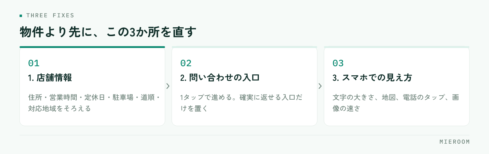

<!--META
{
  "title": "賃貸仲介の自社ホームページから反響を取る方法｜ポータル以外の経路を育てる順番",
  "date": "2026-11-24",
  "category": "集客・広告",
  "excerpt": "ポータル頼みの集客から抜け出したい賃貸仲介の店舗に向けて、自社ホームページから反響を取るまでの順番をまとめました。先に直す3か所、物件情報の載せ方、問い合わせ経路の作り方、経路別に数える仕組み、よくある失敗までを整理しています。",
  "hook": "自社サイトは物件より先に直す所がある",
  "tags": ["自社サイト", "反響", "集客", "ホームページ", "賃貸仲介"]
}
META-->

ポータルの掲載費は上がるのに、反響は増えない。自社のホームページがあるのに、そこからの問い合わせはほとんど来ない。賃貸仲介の店舗で、集客の相談がいちばん多く集まるのがこの場面です。結論から申し上げると、**自社ホームページからの反響は、物件を増やす前に受け皿を直したほうが先に動きます**。この記事では、どこから手を付ければ反響が来るようになるのか、順番で整理します。

<h4>この記事の結論</h4>
自社サイトの反響が来ない原因は、ほとんどが物件数ではありません。見ている人が問い合わせる手前で止まっています。先に直すのは<strong>店舗情報と問い合わせの入口</strong>、次に物件情報の鮮度、最後に流入の経路です。この順番を逆にすると、手間をかけた分が反響になりません。

## 自社サイトの反響が来ないのは、物件数が足りないからではない

自社サイトから反響が来ない店舗を見ていくと、原因は物件の数より手前にあることが多いです。

よくあるのは、物件ページまでたどり着いた人が、そこで止まっている状態です。問い合わせのボタンが下まで下げないと見つからない、入力項目が多すぎる、送ったあとに何が起きるのか書かれていない。見ている側は、電話をかけるかポータル経由で問い合わせるかを選びます。結果として、自社サイトを見たのにポータルからの反響として記録されます。

もう一つは、店舗を探している人の受け皿が無い状態です。賃貸仲介の自社サイトに来る人は、物件を探している人だけではありません。「この店に行っても大丈夫そうか」を確かめに来ている人がいます。営業時間、定休日、駐車場、来店の予約方法、スタッフの顔。この情報が無いと、物件が気に入っても来店の判断ができません。

**自社サイトは、物件を並べる場所ではなく、来店の不安を減らす場所として作ると反響が変わります**。ポータル側の見直し方は[ポータルサイトの反響を増やす方法](./portal-hankyo-fuyasu.html)に整理しています。

## 先に直す3か所：店舗情報・問い合わせの入口・スマートフォンでの見え方

物件情報に手を入れる前に、先に直す場所が3つあります。どれも1日で終わる作業です。

<figure class="fig"><figcaption>どれも1日で終わる作業です。すでに来ている訪問者に先に効きます。</figcaption></figure>

一つ目は、店舗情報です。住所と地図、営業時間と定休日、電話の受付時間、駐車場の有無と台数、最寄り駅からの道順、対応している地域。来店を考えている人が確かめたい項目をそろえます。免許番号と会社情報も、信頼の判断材料として見られます。

二つ目は、問い合わせの入口です。どのページからでも1タップで問い合わせに進める状態を作ります。入口は複数あってよく、電話、フォーム、LINE、来店予約のうち、店舗で確実に対応できるものだけを置きます。対応できない入口を置くと、返信が遅れて信頼を落とします。

三つ目は、スマートフォンでの見え方です。賃貸を探す人のほとんどはスマートフォンから見ます。文字が小さい、地図が指で動かせない、電話番号がタップできない、画像の読み込みが遅い。この4つは反響に直接響きます。

✓自分の店のサイトを客の目で見る方法

自分のスマートフォンで、店名ではなく「地域名＋賃貸」で検索し、そこから自社サイトに入ってみてください。普段はブックマークや管理画面から入っているため、初めて来た人が見る順番とは違う画面を見ています。

### 問い合わせ経路は、店舗が確実に返せるものだけを置く

入口を増やせば反響が増えるわけではありません。返せない入口は、反響を減らします。

フォームを置く場合は、入力項目を絞ります。名前と連絡先、希望の条件、見たい物件。この程度で足ります。年収や勤務先を最初に聞くと、送る手前で離脱します。

LINEを置く場合は、受付の時間と返信の目安を書きます。LINEは電話より気軽に送れるため、営業時間外にも届きます。すぐ返せないなら、自動の返信で受け取ったことを伝える形にしておきます。自動返信の作り方は[反響メールの自動返信の作り方](./hankyo-jido-henshin-tsukurikata.html)に整理しています。

来店予約を置く場合は、枠の管理を決めます。予約が入ったときに誰が気付くのか、重なったときにどう調整するのか。ここが決まっていないと、予約を受けたのに準備ができていない状態になります。

**入口の数ではなく、入口ごとに「誰がいつ返すか」が決まっているかで反響の質が変わります**。営業時間外の反響の扱いは[営業時間外に入った反響の拾い方](./eigyo-jikangai-hankyo.html)も参考になります。

## 物件情報は、数より鮮度と載せる順番で決まる

受け皿が整ったら、物件情報に手を入れます。ここで大事なのは掲載数ではありません。

まず鮮度です。すでに決まった物件が載っているサイトは、1度問い合わせた人が二度と使いません。反響が来てから「その物件はもう決まっています」と答える対応が続くと、店舗側の手間も増えます。掲載の取り下げの手順は[掲載物件の取り下げ](./keisai-bukken-torisage.html)にも書いています。

次に、載せる順番です。自社サイトの物件一覧は、新着と自社で預かっている物件を上に置きます。ポータルと同じ並びにすると、見ている側は比べる理由を見つけられません。自社サイトで見る価値があるのは、ポータルに出していない物件、出す前の物件、条件の相談ができる物件です。

三つ目は、1件あたりの情報量です。間取り図、写真、周辺の環境、初期費用の目安、入居できる時期。ポータルの転載ではなく、現地を見た人が書いた一言が入っていると、問い合わせの内容が具体的になります。

| 自社サイトに向く物件 | ポータルに向く物件 |
|---|---|
| 自社で預かっている物件 | 広く数を当てたい物件 |
| 公開前・相談中の物件 | 条件が標準的で比較されやすい物件 |
| 条件の交渉ができる物件 | 繁忙期に回転させる物件 |
| 地域を絞って探している人向けの物件 | 遠方から探している人向けの物件 |

掲載の手間が増えるほど鮮度は落ちます。業者間サイトから集めた情報を自社サイト用に作り直す作業が重い場合は、取り込みと変換の仕組みを先に整えるほうが続きます。

## 自社サイトに人を連れてくる3つの経路

受け皿と物件が整ったら、流入を作ります。賃貸仲介の店舗で現実的に効く経路は3つです。

一つ目は、地域の検索です。「地域名＋賃貸」「駅名＋賃貸」で探している人に向けて、地域ごとのページを作ります。扱っている地域の特徴、家賃の傾向、学校や買い物の環境。物件一覧だけのページより、地域を説明したページのほうが読まれます。

二つ目は、地図からの流入です。Googleのビジネスプロフィールに店舗を登録し、営業時間と写真と口コミを整えると、地図で店を探している人がサイトに来ます。来店に近い人が多い経路です。進め方は[賃貸仲介店舗のGoogleビジネスプロフィール運用](./chintai-tenpo-gbp-unyo.html)にまとめています。

三つ目は、既存の顧客と紹介です。契約した方、過去に問い合わせた方、地域の法人。名刺や契約書類、メールの署名に自社サイトの場所を入れておくと、次に必要になったときの入口になります。

この3つに共通するのは、広告費をかけ続けなくても積み上がることです。ポータルの掲載を止めた瞬間に反響が止まる状態と違い、作ったページは残ります。ただし成果が出るまでに時間がかかるため、ポータルを止めてから始める順番にはしないでください。

## 反響がどこから来たかを数える仕組みを先に作る

自社サイトに手を入れるときに、いちばん抜けやすいのがこの部分です。経路を数えていないと、どの作業が効いたのか分かりません。

最低限、反響1件ごとに次の3つを記録します。入った日時、経路（ポータル名・自社サイト・電話・LINE・紹介）、問い合わせの内容。この3つがあれば、月末に経路別の件数が出せます。

さらに、経路ごとに来店と成約まで追えると、判断が変わります。件数が多い経路と、契約につながる経路は同じではありません。自社サイトは件数が少なくても、来店率が高い経路になることがあります。件数だけで判断すると、育てる価値のある経路を切ってしまいます。

- 反響の入力時に、経路を選ぶ欄があるか
- 電話で入った反響も記録に残っているか
- 同じ人が別の経路から2回来たときに、重複が分かるか
- 月末に経路別の件数を出すのに、集計作業が必要になっていないか
- 来店・申込・契約まで、同じ1件としてつながっているか

記録の型は[賃貸仲介の反響管理の方法](./hankyo-kanri-hoho.html)に整理しています。**経路を数えていない状態で自社サイトに手をかけると、効いたかどうかが分からないまま判断することになります**。

## よくある失敗とその避け方

自社サイトからの反響を増やす取り組みで、止まりやすい形を並べます。

物件数をそろえることから始めてしまう。掲載の作業が重くなり、鮮度が落ちて、更新が止まります。先に受け皿を直してから、扱う物件を絞って載せるほうが続きます。

サイトを作り直すところから始めてしまう。見た目を変えても、問い合わせの入口と店舗情報が同じなら反響は変わりません。作り直す前に、今のサイトで直せる3か所を試してください。

入口を増やしすぎる。フォーム、LINE、電話、チャット、メール。返す人が決まっていない入口は、返信漏れの原因になります。確実に返せるものだけに絞ります。

ポータルを止めてから自社サイトを始めてしまう。自社サイトの流入は積み上がるまで時間がかかります。重なっている期間を作ってから、経路別の数字を見て判断します。

更新する人を決めていない。物件の入れ替えも、地域ページの追記も、担当が決まっていなければ止まります。週に1回、15分の作業として誰かの仕事に入れておきます。

## 自分で進める場合と、ツールに任せる場合の分かれ目

自社サイトからの反響づくりは、手でも進められます。分かれ目を整理します。

手で進めやすいのは、店舗情報の整備、問い合わせの入口の見直し、地域ページの作成です。どれも1回やれば残る作業で、外に頼まなくても始められます。文章を書く時間が取れるなら、ここは自分で進めたほうが店舗の実情が反映されます。

ツールや仕組みに任せたほうがよいのは、繰り返し発生する作業です。物件情報の取り込みと掲載の更新、反響が入ったときの記録、経路別の集計、営業時間外の一次対応。これらは毎日・毎月発生し、手でやると鮮度と記録の精度が落ちます。

判断の目安は、作業の回数です。1回で終わる作業は手で、毎週・毎月発生する作業は仕組みで。**手で続けられなくなった時点で鮮度が落ち、鮮度が落ちた自社サイトは反響を生まなくなります**。続かない仕組みを作らないことが、結果として反響の数を決めます。

## よくある質問

自社サイトとポータル、どちらに力を入れるべきですか？

同時に持つのが現実的です。ポータルはすぐ反響が立ち上がる代わりに、出し続ける費用がかかります。自社サイトは時間がかかる代わりに積み上がります。ポータルで反響を確保しながら、自社サイトの受け皿を整えていく順番をおすすめします。

どのくらいで反響が来るようになりますか？

期間は地域の状況と扱う物件によって変わるため、一律には言えません。ただし、店舗情報と問い合わせの入口の見直しは、すでに来ている訪問者に効くため比較的早く変化が見えます。地域ページからの検索流入は、積み上がるまで時間がかかります。

サイトを作り直したほうがいいですか？

スマートフォンで見られない、更新ができない、問い合わせフォームが動いていないといった場合は作り直しが必要です。そうでなければ、今のサイトで店舗情報と入口を直し、反響の記録を取り始めてから判断したほうが無駄がありません。

物件はどのくらい載せればいいですか？

数より鮮度です。決まった物件が載っている状態をなくせる範囲に絞ってください。自社で預かっている物件と、公開前の物件を中心に置くと、ポータルと見比べる理由が生まれます。

反響の経路は、どう記録すればいいですか？

反響1件ごとに、入った日時・経路・内容を残す形が最小です。電話で入った反響も同じ欄に記録してください。経路の選択肢を先に決めておくと、月末の集計で表記のばらつきに悩まなくなります。

## まとめ：受け皿を直してから、経路を育てる

自社ホームページからの反響は、物件を増やす前に受け皿を直すところから始まります。店舗情報と問い合わせの入口、スマートフォンでの見え方を整え、物件は数より鮮度で絞り、地域の検索・地図・紹介の3つの経路を育てる。そして、どの経路から来た反響なのかを1件ごとに記録する。この順番で進めると、かけた手間が数字で確かめられるようになります。

ミエルームなら、反響が入った経路を案件ごとに記録でき、フォームとメールの自動取込で自社サイトから届いた問い合わせもそのまま一覧に入るため、経路別の件数を月末に数え直す作業がなくなります。反響から来店・申込・入金までが同じ1件としてつながるので、件数の多い経路ではなく契約につながる経路が見えるようになります。地図からの流入を強くするMEO・AIO対策や、物件情報の取り込みを軽くする物件コンバータ・業者間サイト連携もオプションでご用意しています。機能の詳細は[ミエルームの機能一覧](../features.html)をご覧ください。資料のご請求やデモアカウントの発行は、この下のボタンからお気軽にどうぞ。
