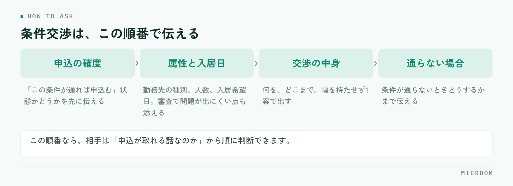

<!--META
{
  "title": "賃料や条件の交渉を通す進め方｜確認の順番と、断られたときの代替案",
  "date": "2026-10-17",
  "category": "業務効率化",
  "excerpt": "入居希望者から賃料交渉を受けたときの進め方を、確認の順番・管理会社への伝え方・断られたときの代替案の3段で整理しました。通りやすい交渉と通りにくい交渉の違い、店として決めておくルールまでまとめています。",
  "hook": "交渉が通るかは、聞く順番と材料で決まる",
  "tags": ["条件交渉", "申込管理", "店舗運営", "接客", "賃貸仲介"]
}
META-->

「家賃、少し下がりませんか」と聞かれたとき、そのまま管理会社に電話していないでしょうか。**条件交渉が通るかどうかは、交渉の上手さではなく、先に何を確認したかで決まります**。確認を飛ばした交渉は、通らないだけでなく、申込そのものを長引かせます。

<h4>この記事の結論</h4>
交渉の前に確認するのは、金額ではなく申込の確度と入居日です。<strong>「この条件が通れば申込む」という状態を作ってから出すと、交渉は通りやすくなります</strong>。賃料以外に動かせる条件を先に並べ、断られたときの代替案まで用意してから連絡してください。

## 交渉を受けたとき、最初に確認する3つのこと

交渉の相談を受けて、すぐ管理会社に確認を入れるのは早すぎます。先に次の3つをお客様に確認してください。

ひとつめは、**この条件が通れば申込むのかどうか**です。「通れば申込みます」と「通ったら考えます」では、交渉として出せる話が変わります。後者の状態で金額の相談を入れると、通ったあとに申込まれなかったときに、次の交渉が出しづらくなります。

ふたつめは入居希望日です。空室期間を短くできる入居日なら、それ自体が交渉の材料になります。みっつめは、ほかに比較している物件があるかどうかです。賃料より初期費用のほうが効く場合があります。

✓金額を先に聞かない

「いくらなら決めますか」から入ると、話が金額だけになります。先に入居日と優先順位を聞くと、賃料を動かさずに済む選択肢が出てきます。金額の話は、動かせる条件を並べたあとです。

## 賃料以外に動かせる条件を先に並べる

交渉というと賃料だけの話になりがちですが、実際に動く余地があるのは賃料以外の部分です。優先順位を決めて並べてください。

| 交渉する条件 | 通りやすさの傾向 | 向いている場面 |
|---|---|---|
| フリーレント | 比較的通りやすい | 入居日が先で、空室期間が気になる物件 |
| 初期費用の内訳 | 条件によって動く | 初期費用の総額が理由で迷っているとき |
| 設備の修繕・交換 | 入居前提なら相談しやすい | 内見で気になった点が決め手になっているとき |
| 入居日の調整 | 店側で調整できることが多い | 希望日と募集条件がずれているとき |
| 賃料の減額 | いちばん通りにくい | ほかの条件で埋まらない差があるとき |

**賃料は最後に回します**。月額が下がると、オーナー側は以後の募集条件にも影響すると考えるためです。同じ負担の軽減でも、一時的な条件のほうが受け入れられやすくなります。募集条件そのものの見直しをオーナーへ提案する場合の組み立て方は[空室が動かないときの募集条件の見直し](./kushitsu-boshu-joken-minaoshi.html)にまとめています。

## 管理会社・オーナーに伝える順番

交渉の連絡は、結論から入ると判断してもらえません。相手が判断に必要な材料を、順番に出してください。

<figure class="fig"><figcaption>金額から入ると、材料がないまま断る判断になりがちです。</figcaption></figure>

1. **申込の確度**：「この条件が通れば申込む」という状態かどうかを先に伝える
2. **入居者の属性と入居日**：勤務先の種別、人数、入居希望日。審査で問題が出にくい点があれば添える
3. **交渉の中身**：何を、どこまで。幅を持たせず1案で出す
4. **通らなかった場合の意向**：条件が通らないときどうするかまで伝える

この順番で伝えると、相手は「申込が取れる話なのか」から順に判断できます。逆に金額から入ると、材料がないまま断る判断になりがちです。

## 通りやすい交渉と、通りにくい交渉の違い

同じ内容でも、出し方で結果が変わります。通りやすい交渉には共通点があります。

- **申込とセットになっている**：条件が通れば申込む状態で出ている
- **幅がなく1案**：「できるだけ下げてほしい」ではなく、具体的な1案で出ている
- **空室期間に触れている**：入居日が早い、繁忙期を外さない、といった材料がある
- **代替案がある**：賃料が無理ならフリーレント、という次の案まで用意されている

逆に通りにくいのは、申込の確度が分からないまま金額だけを聞く形、複数の条件を同時に出す形、そして根拠を言わずに「相場より高い」と伝える形です。**交渉の回数が増えるほど通りにくくなる**ため、一度で決められる形にまとめてから連絡してください。

## 断られたときの代替案を用意しておく

断られる前提で準備しておくと、その場で次の話に進めます。用意するのは次の3つです。

ひとつは、別の条件への振り替えです。賃料が通らなかった場合に、フリーレントや設備の相談に切り替えます。ふたつめは、同条件帯の別物件です。交渉が通らない連絡で、次の提案を一緒に出せる状態にしておきます。みっつめは、断られた理由の記録です。

✓断られた理由は物件ごとに残す

同じ物件で同じ交渉を何度も出すと、関係が悪くなります。「この物件はフリーレントは相談可、賃料は不可」といった結果が残っていれば、次の案件では最初から通る案だけを出せます。担当者の記憶だけに置かないでください。

## 店としてのルールを決めておく

交渉を担当者の判断に任せると、店として出す条件がばらつきます。次の3つを決めておいてください。

**どこまで店長の確認なしで出せるか。** フリーレントの相談までは担当者、賃料の減額は店長の確認を通す、という線を決めます。**出した交渉を記録に残す形。** 誰が、どの物件に、何を出して、結果がどうだったか。案件の記録と同じ場所に残しておくと、引き継ぎのときに経緯が読めます。

そして、**交渉中の案件を止めない仕組み**です。回答待ちのまま数日動かない案件が、いちばん失注につながります。回答待ちの案件が一覧で見える形にしておけば、催促の判断ができます。申込段階の情報の持ち方は[申込管理表の作り方](./moushikomi-kanrihyo-tsukurikata.html)の形がそのまま使えます。

家賃交渉はどこまでお願いできるものですか？

物件とオーナーの状況によって変わるため、一律の上限はありません。判断の材料になるのは、空室になっている期間と入居日です。長く空いている部屋と、募集を始めたばかりの部屋では、同じ相談でも受け取られ方が違います。お客様に「どのくらいまで下がりますか」と聞かれた場合は、金額を約束せず、確認してから回答する旨を伝えてください。先に見込みを言うと、通らなかったときに申込が止まります。

交渉の回答を待つ間、ほかのお客様に案内してよいですか？

店として扱いを決めておく必要があります。交渉の回答待ちは申込ではないため、物件を止める根拠にはなりません。一方で、案内を続けて先に申込が入ると、交渉していたお客様への説明が難しくなります。現実的なのは、回答待ちの期限を決めておくことです。いつまでに回答が来なければ通常の案内に戻す、という線を社内で共有しておくと、担当者ごとの判断が揃います。

交渉が通ったあとに申込がキャンセルされたときは？

管理会社やオーナーへ、理由を添えて早めに連絡してください。連絡が遅れると、次の交渉が出しづらくなります。あわせて、キャンセルの理由を案件の記録に残してください。交渉が通ったのにキャンセルになる場合、理由が条件以外にあることが多く、同じ段階での取りこぼしが続いていないかを後から確認できます。

## まとめ：交渉は、確認と記録で通る形になる

条件交渉の進め方は3段です。先に申込の確度と入居日を確認する、賃料以外に動かせる条件から並べる、断られたときの代替案を用意して1案で出す。この形にすると、交渉の回数そのものが減ります。

そして**出した交渉と結果を物件ごとに残す**ことが、次の案件を速くします。記録がなければ、同じ物件に同じ相談を繰り返すことになります。

[ミエルーム](../index.html)なら、反響から申込・入金までを案件ごとに1か所で記録できるので、回答待ちの案件や交渉の結果を担当者の記憶に預けずに済みます。接客と反響の成績もあわせて見えるため、どの段階で取りこぼしているかが後から追えます。回答待ちの案件を探す手間がなくなり、催促と次の提案の判断が早くなります。デモアカウントの発行やご相談は、この下のボタンからお気軽にどうぞ。
