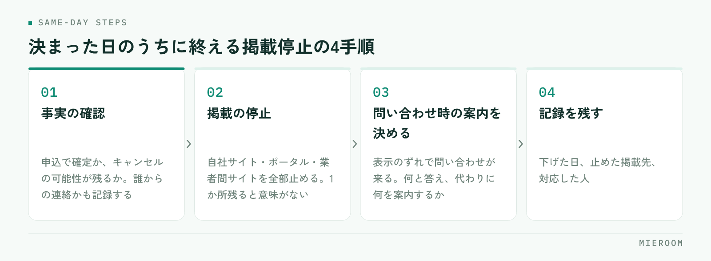

<!--META
{
  "title": "成約済み物件の掲載を止める運用｜おとり物件を防ぐ棚卸しの手順",
  "date": "2026-10-13",
  "category": "集客・広告",
  "excerpt": "決まった物件の掲載を止める運用を、下げる基準・当日の手順・週1回の棚卸し・掲載先ごとの進め方に分けて整理しました。おとり広告として扱われるリスクと、下げたあとに残す記録もまとめています。",
  "hook": "成約した物件は、その日のうちに下げる",
  "tags": ["掲載管理", "ポータルサイト", "おとり広告", "反響管理", "賃貸仲介"]
}
META-->

「この物件、まだ空いていますか」という問い合わせに、「すでに決まってしまいまして」と答える回数が多い店舗は、掲載の棚卸しが追いついていません。**決まった物件を下げる作業は、集客の作業の一部**です。載せる手を増やす前に、下げる手順を決めるほうが反響の質は上がります。

<h4>この記事の結論</h4>
成約済み物件の掲載が残るのは、担当者の不注意ではなく<strong>下げる基準と担当が決まっていないから</strong>です。申込の段階に合わせて下げる基準を決め、当日に止め、週1回の棚卸しで漏れを拾う。この3つで運用になります。

## 決まった物件が載り続けると、何が起きるか

起きることは3つに分かれます。順に見ていきます。

まず、**問い合わせの中身が悪くなる**ことです。決まった物件への問い合わせは、どれだけ丁寧に対応しても代替の提案から始めることになります。最初に断る形で会話が始まるため、来店につながりにくくなります。

次に、**お客様の見る目が変わる**ことです。問い合わせた物件が決まっていた経験が重なると、その店舗の掲載情報そのものを疑うようになります。実際に空いている物件への反響も減ります。

そして、**法令上のリスク**です。成約済みと分かっている物件を広告として掲載し続けることは、おとり広告として扱われるおそれがあります。意図していなくても、掲載が残っていれば外から見た状態は同じです。

✓「まだ決まっていないかもしれない」で残さない

申込が入った物件を、審査が通るまで念のため載せておく運用は危険です。審査が通る前提で動いている以上、空いている物件として扱うことはできません。残したいのであれば、掲載を止めて、問い合わせがあったときに「申込が入っている」と伝える形にしてください。

## 掲載を止める基準を、申込の段階で決めておく

判断を担当者ごとに委ねると、同じ店舗の中で扱いがばらつきます。段階ごとに決めておけば迷いません。基準の例を挙げます。

- **申込が入った時点で止める**：もっとも安全で、多くの店舗が採る形です
- **審査が通った時点で止める**：申込のキャンセルが多い場合に選ばれますが、その間は「申込あり」と伝える前提が必要です
- **契約が済んだ時点で止める**：掲載が残る期間が長くなるため、おすすめしません

どの基準にするかは店舗の判断ですが、**決めたら全員で同じ基準を使う**ことが前提です。そして基準は紙に書いて貼ってください。口で決めただけの基準は、繁忙期に崩れます。

管理会社の物件で、こちらに決定権がない場合もあります。その場合は「申込が入った連絡を受けたら止める」と決めておき、連絡が来ない管理会社には週1回まとめて確認する形にします。

## 成約が決まった日のうちに終える手順

下げる作業は、翌日に回すと忘れます。受けた日のうちに終える手順を4つに分けます。

<figure class="fig"><figcaption>2番目で漏れが出やすいのは、ふだん開かない掲載先です。</figcaption></figure>

1. **事実の確認**：申込で確定なのか、キャンセルの可能性が残るのか。誰からの連絡かも記録します
2. **掲載の停止**：自社サイト、ポータルサイト、業者間サイトのすべてを止めます。1か所だけ残ると意味がありません
3. **問い合わせがあったときの案内を決める**：止めた直後も、表示のずれで問い合わせが来ます。何と答えるか、代わりに案内する物件を先に決めておきます
4. **記録を残す**：下げた日、止めた掲載先、対応した人を書きます

このうち2番目で漏れが出やすいのは、**ふだん開かない掲載先**です。使っている掲載先の一覧を作っておき、止めるときはその一覧を上から順に消していく形にすると落ちません。

反響がどの物件に付いているかを把握する考え方は[反響管理のやり方](./hankyo-kanri-hoho.html)にも整理しています。

## 週1回の棚卸しで、取りこぼしを拾う

当日の手順を決めても、取りこぼしはゼロになりません。連絡が遅れて届く物件、他社で決まった物件、募集が終了した物件があるからです。そこで週1回、掲載中の物件を上から確認する時間を取ります。

見るのは次の3点だけです。**掲載してから日数が経っている物件**、**反響が1件も来ていない物件**、**最後に空室を確認した日が古い物件**です。この3つに該当する物件を、管理会社や元付に確認します。

所要時間を読めるようにするため、曜日と担当を固定してください。「週明けの午前、店長が見る」のように決めておくと、繁忙期でも残りやすくなります。全件を毎週見る必要はなく、確認した日付を記録して古いものから回していく形で十分です。

✓反響が来ない物件は、2つの原因に分かれる

反響が来ない物件は、すでに決まっている場合と、募集条件や紹介文が合っていない場合があります。棚卸しでは先に空室かどうかを確認し、空いているなら条件側を見てください。条件の見直し方は<a href="./kushitsu-boshu-joken-minaoshi.html">空室の募集条件の見直し</a>、紹介文は<a href="./bukken-shokaibun-kakikata.html">物件紹介文の書き方</a>に分けてまとめています。

## 掲載先が複数あるときの進め方

掲載先は性質が違うため、止めるときの注意点も変わります。

| 掲載先 | 止めるタイミング | 気をつける点 |
|---|---|---|
| 自社サイト | 当日すぐ | 自分で止められるので最初に。検索結果に残る場合があるため表示も確認する |
| ポータルサイト | 当日すぐ | 反映に時間差が出ることがある。止めた直後の問い合わせを想定しておく |
| 業者間サイト | 当日すぐ | 他社が見て客付けを進めるため、残すと先方にも迷惑がかかる |
| 紙の資料・店頭貼り出し | 当日すぐ | 画面の作業だけで終えると残る。店内の貼り出しも一緒に外す |

いちばん忘れられやすいのは、**店頭に貼ってある紙と、作り置きした物件資料**です。掲載を止めるという言葉が画面の作業だけを指していると、紙はそのまま残ります。下げる手順の中に「紙を外す」を必ず入れてください。

業者間サイトでの探し方と載せ方の整理は[業者間サイトでの物件検索](./gyoshakan-site-bukken-kensaku.html)にもまとめています。

## 下げたあとに残しておく記録

止めたあとに記録を残すのは、次の募集のためです。残す項目は3つで足ります。

**1つめは、いつ・どの条件で決まったか**です。家賃と初期費用の条件、申込までにかかった日数が分かると、同じ物件が次に空いたときの募集条件を決めやすくなります。

**2つめは、どの掲載先から反響が来たか**です。媒体ごとの差は、1件では分かりませんが、数か月分たまると見えてきます。次にどこへ載せるかの判断材料になります。

**3つめは、下げ忘れがあったかどうか**です。漏れた掲載先を記録しておくと、手順のどこが弱いかが分かります。人を責めるためではなく、一覧から抜けている掲載先を見つけるために使ってください。

申込が入った物件を、キャンセルに備えて載せたままにしてはいけませんか？

載せたままにすることはおすすめしません。申込が入っている物件を空室として広告している状態になり、おとり広告として扱われるおそれがあります。キャンセルが心配な場合は掲載を止めたうえで、その物件を気に入っていたお客様の連絡先を記録しておき、キャンセルが出たときに個別にご案内する形にしてください。キャンセル時の処理の流れは<a href="./moushikomi-cancel-shori.html">申込キャンセルが出たときの処理</a>に整理しています。

管理会社から成約の連絡が来ないことが多く、下げるのが遅れます

連絡を待つ運用から、こちらから確認する運用に切り替えてください。週1回の棚卸しの時間に、掲載してから日数が経っている物件と反響が来ていない物件をまとめて確認すると、1件ずつ問い合わせるより手間が少なくなります。また、連絡が遅れがちな先がどこかを記録しておくと、その先の物件だけ確認の間隔を短くする判断ができます。

掲載物件の数が減ると、集客に不利になりませんか？

掲載数は多いほうが接触の機会は増えますが、決まった物件が混ざっていると、問い合わせが断りから始まることになります。結果として来店につながる率が下がるため、数だけを見て判断しないでください。空いている物件の情報を正確に載せ、反響が来ない物件は条件や紹介文を見直す。この順番のほうが、同じ掲載数でも来店の数は変わります。

## まとめ：掲載の鮮度は、反響の質に直結する

成約済み物件の掲載が残る原因は、注意不足ではなく運用の不在です。申込の段階に合わせて下げる基準を決め、決まった日のうちに全部の掲載先を止め、週1回の棚卸しで漏れを拾う。この3つを決めれば、担当者が変わっても同じ状態を保てます。

そして**下げる作業は、載せる作業と同じくらい集客に効きます**。断りから始まる問い合わせが減れば、同じ反響の数でも来店の数は変わります。

[ミエルーム](../index.html)なら、申込が入った時点で案件の段階を記録できるので、どの物件を下げるべきかが管理表の上で分かります。反響がどの物件とどの媒体から来ているかも残るため、棚卸しのときに確認する物件を選びやすくなり、掲載先を一つずつ思い出す作業がなくなります。デモアカウントの発行やご相談は、この下のボタンからお気軽にどうぞ。
