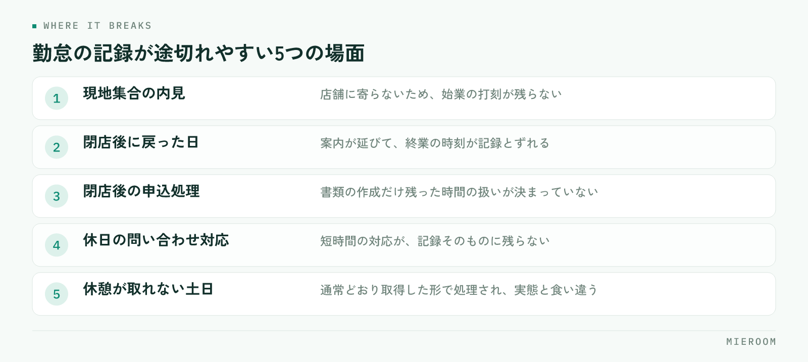

<!--META
{
  "title": "賃貸仲介店舗の勤怠管理｜繁忙期の残業を、あとで揉めない形で残す",
  "date": "2026-10-22",
  "category": "組織・育成",
  "excerpt": "賃貸仲介の店舗で勤怠と残業を正確に残すための進め方をまとめました。打刻が狂いやすい場面、直行直帰や内見同行の扱い、残業の申請ルール、繁忙期前に決めておく項目まで、店舗の実務に沿って整理しています。",
  "hook": "繁忙期の勤怠は、あとから思い出せない",
  "tags": ["勤怠管理", "労務", "繁忙期対策", "店舗運営", "賃貸仲介"]
}
META-->

繁忙期が終わったあとに、残業代の計算で手が止まる。あるいは「あの日は何時まで残っていたか」をスタッフと確認し合う。賃貸仲介の店舗で起きがちな場面です。**勤怠は、起きたその日に記録が残っていないと、あとから正確に復元できません**。繁忙期に入る前に、どこで記録が途切れるかを潰しておく必要があります。

<h4>この記事の結論</h4>
勤怠管理でもめる原因は、スタッフの申告が不正確なことではなく、<strong>打刻できない時間帯が業務の中に残っていること</strong>です。直行直帰の内見、閉店後の申込処理、休憩が取れなかった日。この3つの扱いを先に決めて、申請の形を1つにそろえれば、繁忙期でも記録は揃います。

## 賃貸仲介の勤怠は、店舗にいない時間でずれる

勤怠管理の仕組みを入れても記録が合わないのは、賃貸仲介の業務が店内で完結しないためです。来店されたお客様の案内で外に出る、物件の鍵を取りに行く、オーナーや管理会社に寄る。こうした時間は店舗のタイムカードでは拾えません。

<figure class="fig"><figcaption>働いた本人は覚えていても、1週間経つと正確には思い出せません。</figcaption></figure>

実務でずれが出るのは、おおむね次の場面です。

- 朝いちばんの内見で、店舗に寄らず現地集合した日
- 案内が長引いて、閉店時刻を過ぎてから店舗に戻った日
- 申込が重なり、閉店後に書類の処理だけ残った日
- 休日に業者間サイトの問い合わせ対応だけ行った日
- 繁忙期の土日で、休憩を取れずに通して動いた日

**この5つは、どれも「働いた本人は覚えているが、記録には残っていない」時間です**。繁忙期は件数が多いため、1週間経つと本人も正確に思い出せません。シフトと人員の組み方そのものは[繁忙期のシフトと人員計画](./hanbouki-shift-jinin-keikaku.html)にまとめています。

## 先に決めるのは、打刻の起点と終点

ずれを潰す方法は、ルールを増やすことではありません。「いつからが労働時間か」を場面ごとに決めて、全員が同じ基準で打刻することです。

決めておく項目は4つあります。1つめは、現地集合で始まる日の起点をどこに置くか。移動の出発時点にするのか、現地到着時点にするのかを決めます。2つめは、直帰する日の終点です。最後のお客様と別れた時点か、報告の連絡を入れた時点かを決めます。

3つめは、閉店後の残り作業の扱いです。申込書の作成や審査の申請を閉店後に行う日は実務上あります。この時間を打刻に含めるのか、別の申請として出すのかを明文化します。4つめは、休日に短時間だけ対応した場合の扱いです。

決めた内容は、次のように場面と対応させた形で残しておくと共有が早く済みます。

| 場面 | 決めること | 記録の残し方 |
|---|---|---|
| 現地集合で始まる日 | 労働時間の起点をどこに置くか | 出発または到着の時刻を打刻 |
| 案内が延びて直帰する日 | 終点をどこに置くか | 別れた時刻または報告の時刻を打刻 |
| 閉店後に残る申込処理 | 打刻に含めるか申請に分けるか | 残業の申請として記録 |
| 休日の短時間対応 | 労働時間として扱う範囲 | 対応した時間と内容を1行で記録 |

✓決め方の基準

どちらの扱いが正しいかを考えるより、全員が同じ基準で迷わず打刻できるかを基準に選んでください。基準が人によって違うと、同じ働き方をした2人の記録が違う形になり、そこから不信が生まれます。

## 残業は「事後報告」ではなく、申請の形にする

繁忙期の残業が揉めるのは、金額ではなく経緯のほうです。本人は必要だと思って残り、店長は把握していなかった。あとから時間だけを見て、必要だったかを議論することになります。

これを避けるには、残業を**申請して始める形**に変えます。形は簡単なものでかまいません。残る理由（どの案件のどの作業か）と、見込みの終了時刻を、残り始める前に店長へ出す。出したうえで残り、終わったら実際の時刻を記録する。

この形にすると、副産物として業務の偏りが見えます。同じ人の申請が続くなら案件の配分に問題があり、同じ作業名が続くならその作業自体を見直す対象になります。残業時間を減らす話は、記録が揃ってはじめて始められます。

## 休憩の記録は、取れなかった日こそ残す

賃貸仲介の繁忙期で現実に起きるのが、休憩を取れないまま一日が終わることです。来店が途切れず、交代できる人がいない。この日の記録を「通常どおり休憩1時間」として処理していると、実態と帳簿が食い違った状態が積み上がります。

必要なのは、取れなかったことを残せる形にしておくことです。休憩の開始・終了を打刻する形にして、取れなかった日はその旨と理由を1行で残す。そのうえで、翌営業日以降に時間をずらして確保するか、別の形で調整するかを店長が判断します。

**記録に残っていれば調整の対象になりますが、残っていない時間は調整の判断そのものができません**。この積み残しは、繁忙期が終わってから発覚すると対応の選択肢が狭まります。

## 勤怠を給与まで一本で通す

勤怠の記録が揃っても、そこから給与計算に移すときに転記が入ると、また手間と誤りが戻ってきます。賃貸仲介の店舗では、基本給のほかに歩合や手当がある場合が多く、計算の工程が増えやすい構造です。

繁忙期前に確認しておきたいのは次の点です。

1. 打刻の記録から、月単位の労働時間と残業時間がそのまま出せるか
2. 歩合の対象になる成果（契約・申込など）の確定時期と、給与の締め日が合っているか
3. キャンセルが出たときに、確定した成果をどう戻すかが決まっているか
4. 記録を見られる人の範囲が決まっているか

3つめは賃貸仲介に固有の論点です。申込が入った月と、キャンセルが出た月が違う場合の扱いを事前に決めていないと、支給後の調整になります。成果の記録と評価の扱いは[スタッフの成績管理](./staff-seiseki-kanri.html)でも触れています。

!繁忙期の途中でルールを変えない

繁忙期に入ってから打刻の基準や残業の申請方法を変えると、変更前と変更後で記録の形が違うものが混ざります。見直しは閑散期のうちに終えて、繁忙期は同じ形で通してください。

## 繁忙期前にそろえておく確認項目

ここまでの内容を、繁忙期に入る前の確認項目として並べます。

- 現地集合・直帰の日の、打刻の起点と終点を決めてある
- 閉店後の残り作業の扱いを決めてある
- 休日の短時間対応の扱いを決めてある
- 残業を、残り始める前に申請する形にしてある
- 休憩を取れなかった日を記録に残せる形にしてある
- 打刻の記録から月の労働時間と残業時間がそのまま出る
- 成果の確定時期と、給与の締め日が合っている
- キャンセル時に成果を戻す手順が決まっている

全員に共有するのは、このうち上の5つで足ります。下の3つは店長と管理側で確認しておく項目です。

打刻を忘れたときは、どう直すのがよいですか？

本人の申告で修正する形にして、修正した記録であることが分かるように残してください。上書きして痕跡が消える形にすると、あとで確認が必要になったときに経緯が追えません。修正の申告が続く場合は、打刻の場所や方法が業務の動きに合っていない可能性があります。忘れた人を指導するより、打刻しやすい形に変えたほうが回数は減ります。

少人数の店舗でも、勤怠の仕組みは必要ですか？

人数が少ないほど、1人あたりの繁忙期の負荷が大きくなるため、記録の必要性は下がりません。むしろ全員が常に動いている状態になり、あとから時間を思い出すのが難しくなります。紙やExcelで回す場合も、打刻の起点と終点の基準と、残業の申請の形だけは先に決めておいてください。仕組みの前に、基準が要ります。

直行直帰の日の労働時間は、どう考えればよいですか？

業務の指示があって現地に向かう時間は、原則として労働時間として扱います。ただ、店舗の運用としては起点をどこに置くかを決めておく必要があり、ここが人によって違うと記録が揃いません。自宅から現地までの移動をどう扱うかは勤務の形態によって判断が分かれるため、店舗で決めた基準を文書にしたうえで、社会保険労務士など専門家に一度確認しておくと安心です。

## まとめ：繁忙期前に、記録が途切れる場所を潰す

勤怠管理で必要なのは、細かいルールではなく、記録が途切れる場所を先に潰しておくことです。現地集合と直帰、閉店後の作業、休日の短時間対応。この3つの扱いを決め、残業は申請の形にして、休憩は取れなかった日を残せるようにする。これだけで、繁忙期が終わったあとの確認作業はほとんどなくなります。

そして、揃った記録をそのまま給与まで通せるかどうかで、月末にかかる時間が変わります。閑散期のうちに形を決めておけば、繁忙期はその形で通すだけです。

[ミエルーム](../index.html)なら、勤怠の記録と給与の計算を同じ仕組みの中で扱えるうえ、歩合の対象になる申込・契約も案件ごとに記録されるので、月末に勤怠表と売上の管理表を突き合わせる作業がなくなります。繁忙期の締めが、転記ではなく確認だけで終わるようになります。デモアカウントの発行やご相談は、この下のボタンからお気軽にどうぞ。
