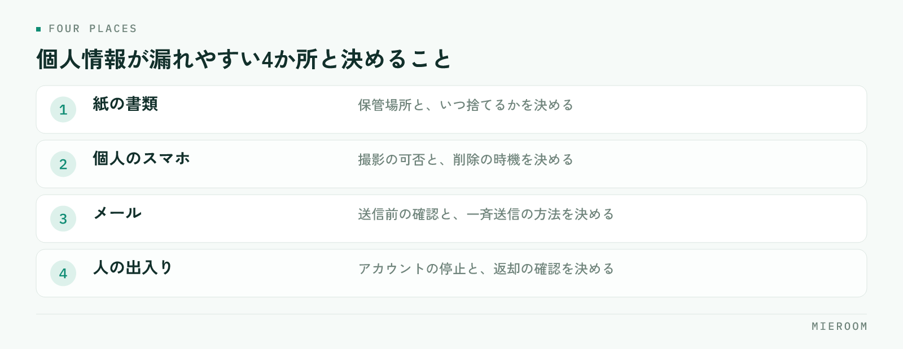

<!--META
{
  "title": "賃貸仲介店舗の個人情報の扱い方｜漏れやすい場所と、決めておく社内ルール",
  "date": "2026-10-20",
  "category": "DX",
  "excerpt": "賃貸仲介の店舗で預かる個人情報が、どこから漏れやすいかを場所ごとに整理しました。紙の申込書、個人のスマホとLINE、メールの宛先、退職時の持ち出しという4か所と、決めておく社内ルールの作り方までまとめています。",
  "hook": "情報は、決めていない場所から漏れる",
  "tags": ["個人情報", "店舗運営", "社内ルール", "DX", "賃貸仲介"]
}
META-->

賃貸仲介の店舗は、身分証、収入の資料、勤務先、家族構成、連絡先まで預かります。扱う情報の量は、規模のわりに多い業種です。それでも事故が起きるのは、**悪意があるからではなく、どこに置いてよいかを決めていない場所に情報が溜まるから**です。

<h4>この記事の結論</h4>
個人情報の管理は、意識を高めることでは良くなりません。<strong>紙の置き場所、私物スマホ、メールの宛先、退職時の持ち出しという4か所に、具体的なルールを1つずつ決める</strong>ことで減ります。決めたら1枚にまとめて配り、入社時に渡してください。

## 店舗で個人情報が漏れやすいのは4か所

賃貸仲介の店舗で起きる情報の事故は、原因がほぼ決まっています。見るべきは次の4か所です。

<figure class="fig"><figcaption>注意ではなく、場所ごとに置き場所と手順を決める形でしか変わりません。</figcaption></figure>

- 紙の書類：申込書、身分証のコピー、審査の資料
- 個人のスマホ：LINEのやりとり、撮影した身分証の写真
- メール：宛先の間違い、一斉送信での宛先の露出
- 人の出入り：退職時や異動時のデータの持ち出し

このうち、紙と私物スマホが大半です。どちらも「その場では便利だから」そうなっている運用で、担当者が悪いわけではありません。だからこそ、注意では直らず、置き場所と手順を決める形でしか変わりません。

| 漏れやすい場所 | 起きやすいこと | 決めておくこと |
|---|---|---|
| 紙の書類 | 机の上に残る、持ち出して戻らない | 保管場所と、いつ捨てるか |
| 個人のスマホ | 身分証の写真が残り続ける | 撮影の可否と、削除の時機 |
| メール | 宛先の間違い、宛先の露出 | 送信前の確認と、一斉送信の方法 |
| 人の出入り | 退職時の持ち出し | アカウントの停止と、返却の確認 |

## 紙の申込書は、置き場所と捨てる時機を決める

紙でいちばん多いのは、処理が終わった書類が机の上や引き出しに残ることです。保管場所を決めていない店舗では、担当者ごとに違う場所に溜まります。

決めるのは2つです。処理中の書類をどこに置くか、処理が終わった書類をいつどう捨てるか。処理中は施錠できる場所に集め、担当者の机には置かない形にします。捨てるときは、裁断するかどうかまで決めてください。そのまま紙ごみに出す運用が残っている店舗は、まずここです。

身分証のコピーは、残す必要があるかどうかから見直す価値があります。審査の提出後に店舗側で保管し続ける理由がなければ、保管する期間を短く決めておくほうが安全です。

✓紙を減らすほうが早い場合もある

保管のルールを細かく作るより、申込の情報をシステム側に入れて、紙を手元に残さない形にしたほうが管理が簡単になることがあります。残す紙の種類を絞ってから、残った分のルールを決める順番が現実的です。

## 私物のスマホに、身分証の写真が残る

内見の現場や物件の前で、身分証をスマホで撮る。その場では早いのですが、写真はカメラロールに残り続けます。本人が削除を忘れれば、退職後も個人の端末に残ります。

決めておくのは次の3点です。

1. 私物の端末で撮ってよいかどうか
2. 撮った場合、どこに移してから削除するか
3. 削除をいつ確認するか

撮影を一切禁止する形は、現場が回らないことがあります。その場合は「撮ってよいが、その日のうちに店舗側へ移して端末からは消す」という形にしてください。禁止だけを伝えると、報告されないまま続きます。

LINEのやりとりも同じです。個人のアカウントで追客している店舗では、やりとりが担当者の端末にしか残らず、退職と同時に顧客との接点も消えます。情報管理の観点でも、引き継ぎの観点でも、店舗の側に記録が残る形にしておくほうが安全です。引き継ぎの残し方は[担当の引き継ぎ記録](./tantou-hikitsugi-kiroku.html)にまとめています。

## メールは、宛先の確認を手順にする

メールの事故は、確認の意識ではなく手順で減ります。起きるのは宛先の間違いと、複数の宛先を宛先欄に並べたことによる露出の2つです。

宛先の間違いは、送信前に宛先と添付を読み上げる手順を入れると減ります。とくに、同じ姓の入居希望者が複数いる時期、転送で返信するときに起きます。

複数の人へ同じ内容を送る場合は、宛先を並べないでください。管理会社や業者への一斉連絡でも、宛先が他社に見える形は避けます。送り先が多い連絡は、1件ずつ送るか、宛先が見えない方法を使うかを決めておきます。

!添付で送る前に考える

身分証や収入の資料をメールの添付で送る運用は、宛先を間違えた時点で取り返せません。業者間で授受が必要な資料は、どの経路で渡すかを先に決めておいてください。

## 誰がどこまで見られるかを決める

情報を集約するほど、見られる範囲が広がります。店舗の全員が全案件の資料を見られる状態は、管理としては緩い形です。

決めるのは、案件の情報を見られる範囲と、売上や給与に関わる情報を見られる範囲です。前者は店舗の全員で構いますが、後者は店長以上に絞るのが一般的な形です。アルバイトやパートを採用している店舗では、入る範囲を最初に決めておいてください。

アクセスの範囲は、ツールの設定でできることが多い項目です。設定できるのに全員同じ権限にしている状態は、見直すだけで改善します。

## 退職と異動のときに、持ち出しが起きる

事故が集中するのは、人が入れ替わるときです。多いのは次の形です。

- 業務のデータを個人のメールやクラウドに送って持ち出す
- 顧客の連絡先が、個人のスマホに残ったままになる
- 共有のパスワードが変更されず、退職後も入れる

対策は退職日に合わせた手順を決めておくことです。アカウントの停止、共有パスワードの変更、貸与端末と鍵の返却、私物端末に残った顧客情報の削除確認。この4つを退職の手続きに含めてください。

とくに共有パスワードは見落とされます。ポータルの管理画面、業者間サイト、店舗のメールアドレス。誰かが辞めるたびに変える運用にしておくと、あとで慌てずに済みます。

## 決めたルールは、1枚にまとめて配る

ここまでの内容を、口頭で伝える形にしないでください。入社のタイミングで渡せる1枚があるかどうかで、守られ方が変わります。

書くのは、紙の保管場所と廃棄、私物端末での撮影と削除、メール送信前の確認、見られる情報の範囲、退職時の手続きの5項目です。それぞれ2〜3行で足ります。長い規程を作るより、店舗の実際の動きに合わせた短い1枚のほうが読まれます。

年に1回は読み合わせる時間を取ってください。店舗の運用は変わっていくので、紙を減らした、ツールを変えた、という変化のあとは内容が合わなくなります。

小規模な店舗でも、ここまで決める必要がありますか？

規模が小さいほど、決めておく価値があります。人数が少ない店舗では、担当者の手元に情報が集まりやすく、その人が休んだり辞めたりしたときに誰も分からない状態になります。ルールは短くて構いません。紙の置き場所、私物端末での撮影の扱い、退職時の手続きの3つだけでも、決めていない状態とは大きく違います。

紙の申込書は、いつまで保管すればよいですか？

保管の期間は、法令や管理会社との取り決めで必要な分があるため、一律には決められません。確認すべきなのは、必要な期間を過ぎた書類が店舗に残り続けていないかです。必要な分を決めたうえで、それを過ぎた書類を定期的に処分する時機を運用として決めてください。期限が分からないまま全部取っておく形が、いちばん量が増えます。

個人のLINEで追客している担当者に、どう切り替えてもらえばよいですか？

やり方だけを変えるよう伝えても戻ります。個人のLINEが使われるのは、それがいちばん早いからです。店舗側の仕組みで同じ速さが出る状態を用意してから切り替えてください。そのうえで、新規の案件からは店舗側の経路に統一し、既存のやりとりは引き継ぎのタイミングで移す形にすると、現場が止まりません。

## まとめ：決めるのは4か所と、1枚のルール

個人情報の管理は、紙の保管場所、私物端末での撮影、メールの宛先確認、退職時の手続きの4か所を決めるところから始めてください。そのうえで、見られる情報の範囲を役職で分け、全部を1枚にまとめて入社時に渡す。これだけで、注意に頼る状態からは抜けられます。

逆に言えば、情報が担当者の手元にしか無い状態が続くほど、管理は難しくなります。記録が店舗の側に残る形にしておくことが、管理の前提になります。申込に関わる情報の残し方は[申込管理表の作り方](./moushikomi-kanrihyo-tsukurikata.html)も参考にしてください。

[ミエルーム](../index.html)なら、反響をフォームやメールから自動で取り込み、追客のLINEやSMSもシステム側から送れるので、顧客とのやりとりが担当者の私物スマホにだけ残る状態をなくせます。申込から入金・後ADまでも案件ごとに1行で記録できるため、紙の申込書を手元に置き続ける必要もなくなります。人が入れ替わっても記録が店舗側に残るので、引き継ぎと情報の片付けを別々にやる手間がなくなります。デモアカウントの発行やご相談は、この下のボタンからお気軽にどうぞ。
