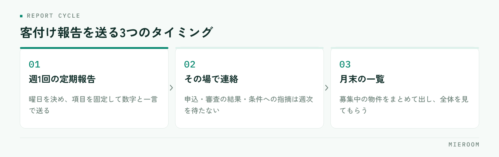

<!--META
{
  "title": "管理会社への客付け報告の進め方｜募集状況をそろえて任される店舗になる",
  "date": "2026-10-27",
  "category": "業務効率化",
  "excerpt": "管理会社や元付へ送る客付け報告を、毎回ゼロから作らずにそろえる手順をまとめました。報告に入れる項目、送る頻度の決め方、決まらない物件の伝え方、報告を作る時間を減らす進め方まで整理しています。",
  "hook": "客付け報告は、毎回作らずそろえる",
  "tags": ["客付け報告", "管理会社", "募集状況", "業務効率化", "賃貸仲介"]
}
META-->

管理会社や元付から預かった物件について、「今どうなっていますか」と聞かれてから慌てて数えていないでしょうか。賃貸仲介の店舗にとって客付け報告は売上に直接つながらない作業ですが、**次にどの物件を任されるかは、この報告の中身で決まります**。毎回ゼロから作らずにそろえる手順を整理します。

  <h4>この記事の結論</h4>
  
客付け報告で見られているのは、決まったかどうかではありません。<strong>預かった物件に対して、何件問い合わせがあり、何件案内し、どこで止まったかを言えるかどうか</strong>です。報告に入れる項目を先に固定し、日々の反響と案内の記録から取り出す形にすれば、報告の作成そのものに時間はかかりません。

## 聞かれてから数えている状態が、いちばん重い

客付け報告が負担になるのは、報告する内容が決まっていないからです。聞かれるたびに、メールの履歴をさかのぼり、案内した記憶をたどり、担当者に確認して数を合わせる。この作業が物件ごとに発生します。

さらに、担当者によって答える内容が変わります。問い合わせの件数を答える人、内見の件数を答える人、「反応は悪くないです」で済ませる人。受け取る側からすると、店舗としての判断が見えません。

重いのは報告を書くことではなく、**報告のために数を作り直していること**です。日々の記録から取り出せる形になっていれば、作業は数分で終わります。反響そのものの残し方は[反響の管理方法](./hankyo-kanri-hoho.html)に整理しています。

## 報告に入れる項目を、先に固定する

物件の種類や取引先が違っても、報告に入れる項目は共通で足ります。毎回同じ並びで出すことが、何より効きます。

| 項目 | 何を書くか | なぜ必要か |
|---|---|---|
| 掲載の状況 | どのポータルサイトに、いつから出しているか | 露出が足りているかの判断材料になる |
| 問い合わせ件数 | 期間内に入った反響の数 | 条件が市場に合っているかが見える |
| 案内件数 | 実際に内見した組数 | 問い合わせが案内につながっているかが分かる |
| 申込の状況 | 申込の有無、審査中かどうか | 次の動きを待つべきかが決まる |
| 止まっている理由 | 問い合わせが無い／案内で決まらない／審査で止まる | どこを直せばよいかが決まる |

この5つがそろっていると、受け取る側は条件の見直しを判断できます。逆に「まだ決まっていません」だけの報告では、相手は何も決められません。**報告は、相手に次の判断をしてもらうために送るもの**だと考えると、入れる項目が決まります。

## 送る頻度は、物件ではなく期間で決める

報告の頻度を物件ごとに変えると、送り忘れが出ます。現実的なのは、期間を固定する形です。

<figure class="fig"><figcaption>物件ごとに頻度を変えず、期間で固定すると送り忘れが出ません。</figcaption></figure>

決めるのは3つです。1つ目は、週に1回まとめて送る曜日。2つ目は、申込が入ったときなど、その場で連絡する出来事。3つ目は、月末にまとめて出す募集中の一覧です。

週次の報告は、文章を作り込む必要はありません。項目が固定されていれば、数字と一言のコメントで足ります。むしろ短いほうが読まれます。繁忙期に報告が止まりがちなのは、作り込みすぎているからです。

  
✓その場で連絡するもの

  
申込が入ったとき、審査が通らなかったとき、案内した入居希望者から条件について指摘があったときは、週次を待たずに連絡します。とくに条件への指摘は、賃料や初期費用の見直しにつながるため、受け取る側にとって価値が高い情報です。

## 決まらない物件こそ、報告の中身で差が出る

決まった物件の報告は簡単です。難しいのは、問い合わせが入らない物件や、案内しても決まらない物件です。ここで黙ってしまうと、相手は「動いていない」と受け取ります。

伝え方は、止まっている場所で分けます。問い合わせが入らないなら、掲載している条件が周辺の募集と比べてどうかを一言添えます。案内まで行くのに決まらないなら、案内時に出た言葉を具体的に伝えます。「駐車場の空きを聞かれた」「写真と室内の印象が違うと言われた」といった内容は、相手が直せる情報です。

審査で止まる場合は、審査の種類と止まった段階だけを伝えます。入居希望者の個人的な事情は書きません。**報告に書くのは、相手が次に動かせることだけ**です。掲載を取り下げる判断の整理は[掲載物件の取り下げ](./keisai-bukken-torisage.html)に分けて書いています。

## 報告の時間を減らすのは、入力の場所を1つにすること

報告を楽にする方法は、報告の書式を工夫することではありません。報告に使う数字が、日々の業務の中で勝手に残る状態を作ることです。

問い合わせをメールの受信箱で、案内を紙の予定表で、申込をExcelで持っていると、報告のたびに3か所から数えます。入力の場所が分かれているかぎり、報告の時間は減りません。

- 反響は、入った時点で物件と結び付けて記録する
- 案内は、実施した時点で組数が残る形にする
- 申込は、受け付けた時点と審査の結果の両方を残す
- 止まっている理由は、担当者が一言で選べる形にする

この4つがそろうと、報告は「期間を指定して取り出す」作業になります。担当者が報告のために思い出す場面が無くなるため、担当が変わっても中身が変わりません。担当の引き継ぎ自体の残し方は[担当引き継ぎの記録](./tantou-hikitsugi-kiroku.html)にまとめています。

## 報告でつまずく、よくある3つの形

1つ目は、良い数字だけを出すことです。問い合わせの件数だけを伝えて案内の件数を省くと、次に聞かれたときに答えられません。悪い数字を出した報告のほうが、結果として信頼されます。

2つ目は、報告の形式を取引先ごとに作り分けることです。相手に合わせた体裁を増やすと、担当者が作れなくなります。項目は共通にして、送り方だけ相手に合わせてください。

3つ目は、報告を止めてしまうことです。決まらない期間が続くと送りにくくなりますが、途切れた時点で預かる物件は減っていきます。短くても続けるほうが優先されます。

客付け報告は、どのくらいの分量で送るものですか？

週次であれば、物件ごとに数行で足ります。掲載の状況、問い合わせと案内の件数、申込の状況、止まっている理由の順に並べ、必要なら一言コメントを添える形です。長い文章にすると作る側も読む側も負担になり、続かなくなります。物件数が多い場合は、動きがあった物件を先に並べ、動きのないものはまとめて一覧にしてください。

問い合わせがゼロの物件は、何を報告すればよいですか？

ゼロであること自体が報告する内容です。あわせて、掲載しているポータルサイトと掲載開始日、周辺の募集と比べた条件の印象を一言添えます。ゼロの原因は条件か露出のどちらかに絞られるため、この2点を伝えれば相手は賃料や初期費用、募集条件の見直しを判断できます。黙っているより、ゼロを伝えたほうが物件は動きます。

報告の数字が担当者ごとに違ってしまいます。どうすればよいですか？

数え方の定義を一度決めてください。問い合わせは「物件を指定した連絡が入った時点で1件」、案内は「実際に室内を見た組で1件」のように、数える単位を文章にして店内で共有します。定義が共有されていないと、同じ物件でも報告する人によって数が変わります。記録する場所を1つにそろえると、定義も自然に固定されます。

## まとめ：報告は、次の物件を任されるための記録

客付け報告で見られているのは、決まったかどうかではなく、預かった物件に対して何をして、どこで止まっているかを言えるかどうかです。入れる項目を掲載の状況・問い合わせ件数・案内件数・申込の状況・止まっている理由の5つに固定し、送る頻度を期間で決めれば、作成そのものに時間はかかりません。

決まらない物件は、止まっている場所で伝え方を分けます。そして報告を軽くする本当の方法は、書式の工夫ではなく、反響と案内と申込の入力の場所を1つにすることです。**報告のために数え直す作業が無くなれば、報告は続きます**。

[ミエルーム](../index.html)なら、反響管理と接客管理、申込・入金管理が同じ場所でつながるので、物件ごとの問い合わせ件数・案内の記録・申込の状況を、報告のために数え直さずにそのまま取り出せます。反響分析と接客・反響成績の可視化もあるため、止まっている場所を担当者の記憶ではなく記録から説明できます。週次の報告が数分で終わり、担当が変わっても報告の中身がそろうようになります。デモアカウントの発行やご相談は、この下のボタンからお気軽にどうぞ。
