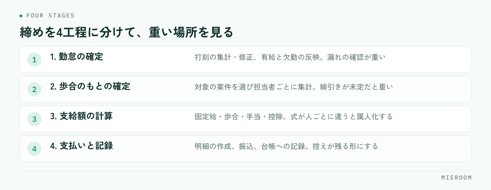

<!--META
{
  "title": "賃貸仲介の給与計算と勤怠の締め作業を軽くする手順｜歩合の集計でつまずかないために",
  "date": "2026-11-22",
  "category": "業務効率化",
  "excerpt": "賃貸仲介の店舗で毎月発生する勤怠の締めと給与計算、歩合の集計を軽くする手順をまとめました。締めを4つの工程に分ける考え方、歩合の集計でつまずく場面、月中にやっておくこと、勤怠で記録する項目、締めのチェックリストとよくある失敗までを整理しています。",
  "hook": "締めが重いのは、計算ではなく集計です",
  "tags": ["給与計算", "勤怠管理", "歩合給", "締め作業", "賃貸仲介"]
}
META-->

月末から月初にかけて、勤怠の集計と歩合の計算で夜が埋まる。賃貸仲介の店舗で、オーナーや店長が最後まで手放せない作業がここです。結論から申し上げると、**締め作業が重いのは計算が難しいからではなく、計算のもとになる数字を毎月あちこちから集め直しているから**です。この記事では、勤怠と歩合の締めを工程に分け、月中に何を決めておけば月末の作業が短くなるのかを順番に整理します。

<h4>この記事の結論</h4>
締め作業を短くする鍵は、給与の計算式ではなく<strong>歩合のもとになる数字が確定するタイミング</strong>を決めることです。入金がまだの売上、後から入るAD、キャンセルになった申込。この3つの扱いを先に決めておけば、締めの日に案件を一件ずつ追い直す作業がなくなります。

## 締めが重いのは、計算ではなく「数字を集める作業」

給与計算そのものは、計算式が決まっていれば難しい作業ではありません。時間がかかっているのは、その手前にあります。

勤怠の打刻をまとめ、遅刻や早退を拾い、有給の消化を確認する。並行して、今月成約した案件を一覧にし、担当者ごとに分け、歩合の対象になるものを選び出す。入金がまだの案件を外すか入れるかを判断し、先月に入ったADを今月に足す。この「集める作業」が、締めの時間のほとんどを占めています。

やりにくさの正体は3つあります。

一つ目は、数字の置き場所が分かれていることです。勤怠は勤怠の表、売上は売上の管理表、入金は通帳や会計の画面。3か所を見比べる作業が毎月発生します。

二つ目は、締めの時点で確定していない数字があることです。成約したが入金前、ADが後から入る、申込がキャンセルになるかもしれない。確定していないものをどう扱うかが決まっていないと、その都度判断することになります。

三つ目は、判断した結果が残らないことです。先月どう扱ったかを覚えていないため、同じ論点を毎月考え直します。**締め作業を軽くする作業は、数字を集めやすくすることと、判断を先にルールにすることの2つ**に分かれます。

## 締め作業を4つの工程に分ける

締めをひとかたまりの作業として見ていると、どこが重いのか分かりません。4つに分けると、手を入れる場所が見えます。

<figure class="fig"><figcaption>月末に集中して重いのは1と2です。手を入れる価値があるのはこの2つです。</figcaption></figure>

| 工程 | やること | 重くなる原因 |
|---|---|---|
| 1. 勤怠の確定 | 打刻の集計、修正、有給と欠勤の反映 | 打刻漏れの確認を締めの日にまとめてやっている |
| 2. 歩合のもとの確定 | 対象の案件を選び、担当者ごとに集計する | 確定・見込みの線引きが決まっていない |
| 3. 支給額の計算 | 固定給、歩合、手当、控除を合わせる | 計算式が人ごとに違い、表が属人化している |
| 4. 支払いと記録 | 明細の作成、振込、台帳への記録 | 明細の控えが残らず、問い合わせに答えられない |

この4つのうち、月末に集中して重いのは1と2です。3の計算式は一度決めれば毎月変わりません。4は記録の形が決まっていれば流れます。つまり、**手を入れる価値があるのは勤怠の確定と、歩合のもとの確定の2つ**です。

工程を分ける効果はもう一つあります。どこで止まっているかを人に説明できるようになり、担当を分けられます。勤怠の確定は店長、歩合のもとの確定は経理、計算は共通の表、という分け方ができます。

## 歩合の集計でつまずく3つの場面

歩合の対象を選ぶ作業が毎月もめるのは、次の3つの場面で判断が必要になるからです。扱いを先に決めておきます。

ひとつは、入金がまだの売上です。契約は済んだが仲介手数料の入金が翌月になる案件を、どちらの月の歩合に入れるのか。契約日で見るのか、入金日で見るのか。どちらでも構いませんが、**途中で変えると担当者の不信につながる**ため、決めたら動かしません。

ふたつめは、後から入るADです。広告料が契約の翌月以降に入る場合、その案件の歩合をいつ計算するのか。契約時点で見込みとして入れ、入金時に差額を調整する形と、入金月にまとめて計上する形があります。案件ごとにADの入金予定と実績が記録されていないと、どちらの形も回りません。

みっつめは、キャンセルです。申込後に入居審査で落ちた、契約直前で取りやめになった。すでに歩合として支払った分をどう戻すのか。戻さないのか、翌月で調整するのか。歩合の対象にする成果の定義そのものは[歩合給の決め方](./buai-kyu-kimekata.html)に整理しています。

✓3つの扱いは紙1枚に書く

入金前の売上・後から入るAD・キャンセルの3つについて、どう扱うかを紙1枚に書いてスタッフにも見せてください。締めの日の判断が消えるだけでなく、「あの案件はどうなるのか」という質問が月中に来なくなります。

## 月中にやっておくと締めが軽くなること

締めの作業は、締めの日にやる作業を減らすのではなく、月中に分散させると短くなります。やっておく価値が高いのは次の4つです。

打刻の漏れを週に一度見ることが最初です。月末にまとめて1か月分の漏れを確認すると、本人の記憶も薄くなっています。週の区切りで見れば、その場で埋まります。

案件の記録を成約の日に埋めることが次です。契約日、仲介手数料の額、ADの有無と入金予定、担当者。この4つが成約の時点で入っていれば、締めの日に案件を一件ずつ開く作業がなくなります。

確定と見込みを分けて見える状態にしておくことも効きます。入金済みの確定売上と、入金待ちの見込みが同じ列に並んでいると、締めのたびに選び分ける作業が発生します。日々の記録の段階で分かれていれば、締めは集計するだけです。月末の集計を日次に寄せる考え方は[月末売上集計を自動化する方法](./getsumatsu-uriage-shukei-jidoka.html)にまとめています。

有給と残業の状況を月中に見ることも入れてください。締めの日に残業が多かったと気づいても、もう手が打てません。月の半ばで見れば、シフトで調整できます。

## 勤怠の記録でそろえておく項目

勤怠の記録は、打刻の時刻だけでは足りません。給与計算と、繁忙期の人の配置の両方に使うなら、次の項目をそろえておきます。

- 出勤と退勤の時刻（修正した場合は、誰がいつ直したかも残す）
- 休憩の時間
- 時間外の時間（所定を超えた分。深夜にかかる分は分けて記録する）
- 休日出勤の有無と、振替の予定
- 有給の取得日と残り日数
- 遅刻・早退・欠勤の区分
- 店舗をまたいで応援に入った日と、その店舗名

店舗をまたいだ応援の記録は、見落とされがちですが重要です。繁忙期に他店舗の手伝いに入った日が記録されていないと、その店舗の人件費が実態と合わなくなり、店舗別の損益を見るときにずれます。

!記録の修正は履歴を残す

打刻の修正を元の値を上書きする形で行うと、後から確認できなくなります。労務の確認が入ったときに説明できる形にしておくため、誰がいつどう直したかを残す仕組みにしてください。

## 締めのチェックリストとよくある失敗

毎月の締めで確認する項目を、順番に並べます。そのまま印刷して使える形にしてあります。

- 全員の打刻に漏れがないか。修正したものは履歴が残っているか
- 時間外と深夜の時間が分かれて集計されているか
- 休日出勤の振替予定が決まっているか
- 有給の取得日が反映され、残り日数が合っているか
- 今月の成約案件が全件記録されているか（申込だけで止まっていないか）
- 歩合の対象として、入金前の売上をどう扱ったか。先月と同じ扱いか
- 後から入るADのうち、今月入金されたものを拾ったか
- キャンセルになった案件の調整を入れたか
- 店舗をまたいだ応援の日が、正しい店舗に付いているか
- 支給額の計算式が、先月と同じ式で計算されているか
- 明細の控えが残り、本人からの問い合わせに答えられるか

よくある失敗は、次の5つです。

**歩合の計算式を頭の中に置いている**。オーナーや店長の頭の中にしかないと、その人が休んだ月に締めが止まります。式は紙かファイルに書き出してください。

**確定と見込みを混ぜたまま締める**。入金前の売上を歩合に入れた月と入れなかった月が混ざると、担当者から見て不公平に見えます。扱いは固定します。

**締めの日にまとめて打刻を直す**。1か月分の記憶を本人に思い出させる作業になり、精度も落ちます。週単位で見てください。

**ADの入金を案件とひも付けずに記録する**。入金の合計だけ記録していると、どの案件のADか分からなくなり、歩合の計算に反映できません。案件ごとに記録します。

**明細を渡して控えを残さない**。数か月後に金額の問い合わせが来たとき、計算の根拠を示せません。明細と、そのもとになった案件の一覧を残してください。

## 自分で進める場合と、ツールに任せる場合の分かれ目

一般論として、判断の基準は3つあります。

一つ目は、人数と計算式の数です。数人の店舗で、固定給と単純な歩合だけなら、表計算のファイルで十分に回ります。人数が増え、役職や経験で歩合の率が分かれ、手当の条件も人によって違ってくると、表の管理そのものが仕事になります。式が人ごとに違う状態が続くなら、仕組みに預ける価値が出てきます。

二つ目は、歩合のもとになる数字がどこにあるかです。売上と入金の記録が給与計算と同じ場所にあるなら、集計は短く済みます。売上は別の表、入金は会計、勤怠はまた別の場所という形になっていると、締めのたびに転記が発生します。転記が入る工程の数が、締めの時間とほぼ比例します。

三つ目は、締めが特定の人に依存しているかどうかです。その人が不在の月に締めが止まる、あるいは誰も検算できない状態であれば、人の問題ではなく形の問題です。誰が見ても同じ数字が出る形に変えたほうが、長く続きます。

迷うときは、先月の締めに何時間使ったかと、そのうち転記と確認に何時間使ったかを分けて数えてみてください。計算そのものに使った時間が短く、集めることに時間が消えているなら、手を入れる場所は計算ではなく記録の形です。

## よくある質問

歩合は契約日で計算すべきですか、入金日で計算すべきですか？

どちらでも構いませんが、決めたら変えないことが大切です。契約日で見ると担当者の実感に近く、入金日で見ると会社の資金と合います。入金前を歩合に入れる場合は、キャンセルや入金されなかった場合の調整方法も同時に決めておいてください。

後から入るADは、どう記録しておくとよいですか？

案件ごとに、ADの有無・金額・入金予定の時期・入金の実績を記録してください。入金の合計だけを記録していると、どの案件の分か分からなくなり、歩合の計算に反映できません。一部だけ入金される場合もあるため、分割で入ったことが分かる形にしておくと確実です。

打刻の修正は、どこまで残す必要がありますか？

元の値、修正後の値、修正した人、修正した日の4つが残っていれば説明できます。打刻を上書きする形は避けてください。労務に関する確認が入ったときだけでなく、本人から勤務時間の問い合わせがあったときにも、記録があると説明が短く済みます。

店舗が複数ある場合、給与の締めは店舗ごとに分けるべきですか？

記録は店舗ごと、計算のルールは全店舗で共通にするのが扱いやすい形です。歩合の率や手当の条件が店舗ごとに違うと、異動のときに説明できなくなります。応援で他店舗に入った日は、その日の人件費がどちらの店舗に付くかを先に決めておいてください。

締め作業を外部に頼むこともできますか？

給与の計算と手続きの部分は、社会保険労務士などの専門家に任せられます。ただし、歩合のもとになる売上と入金の数字をそろえる作業は社内に残ります。外部に渡す数字が毎月きれいな形で出てくる状態を先に作っておくと、任せる範囲がはっきりします。

## まとめ：数字が確定するタイミングを決めれば、締めは短くなる

賃貸仲介の給与計算と勤怠の締めを軽くする順番は決まっています。締めを勤怠の確定・歩合のもとの確定・支給額の計算・支払いと記録の4つに分ける。入金前の売上、後から入るAD、キャンセルの3つの扱いを紙1枚に書いて固定する。打刻の漏れは週に一度見る。成約の日に契約日・手数料・ADの予定・担当者を埋める。確定売上と見込みを日々の記録の段階で分けておく。この形にすると、締めの日にやることは集計だけになります。

逆に、月末にすべてを集め直す形のままだと、人数が増えるほど締めの時間が伸びていきます。締めが重い原因は計算の難しさではなく、数字が確定するタイミングを決めていないことにあります。

ミエルームなら、歩合のもとになる数字を締めの日に集め直す必要がありません。申込・入金管理では案件ごとに契約・入金・後ADを1行で記録でき、一部入金や分割入金もそのまま残るため、後から入ったADがどの案件のものか分かります。確定売上と見込みが分かれて表示されるので、歩合の対象を選び分ける作業も発生しません。経理・勤怠・給与の機能も同じ中にあり、勤怠の記録と売上の数字を別の場所から集めてくる手間がなくなります。締めの夜に案件を一件ずつ開き直す作業が、画面を見るだけの作業に変わります。機能の詳細は[機能・事例](../features.html)をご覧ください。資料のご請求やデモアカウントの発行は、この下のボタンからお気軽にどうぞ。
