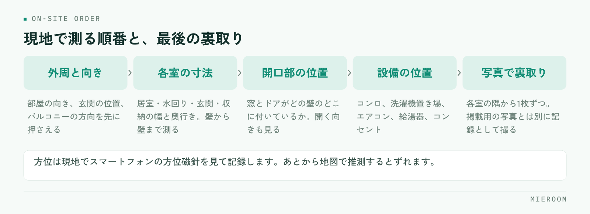

<!--META
{
  "title": "賃貸仲介の間取り図を自分で作る手順｜見やすい図面にそろえる基準",
  "date": "2026-10-14",
  "category": "業務効率化",
  "excerpt": "図面が無い物件や見づらい図面の間取り図を、店舗で自分で作るための手順をまとめました。採寸と確認の順番、必ず入れる項目、店舗で表記をそろえる基準、作り直しを減らす管理の仕方まで整理しています。",
  "hook": "図面の作り直しは、基準が無いから起きる",
  "tags": ["間取り図", "物件資料", "業務効率化", "店舗運営", "賃貸仲介"]
}
META-->

管理会社から届いた図面が手書きのコピーで読めない、そもそも図面が付いていない。賃貸仲介の現場では珍しくない場面です。そのまま掲載すると反響が落ちますが、作り直すたびに書き方が変わると今度は資料がばらつきます。**間取り図は作る技術より、店舗の中で表記をそろえる基準のほうが効きます**。

<h4>この記事の結論</h4>
間取り図の作り直しが多いのは、絵が下手だからではなく<strong>どこまで書くかの基準が店舗で決まっていないから</strong>です。採寸と確認の順番を決め、必ず入れる項目を固定し、作ったものを物件ごとに残す。この3つで作り直しが減ります。

## 間取り図を自分で作る必要が出る場面

自分で作る判断になるのは、だいたい次の場面です。先に分けておくと、どこまで手をかけるかが決まります。

まず、**図面そのものが無い物件**です。古いアパートや、オーナーが直接管理している物件で起きます。この場合はゼロから作ることになるため、採寸から必要です。

次に、**図面はあるが掲載に使えない物件**です。手書きのコピーを何度も複写したもの、方位や寸法が入っていないもの、他社の社名が入っているものが該当します。情報は取れるので、作り直しは速く済みます。

そして、**自社の資料の見た目をそろえたい場合**です。物件ごとに図面の書き方が違うと、複数の物件をまとめて提案したときに比較しづらくなります。お客様が選びやすい資料にするために作り直す判断です。

✓他社が作った図面をそのまま使わない

ポータルサイトや他社の資料に載っている間取り図を複写して使うことは避けてください。図面にも作成した側の権利があり、社名やロゴが入ったまま掲載するとトラブルになります。情報として寸法や配置を参考にするのは別ですが、画像そのものを流用しないでください。

## 採寸と確認の順番

現地で採寸するときは、順番を決めておくと測り漏れが出ません。内見や鍵の引き取りに行くタイミングで、まとめて済ませるのが現実的です。

<figure class="fig"><figcaption>最後の写真を省くと、店に戻って図に落とす段階で必ず迷います。</figcaption></figure>

1. **外周と向き**：建物に対する部屋の向き、玄関の位置、バルコニーの方向を先に押さえます
2. **各室の寸法**：居室・水回り・玄関・収納の幅と奥行き。壁から壁まで測ります
3. **開口部の位置**：窓とドアがどの壁のどこに付いているか。開く向きも見ます
4. **設備の位置**：コンロ、洗濯機置き場、エアコン、給湯器、コンセントの位置
5. **写真で裏取り**：各室の隅から1枚ずつ撮っておきます

このうち5番目を省くと、店に戻って図に落とす段階で必ず迷います。**写真は採寸の記録として撮る**もので、掲載用の写真とは別に用意してください。掲載用の撮り方は[物件写真の撮り方](./bukken-shashin-torikata.html)に分けてまとめています。

方位は、現地でスマートフォンの方位磁針を見て記録します。あとから地図で推測すると、建物の向きと部屋の向きがずれることがあります。

## 図面に必ず入れる項目を固定する

何を書くかを毎回考えていると、作る時間が読めず、出来上がりもばらつきます。入れる項目を決めて固定してください。店舗で使いやすいのは次の形です。

- **各室の用途と広さ**：洋室・和室・LDKの区別と、畳数または平米
- **方位**：北を示す記号。部屋の向きが分かる形で
- **玄関・バルコニーの位置**：入る方向と、外に出られる方向
- **水回りの配置**：浴室・洗面・トイレ・キッチンの位置関係
- **洗濯機置き場**：室内か室外か。ここは問い合わせが多い項目です
- **収納**：クローゼットと押入れの位置と、だいたいの大きさ
- **窓の位置**：採光がどの方向から入るか

逆に、**入れないほうがよいもの**もあります。家賃や初期費用のような変わる情報、キャンペーンの文言、縮尺が保証できない正確な寸法の数値です。図面に入れると、条件が変わるたびに作り直しになります。

✓畳数は根拠のあるものだけ書く

畳数は、管理会社の資料や登記の情報に記載があるものを使ってください。採寸から換算した数字を独自に書くと、実際の表示と食い違う可能性があります。資料に記載が無い場合は、畳数を書かずに配置だけを図にして、広さは別途確認すると案内する形が安全です。

## 店舗で表記をそろえる基準

図面が人によって違って見える原因は、絵の上手さではなく表記の揺れです。次の項目を店舗で決めて、紙に書いて共有してください。

| そろえる項目 | 決めておく内容 |
|---|---|
| 部屋の呼び方 | 洋室・和室・LDK・DKの使い分け。「サービスルーム」の扱いも決める |
| 方位の向き | 図の上を北にするか、建物の向きに合わせるか |
| 色の使い方 | 水回り・収納・バルコニーの塗り分けを固定する |
| 文字の大きさ | 部屋名と畳数の文字サイズ。小さすぎると印刷で読めない |
| 画像のサイズ | 掲載先に合わせた縦横の比率と解像度 |

いちばん効くのは、**部屋の呼び方をそろえること**です。同じ間取りの物件が、担当者によって「1LDK」と「2K」で載っていると、お客様の検索に引っかからないことがあります。

決めた基準は、見本になる図面を1枚残しておくのがおすすめです。文章の基準より、見本を見てもらうほうが早く伝わります。

## 作った図面を使い回せる形で残す

同じ物件が次に空いたとき、図面をもう一度作ることになる店舗は少なくありません。作ったものが見つからないからです。残すときの決め方は3つです。

**1つめは、物件単位で置き場所を決めること**です。担当者のパソコンの中や、個人のスマートフォンの中に置くと、担当が変わった時点で探せなくなります。物件に紐づく形で保存してください。

**2つめは、元のデータを残すこと**です。画像だけ残して元データを捨てると、部屋の呼び方を直したいときに作り直しになります。手を入れられる形で残しておきます。

**3つめは、作った日を記録すること**です。設備が入れ替わると図面も古くなります。いつの時点の図面かが分かれば、確認が必要かどうかを判断できます。

作った図面と紹介文はセットで使うため、同じ場所にまとめておくと探す手間が減ります。紹介文の書き方は[物件紹介文の書き方](./bukken-shokaibun-kakikata.html)に整理しています。

手書きの図面をスキャンして載せるのは問題ありますか？

読めるのであれば使えますが、複写を繰り返して線がつぶれているもの、他社の社名が入っているものは避けてください。また、スマートフォンで見たときに文字が読めるかを必ず確認してください。お客様の多くはスマートフォンで物件を見ているため、紙で読める図面が画面では読めない場合があります。読みづらい場合は、情報を取って作り直すほうが結果として速く済みます。

図面を作るのに専用のソフトは必要ですか？

必ずしも必要ではありません。表記をそろえる基準が決まっていれば、使い慣れたツールでも店舗として統一された資料になります。ただし、作る本数が多い店舗では、部屋の形や設備の記号があらかじめ用意されているものを使ったほうが所要時間が安定します。判断の基準は、月に何枚作るか、誰が作るかです。1人だけが作れる状態を避けたい場合は、操作が簡単なものを選んでください。

採寸した寸法を図面に書いてもよいですか？

書くことは可能ですが、正確さを保証できる測り方をしている場合に限ってください。メジャーで壁から壁を測った数値は、壁の厚みや仕上げによって図面上の寸法とずれます。家具が入るかどうかを気にされるお客様には、図面に数値を載せるより、該当箇所の寸法を個別にお伝えする形が確実です。図面には配置と向きを載せ、寸法は補足として扱うのが安全です。

## まとめ：基準を決めれば、作る時間は読めるようになる

間取り図を自分で作る作業は、採寸と確認の順番を決め、入れる項目を固定し、作ったものを物件単位で残す。この3つで回ります。うまく描くことより、店舗の中で同じ形にそろうことのほうが、お客様にとっても担当者にとっても使いやすい資料になります。

そして**作り直しの多さは、技術の問題ではなく基準の不在**です。見本を1枚決めて共有するだけでも、ばらつきは目に見えて減ります。

[ミエルーム](../index.html)なら、間取り作成の機能で図面を作り、物件や案件の情報と同じ場所に残せます。担当者のパソコンの中を探す作業や、同じ物件の図面を作り直す作業がなくなり、引き継いだ担当者もそのまま使えます。デモアカウントの発行やご相談は、この下のボタンからお気軽にどうぞ。
