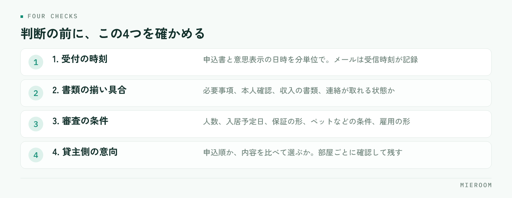

<!--META
{
  "title": "賃貸の申込が重なったときの進め方｜一番手・二番手の管理と伝え方",
  "date": "2026-11-25",
  "category": "業務効率化",
  "excerpt": "同じ部屋に申込が重なったときの店舗側の進め方を整理しました。最初に確かめる4つ、店舗で決められることと貸主・管理会社が決めること、二番手の方への伝え方、順番が後から分かる記録の残し方、よくある失敗までをまとめています。",
  "hook": "申込が重なった日に迷わない順番の決め方",
  "tags": ["申込管理", "入居審査", "繁忙期", "業務効率化", "賃貸仲介"]
}
META-->

同じ部屋に、同じ日のうちに申込が2件入った。先に書類を受け取ったのはこちらだが、もう一方は条件が良い。どちらを先に通すのかを、その場で聞かれる。賃貸仲介の店舗で、判断に迷いやすく、後から苦情になりやすい場面です。結論から申し上げると、**申込の重複でもめるのは判断そのものではなく、順番と伝えた内容が記録に残っていないこと**が原因です。この記事では、重なった日に迷わない進め方を順番で整理します。

<h4>この記事の結論</h4>
申込の重複は、店舗が決めることと貸主・管理会社が決めることを分けると迷わなくなります。先に確かめるのは<strong>受付の時刻と書類の揃い具合</strong>、決めるのは貸主側、店舗の仕事は事実を正確に伝えて記録に残すことです。この順番を崩すと、約束していないことを約束したと受け取られます。

## 申込が重なるのは、繁忙期だけの話ではない

申込の重複は、繁忙期に増えますが、時期に関係なく起きます。起きやすい場面は決まっています。

一つ目は、条件の良い部屋が出た直後です。賃料が相場より抑えられている部屋、駅に近い部屋、設備が新しい部屋は、公開から短い期間で複数の問い合わせが入ります。

二つ目は、複数の経路から反響が入っている部屋です。ポータルサイト、自社サイト、業者間サイト、電話。経路が分かれていると、店舗の中で誰がどこまで話を進めているのかが見えにくくなります。同じ部屋に、別の担当者が別の方を案内している状態が生まれます。

三つ目は、他社も募集している部屋です。自社で預かっていない部屋では、こちらの申込より先に、他社経由の申込が貸主側に届いていることがあります。この場合、店舗が受付の順番を把握できません。

四つ目は、申込書が不完全なまま受け取っている場合です。空欄のある申込書を「後で埋めます」として受け取ると、次に完全な申込書が来たときに、どちらが先なのかの説明が難しくなります。申込書の不備を減らす方法は[申込書の不備を減らす方法](./moushikomisho-fubi-herasu.html)に整理しています。

**重複は事故ではなく、条件の良い部屋で必ず起きる前提で手順を決めておく対象**です。

## 重なったときに最初に確かめる4つ

重複に気づいたら、判断の前に事実を確かめます。確かめる順番は決まっています。

<figure class="fig"><figcaption>この4つが揃うまでは、どちらのお客様にも順番を口にしないのが安全です。</figcaption></figure>

一つ目は、受付の時刻です。申込書を受け取った日時、申込の意思を受けた日時を、どちらの案件についても分単位で確かめます。メールやメッセージで受けた場合は、その受信時刻が記録になります。

二つ目は、書類の揃い具合です。申込書の必要事項が埋まっているか、本人確認の書類、収入に関する書類、連絡先が取れる状態か。先に意思表示があっても、書類が揃っていなければ審査に出せません。

三つ目は、審査の条件です。入居する人数、入居予定日、連帯保証人か保証会社か、ペットや楽器などの条件、勤務先と雇用の形。貸主側が見る項目は、申込の早さだけではありません。

四つ目は、貸主または管理会社の意向です。申込順で見る方針なのか、条件を比べて選ぶ方針なのか。部屋ごとに違うため、確認した内容を案件に残します。

この4つが揃うまでは、どちらのお客様にも「順番」を口にしないのが安全です。審査の流れそのものは[保証会社の審査の流れ](./hosho-gaisha-shinsa-nagare.html)にまとめています。

## 店舗で決められることと、貸主・管理会社が決めること

重複対応でもめる原因の多くは、店舗が決められないことを決めてしまう点にあります。線を引いておくと、その場の受け答えが変わります。

| 項目 | 決めるのは | 店舗の仕事 |
|---|---|---|
| 入居者を誰にするか | 貸主（または管理会社） | 申込内容と書類を正確に伝える |
| 審査に出す順番 | 貸主側の方針に従う | 受付の時刻と書類の状態を事実のまま報告する |
| 賃料や条件の変更 | 貸主 | 希望を預かり、回答を待つ |
| 申込書を受け取るかどうか | 店舗 | 受け取る基準を先に決めておく |
| 二番手として待つ案内 | 店舗 | 待つ場合の条件と期限を文字で伝える |
| 申込の取り下げの扱い | 入居希望者 | 取り下げの意思を記録に残す |

右の列だけが店舗の仕事です。左が貸主側の項目を、良い返事になりそうだからと先に伝えてしまうと、後で覆ったときに店舗の責任になります。

とくに注意が必要なのが、申込書を受け取るかどうかの基準です。重複が分かっている部屋で2件目を受け取る場合、受け取った時点で「二番手である」と伝えているかどうかで、後の対応がまったく変わります。

## 二番手になった入居希望者への伝え方

二番手の方への連絡は、伝える内容を先に決めておきます。その場で考えると、言わなくてよいことまで話してしまいます。

伝えることは4つです。先に申込が入っている状態であること。審査と入居者の決定は貸主側が行うこと。一番手の方の審査結果が出るまでの見込みの時期。待つかどうかを選べること。この4つを、同じ言い方で伝えます。

伝えないことも決めておきます。一番手の方の属性や条件、勤務先、審査の進み具合は、ほかのお客様に話す内容ではありません。また、「おそらく通らないと思います」「たぶん回ってきます」といった見通しは、根拠がないまま期待を作ります。

✓待つ場合は期限を文字で

二番手として待つと決まった場合は、いつまで待つのか、その間に他の部屋を探してよいか、連絡はどの方法で行うかを、メッセージやメールで送って残します。口頭だけで進めると、連絡が遅れたときに行き違いになります。

同時に、二番手の方には別の候補を用意しておきます。待っている間に他社で決めてしまうのは当然のことで、それ自体は防げません。待つ案内と並行して、条件の近い部屋を案内できる状態にしておくほうが、結果としてお客様の役に立ちます。追客の進め方は[追客メールの文例](./tsuikyaku-mail-reibun.html)にまとめています。

## 順番が後から分かる記録の残し方

重複対応で後から困るのは、判断ではなく「何を、いつ、誰に伝えたか」が分からなくなることです。記録は案件ごとに1行で残す形が、いちばん崩れません。

残しておく項目は次のとおりです。

- 申込の意思を受けた日時と、受けた経路（来店・電話・メール・メッセージ）
- 申込書を受け取った日時と、そのときの不備の有無
- 重複していることを伝えた日時と、伝えた相手
- 貸主または管理会社へ報告した日時と、その内容
- 貸主側から返ってきた方針と、その回答の日時
- 二番手として待つ意思を確認した日時と、伝えた期限
- 取り下げや辞退があった場合の日時と、申し出た相手

当日の手順も、順番で決めておくと担当者が変わっても同じ動きになります。

- 重複に気づいた担当者が、まず受付の時刻を両方そろえる
- 書類の揃い具合を確認し、審査に出せる状態かを見る
- 貸主または管理会社へ、事実のみを報告する
- 方針の回答を受けたら、案件に記録する
- 一番手・二番手の双方へ、決めた言い方で連絡する
- 待つ場合の条件と期限を、文字で送って残す

**記録は苦情を防ぐためではなく、担当者が休んでいても同じ説明ができるようにするためのもの**です。申込の管理表の作り方は[申込管理表の作り方](./moushikomi-kanrihyo-tsukurikata.html)に整理しています。

## よくある失敗と、その避け方

重複対応で繰り返し起きる失敗は、次の5つに集まります。

**申込順で決まると言ってしまう**。部屋ごとに方針が違うため、確認する前に断定すると覆ります。「順番と内容を貸主側へお伝えし、回答をお待ちします」が正確な言い方です。

**2件目を受け取るとき、二番手であることを伝えない**。伝えないまま受け取ると、同じ条件で審査されていると受け取られます。受け取る時点で状況を伝え、記録に残してください。

**一番手の情報を二番手に話す**。属性や審査の進み具合は、他のお客様に伝える内容ではありません。話せる範囲を先に決めておきます。

**待つ期限を決めずに保留する**。期限がないと、二番手の方は動けず、店舗も追いかけません。結果としてどちらの部屋も決まらない状態になります。

**取り下げや辞退を口頭だけで処理する**。後から「取り下げたつもりはない」となる場面があります。意思を受けた日時と相手を記録に残してください。キャンセルの処理手順は[申込キャンセルの処理手順](./moushikomi-cancel-shori.html)にまとめています。

## 自分で進める場合と、ツールに任せる場合の分かれ目

一般論として、判断の基準は3つあります。

一つ目は、同時に動いている申込の件数です。扱う件数が少なく、担当者が1人で全体を把握できているなら、紙や表計算での管理でも順番は分かります。複数の担当者が同じ部屋に別の方を案内する状態が出てきたら、記録の置き場所を1か所にまとめる必要があります。

二つ目は、担当者の人数と交代の有無です。担当が休んだ日や、夜に入った連絡を別の人が受ける体制なら、申込の状態が一覧で見える形が要ります。個人の手帳とメールの中に記録が分かれている状態では、同じ説明ができません。

三つ目は、後から経緯を説明する必要が出ているかどうかです。すでに行き違いが起きたことがあるなら、記録の形を変えるほうが早いです。項目を決めて同じ場所に残す仕組みがあれば、経緯をたどる作業そのものがなくなります。

迷うときは、昨日の申込が今どの段階にあるかを、担当者に聞かずに言えるかを試してみてください。言えるなら今の方法で足ります。聞かないと分からないなら、記録の置き場所を見直す段階です。

## よくある質問

申込は先に出した方が有利になるのでしょうか？

部屋によって異なります。申込を受けた順に審査へ進める方針の貸主もいますし、複数の申込内容を比べて決める方針の貸主もいます。店舗側で判断できる事項ではないため、部屋ごとに方針を確認し、確認した内容を案件に残しておくのが確実です。お客様には、順番と内容を正確に伝える役割であることをお話しください。

2件目の申込書は、受け取らないほうがよいですか？

受け取る・受け取らないのどちらにも理由があるため、店舗として基準を先に決めておく形をおすすめします。受け取る場合は、先に申込が入っている状態であることをその場で伝え、伝えた日時を記録に残してください。基準が担当者ごとに違うと、同じ店舗で対応が分かれ、説明がつかなくなります。

一番手の方の審査が長引いています。二番手の方にどう伝えればよいですか？

分かっている事実と、分かっていないことを分けて伝えます。審査が進行中であること、結果の連絡が来ていないこと、分かり次第すぐに連絡すること。この3つで足ります。見込みの時期を伝える場合は、貸主や保証会社から聞いた範囲に限ってください。こちらの推測で期間を言うと、過ぎたときに不信につながります。

他社が先に申込を入れているかどうかは、確認できますか？

自社で預かっていない部屋では、管理会社や貸主に確認する形になります。業者間サイトの情報は更新の間隔があるため、申込状況が反映されていない場合があります。案内の前に申込の有無を確認し、確認した日時を残しておくと、重複に気づくのが早くなります。

重複が起きたとき、記録はどこまで残すべきですか？

日時・相手・伝えた内容の3点が残っていれば、後から経緯を説明できます。細かい会話の全文は不要です。重要なのは、伝えた内容と伝えた時刻が対応していることと、その記録を担当者以外も見られる場所にあることです。個人のメールや手帳の中だけに残る形は避けてください。

## まとめ：決めるのは貸主、店舗の仕事は事実と記録

申込が重なったときの進め方は、順番が決まっています。受付の時刻と書類の揃い具合をそろえ、審査の条件を確かめ、貸主または管理会社の方針を確認する。入居者を決めるのは貸主側で、店舗の仕事は事実を正確に伝え、伝えた内容を記録に残すことです。二番手の方には、状況と待つ場合の期限を文字で伝え、並行して別の候補を用意する。この形にしておくと、重なった日でも担当者が迷いません。

ミエルームなら、申込から入金・後ADまでを案件ごとに1行で記録できるため、受付の時刻や貸主側へ報告した内容、二番手として待っている状態が、担当者に聞かずに一覧で分かります。反響の経路と接客の記録も同じ案件につながるので、同じ部屋に別の担当者が別の方を案内している状態にも早く気づけます。申込の状態を探す手間と、後から経緯をたどる作業がなくなります。機能の詳細は[ミエルームの機能一覧](../features.html)をご覧ください。資料のご請求やデモアカウントの発行は、この下のボタンからお気軽にどうぞ。
