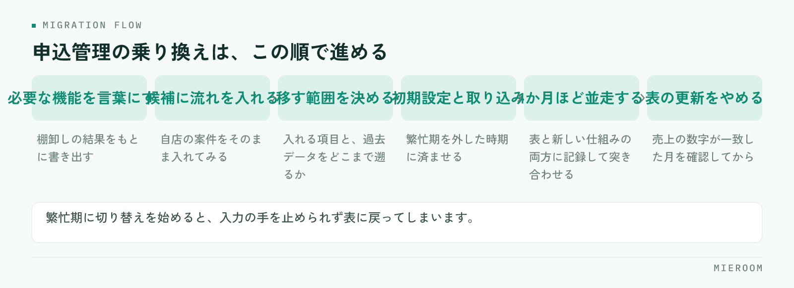

<!--META
{
  "title": "申込管理をシステムに移すタイミング｜Excelの管理表で漏れが出始めたら",
  "date": "2026-11-02",
  "category": "売上管理",
  "excerpt": "Excelの申込管理表で漏れや二重入力が出てきた店舗に向けて、システムへ移すかどうかの判断基準と、移す前にやる棚卸しの手順を整理しました。繁忙期を避けた段取り、乗り換えでよくある失敗の避け方までまとめています。",
  "hook": "申込管理の限界は件数ではなく人数で来る",
  "tags": ["申込管理", "業務管理システム", "Excel", "乗り換え", "賃貸仲介"]
}
META-->

申込管理表はきちんと作ってあるのに、気づくと入金の確認漏れが出る。同じ案件を二人が別の行に入れている。そんな状態になったら、表の作り方を直す段階ではなくなっているかもしれません。**申込管理をシステムに移す判断は、案件の件数ではなく、同じ情報を触る人数と更新の回数で決まります**。この記事では、移すタイミングの見極め方と、移す前にやっておく準備を整理します。

<h4>この記事の結論</h4>

Excelの管理表が限界に近づくサインは、件数の増加ではなく、同じ案件を複数の人が別々に更新し始めたときに出ます。<strong>移す前にいまの管理表を棚卸しして、残す項目と捨てる項目を決めておくことが、乗り換えの成否を分けます</strong>。切り替えは繁忙期を外し、しばらく両方を並走させる段取りで進めてください。

## Excelの申込管理表が限界に近づくときのサイン

Excelの申込管理表は、よく作られていれば長く使えます。限界が来るのは表の出来が悪いからではなく、使う人数と更新の回数が増えたときです。

次のような状態が出てきたら、表の工夫では戻しにくいところに入っています。ファイルを開こうとしたら誰かが開いていて編集できない。最新がどのファイルか分からず、日付入りのコピーが増えている。入金の確認を月末にまとめてやるため、その日まで未入金に気づかない。担当者が自分の案件だけを別のシートで管理している。月をまたいだ案件が、申込の月のシートと契約の月のシートに分かれている。

共通しているのは、情報が一か所にない状態です。表そのものは正しくても、正しい表が複数あると、どれを見て判断すればよいかが決まりません。項目の設計で直せる範囲は[賃貸仲介の申込管理表の作り方](./moushikomi-kanrihyo-tsukurikata.html)に整理していますので、まずそちらで直せるかを確かめてから、この記事の判断に進んでください。

## 漏れと二重入力はどこで起きているか

漏れが出る場所は、だいたい決まっています。申込から契約までの間ではなく、その前後です。

一つは入金の確認です。契約までは担当者が追いますが、入金は経理や店長が見る情報になるため、担当が変わるところで引き継ぎが落ちます。一部入金や分割の入金が入ると、表の1つのセルでは表せなくなり、備考欄に書かれて見落とされます。

もう一つは後ADです。入金の予定が契約から数か月先になるため、管理表の視界から外れます。月末に突き合わせる作業で見つかればよいのですが、件数が増えると突き合わせ自体が終わらなくなります。後ADの追い方は[後ADの未入金を防ぐ管理表の作り方](./go-ad-nyukin-kanrihyo.html)にまとめています。

二重入力は、同じ情報を二か所に書く構造があるところで起きます。反響の記録と申込の記録が別の表になっていると、物件名と顧客名を二度入力します。売上の集計表が別にあれば、三度目の入力が発生します。入力の回数が増えるほど、どこかで食い違い、どちらが正しいかを調べる時間が生まれます。

## 移す前に、いまの管理表を棚卸しする

いきなりシステムを探し始めると、機能の一覧を見比べる話になり、自店に必要なものが分からなくなります。先に手元の表を棚卸ししてください。

そのまま使えるチェックリストにしました。

- いま使っている表やシートを、すべて書き出す（申込・売上・反響・接客・経理など）
- それぞれの表を、誰が・いつ・何のために開いているかを書く
- 同じ情報を二か所以上に入力している箇所に印を付ける
- 月末や締めの日にだけ発生している作業を書き出す
- 集計のために作っている中間の表を特定する
- 実際には誰も見ていない項目を見つける
- 案件が月をまたぐときに、どこに分かれて記録されているかを確認する
- 過去のデータをどこまで引き継ぎたいかを決める

✓使っていない項目は移さない

長く使った表には、いつか必要になるかもしれないと思って残した列が増えています。移すときに全部を持っていくと、新しい仕組みでも同じ入力の手間が続きます。棚卸しで誰も見ていない項目が見つかったら、移す前に落としてください。

棚卸しが終わると、必要な機能が自然に言葉になります。「反響から申込までを同じ画面でつなぎたい」「入金を案件ごとに分けて残したい」「確定した売上と見込みを分けて見たい」という形で書けるようになれば、比べる準備ができています。

## 移すタイミングの判断基準

判断の材料は、件数ではなく使い方の側にあります。下の表で、自店がどちらに近いかを見てください。

| 見る場所 | 表のままで回る | 仕組みに移す段階 |
|---|---|---|
| 表を更新する人数 | 1〜2人で、席も近い | 3人以上、または店舗が分かれている |
| 更新の頻度 | 1日の終わりにまとめて入れる | 日中に何度も、別の人が入れる |
| 入金の確認 | 件数が少なく、月末に追える | 一部入金や後ADが重なり、月末が終わらない |
| 集計の手間 | 表の関数で足りている | 集計のために別の表を作っている |
| 月をまたぐ案件 | 数が少なく、手で追える | 申込と契約と入金が別の場所に散る |
| 担当の引き継ぎ | 口頭で足りている | 引き継ぎのたびに経緯を探している |

右側に3つ以上当てはまるなら、表の改善を続けるより、仕組みを変えたほうが戻りが大きい段階です。左側が多い場合は、まず項目の設計を直すほうが先です。道具を入れても、何を記録するかが決まっていなければ同じ場所でつまずきます。

## 乗り換えの進め方と、繁忙期を避ける段取り

切り替えの失敗は、機能が足りないからではなく、時期と並走の設計を決めていないことで起きます。

<figure class="fig"><figcaption>並走の目的は確認ではなく、安心して表を閉じられる状態を作ることです。</figcaption></figure>

1. 棚卸しの結果をもとに、必要な機能を言葉にする
2. 候補をいくつか見て、自店の案件の流れを入れてみる
3. 入れる項目と、移す過去データの範囲を決める
4. 繁忙期を外した時期に、初期設定とデータの取り込みを行う
5. 1か月ほど、表と新しい仕組みの両方に記録して突き合わせる
6. 数字が合うことを確認してから、表の更新をやめる

賃貸仲介の繁忙期に切り替えを始めるのは避けてください。入力の手が止められない時期に新しい画面を覚えるのは無理があり、結果として表に戻ってしまいます。閑散期に設定を済ませ、繁忙期には慣れた状態で入るのが安全です。

5番の並走を飛ばさないでください。並走の目的は確認ではなく、安心して表を捨てられる状態を作ることです。売上の数字が両方で一致した月を一度でも見ておけば、表を閉じる判断ができます。

## よくある失敗と、その避け方

乗り換えでつまずく場所は限られています。先に知っておくと避けられます。

- **繁忙期に切り替えを始める**：閑散期に初期設定とデータ取り込みを終え、繁忙期は慣れた状態で迎えます
- **過去データを全部移そうとする**：どこまで必要かを先に決めます。参照するだけのものは表のまま残しておけば足ります
- **表をすぐに閉じる**：1か月ほど並走し、売上の数字が一致した月を確認してから閉じます
- **担当者ごとに入力の仕方が違う**：どの項目を誰が入れるかを紙1枚にして、切り替えの前に共有します
- **使っていない項目を持ち込む**：棚卸しで落とします。移したあとに増やすほうが簡単です
- **店長だけが新しい画面を覚える**：日々入力する人が触れないと戻ります。最初の設定から担当者を入れてください
- **入金の記録を後回しにする**：一部入金・分割入金・後ADをどう残すかは、切り替えの前に決めておきます

> 乗り換えが止まる原因は、たいてい機能ではなく、いつ・誰が・何を入れるかを決めていないことです。

## 自分たちで進める場合と、ツールに任せる場合の分かれ目

分かれ目になるのは、表を更新する人数と、締めの作業にかかっている時間です。

自分たちの表で進めやすいのは、更新する人が1〜2人で、席が近く、口頭で確認が取れる場合です。この規模なら、項目の設計を直し、月末の確認手順を決めるだけで回ります。まず項目を整えて数か月続けてみると、どの作業が本当に重いのかが分かり、次の判断がしやすくなります。

仕組みに移したほうが早いのは、更新する人が3人以上に増えた場合、店舗が分かれて同じファイルを開けない場合、集計のために別の表を作っている場合です。入金の確認が月末に集中して終わらない状態や、月をまたぐ案件が複数の場所に分かれている状態も、表の工夫では戻しにくいところです。

判断の順番としては、まず棚卸しをして、項目の設計で直せる分を直す。それでも残る手間が、人数と場所に由来するものであれば移す。この順で進めると、移したあとに同じ問題が再発しません。道具を先に決めると、何を記録するかの議論が後回しになりがちです。

## よくある質問

案件が何件くらいになったら、システムに移すべきですか？

件数で線を引くのは難しいところです。同じ件数でも、更新する人が1人なら表で回りますし、3人いれば開けない時間が生まれます。判断は人数と更新の回数、それに締めの作業にかかっている時間で行ってください。月末の突き合わせが終わらない状態が続いているなら、件数に関係なく移す段階です。

過去のExcelデータは引き継げますか？

引き継げます。ミエルームはExcelデータのインポートと初期設定の代行に対応しています。ただし全部を移す必要はありません。どこまで遡って必要かを先に決め、参照するだけの古いデータは表のまま保管しておくほうが、切り替えがすっきり進みます。

切り替えの期間はどのくらい見ておけばよいですか？

初期設定とデータの取り込み自体は短く済みますが、表と並走する期間を1か月ほど取ってください。並走の目的は、売上の数字が両方で一致することを確認して、安心して表を閉じられる状態を作ることです。繁忙期を外した時期に始めれば、この並走にも無理なく時間を使えます。

一部入金や分割の入金も記録できますか？

記録できます。ミエルームの申込・入金管理では、一部入金・分割入金を案件ごとに残せて、後ADの入金も同じ案件の記録として追えます。確定した売上と見込みが分かれて表示されるため、入金済みの分だけを見たい月末の確認にも使えます。

まずどこから見始めればよいですか？

いま使っている表をすべて書き出すところからです。申込・売上・反響・接客・経理と分かれているうち、同じ情報を二度入力している箇所に印を付けてください。その印の数が、移したときに消える手間のおおよその量になります。

## まとめ：表を直すか移すかは、人数と締めの時間で決まる

申込管理をシステムに移すタイミングは、案件が増えたからではありません。同じ案件を複数の人が別々に更新し始め、月末の突き合わせが終わらなくなったときです。この二つが出ていなければ、項目の設計を直すほうが先です。

移すと決めたら、棚卸しで残す項目と捨てる項目を決め、繁忙期を外して初期設定を済ませ、1か月並走してから表を閉じる。この段取りを守るだけで、切り替えの途中で戻ってしまう事態をほとんど防げます。

ミエルームなら、申込から入金・後ADまでを案件ごとに1行で記録でき、一部入金や分割入金もそのまま残せます。反響管理・接客管理・売上管理が同じ場所にあるので、同じ物件名と顧客名を二度入力する手間がなくなり、確定売上と見込みが分かれて表示されるため月末に管理表を突き合わせる作業もなくなります。Excelデータのインポートと初期設定の代行に対応しているので、いまの管理表からの切り替えもそのまま進められます。他のシステムとの違いは[業務管理システムの比較](../compare.html)に整理しています。資料のご請求やデモアカウントの発行は、この下のボタンからお気軽にどうぞ。
