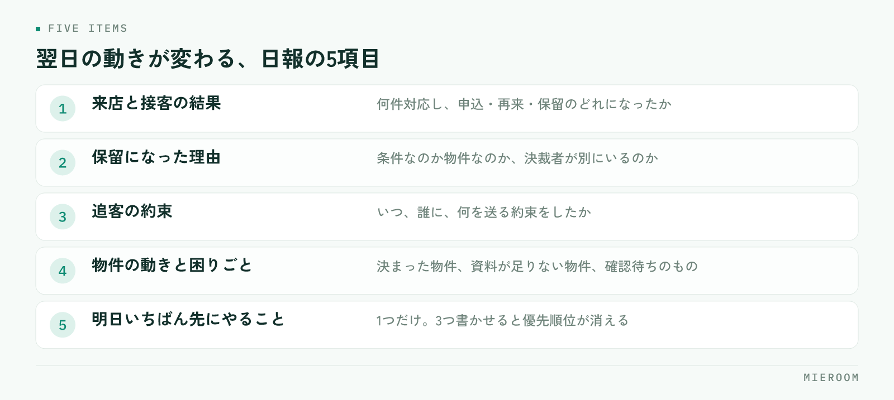

<!--META
{
  "title": "賃貸仲介の日報の書き方｜翌日の動きが決まる項目と運用",
  "date": "2026-10-15",
  "category": "組織・育成",
  "excerpt": "賃貸仲介の店舗で日報が続かない原因と、翌日の動きが決まる項目の決め方をまとめました。書く項目を絞る基準、書く時間と読む人の決め方、読んだ側が返すもの、週の振り返りへのつなぎ方まで整理しています。",
  "hook": "続かない日報は、項目と読む側に原因がある",
  "tags": ["日報", "店舗運営", "組織づくり", "スタッフ育成", "賃貸仲介"]
}
META-->

日報を始めたのに、数週間で提出が止まった。出てはいるが「本日も接客1件、追客を進めました」としか書かれていない。賃貸仲介の店舗でよくある状態です。**日報が続かない原因は、書く側の意識ではなく、項目の多さと読んだ側の反応の無さにあります**。

<h4>この記事の結論</h4>
日報は、書く項目を絞り、読んだ側が必ず何かを返す形にすると続きます。<strong>翌日の動きが1つでも変わらない日報は、書いても読んでも意味がありません</strong>。項目を5つに絞り、返すことを決めるところから始めてください。

## 日報が続かなくなる店舗で起きていること

日報が止まる店舗では、だいたい同じことが起きています。

まず、**項目が多すぎる**ことです。来店・反響・追客・物件の動き・所感まで全部書かせると、閉店後に20分以上かかります。繁忙期に最初に捨てられるのが、この20分です。

次に、**書いても何も返ってこない**ことです。提出先が店長だけで、読んだ反応が無いまま日が過ぎると、書く側は提出することだけが目的になります。そうなると中身は定型文になります。

そして、**数字を手で集計させている**ことです。来店数や反響数を日報に書くために、別のシートを開いて数えている状態です。これは日報ではなく集計作業で、本人の気づきを書く余力が残りません。

✓反省文を書かせる形にしない

「至らなかった点」「次回への決意」といった項目を入れると、日報が反省文になります。書く側は書きやすい無難な言葉を選ぶため、店舗にとって必要な情報が出てきません。日報で集めるのは反省ではなく、翌日の判断に使える事実です。

## 日報に入れる項目を5つに絞る

項目は、翌日の動きが変わるものだけに絞ってください。店舗で使いやすいのは次の5つです。

<figure class="fig"><figcaption>翌日に直接効くのは2番目と3番目です。「保留1件」だけでは何も動けません。</figcaption></figure>

1. **来店と接客の結果**：何件対応し、申込・再来・保留のどれになったか
2. **保留になった理由**：条件なのか物件なのか、決裁者が別にいるのか
3. **追客の約束**：いつ、誰に、何を送る約束をしたか
4. **物件の動きと困りごと**：決まった物件、資料が足りない物件、確認待ちのもの
5. **明日いちばん先にやること**：1つだけ

このうち翌日に直接効くのは、2番目と3番目です。**保留の理由が書かれていれば、店長は代わりの物件を探す指示が出せます**。逆に「保留1件」としか書かれていなければ、何も動けません。

5番目を1つに限定するのも大事です。3つ書かせると優先順位が消え、翌朝に確認する側も追えなくなります。

## 数字は集計しないで取れるものだけにする

日報に数字を入れると状況が把握しやすくなりますが、手で数えさせた時点で続かなくなります。基準は「すでにどこかに記録されているか」です。

| 日報に書く | 日報に書かない |
|---|---|
| その日の接客で起きた事実と、次の約束 | 月間の累計や達成率などの集計された数字 |
| 保留・見送りの理由 | 感想や決意表明 |
| 資料や確認の不足で止まっていること | 他のシートを開かないと分からない件数 |
| 翌日に最初にやること1つ | 当日の行動を時間順に並べた記録 |

累計や達成率は、日報とは別の場所で見るものです。日報は毎日の事実を残す場所、成績は期間でまとめて見る場所、と分けてください。成績の見方は[スタッフの成績管理](./staff-seiseki-kanri.html)に整理しています。

日報に書く数字は、その日に本人が対応した件数のように、思い出さずに書けるものだけにしてください。それ以上の数字が必要なら、日報ではなく記録の仕組み側で取るべきものです。

## 書く時間と、読む人を決める

運用で決めるのは、書く時間・提出先・読む時間の3つです。曖昧なままにすると、どれかが崩れて止まります。

**書く時間**は、閉店後ではなく接客の合間に分けて書ける形がおすすめです。1件終わるたびに2行だけ残せば、閉店後の作業はほぼ無くなります。まとめて書かせると、記憶が薄れて定型文になります。

**提出先**は、店長だけにしないほうが続きます。店舗全員が見られる形にすると、他の担当者の保留理由や物件の困りごとが共有され、読む価値が出ます。ただし成績の比較として使わないと決めておいてください。

**読む時間**は、翌朝の最初に固定します。朝の段取りの中に日報を読む時間が入っていないと、読まれない日が出て、そこから提出も止まります。朝の組み立て方は[店長の仕事の段取り](./tencho-shigoto-dandori.html)で扱っています。

## 読んだ側が必ず返すものを決める

日報が続くかどうかは、読んだ側の返し方で決まります。長い返信は不要で、返すものを決めておくだけで変わります。

- **保留の理由に対して**：代わりに当たる物件か、確認する先を1つ返す
- **追客の約束に対して**：送る内容を見てよいか、文面を一緒に作るかを返す
- **困りごとに対して**：誰が対応するかを決めて返す。保留にしない
- **明日やること1つに対して**：その順番でよいか、変えるかを返す

ポイントは、**感想ではなく判断を返すこと**です。「お疲れさま」だけでは、書いた側に何も残りません。1行で「この物件を当たってみてください」と返るだけで、日報は翌日の動きにつながります。

✓返せない日があってもよい形にする

店長が外に出ている日は、すぐに返せないこともあります。その場合は、返す担当をあらかじめ決めておいてください。誰も返さない日が続くと提出が止まりますが、返す人が決まっていれば運用は保ちます。全員分に返せない日は、保留と困りごとだけに返すと決めておくのも有効です。

## 日報を週の振り返りにつなげる

毎日の日報は、1日単位では傾向が見えません。週に一度、並べて読む時間を取ってください。

見るのは3つです。**保留の理由に同じものが並んでいないか、追客の約束が実行されているか、困りごとが解決せずに残っていないか**。同じ保留理由が何人分も並ぶなら、物件の在庫か案内の進め方に原因があります。

約束が実行されていない日が続く場合は、本人の意識よりも、約束が記録として残っていない可能性を先に疑ってください。思い出して対応する形になっていると、忙しい日に必ず漏れます。

週の振り返りで決めるのは、次の週に変えることを1つだけです。日報は、変えることを見つけるための材料として使うのがいちばん機能します。

日報は紙とチャットのどちらがよいですか？

どちらでも運用は作れますが、あとから読み返すかどうかで選んでください。紙は書きやすい反面、週の振り返りで並べて読む作業に手間がかかります。チャットは共有が速い一方、他の連絡に流れて探せなくなることがあります。どちらを選ぶ場合も、案件や顧客に紐づけて残る形にしておくと、担当が変わったときに引き継ぎで使えます。日報のためだけに新しいツールを増やす必要はありません。

書く内容が毎日同じになってしまう担当者にはどう伝えればよいですか？

書き方を指導するより、項目を具体的な質問に変えるほうが効きます。「所感」ではなく「保留になった理由は条件か物件か」と聞く形にすれば、答えは自然に具体的になります。それでも同じ内容が続く場合は、本当にその日に動きがなかった可能性もあります。その場合は日報の問題ではなく、反響や来店の入り口を見直す段階です。

日報を成績評価に使ってもよいですか？

評価の材料にすると、書く側は都合の悪いことを書かなくなります。保留の理由や止まっている困りごとは、評価されると思えば出てきません。日報は翌日の動きを決めるための共有、評価は期間でまとめた成績で行う、と分けてください。分けると決めたことを口頭でも伝えておくと、書かれる内容が変わります。

## まとめ：日報は、翌日の動きが変わって初めて意味を持つ

日報を続けるために必要なのは、項目を5つに絞ること、集計させないこと、読んだ側が判断を1つ返すことです。この3つが揃うと、日報は提出物ではなく、翌日の動きを決める材料になります。

そして**書かれない日報より、読まれない日報のほうが先に止まります**。始めるときは、書く側のルールより、読んで返す側のルールを先に決めてください。

[ミエルーム](../index.html)なら、接客管理と反響管理で来店や追客のやりとりが案件ごとに残り、接客・反響成績も記録からそのまま見られます。日報のために件数を数え直す作業がなくなり、保留の理由や次の約束を書くことに時間を使えるようになります。デモアカウントの発行やご相談は、この下のボタンからお気軽にどうぞ。
