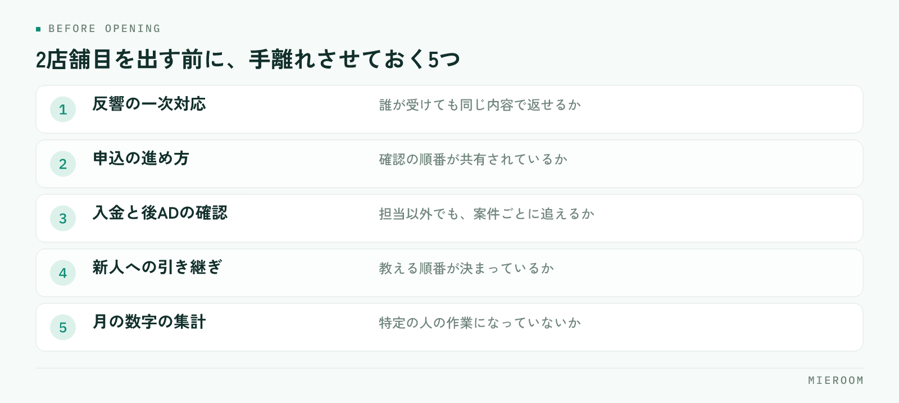

<!--META
{
  "title": "賃貸仲介で2店舗目を出すときの判断｜見る数字と、先に整える順番",
  "date": "2026-10-19",
  "category": "売上管理",
  "excerpt": "賃貸仲介で2店舗目を出すかどうかを、感覚ではなく数字と店舗の状態から判断するための整理です。見るべきは売上ではなく粗利と反響の余り、そして1店舗目が店長不在でも回るかどうかという順番でまとめています。",
  "hook": "2店舗目は、売上ではなく状態で決める",
  "tags": ["多店舗展開", "出店判断", "売上管理", "店舗運営", "賃貸仲介"]
}
META-->

売上が安定してきたので、そろそろ2店舗目を。賃貸仲介の店舗運営でこの話が出るのは、たいてい繁忙期が終わった直後です。ただ、**2店舗目を出すかどうかを決めるのは売上の大きさではなく、1店舗目が「自分がいなくても回る状態」になっているかどうか**です。

<h4>この記事の結論</h4>
2店舗目の判断で見るのは、売上ではなく<strong>粗利の厚みと、1店舗目で取りきれていない反響があるかどうか</strong>です。そのうえで、1店舗目が店長不在でも回る状態になっているかを確かめます。順番を逆にすると、2店舗出して両方が薄くなります。

## 売上が伸びたから、は出店の理由にならない

売上が過去最高だった月の直後は、出店の判断がいちばん甘くなります。繁忙期の売上には、その時期だけの反響と、掲載費を増やした分が混ざっているためです。

見るのは年間の粗利です。売上から掲載費や広告費などの変動費を引き、さらに家賃や人件費といった固定費を引いて、年間で手元に残った額を確認します。2店舗目は**開店してから数か月は赤字で回る前提**で考える必要があるため、その期間を1店舗目の粗利で支えられるかが判断の土台になります。

粗利の出し方そのものが曖昧な場合は、出店の検討より先にそこを整えてください。考え方は[店舗の損益の見方](./tenpo-soneki-arari-handan.html)にまとめています。

## 取りきれていない反響があるか

2店舗目が成り立つかどうかの、もうひとつの材料が反響です。見るのは反響の総数ではなく、**今の店舗で取りきれていない反響があるかどうか**です。

確認するのは次の点です。

- 反響に当日返せていない件数が、月のうちどれくらいあるか
- 来店の予約枠が埋まって断った件数があるか
- 商圏の外から来る反響が、継続的にあるか
- 既存スタッフの手が、繁忙期以外も埋まっているか

取りきれていない反響が常にあるなら、店舗を増やして受け皿を作る意味があります。一方で、反響そのものが足りていない状態で店舗を増やすと、同じ反響を2店舗で分けるだけになります。

とくに注意したいのは、閑散期の数字です。繁忙期だけ手が足りない状態は、人員のやりくりやシフトで解ける問題で、出店の理由にはなりません。

## 1店舗目が、店長不在でも回るかを確かめる

数字が足りていても、ここで止まる店舗が多くあります。2店舗目を出すと、今まで1店舗目にいた人が2店舗目に移るか、2店舗を行き来する形になります。つまり**1店舗目は、今より薄い人数で回ることになります**。

確かめるのは、次の状態になっているかどうかです。

<figure class="fig"><figcaption>この5つが特定の人の頭の中にある状態では、2店舗目を出した時点で1店舗目が止まります。</figcaption></figure>

反響の一次対応が、誰が受けても同じ内容で返せるか。申込の進め方が、確認の順番として共有されているか。入金と後ADの確認を、担当以外でも追えるか。新人が入ったときに教える順番が決まっているか。月の数字の集計が、特定の人の作業になっていないか。

ひとつでも「自分がやっている」状態なら、その業務を先に手離れさせるのが2店舗目の準備です。出店してから整えようとすると、2店舗分の問題が同時に出ます。

## 今の店を伸ばす場合と、2店舗目を出す場合

同じ投資を、今の店に入れる選択もあります。判断材料として並べておきます。

| | 今の店を伸ばす | 2店舗目を出す |
|---|---|---|
| 向く状況 | 反響はあるが取りきれていない。商圏内で伸ばせる余地がある | 商圏の外からの反響が継続している。人が育っている |
| 先に必要なもの | 掲載の見直し、接客の歩留まり改善、増員 | 任せられる人、業務の手順化、数か月分の資金 |
| 効果が出るまで | 比較的早い | 開店から数か月以上かかる前提 |
| 失敗したときの戻し方 | 掲載を絞る、体制を戻す | 固定費が残り、戻すのに時間がかかる |
| 主な負担 | 広告費と人件費 | 家賃、敷金、内装、人件費、システム |

迷っている段階なら、まず今の店で取りきれていない反響を取る側に投資したほうが、判断の材料も増えます。1店舗で歩留まりを上げた経験は、2店舗目でそのまま使えます。

## 人の手当てが先、物件は後

出店の検討は物件探しから始まりがちですが、順番は逆です。よい物件が出たから決めた、という進め方は、任せる人が決まっていない状態での開店につながります。

決める順番は、任せる人 → 必要な粗利の見通し → 商圏 → 物件です。任せる人が社内にいない場合は、採用して育てる期間を出店時期に含めて考えます。賃貸仲介は、入社してすぐ一人で接客から申込まで回せる仕事ではありません。

✓商圏が重なるかどうかの見方

近い場所に出すと、物件情報や業者間のつながりを共用できる一方、同じ反響を2店舗で分けることになります。離した場所に出すと反響は重なりませんが、物件の情報も人の応援も共用しにくくなります。どちらが正しいということはなく、今の店舗の反響が商圏の中で足りているかどうかで決まります。

## 2店舗目を出した直後に起きること

開店後によく起きるのが、記録のばらつきです。1店舗目は今までの形で、2店舗目は新しい人が自分のやりやすい形で記録を付け始めます。

結果として、月末に店舗ごとの数字を並べたときに比較ができません。反響の数え方が違う、申込の記録の粒度が違う、売上の計上の時点が違う。**この状態になると、どちらの店舗が利益を出しているのかが分からなくなります**。

!2店舗目の数字は、1店舗目と同じ形で取る

店舗ごとにExcelを分けて管理すると、集計のたびに突き合わせが必要になり、項目も少しずつずれていきます。開店前に、反響・申込・売上の記録の形をそろえておいてください。あとから統一するほうが手間がかかります。

店舗ごとの比較ができる状態であれば、掲載費の配分、人の配置、どちらの商圏に次を出すかといった判断が数字でできます。担当ごとの成績を店舗をまたいで見る方法は[スタッフの成績管理](./staff-seiseki-kanri.html)を参考にしてください。

売上がどれくらいになったら2店舗目を考えてよいですか？

金額の目安を一律に示すことはできません。家賃も人件費も地域と規模で変わるためです。見るのは売上の額ではなく、年間の粗利で、2店舗目が立ち上がるまでの数か月を支えられるかどうかです。あわせて、1店舗目の反響が取りきれていないかを確認してください。この2つが揃っていないうちは、今の店舗の歩留まりを上げる側に投資したほうが確実です。

任せる人がいない場合、どうすればよいですか？

採用して育てる期間を、出店時期に含めて考えてください。出店を先に決めてから人を探すと、入社直後の人に店舗を任せることになります。先に1店舗目で新人を受け入れ、反響対応から申込まで一人で回せる状態まで育ててから、その人に新店か現店のどちらかを任せる形が現実的です。育てる順番が決まっていない場合は、まずそこを整えるのが準備になります。

2店舗目は近い場所と離れた場所、どちらがよいですか？

今の店舗の商圏で反響が足りているかで決まります。足りていない場合は、離れた場所に出して新しい商圏から反響を取る形になります。足りていて取りきれていない場合は、近い場所のほうが物件情報や応援の行き来が効き、立ち上がりも早くなります。ただし近い場合は、同じ反響をどちらが受けるかの線引きを先に決めておかないと、店舗間で取り合いになります。

## まとめ：判断の順番を固定しておく

2店舗目の判断は、年間の粗利 → 取りきれていない反響 → 1店舗目が店長不在でも回るか → 任せる人 → 商圏 → 物件、という順番で見ます。売上の大きさや、よい物件が出たことを起点にすると、1店舗目まで薄くなります。

そして、出店が決まったら開店前に記録の形をそろえておく。ここだけは、あとから整えるほうが必ず手間がかかります。

[ミエルーム](../index.html)なら、反響から申込・契約・入金までを案件ごとに1行で記録でき、店舗ごと・担当ごとの成績と確定売上を同じ形で見られるので、2店舗目を出したあとに店舗別のExcelを突き合わせる作業が起きません。どちらの店舗にいても同じ画面で記録が残るため、店長が店舗を行き来する期間でも数字が途切れません。デモアカウントの発行やご相談は、この下のボタンからお気軽にどうぞ。
