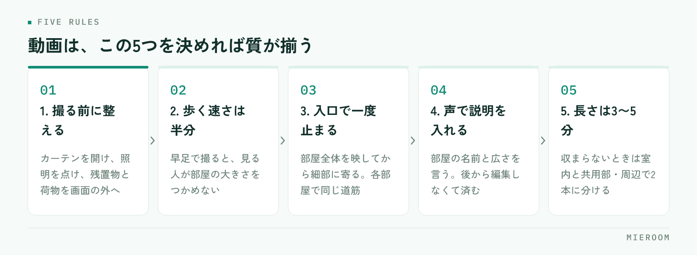

<!--META
{
  "title": "オンライン内見・物件動画の始め方｜遠方のお客様の申込につなげる手順",
  "date": "2026-11-18",
  "category": "集客・広告",
  "excerpt": "遠方のお客様や来店が難しいお客様に向けて、オンライン内見と物件動画を店舗の作業として始める手順をまとめました。使い分けの基準、必要な機材と通信の確かめ方、撮る順番、当日の進め方、申込につなげる段取り、よくある失敗までを順番に整理しています。",
  "hook": "撮る順番と当日の進め方を決めれば回る",
  "tags": ["オンライン内見", "物件動画", "遠方のお客様", "反響対応", "賃貸仲介"]
}
META-->

オンライン内見を始めようとして止まる理由は、機材ではありません。**その場で何を見せ、どの順番で話し、終わりに何を決めるかが店舗で揃っていないこと**が原因です。手順が決まっていれば、スマートフォン1台でも成立します。この記事では、オンライン内見と物件動画を店舗の作業として回すための手順を、準備から申込までの順番で整理します。

<h4>この記事の結論</h4>
オンライン内見は、<strong>見せる順番と所要時間を先に決めておく</strong>だけで成立します。動画は一度撮れば何人にも使え、オンライン内見はその場の質問に答えられる。この違いで使い分け、終わりに次の予定を決めるところまでを1つの手順にしてください。

## オンライン内見が効く場面を、先に決める

オンライン内見をすべてのお客様に使う必要はありません。効く場面を決めておかないと、現地内見で足りるお客様にまで手間をかけることになります。

効くのは4つの場面です。遠方からの転居で、来店の回数を減らしたいお客様。仕事や育児で日中に動けないお客様。候補が多く、現地に行く前に数を絞りたいお客様。そして、ご本人以外に決める人が居て、その人にも見せたいお客様です。

このうち、申込への距離がもっとも近いのは最後の場面です。**決める人が離れて暮らしている場合、画面越しに一緒に見られるかどうかが契約の速さを決めます**。ご両親や配偶者が遠方に居るお客様には、最初の案内の時点でオンライン内見ができることを伝えておいてください。

逆に、同じ市内で明日来店できるお客様には、現地内見を勧めたほうが早く決まります。オンライン内見は、来店が難しい事情を埋めるための道具だと位置づけておくと、使う場面の判断に迷いません。

## 動画・オンライン内見・現地内見の使い分け

3つの方法は、代わりになるものではなく役割が違います。何を目的に見せるかで選んでください。

| 方法 | 向いている段階 | 強み | 弱み |
|---|---|---|---|
| 物件動画 | 候補を絞る前 | 一度撮れば何人にも使える。お客様の都合のよい時間に見られる | その場の質問に答えられない。撮っていない所は見せられない |
| オンライン内見 | 候補を2〜3件に絞った後 | 質問に答えながら見せられる。決める人が同席できる | 担当者の時間が現地内見と同じだけかかる |
| 現地内見 | 申込を決める直前 | においや音、日当たり、周辺の様子まで伝わる | 来店と移動の時間が必要。日程が合わないと止まる |

迷ったときの順番は決まっています。動画で数を絞り、オンライン内見で候補を2〜3件まで詰め、可能なら現地で最終確認をする。遠方で現地に来られない場合は、オンライン内見を現地内見の代わりに使い、後で説明する確認項目を増やして補います。

この流れを店舗の案内に書いておくと、問い合わせの時点でお客様が選べます。**どの方法でどこまで分かるのかを先に伝えておくと、見た後の不満が出にくくなります**。

## 始める前に決める3つのことと、必要な機材

始める前に決めるのは、やり方・担当・所要時間の3つです。これが決まっていないと、依頼が来るたびに段取りから考えることになります。

やり方は、使う通話の方法を1つに決めます。お客様の多くが使えるもの、アプリの新規登録が要らないもの、画面の共有ができるもの。この3つを満たすものであれば十分です。複数を使い分けると、案内文を毎回書き直すことになります。

担当は、その物件に行ける人を決めます。オンライン内見は、現地に担当者が居る形と、事前に撮った動画を見ながら店舗から説明する形の2つがあります。現地に行く形のほうが質問に答えられますが、移動の時間が必要です。物件の距離で分けておくと回しやすくなります。

所要時間は、1件あたり20〜30分を目安に決めます。終わりの時刻を先に伝えておくと、質問が出ないまま時間が過ぎることを防げます。機材は次のもので足ります。

✓最低限そろえるもの

スマートフォン1台／手ぶれを抑える自撮り棒か小型の三脚／マイク付きイヤホン（室内の反響を抑えるため）／予備の電池。現地の通信が弱い物件があるため、事前に電波の状況を確かめ、弱い場合は先に撮った動画を使う形に切り替えてください。

## 物件動画は、撮る順番を決めれば質が揃う

動画は、撮る順番を固定するだけで担当者による差が小さくなります。部屋に入ってから出るまでの道筋をそのまま撮るのが基本です。

<figure class="fig"><figcaption>順番と決めごとを固定すると、担当者が変わっても同じ構成の動画が揃います。</figcaption></figure>

撮る前の準備は、写真と同じです。カーテンを開け、照明をすべて点け、残置物と自分の荷物を画面の外に出します。撮影の条件については[物件写真の撮り方](./bukken-shashin-torikata.html)にまとめた内容がそのまま使えます。

撮るときは、歩く速さを普段の半分にしてください。早足で撮った動画は、見る人が部屋の大きさをつかめません。各部屋では、入口で一度止まって部屋全体を映し、それから細部に寄ります。声で「ここが洋室の6畳です」と入れておくと、後から編集しなくても説明になります。

撮り終えたら、長さを3〜5分に収めます。それより長い動画は最後まで見られません。1本に収まらない場合は、室内と共用部・周辺で2本に分けてください。**同じ順番で撮った動画が並んでいると、お客様が複数の物件を比べやすくなります**。

## オンライン内見の当日の進め方と、そのあとの段取り

当日は、時間の使い方を決めておきます。前半で全体を見せ、後半を質問に充てる形が扱いやすいです。

最初の3分で、物件の場所、周辺の様子、建物の外観を見せます。次の10分で、玄関から順に室内を回ります。ここは撮る順番と同じ道筋にしてください。続く5分で、お客様が気にしている所をもう一度見せます。事前に聞いておくと、この時間が有効に使えます。残りを質問と、次に決めることの確認に充てます。

オンラインでは伝わりにくいものがあるので、言葉で補います。

- 階段や廊下の幅（持っているものが運び込めるか）
- 窓からの音（窓を開けて数十秒、黙って聞いてもらう）
- 日当たりの時間帯（内見した時刻と、方角を伝える）
- においや湿り（担当者が確かめて、正直に伝える）
- 携帯電話の電波の状況（室内で実際に確かめる）
- 収納の奥行き（メジャーを当てて数字を読む）
- コンセントと配管の位置（家具の配置に関わる部分）
- 駐車場や駐輪場の幅（実際に使う車種を聞いてから見せる）

終わる前に、必ず2つを決めてください。候補の中での順位と、次の連絡の日です。ここを決めずに「ご検討ください」で終えると、遠方のお客様は次の動きが取れません。終わった後は、見せた物件と出た質問、残っている不安を接客の記録に残します。**次の連絡で前回の続きから話せるかどうかが、申込までの速さを決めます**。追客の組み立て方は[反響管理の方法](./hankyo-kanri-hoho.html)もあわせてご覧ください。

## よくある失敗と、その避け方

**通信を確かめずに当日を迎える**。室内で電波が弱く、途中で切れると信頼を損ねます。事前に現地で確かめ、弱ければ動画を使う形に切り替えてください。

**歩きながら全部を撮ろうとする**。画面が揺れ、部屋の大きさが伝わりません。各部屋の入口で止まり、全体を映してから寄ってください。

**所要時間を伝えていない**。終わりの時刻が分からないと、お客様が質問を切り出せません。最初に「30分ほどで」と伝えてください。

**明るく見せようと加工する**。現地に来たときの落差が、申込の取り消しにつながります。暗い部屋は、照明を点けた状態をそのまま見せてください。

**終わりに次の予定を決めない**。遠方のお客様は、自分から動くきっかけがありません。順位と次の連絡日を、その場で決めてください。

**撮った動画を個人の端末に置いたままにする**。担当者が休みの日に使えません。保存場所と名前の付け方を店舗で統一してください。

**オンライン内見で見せていない所を、聞かれて答えられない**。事前に気になる点を聞き、その所を重点的に見せる段取りにしてください。

## 自分で進める場合と、ツールや専門家に任せる場合の分かれ目

一般論として、判断の基準は3つあります。

一つ目は、依頼が来る件数です。月に数件であれば、通話アプリと手順書だけで回ります。件数が増え、誰がいつ誰に対応したかが分からなくなってきたら、記録を残す仕組みを入れる段階です。

二つ目は、関わる人数です。担当者1人で完結している間は、個人のやり方で足ります。複数のスタッフが対応するようになると、撮った動画の保管場所、見せた物件、出た質問の引き継ぎが必要になります。この引き継ぎを口頭で回している店舗は、同じ説明を繰り返す時間が増えていきます。

三つ目は、効果を確かめたいかどうかです。オンライン内見を始めた結果、申込が増えたのかを知るには、どの反響がどの方法で内見し、申込に至ったかを数えられる状態が必要です。感覚で続けるなら手順書で足り、判断したいなら記録の仕組みが要ります。

迷うときは、まず手順を1枚にまとめて数件回してみてください。回してみると、自店で足りないのが手順なのか記録なのかが具体的に分かります。

## よくある質問

オンライン内見だけで申込まで進めてよいのでしょうか？

遠方のお客様では現実的な進め方です。ただし現地で確かめられない点があるため、音・におい・日当たり・電波・収納の奥行きといった項目を担当者が確かめ、言葉と数字で伝えたうえで進めてください。伝えた内容は記録に残し、入居後の認識の違いを防ぐことをおすすめします。

動画はどの媒体に載せればよいですか？

媒体ごとに動画の扱いが違うため、まずは掲載しているポータルの仕様を確認してください。載せられない場合でも、個別の案内で送る形で使えます。問い合わせへの返信に動画を添える運用だけでも、来店が難しいお客様の反応が変わります。

室内が暗い物件は、どう見せればよいですか？

照明をすべて点け、明るい時間帯に撮るのが基本です。それでも暗い場合は、加工で持ち上げずに、暗いという事実を伝えてください。窓の向きと、光が入る時間帯を言葉で添えると、お客様が自分の生活に当てはめて判断できます。

お客様がアプリの操作に慣れていない場合は？

新規登録が不要で、送ったリンクを開くだけで始められる方法を選んでください。案内のメールに、開き方の手順を3行程度で書いておくと当日の遅れが減ります。それでも難しい場合は、先に撮った動画を送り、電話で説明しながら見ていただく形に切り替えてください。

1日に何件まで対応できますか？

1件あたりの所要時間と移動時間で決まります。現地に行く形であれば、移動を含めて半日に2件程度が目安です。事前に撮った動画を使って店舗から説明する形であれば、移動がないため多く入れられます。物件の距離で形を分けると、予定が組みやすくなります。

## まとめ：手順を1枚にすれば、オンライン内見は回る

オンライン内見と物件動画の始め方は決まっています。効く場面を決める。通話の方法と担当と所要時間を先に決める。撮る順番を固定して動画を用意する。当日は前半で全体、後半で質問に充てる。伝わりにくい点を言葉と数字で補う。終わりに順位と次の連絡日を決める。見せた内容と出た質問を記録に残す。この形なら、スマートフォン1台でも遠方のお客様の判断を前に進められます。

逆に、記録を残さないまま件数が増えると、同じ説明を繰り返し、誰がどこまで話したかが分からなくなります。オンライン内見の成果を決めるのは、見せ方よりも、そのあとの続きの作り方です。

ミエルームなら、フォームやメールから入った反響がそのまま案件として残り、接客管理に内見で見せた物件や出た質問、残っている不安を書き足していけるので、次の連絡を別の担当者が受けても前回の続きから話せます。反響分析で経路ごとの成績を見られるため、オンライン内見を始めた後の変化も数字で追えます。LINE・SMSの自動追客まで同じ案件につながるので、遠方のお客様へのこまめな連絡が手作業で止まりません。機能の詳細は[機能・事例](../features.html)をご覧ください。資料のご請求やデモアカウントの発行は、この下のボタンからお気軽にどうぞ。
