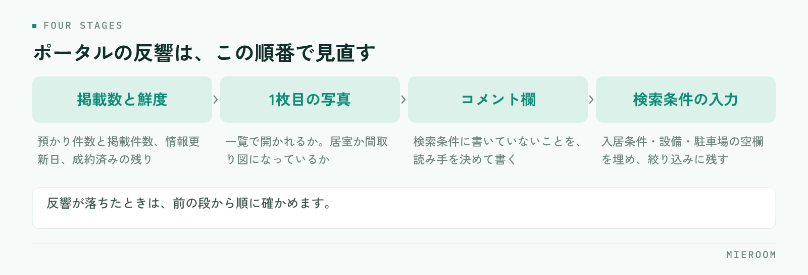

<!--META
{
  "title": "ポータルサイトの反響を増やす方法｜掲載物件・写真・コメントを見直す順番",
  "date": "2026-11-11",
  "category": "集客・広告",
  "excerpt": "ポータルサイトの反響が少ないときに、どこから手を入れるかを順番で整理しました。掲載できている物件の数と鮮度、1枚目の写真、コメント欄、検索条件の入力という4段階の見直し方と、原因の切り分け、毎週の確認項目までまとめています。",
  "hook": "反響が少ないときは、見直す順番を決める",
  "tags": ["ポータルサイト", "反響", "集客", "物件写真", "賃貸仲介"]
}
META-->

ポータルサイトの反響を増やすときに効くのは、掲載する物件を増やすことではありません。**今載っている物件が、探している人の画面にきちんと出て、開かれているかを順番に確かめること**です。順番を決めずに写真から直し始めると、そもそも検索結果に出ていなかった、という取りこぼしが残ります。

<h4>この記事の結論</h4>

反響の見直しは、<strong>掲載数と鮮度 → 1枚目の写真 → コメント欄 → 検索条件の入力</strong>の順に進めます。前の段で落ちている物件は、後ろの段をいくら直しても反響になりません。

## ポータルサイトの反響が少ないときは、見直す順番を決める

ポータルサイトの反響は、4つの段を順に通って問い合わせになります。探している人の検索条件に引っかかる、一覧に出る、写真を見て開く、詳細を読んで問い合わせる。この順番のどこかで落ちていれば、その先は起きません。

<figure class="fig"><figcaption>前の段で落ちている物件は、後ろの段を直しても反響になりません。</figcaption></figure>

反響が少ないという相談で最初に出てくるのは「写真を撮り直したほうがいいか」「コメントを書き直したほうがいいか」という話です。どちらも効きますが、順番としては後ろです。掲載できている物件が少なかったり、決まった物件が残っていたりすると、写真を直しても見てもらう機会そのものが増えません。

そこで、見直しは前の段から順に進めます。まず数を数え、次に1枚目の写真、次にコメント欄、最後に検索条件の入力です。前の段に手を入れるほど、作業量に対して反響の変化が出やすくなります。逆に、後ろの段だけを直し続けると「がんばっているのに変わらない」という状態になります。

店舗でこの順番を共有しておくと、担当者が変わっても手の入れ方がぶれません。見直しの会話が「写真をもっときれいに」ではなく「どの段で落ちているか」に変わります。

## 掲載できている物件の数と鮮度を数える

最初にやるのは、感覚ではなく数を数えることです。確かめる数字は3つです。

**1つめは掲載件数**です。自店が預かっている物件のうち、何件が実際に掲載されているか。管理物件や専任物件が掲載から漏れていることは珍しくありません。入力が追いついていない、担当者が止まっている、画像が足りなくて下書きのままになっている、といった理由で止まります。

**2つめは掲載の鮮度**です。情報更新日が古い物件は、ポータルサイトの並び順でも、見た人の印象でも不利になります。更新日は、内容を直さなければ新しくなりません。空室確認をしたら更新する、という流れを決めておきます。

**3つめは決まった物件が残っていないか**です。成約済みの物件が載り続けていると、問い合わせは来ても「もう決まっています」で終わります。反響数は増えても来店にはつながらず、おとり広告として扱われる危険もあります。掲載の下げ方は[成約済み物件の掲載を止める運用](./keisai-bukken-torisage.html)に分けて書いています。

### 数えるときの見方

| 見る数字 | 確かめ方 | 低いときに起きること |
|---|---|---|
| 掲載件数 | 預かり件数と掲載件数を突き合わせる | 検索結果に出る回数そのものが少ない |
| 情報更新日 | 7日以上更新のない物件を数える | 並び順で後ろに回り、古い印象を持たれる |
| 成約済みの残り | 決まった物件が掲載に残っていないか | 反響は来ても来店につながらない |

## 写真は1枚目で開くかどうかが決まる

数がそろったら写真です。ここで見るのは写真全体の出来ではなく、**一覧に出る1枚目で開かれているか**だけです。一覧の画面では、間取り図と外観と室内が小さく並びます。そこで指が止まるかどうかで、詳細を開くかが決まります。

1枚目に向くのは、部屋の広さと明るさが一度で分かる写真です。多くの場合、窓が入った居室の引きの写真か、間取り図になります。玄関のドアや、ポストや、駐輪場の写真が1枚目になっている物件は、一覧で埋もれます。順番の入れ替えだけで済むので、撮り直す前にまず並び順を直します。

枚数も見ます。写真が3〜4枚しかない物件は、詳細を開いても判断材料が足りず、問い合わせの手前で離れます。居室・水回り・収納・玄関・外観・共用部・周辺という順で、最低限の種類をそろえます。撮る順番を店舗で決めておくと担当者ごとの差が出にくくなります。撮り方は[賃貸物件の写真の撮り方](./bukken-shashin-torikata.html)にまとめています。

✓先に直すのは並び順

撮り直しは時間がかかります。手持ちの写真のまま1枚目を入れ替えるだけでも一覧での見え方は変わるので、まず全物件の1枚目を点検してから撮影の計画を立ててください。

## コメント欄には、検索条件に書いていないことを書く

コメント欄で反響が変わるのは、検索条件の欄にすでにある情報を繰り返していないときです。「2LDK」「駅徒歩8分」「南向き」は、絞り込みの条件として画面に出ています。同じことをコメントに書いても、読む人の判断は進みません。

書くのは、条件では分からないことです。部屋に入ったときの明るさの印象、前の入居者がどういう使い方をしていたか、キッチンの作業する幅、収納の奥行き、洗濯機置き場の広さ、近くのスーパーの営業時間、坂の有無。内見に行った担当者だけが知っていることが、そのまま材料になります。

誰に向けて書くかも決めます。単身の社会人、学生、二人暮らし、ファミリーでは、見る場所が変わります。読み手を一人に決めてから書くと、文章が短くても具体的になります。書き方は[物件紹介文の書き方](./bukken-shokaibun-kakikata.html)に分けてあります。

!書かないほうがよいこと

確かめていない設備、断定できない周辺情報、前の入居者が特定できる内容は書きません。問い合わせ後の説明と食い違うと、来店の前に信用を落とします。

## 検索の絞り込みから外れていないかを確かめる

最後の段は、入力漏れです。ここは地味ですが、効き方が大きい部分です。探している人は条件で絞り込みます。その条件に対応する項目が空欄だと、**条件を満たしている物件でも検索結果から外れます**。

確かめる項目は決まっています。ペット可、二人入居可、事務所使用可、楽器可といった入居条件。バス・トイレ別、独立洗面台、宅配ボックス、オートロック、インターネット無料、都市ガスといった設備。駐車場の有無と台数。初期費用に関わる敷金・礼金・保証会社の区分。

これらは「書いてなくても問い合わせがあれば答えればいい」と思われがちですが、絞り込みで外れた物件は問い合わせの機会すら発生しません。入力漏れの点検は、写真の撮り直しより早く終わり、効果が出るのも早い作業です。

複数のポータルサイトに出している場合は、サイトごとに項目の作りが違います。1か所で直しても他が古いまま、という状態が起きやすいので、物件ごとに「どのサイトに、いつの情報で出ているか」を1行で分かるようにしておくと点検が早くなります。

## 反響が減った原因を切り分け、毎週の見直しに回す

反響が落ちたときは、原因を切り分けてから手を打ちます。症状ごとに見る場所が違います。

| 症状 | まず疑うところ | やること |
|---|---|---|
| 反響数そのものが少ない | 掲載件数・情報更新日・入力漏れ | 掲載漏れを埋め、更新日を新しくし、条件項目を点検 |
| 一覧に出るが問い合わせが来ない | 1枚目の写真・枚数 | 全物件の1枚目を入れ替え、枚数の少ない物件を撮影 |
| 問い合わせは来るが来店にならない | 成約済みの掲載・コメントと実際の差 | 決まった物件を下げ、コメントの内容を実際に合わせる |
| 特定の媒体だけ落ちた | その媒体の掲載状況・掲載枠 | 件数と更新日を媒体単位で比べる |
| 時期で落ちた | 繁忙期・閑散期の波 | 前年の同じ月と比べ、媒体別に分けて見る |

媒体ごとに成果が違う場合は、反響数だけでなく成約まで見ます。反響が多い媒体と利益が残る媒体は一致しないことがあるためです。[媒体別ROIの見方](./media-roi.html)も合わせて確かめてください。

### 毎週の確認項目

- 預かり件数と掲載件数が合っているか（掲載漏れを探す）
- 7日以上更新していない物件を一覧で出し、空室確認して更新する
- 成約済みの物件が掲載に残っていないか
- 新規掲載した物件の1枚目が、居室か間取り図になっているか
- 写真が5枚以下の物件を抽出し、撮影の予定に入れる
- 入居条件・設備の項目に空欄が残っていないか
- 媒体ごとの反響数を記録し、前週と比べる

### よくある失敗とその避け方

**掲載件数を増やすことだけを目標にする**。件数は増えても、更新が止まった物件が積み上がると全体の印象が下がります。増やすのと同じ手間で、下げる作業と更新する作業も回します。

**写真を一斉に撮り直そうとして止まる**。全物件の撮影は時間がかかり、途中で止まると中途半端になります。1枚目の入れ替えから始め、撮影は反響の多い物件から順に進めます。

**コメントをテンプレートで埋める**。全物件が同じ文章になると、どれを見ても判断が進みません。条件に書いていないことを1〜2行足すだけでも差が出ます。

**媒体を増やして様子を見る**。掲載先が増えるほど更新の手間も増え、古い情報が残りやすくなります。今の媒体で更新が回っているかを確かめてから増やします。

**担当者ごとに入力の細かさが違う**。同じ物件でも入力する人によって項目の埋まり方が変わります。入力の必須項目を決め、公開前に1人が点検する形にします。

## 自分で進める場合と、ツールに任せる場合の分かれ目

ここは一般論として、判断の基準だけを整理します。どちらが正しいという話ではなく、扱う物件数と人手で決まります。

自分で進める形が向くのは、掲載物件が店舗で把握できる範囲にあり、入力と更新を担当できる人が決まっている場合です。物件数が限られていれば、一覧を開いて目で確かめるほうが早く、細かい判断も入れられます。見直しの手順を紙にして、週1回の作業として回せるなら、それで足ります。

ツールに任せる形が向くのは、掲載する媒体が複数あって同じ情報を何度も入れている場合、物件数が増えて更新漏れが目で追えなくなった場合、担当者が複数いて入力の細かさがそろわない場合です。特に、同じ物件情報を媒体ごとに入れ直す作業と、更新日が古い物件を探す作業は、人の目で続けるには向きません。

分かれ目をひとつに挙げるなら、**同じ情報を2回以上入力しているかどうか**です。1回で済んでいるなら手作業で回せます。2回以上入れているなら、入力の手間が反響の見直しに使う時間を奪っています。手が足りないから見直せない、という順番で詰まっているときは、作業を減らすほうが先です。

## よくある質問

掲載物件は多いほど反響が増えますか？

件数は反響の上限を決めますが、更新が止まった物件や成約済みの物件が混ざると、来店につながらない反響が増えます。増やすのと同時に、下げる作業と更新する作業を回してください。

写真は何枚あればよいですか？

枚数の正解はありませんが、居室・水回り・収納・玄関・外観・共用部・周辺の種類がそろっているかで判断してください。種類が欠けている物件は、枚数だけ足しても判断材料になりません。

コメント欄はどのくらいの長さが適切ですか？

長さより中身です。検索条件に書いていないことを2〜3点書けていれば、短くても役に立ちます。条件の言い換えで長くなっている文章は、短くしたほうが読まれます。

どの媒体を使うかはどう決めればよいですか？

反響数だけでなく、来店と成約まで媒体別に記録して比べます。反響が多い媒体が、利益の残る媒体とは限りません。記録が無い状態では比べられないので、まず媒体を記録する項目を作るところから始めます。

見直しは誰が担当すべきですか？

入力する人と点検する人を分けると漏れが減ります。入力は担当者ごと、公開前の点検は1人に固定する形が回しやすいです。

## まとめ：順番を決めると、手を入れる場所が迷わなくなる

ポータルサイトの反響を増やす作業は、思いつきで直すと手が止まります。掲載数と鮮度を数え、1枚目の写真を入れ替え、コメント欄に条件以外のことを書き、入力漏れを埋める。この順番を店舗の約束にしておけば、反響が落ちたときに「どこから見るか」で迷わなくなります。

ミエルームなら、この記事で挙げた「掲載漏れや更新の止まった物件が目で追えない」「同じ物件情報を媒体ごとに入れ直している」という手間に対して、反響管理と反響分析で媒体別の反響を記録して比べられるようにし、物件コンバータや業者間サイト連携、間取り作成で物件情報の入力と掲載の手戻りを減らせます。フォームやメールからの反響も自動で取り込めるので、見直しに使う時間を入力ではなく掲載の中身に回せるようになります。[機能と事例](../features.html)に実際の画面を載せています。資料のご請求やデモアカウントの発行は、この下のボタンからお気軽にどうぞ。
