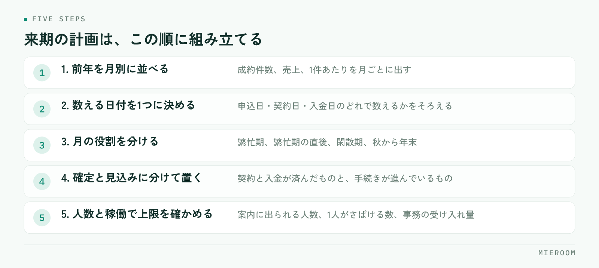

<!--META
{
  "title": "賃貸仲介の来期売上計画の立て方｜月別の季節差を踏まえて組む手順",
  "date": "2026-11-27",
  "category": "売上管理",
  "excerpt": "賃貸仲介の来期の売上計画を、前年実績の月別の並べ方から月ごとの役割の分け方、確定売上と見込みの分け方、人数と稼働からの上限の確かめ方まで手順で整理しました。計画を作る前のチェックリストとよくある失敗もまとめています。",
  "hook": "前年の合計から割るのではなく、月から積む",
  "tags": ["売上管理", "売上計画", "目標設定", "店舗運営", "賃貸仲介"]
}
META-->

年明けの繁忙期を前に、来期の売上計画を考える時期です。ただ、年間の目標額を決めて12で割った計画は、月末に見ても手が打てません。**賃貸仲介の計画が効くのは、月ごとの性格の違いを織り込めたとき**です。この記事では、来期の売上計画を月から積み上げる手順を整理します。

<h4>この記事の結論</h4>
賃貸仲介の売上計画は、年間の合計を決めてから月に割るのではなく、<strong>前年の実績を月別に並べてから積み上げる</strong>と現場で使えます。繁忙期・端境・閑散期で月の役割を分け、件数と1件あたりに分解し、人数と稼働で上限を確かめてから数字を置きます。

## 合計から割った計画は、月末に効かない

年間目標を決めて12で割ると、どの月も同じ数字が並びます。この形の問題は2つあります。

ひとつは、達成できない月が最初から決まっていることです。賃貸仲介の繁忙期と閑散期では、入ってくる反響の量がそもそも違います。閑散期に繁忙期と同じ数字が置かれていれば、現場は「この月は無理な数字だ」と早い段階で見切ります。一度そう思われた計画は、達成できる月でも参照されなくなります。

もうひとつは、ずれの原因が分からないことです。「今月は目標に届かなかった」という事実は分かっても、反響が少なかったのか、来店までつながらなかったのか、成約の単価が下がったのかが分からなければ、翌月も同じ結果になります。

逆に、月ごとに違う数字が置かれていて、その根拠が「去年のこの月はこうだった」と説明できれば、計画は現場の判断材料になります。目標の立て方そのものは[繁忙期の売上目標の立て方](./hanbouki-uriage-mokuhyo.html)でも整理していますので、あわせてご覧ください。

## 計画を組む前に、前年の数字を月別にそろえる

計画づくりは、数字を決める作業ではなく、前年を並べ直す作業から始まります。並べるのは次の3つです。

<figure class="fig"><figcaption>合計を決めてから月に割るのではなく、この順に積み上げると月の途中で手が打てます。</figcaption></figure>

- 月ごとの成約件数
- 月ごとの売上（仲介手数料と、広告料などそれ以外を分ける）
- 1件あたりの売上

ここでつまずくのが、**月の区切りがそろっていない**ことです。申込が入った日で数えた表と、契約した日で数えた表と、入金があった日で数えた表が混ざっていると、同じ案件が違う月に乗ります。計画を作る前に、どの日付で数えるかを1つに決めます。

決め方の目安は、計画を何に使うかです。現場の動きを追いたいなら契約日、資金の計画に使いたいなら入金日です。両方必要なら、両方の数え方で並べておきます。どちらか一方に寄せて、もう一方を後から作り直すほうが手間がかかります。

前年の数字が月別に出てこない場合は、ここが最初の課題です。計画を立てる前に、月別に出せる形に整える作業が必要になります。

## 賃貸仲介の1年には、月ごとに違う役割がある

月別に並べると、売上の多い月と少ない月が見えます。ただ、計画で置くべきものは売上の数字だけではありません。月には、売上を作る月と、次の売上の準備をする月があります。

| 期間 | 店舗で起きること | その月の計画で置くもの |
|---|---|---|
| 繁忙期 | 反響と来店が集中し、成約が重なる | 件数の目標。受け入れられる上限と人の配置 |
| 繁忙期の直後 | 契約事務と入金の確認、広告料の回収が残る | 売上の確定と回収の完了。取りこぼしの確認 |
| 閑散期 | 反響が落ち、時間に余裕が出る | 掘り起こしと仕込みの量。件数より準備の中身 |
| 秋から年末 | 単身・法人の動きと、翌年の繁忙期の準備 | 採用と育成の予定。広告の出し方の決定 |

閑散期に売上の目標だけを置くと、現場は無理な追客に走るか、あきらめるかのどちらかになります。この時期に置くべきなのは、掘り起こしの件数や、物件情報の整備のような準備の量です。準備の量は、繁忙期の件数に効いてきます。

✓閑散期の計画の置き方

売上の数字をゼロにするのではなく、低めに置いたうえで、準備の項目を別に並べます。「この月は売上より仕込み」と明示されているほうが、現場は動きやすくなります。

## 月の売上を、確定と見込みに分けて置く

月別の計画を作るとき、売上を1つの数字で置くと、月の途中で状況が分からなくなります。賃貸仲介では、申込が入ってから入金まで時間があり、審査で止まることも、キャンセルになることもあります。

そこで、計画も実績も2つに分けます。

- **確定した売上**……契約が済み、入金の確認が取れているもの
- **見込みの売上**……申込が入っていて、審査や契約の手続きが進んでいるもの

この2つを分けて並べると、月の途中で「あと何件必要か」ではなく「今ある見込みがどれだけ確定に変わるか」で見られるようになります。見込みが十分にあるのに確定が増えないなら、問題は追客ではなく契約事務や審査の進行にあります。見込み自体が少ないなら、反響と来店を増やす側に手を打ちます。

打つ手が変わるので、この分け方は計画の段階で決めておく価値があります。粗利の見方については[店舗の損益と粗利の見方](./tenpo-soneki-arari-handan.html)も参考になります。

## 人数と稼働から、月ごとの上限を確かめる

月別の数字を置いたら、最後に「その件数を本当にさばけるか」を確かめます。ここを飛ばした計画は、繁忙期に破綻します。

確かめるのは次の3つです。

1. **案内に出られる人の数**……繁忙期に何人が店頭と案内に立てるか。シフト、研修中の人、兼務の有無を踏まえる
2. **1人がさばける案件の数**……反響への対応、案内、申込の受け付け、契約事務のどこまでを1人が持つかで変わる
3. **事務の受け入れ量**……契約書類の作成と審査の進行は、案内とは別に時間がかかる。ここが詰まると成約が遅れる

計画の件数が上限を超えているなら、選択は3つです。人を増やす、1人が持つ工程を減らして分業する、あるいは受ける反響の絞り方を変える。どれも年明けに急には決められないので、計画を作る今の時期に判断します。

新人が入る予定なら、戦力になる時期を計画に織り込みます。繁忙期の初めから一人前として数えると、計画が上振れします。

## 計画を作る前のチェックリストと、よくある失敗とその避け方

着手の前に、次の項目が埋まるか確かめてください。埋まらない項目があれば、そこが先にやるべきことです。

- 前年の成約件数・売上・1件あたりが、月別に出せる
- 月を数える日付（申込日・契約日・入金日）が1つに決まっている
- 仲介手数料と、広告料などそれ以外の収入が分けて見られる
- 繁忙期・端境・閑散期の区分が、自店の実績に合わせて決まっている
- 確定売上と見込みを分けて置く形になっている
- 繁忙期に案内と事務に出られる人数が分かっている
- 新人が入る予定と、戦力になる時期が織り込まれている
- 月の途中で見る場所（週ごとの数字）が決まっている

よくある失敗は、次の4つです。

**前年の数字を、月別に出せないまま計画を作る**。感覚で置いた数字は、達成できなかったときに検証できません。先に月別に出せる形を作るほうが、結果として早く進みます。

**全店・全員に同じ伸び率を掛ける**。店舗の立地や担当者の経験は同じではありません。同じ率で掛けると、余力のある店舗は楽に届き、厳しい店舗は最初からあきらめます。店舗別・担当別に条件の差を見てから配ります。

**計画を立てたあと、月末まで見ない**。月末に分かっても手は打てません。週ごとに、反響・来店・申込・契約のどこまで進んだかを見る形にしておきます。日々の数字の見方は[店長が毎朝見る数字](./tencho-maiasa-suji.html)でも触れています。

**閑散期に無理な売上目標を置く**。達成できない月が続くと、計画そのものが信用されなくなります。閑散期は売上を低めに置き、準備の量を別に並べます。

## 自分で進める場合と、ツールに任せる場合の分かれ目

計画づくりを手元の表計算で進められるかどうかは、店舗の規模よりも、前年の数字がどれだけ揃っているかで決まります。

手元で進めやすいのは、店舗が1つで担当者の人数も限られ、前年の成約が月別に数えられる状態にある場合です。月別の表を作り、件数と1件あたりに分けて置くところまでは、表計算でも十分にできます。

ツールに任せたほうがよいのは、次のような場合です。店舗や担当者が増えて、月別・店舗別・担当別の集計を手で作ると時間がかかるとき。申込から入金までの途中の状態を追う必要があり、確定と見込みを常に分けて見たいとき。そして、計画と実績の比較を週ごとに見たいときです。手集計では、集計が終わった時点でもう数字が古くなっています。

分かれ目は、**集計に手がかかるほど、見る回数が減る**という点にあります。月に一度しか見ない計画は、月末の報告書にしかなりません。週ごとに見たいのであれば、記録した時点で集計が出ている形が必要になります。

## よくある質問

開業してまだ1年経っていません。前年の数字がない場合はどうすればいいですか？

手元にある数か月分を月別に並べ、季節の動きは一般的な傾向で補います。そのうえで、人数と稼働から「さばける上限」を先に出し、そこから計画を置くのが現実的です。1年分の実績が揃った翌期から、自店の実績で組み直してください。

月を数える日付は、契約日と入金日のどちらがよいですか？

計画の使い道で決まります。現場の動きを追うなら契約日、資金の計画に使うなら入金日です。どちらか一方に決めて並べるのが前提ですが、両方必要な場合は最初から両方の数え方で持っておきます。途中で数え方を変えると、前年との比較ができなくなります。

広告料（AD）は売上計画に入れるべきですか？

入れますが、仲介手数料とは分けて置きます。入ってくる時期も、回収にかかる手間も違うためです。分けておくと、月の売上が届かなかったときに、成約が足りなかったのか回収が遅れているのかを切り分けられます。

担当者ごとの目標は、計画と同時に決めるべきですか？

店舗の月別の計画を先に固め、そのあとに担当別へ落とす順番をおすすめします。先に個人の目標を決めると、合計が店舗の計画と合わなくなります。落とすときは経験と担当する工程の違いを見て、同じ率で割らないようにします。

計画は期中に見直してもよいのでしょうか？

見直して構いません。ただし、見直す基準を先に決めておくのが大切です。「繁忙期の入り方が前年と大きく違った場合に、残りの月を組み直す」のように条件を決めておくと、都合の悪い月だけ下げる見直しになりません。

## まとめ：計画は、合計から割らずに月から積む

来期の売上計画は、年間の目標額を決める作業ではなく、前年を月別に並べ直す作業から始まります。月ごとの役割を繁忙期・端境・閑散期で分け、件数と1件あたりに分解し、確定売上と見込みを分けて置く。最後に人数と稼働で上限を確かめる。この順番なら、月の途中で手が打てる計画になります。

ミエルームなら、申込から入金・後ADまでを案件ごとに1行で記録でき、確定売上と見込みが分かれて表示されるので、この記事で挙げた月別・店舗別・担当別の集計を手で作り直す必要がなくなります。反響・接客の成績も同じ場所で見られるため、計画に届かない月でも、反響が足りないのか契約事務が詰まっているのかを週の途中で切り分けられます。既存のExcelデータのインポートと初期設定の代行にも対応しており、デモアカウントの発行で最短即日から試せますので、計画を立てる時期にそのまま使い始められます。機能の詳細は[機能・事例のページ](../features.html)にまとめています。資料のご請求やデモアカウントの発行は、この下のボタンからお気軽にどうぞ。
