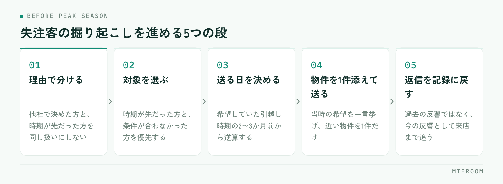

<!--META
{
  "title": "賃貸仲介の失注客の掘り起こし方｜繁忙期前に声をかける相手の選び方",
  "date": "2026-10-21",
  "category": "集客・広告",
  "excerpt": "過去に決まらなかった反響へ、繁忙期前にもう一度声をかけるための進め方をまとめました。失注理由で対象を分ける考え方、引越し時期から逆算した連絡の時機、送る文面の形、そして掘り起こしができる記録の残し方まで整理しています。",
  "hook": "決まらなかった反響は、全員に声をかけない",
  "tags": ["反響管理", "追客", "集客", "繁忙期対策", "賃貸仲介"]
}
META-->

繁忙期に向けて反響を増やしたい、という話になると、まず掲載プランの話から始まりがちです。ただ、**掲載を増やす前に手を付けられるのが、過去に決まらなかった反響です**。失注した反響のなかには、そのときは動けなかっただけで、今ならもう一度検討する方が確実に混ざっています。

<h4>この記事の結論</h4>
掘り起こしは、過去の反響リスト全員に一斉送信する作業ではありません。<strong>失注した理由で分けて、今動く理由がある方にだけ声をかけます</strong>。対象になるのは主に「時期が先だった方」と「条件が合わなかった方」の2つで、連絡する時機は引越しの時期から逆算して決めます。

## 失注した反響は、理由で分けないと声をかけられない

決まらなかった反響をひとまとめに「失注」として扱っていると、掘り起こしのしようがありません。送る文面も時機も、失注した理由によって変わるためです。

実務で分かれるのは、おおむね次の5つです。

- 他社で決めた
- 希望の条件に合う物件が出なかった
- 引越しの時期がまだ先だった
- 連絡が途切れて、そのままになった
- 審査が通らなかった

この5つを混ぜて同じ案内を送ると、すでに引越しを終えた方にも物件の案内が届きます。届いた側からすれば、自分の状況を把握されていない連絡です。**分けないまま送ることは、送らないより印象を損ねます**。反響を理由まで残す記録の付け方は[反響管理の方法](./hankyo-kanri-hoho.html)にまとめています。

## 掘り起こしの対象になるのは、この2つ

5つのうち、優先して声をかけるのは「引越しの時期がまだ先だった方」と「希望の条件に合う物件が出なかった方」です。

時期が先だった方は、断られたわけではありません。その時点では動けなかっただけで、希望の時期が近づけば検討が再開します。この層は、連絡が遅れると他で決まります。

条件が合わなかった方は、在庫の状況が変われば話が変わります。繁忙期前は募集が出てくる時期なので、当時なかった条件の物件が出ている可能性があります。

| 失注した理由 | 掘り起こしの対象 | 声をかける時機 | 伝えること |
|---|---|---|---|
| 引越しの時期が先だった | 優先して対象にする | 希望時期の2〜3か月前 | 時期が近づいた確認と、今の在庫の状況 |
| 条件に合う物件がなかった | 対象にする | 条件に合う物件が出たとき | 当時の希望に合う具体的な物件を1件 |
| 連絡が途切れた | 一度だけ確認する | 最後の連絡から数か月後 | 検討が続いているかの確認のみ |
| 他社で決めた | 原則として外す | — | （送らない。次の更新時期まで置く） |
| 審査が通らなかった | 条件を変えて再提案できる場合のみ | 状況が変わったと分かったとき | 条件を広げた提案 |

連絡が途切れた方は、判断がつかない層です。一度だけ状況を確認し、返信がなければそこで止めます。繰り返し送る相手ではありません。

## 声をかける時期は、引越しの時期から逆算する

掘り起こしで一番効くのは、文面よりも送る時機です。基準は、お客様が当時言っていた希望の引越し時期です。

希望時期の2〜3か月前に連絡が届くと、まだ部屋を探し始めていない段階で接点が戻ります。逆に、希望時期に入ってから送ると、すでに他で動き始めている段階です。

- 来春の入居を希望していた方 → 年内のうちに連絡する
- 契約更新を機に検討していた方 → 更新の3か月前を目安にする
- 時期を決めていなかった方 → 繁忙期前の落ち着いた時期に確認する

当時の記録に希望時期が残っていなければ、この逆算ができません。掘り起こしができるかどうかは、**失注した時点で希望時期を書き残していたかどうか**で決まります。閑散期にやっておく仕込みの全体像は[閑散期にやること](./kansanki-yarukoto.html)で触れています。

## 一斉送信ではなく、物件を1件添えて送る

掘り起こしの連絡で返信が返ってくるかどうかは、具体的な物件が入っているかで大きく変わります。「お部屋探しはお済みですか」だけの文面は、読んだ側に判断の材料がありません。

文面の形は次の3つで足ります。

1. 当時の希望を一言で挙げる（エリア、間取り、予算の範囲）
2. その希望に近い物件を1件だけ挙げる
3. 検討が続いているかどうかだけ尋ねて終える

物件を複数並べると、選ぶ作業が発生して返信が止まります。1件に絞り、「ご希望に近いものが出ました」という形にするほうが返信につながります。

✓送る前に、当時の記録を1行読み返す

希望エリアと間取り、当時断られた理由の3点だけ確認してから送ってください。この確認を省くと、条件の合わない物件を添えることになり、一斉送信と同じ扱いになります。1件あたり数十秒の確認で、文面の質が変わります。

## やってはいけない送り方

掘り起こしは、やり方を決めずに始めると苦情につながる作業です。先に線を引いておきます。

送る頻度を決めること。同じ方に何度も続けて送らない形にします。返信がなければ一度で止める、という基準を店舗で共有してください。

他社で決めた方を対象に入れないこと。すでに入居している方に物件の案内が届くのは、記録を見ていないことの証明になります。

連絡手段を変えて追わないこと。メールに返信がないからSMS、SMSに返信がないから電話、という追い方は、相手からすると断りづらい形の連絡です。

!誰に送ったかを記録しないまま始めない

送信の記録が残っていないと、同じ方に別の担当者から重ねて連絡が行きます。掘り起こしで一番多い苦情がこの重複です。送った日と内容、返信の有無を反響の記録に残してから次に進んでください。

## 掘り起こしができる状態にするには、記録の形が先

ここまでの手順は、すべて過去の反響の記録に依存します。決まらなかった反響について、次の4つが残っていれば掘り起こしは回ります。

希望エリアと間取り、予算の範囲。希望していた引越しの時期。決まらなかった理由。最後に連絡した日。

逆に、反響を一覧に名前と電話番号だけ記録している状態だと、理由でも時期でも分けられません。失注の時点でこの4つを書き残す運用に変えるのが、来期以降の掘り起こしの準備になります。追客の連絡を自動で流す形にする場合も、分ける材料がなければ全員に同じ内容が届くことになります。手段の選び方は[LINE・SMSでの追客](./chintai-tsuikyaku-line-jidoka.html)を参考にしてください。

## 繁忙期前の2か月でやる段取り

実際に進める順番を決めておきます。

<figure class="fig"><figcaption>最後の段が抜けると、戻した接点がまた途切れます。</figcaption></figure>

反響の記録を失注理由で分ける。対象になる方を選ぶ。希望時期から逆算して送る日を決める。物件を1件添えて送る。返信があった方を、新しい反響として記録に戻す。

最後の段が抜けやすい部分です。掘り起こしで返信があった方は、過去の反響ではなく今の反響として扱います。来店の約束まで追う対象に入れないと、せっかく戻した接点がまた途切れます。

何か月前の反響まで掘り起こしの対象になりますか？

期間で区切るよりも、当時の希望時期で判断してください。1年以上前の反響でも、契約更新を機に検討していた方であれば、更新の時期に合わせて声をかける意味があります。逆に数か月前でも、他社で決めた方は対象になりません。期間で一律に区切ると、動く理由がある方を外して、すでに決まった方に送ることになります。

返信がなかった方には、もう一度送ってよいですか？

同じ時期に重ねて送るのは避けてください。返信がないこと自体が、今は検討していないという返事です。次に声をかけるなら、物件の状況が変わったときや、希望していた時期が近づいたときなど、相手の状況が動いたタイミングに限ります。送った日と返信の有無を記録に残しておけば、この判断が担当者ごとにぶれません。

掘り起こしは誰が担当するのがよいですか？

当時その反響を担当した人が送るのが、文面の精度としては最も高くなります。ただ、繁忙期前は目の前の反響対応もあるため、対象の選び出しと送る日の設定までを店長側でまとめ、送信と返信対応を担当者が行う分担が現実的です。この形にする場合も、誰に送ったかは全員が見える記録に残してください。重複して連絡が行くのを防げます。

## まとめ：掲載を増やす前に、戻せる接点から見る

掘り起こしは、失注理由で分ける、希望時期から逆算する、物件を1件添えて送る、返信を新しい反響として記録に戻す、という4つで回ります。全員に一斉送信する作業ではありません。

そして、この作業ができるかどうかは、失注した時点の記録に希望時期と理由が残っているかで決まります。今期のうちに記録の形を変えておけば、来期の繁忙期前はそのまま使えます。

[ミエルーム](../index.html)なら、反響を希望条件・希望時期・決まらなかった理由まで含めて案件ごとに記録でき、誰にいつ連絡したかも同じ画面に残るので、繁忙期前に対象を選び出すときに過去のExcelを探し回る必要がありません。LINE・SMSでの追客も記録と同じ場所から送れるため、重複して連絡が行く心配をせずに声をかけられます。デモアカウントの発行やご相談は、この下のボタンからお気軽にどうぞ。
