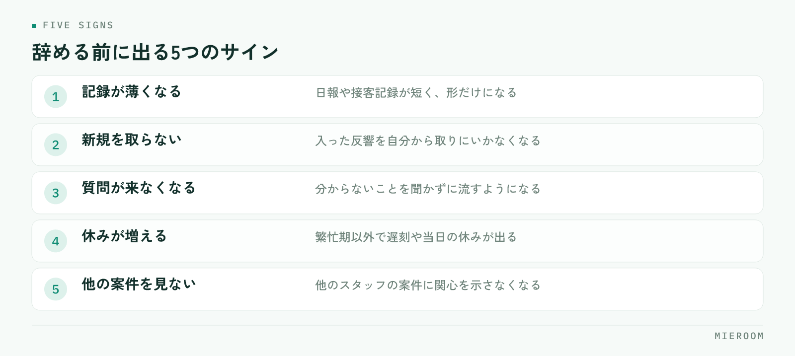

<!--META
{
  "title": "賃貸仲介でスタッフが定着する店舗の作り方｜辞める前に出るサインと打つ手",
  "date": "2026-10-29",
  "category": "組織・育成",
  "excerpt": "賃貸仲介の店舗でスタッフが続かない原因を、業務の渡し方と評価の見え方から整理しました。辞める前に出るサイン、繁忙期と閑散期それぞれで打つ手、引き継ぎの備え方までまとめています。",
  "hook": "辞める理由は、繁忙期より前に生まれる",
  "tags": ["スタッフ定着", "離職防止", "組織づくり", "店舗運営", "賃貸仲介"]
}
META-->

人を採用しても続かない。その状態が何度か続くと、採用そのものが負担になります。賃貸仲介の店舗でよく語られるのは繁忙期の忙しさですが、**辞める理由の多くは、忙しさそのものではなく、忙しさの中で自分の立ち位置が見えなくなることにあります**。

  <h4>この記事の結論</h4>
  
スタッフが定着する店舗は、業務の渡し方と成績の見え方が決まっています。<strong>何をどこまで任されているかと、自分の数字がどう見られているかが本人に分かる状態が、待遇より先に効きます</strong>。辞める前には必ずサインが出ます。閑散期のうちに手を打ってください。

## 辞める理由は、繁忙期より前に生まれている

退職の申し出が出るのは、繁忙期が終わった直後が多くなります。そのため「繁忙期がきつかったから」と受け取りがちですが、本人の中では、その前から理由が積み上がっています。

積み上がるのは、忙しさではなく分からなさです。自分の契約が店の数字にどう効いているのか分からない、先輩が何を基準に動いているのか分からない、評価が誰のどの判断で決まるのか分からない。この状態で繁忙期に入ると、作業量だけが増えて、手応えが返ってきません。

逆に、数字と役割が見えているスタッフは、繁忙期をきっかけには辞めません。忙しさは同じでも、自分が何に貢献しているかが分かるためです。新人の立ち上がりの順番は[新人育成の順番](./shinjin-ikusei-junban.html)に整理しています。

## 定着しない店舗に共通する3つの状態

続かない店舗を見ると、だいたい次のどれかが起きています。

- **業務が口伝えで渡されている**。手順が人の頭の中にあり、聞ける人がいない時間帯は手が止まる
- **成績が月末にしか分からない**。途中で自分の位置が見えず、締まってから結果だけを知らされる
- **店長が現場の最前線に入り続けている**。自分の案件で手が埋まり、スタッフの状況を見る時間が無い

3つめは真面目な店舗ほど起きます。店長が数字を背負って動くこと自体は悪くありませんが、**見てもらえていないという感覚は、仕事の量よりも辞める理由になりやすい**ものです。店長の役割の整理は[店長の仕事の段取り](./tencho-shigoto-dandori.html)で触れています。

## 辞める前に出るサインを決めておく

退職は突然出てくるように見えて、前段に変化が出ます。あらかじめ見る項目を決めておくと気づけます。

<figure class="fig"><figcaption>単発では判断せず、2つ以上が同時に続いたときに面談の時間を取ります。</figcaption></figure>

- 記録の書き込みが減る（日報や接客記録が短く、形だけになる）
- 新規の反響を自分から取らなくなる
- 質問が来なくなる（分からないことを聞かずに流すようになる）
- 遅刻や当日の休みが、繁忙期以外で増える
- 他のスタッフの案件に関心を示さなくなる

どれも単発では判断できません。2つ以上が同時に続いたときに、面談の時間を取ってください。このとき聞くのは「辞める気があるか」ではなく、今どの業務で詰まっているかです。前者を聞くと、本人は決めていなくても決めた形で答えることになります。

## 業務の渡し方を、人からフォーマットに移す

定着に直接効くのは、業務が人に貼りついていない状態です。手順が形になっていれば、聞ける人がいない時間帯でも進められます。

渡し方を変えるときは、全業務をいちどに文書化しようとしないでください。優先するのは、次の順番です。

| 優先度 | 対象の業務 | 形にするもの |
|---|---|---|
| 高 | 毎日発生する業務 | 反響対応・来店前の準備・記録の残し方 |
| 中 | 月に数回の業務 | 申込の受付・審査の依頼・入金の確認 |
| 低 | 年に数回の業務 | 繁忙期前の準備・決算や棚卸しに関わるもの |

毎日の業務から手をつけるのは、効果が出る回数が多いからです。月に数回の業務を先に文書化しても、使われる機会が少なく、書いたこと自体が忘れられます。作り方は[業務マニュアルの作り方](./gyomu-manual-tsukurikata.html)にまとめています。

  
✓書くのは、できる人ではなく覚えた人に頼む

  
手順を文字にする作業は、ベテランより、半年前に覚えたスタッフのほうが向いています。できる人は無意識にやっている部分を書き落としますが、覚えた本人は、どこで迷ったかを覚えています。迷った箇所を書き残してもらうほうが、次の人に伝わります。

## 成績の見え方を、月末だけにしない

評価が不満につながるのは、金額の多寡より、決まり方が見えないときです。歩合の率を上げる前に、途中の数字が本人に見えているかを確認してください。

見えるようにするのは、次の3つで足ります。

1. 自分の反響の件数と、来店につながった件数
2. 自分の接客からの申込と、確定した契約
3. 店全体の中での位置（順位ではなく、どの段階で止まっているか）

3つめが重要です。順位だけを出すと、下位のスタッフには改善の手がかりが残りません。反響は取れているが来店に至っていない、来店はあるが申込で止まっているというように、**どの段階で落ちているかが分かる形で見せる**と、次の行動が決まります。見える化の進め方は[スタッフの成績管理](./staff-seiseki-kanri.html)で解説しています。

歩合の設計そのものを見直す場合は、[歩合給の決め方](./buai-kyu-kimekata.html)もあわせて確認してください。

## 閑散期にやること、繁忙期にやること

定着の手は、打つ時期で中身が変わります。同じことを年中やろうとすると、繁忙期に全部止まります。

閑散期にやるのは、形を作る作業です。毎日の業務の手順を文字にする、成績の見方をそろえる、面談の時間を決める、繁忙期の役割分担を先に決めておく。時間が取れる時期にしかできません。

繁忙期にやるのは、短い確認です。朝に今日の担当を確認する、夕方に詰まっている案件だけを聞く。これを数分で終わらせます。繁忙期に新しい仕組みを入れようとすると、慣れない作業が増えて逆効果になります。

閑散期の使い方は[閑散期にやること](./kansanki-yarukoto.html)にまとめています。繁忙期の人員計画は[繁忙期のシフトと人員計画](./hanbouki-shift-jinin-keikaku.html)を参照してください。

## それでも辞めるときに、店に残すもの

手を打っても、家庭の事情や進路の変更で辞める方はいます。そのときに店側の損失を小さくするのは、引き継ぎの形です。

申し出があった時点で確認するのは、担当している案件の状況、やり取りの履歴、お客様との約束です。頭の中にしかない情報を聞き出す作業が発生すると、本人も気持ちよく終われません。ふだんから案件ごとに記録が残っていれば、引き継ぎは一覧を渡すだけで済みます。

退職の理由も、聞ける範囲で残してください。1人分では傾向になりませんが、何人か重なると共通点が出ます。**同じ理由で2人目が辞める状態が、いちばん避けたい形です**。引き継ぎの備え方は[担当引き継ぎの記録](./tantou-hikitsugi-kiroku.html)で触れています。

給与を上げれば定着しますか？

効果はありますが、単独では続きません。金額が上がっても、何をどこまで任されているか、評価がどう決まるかが見えないままだと、同じ理由で辞める判断に戻ります。先に業務の渡し方と成績の見え方を整えたうえで待遇を見直すほうが、同じ金額でも納得されやすくなります。

面談はどのくらいの頻度で行うべきですか？

閑散期は月に1回、繁忙期は朝夕の短い確認に置き換える形が現実的です。大事なのは長さより間隔です。3か月空くと、その間に積み上がったものを面談で拾い切れません。15分でも、決めた日に必ず行うほうが機能します。

少人数の店舗でも手順を文書化する意味はありますか？

あります。人数が少ない店舗ほど、1人が抜けたときの影響が大きくなります。全業務を書く必要はなく、毎日発生する業務の手順と、記録の残し方を決めておくだけで、急な休みや退職のときに店が止まりません。新しく入った方の立ち上がりも早くなります。

## まとめ：閑散期のうちに、見え方を整える

スタッフが定着する店舗は、業務の渡し方と成績の見え方が決まっています。手順が人の頭の中にあり、評価が月末にしか見えない状態では、繁忙期をきっかけに人が抜けます。

辞める前のサインは必ず出ます。記録が薄くなる、質問が来なくなる、新規を取らなくなる——この変化に気づける状態を作っておき、閑散期のうちに形を整えてください。

[ミエルーム](../index.html)なら、反響から接客・申込・入金までを案件ごとに記録できるので、誰が何をどこまで進めているかが日々の画面で分かり、接客・反響成績の可視化で各スタッフがどの段階で止まっているかも確認できます。月末に集計し直してから評価を考える必要がなくなり、引き継ぎのときも案件の一覧を渡すだけで済みます。デモアカウントの発行やご相談は、この下のボタンからお気軽にどうぞ。
