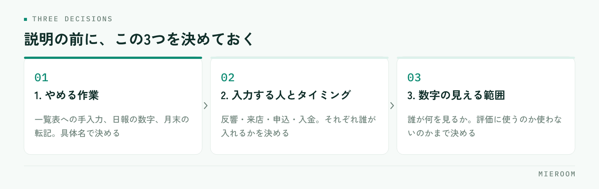

<!--META
{
  "title": "業務システムの導入をスタッフに説明して合意を取る手順｜反対の理由別の進め方",
  "date": "2026-11-23",
  "category": "DX",
  "excerpt": "賃貸仲介の店舗で業務システムの導入が社内の反対で止まってしまう場面について、反対の理由を4つに分けて整理し、説明する順番、伝える項目、反対が残ったままでも進める方法、よくある失敗までをまとめました。",
  "hook": "反対の理由を4つに分けると説明が決まる",
  "tags": ["システム導入", "社内説明", "業務改善", "スタッフ", "賃貸仲介"]
}
META-->

システムを入れたほうが楽になるのは分かっている。それでも「今のやり方で足りている」と言われて止まってしまう。賃貸仲介の店舗で、導入の判断がいちばん長く止まるのはこの場面です。結論から申し上げると、**反対の多くは道具への反対ではなく、自分の仕事が増えることへの反対**です。この記事では、反対の理由を分けて、どの順番で何を説明すれば合意に近づくのかを整理します。

<h4>この記事の結論</h4>
説明の順番を変えるだけで、合意の取りやすさが変わります。最初に話すのは機能ではなく、<strong>やめる作業</strong>です。入力が増える話から入ると、現場は反対の理由を探し始めます。今やっている作業のうち何が消えるのかを先に示し、試す期間と判断の日を決めてから入れる形にしてください。

## 導入が止まるのは、機能の不足ではなく説明の順番

導入の話が進まない店舗で、検討したシステムに機能が足りていなかった例は多くありません。止まる原因は、たいてい説明の入口にあります。

よくある入り方は、画面を見せて機能を順番に説明する形です。説明する側は良さが伝わると思っていますが、聞いている側に見えるのは新しい入力画面です。今の業務に新しい作業が足されるように受け取られ、「繁忙期が終わってから」という返事になります。

もう一つの入り方は、オーナーや店長が決めてから通知する形です。この場合、表面上の反対は出ませんが、使われません。入力されない項目が増え、結果として管理表が二重になります。

説明が効く入り方は1つです。今やっている作業を並べ、そのうちどれがなくなるのかを先に示す形です。**現場が知りたいのは、できることが増えるかどうかではなく、自分の作業が減るかどうか**です。導入後に使われ続ける条件は[業務改善ツールが定着する店舗の共通点](./gyomu-kaizen-tool-teichaku.html)にも整理しています。

## 反対の理由は4つに分かれる

「反対されている」とひとかたまりで捉えていると、打ち手が決まりません。理由を分けると、効く説明が変わります。

| 反対の理由 | 実際に心配していること | 効く説明 |
|---|---|---|
| 今のやり方で足りている | 覚え直す手間がかかる | 覚える範囲を、今の自分の作業の分だけに区切って示す |
| 入力が増える | 自分の仕事が増える | 入力をやめる場所（表・日報・転記）を具体的に挙げる |
| 数字を見られたくない | 評価に使われることへの不安 | 誰が何を見るのか、何に使うのかを先に決めて伝える |
| 繁忙期に間に合わない | 途中で混乱して業務が止まる | 入れる範囲と時期を区切り、戻せる形にしておく |

一つ目と二つ目は、作業量の話です。実際に打つ画面を触ってもらうのがいちばん早く、言葉で説明するより短く済みます。

三つ目は、数字の使い方の話です。接客や反響の成績が見える形になること自体に抵抗が出るのは自然なことです。見える範囲と使い道を決めずに導入すると、入力が止まるか、実態と違う数字が入ります。

四つ目は、時期の話です。これは正当な指摘であることが多く、無理に押し切る場面ではありません。入れる範囲を小さくするか、時期をずらす判断になります。

## 説明する前に、店長・オーナー側で決めておく3つ

説明の場で聞かれて答えられないと、そこで止まります。先に決めておく項目は3つです。

<figure class="fig"><figcaption>この3つを決めずに説明の場に出ると、質問に答えられずそこで止まります。</figcaption></figure>

一つ目は、やめる作業です。システムを入れたときに、今の業務から何を消すのかを具体的に決めます。「反響の一覧表への手入力をやめる」「日報の数字の欄をやめる」「月末の売上集計の転記をやめる」。やめる作業を1つも決めていない導入は、作業が純増します。

二つ目は、入力する人と入力するタイミングです。反響が入ったとき、来店したとき、申込を受けたとき、入金があったとき。誰がどの場面で入れるのかを決めておきます。ここが曖昧だと、全員が「自分の仕事ではない」と考えます。

三つ目は、数字の見える範囲です。店舗全体の数字を全員が見るのか、個人の成績は本人と店長だけが見るのか。評価にどう使うのか、使わないのか。**先に決めて伝えた数字は受け入れられ、後から変えた数字は反発を生みます**。

## 現場に説明する順番

説明は4段に分けて進めます。この順番を守ると、話が機能の説明から始まらなくなります。

| 段 | やること | 注意する点 |
|---|---|---|
| 1. 困っていることの確認 | 今の業務で面倒な作業を現場から挙げてもらう | こちらの案を先に出さない。出た言葉をそのまま記録する |
| 2. やめる作業の提示 | 挙がった作業のうち、どれが消えるかを示す | 消えない作業は正直に消えないと言う |
| 3. 実際の画面を触ってもらう | 自店の案件を1件、入力から通してもらう | 見せるだけで終わらせない。打ってもらう |
| 4. 試す期間と判断の日を決める | いつまで試して、誰が何を見て判断するかを決める | 期限のない試用は、使われないまま終わる |

一段目を飛ばすと、残りの説明が自社の都合の話になります。面倒な作業を挙げてもらう場では、こちらから案を出さないことが大切です。出てきた言葉を記録しておくと、二段目でそのまま使えます。

二段目で正直さが問われます。消えない作業を「楽になります」と言うと、そこから先の説明が信用されません。消える作業と、形が変わる作業と、変わらない作業の3つに分けて伝えてください。

三段目は、言葉の説明より効きます。自店で実際に動いている案件を1件、反響から申込まで通して打ってもらうと、入力の量が体感で分かります。

四段目で、終わりを決めます。いつまで試すのか、何を見て続けるかを決めるのか、誰が決めるのか。ここを決めない試用は、忙しくなった時点で元のやり方に戻ります。

## 説明の場で必ず伝える項目と、言わない方がよいこと

説明の場でそのまま使えるチェックリストです。

- 今の業務のうち、やめる作業（具体名で3つまで）
- 新しく入力してもらう場面と、その所要の感覚
- 入力する人と、入力しないことにした人
- 誰が何の数字を見られるのか
- その数字を評価に使うのか、使わないのか
- 試す期間と、判断する日
- 判断する人
- うまくいかなかったときに、どこまで戻せるのか
- 困ったときに誰に聞くのか（店内の担当者を1人決める）
- 今の表やデータをどうするのか（残すのか、移すのか）

逆に、言わない方がよいことが3つあります。

一つ目は、将来の機能の話です。「将来はこういうこともできる」という説明は、現場には作業が増える予告として伝わります。最初に入れる範囲の話に絞ってください。

二つ目は、他店舗や他社の事例を根拠にする説明です。自店の作業がどう変わるかの話に置き換えないと、自分の話として聞かれません。

三つ目は、決定事項として一方的に伝える形です。決めるのはオーナーや店長で構いませんが、決める前に意見を聞く場を1回入れておくと、入力が続きます。

## 反対が残ったまま進めるときの進め方と、よくある失敗

全員の合意を待っていると、導入の時期が決まりません。反対が残っている状態でも進める方法があります。

一つは、入れる範囲を区切ることです。全業務を一度に移さず、反響の取り込みと申込の管理だけ、売上の集計だけと決めて始めます。範囲が小さいほど、覚える手間も戻す手間も小さくなります。

もう一つは、入力する人を限ることです。最初は店長と事務の担当者だけが入力し、営業担当は見るだけにする形から始められます。入力の負担を感じる人が減り、効果だけが先に見えます。

三つ目は、並行運用の期間を決めることです。今の表とシステムの両方に入れる期間を区切り、終わりの日を決めます。期限を決めない並行運用は、二重入力として固定されます。

よくある失敗は次の5つです。

**機能の説明から始める**。画面を順番に見せる説明は、作業が増える予告として受け取られます。やめる作業から話してください。

**やめる作業を決めずに入れる**。今の表を残したまま新しい入力を足すと、作業は必ず増えます。やめる作業を決めるのは、入れる側の仕事です。

**数字の使い方を後で決める**。成績が見える形にしてから使い方を決めると、実態と違う数字が入り始めます。先に決めて伝えてください。

**試す期間に終わりを置かない**。期限のない試用は、繁忙期が来た時点で止まります。判断の日と判断する人を決めてください。

**店内の担当者を決めない**。聞く相手がいない状態では、分からない項目は空欄のまま残ります。詳しい人を1人決めるだけで、入力の抜けが減ります。

移行そのものの手順は[不動産仲介の業務改善ツール導入の進め方](./fudosan-chukai-gyomu-kaizen-tool-donyu.html)にまとめています。

## 今の運用の工夫で進める場合と、システムに置き換える場合の分かれ目

一般論として、判断の基準は3つあります。

一つ目は、同じ内容を何回打っているかです。反響を受けて一覧に書き、日報に書き、月末の集計表に書く。同じ情報が3か所に手で入っている状態なら、運用の工夫では解決しません。入る先を1つにする側の話になります。

二つ目は、数字を見たいときに見られるかどうかです。今月の反響の数や成約の状況を知るために、誰かに集計を頼んでいる状態なら、置き換えの価値があります。逆に、必要な数字が今の表でその場で見えているなら、急ぐ必要はありません。

三つ目は、人が増える予定があるかどうかです。今の運用が回っているのは、やり方を知っている人がいるからという場合があります。採用や店舗の追加を考えているなら、属人的な手順のうちに整えておくほうが負担が小さくなります。

迷うときは、今の業務で「この作業は自分しかできない」と言える作業を書き出してみてください。3つ以上出てくるなら、置き換えを検討する段階です。1つか2つなら、その作業の手順を書いて共有するところから始めても間に合います。

## よくある質問

スタッフ全員の合意を取ってから導入すべきですか？

全員の合意を待つ必要はありませんが、意見を聞く場を1回入れることをおすすめします。決めるのはオーナーや店長で構いません。意見を聞かずに決めた場合、表面上の反対は出なくても入力が続かないことがあります。聞いた意見のうち、どれを反映してどれを反映しなかったかを伝えるだけでも、受け止め方が変わります。

繁忙期の前に入れるのは避けたほうがよいですか？

入れる範囲によります。全業務を一度に移すのは避けたほうが安全です。一方で、反響の取り込みや申込の管理のように、繁忙期にいちばん手間がかかる部分だけを先に入れる判断はあります。並行運用の期間を取り、戻せる形にしておくことが条件です。

成績が見えるようになることに抵抗があるスタッフがいます。

見える範囲と使い道を先に決めて伝えてください。店舗全体の数字は全員が見る、個人の数字は本人と店長が見る、といった線引きです。評価に使うかどうかも曖昧にしないほうがよいです。曖昧にしたまま運用すると、入力が止まるか、実態と違う数字が入ります。

試用の期間は、何を見て判断すればよいですか？

やめる作業として挙げた項目が、実際にやめられているかどうかを見てください。機能が使えたかどうかではなく、今までやっていた手作業が消えたかどうかが判断の材料です。消えていない場合は、入力のタイミングか担当の決め方に原因があることが多く、使い方の調整で解決する場合があります。

今まで使ってきたExcelのデータは、どうすればよいですか？

移すものと参照用に残すものを分けてください。進行中の案件と直近の顧客は移し、過去の記録は参照用に別に残す形が現実的です。全件をきれいに移そうとすると、導入そのものが止まります。データの移行は作業量が読みにくい部分なので、提供元に相談できるかを確認しておくと安心です。

## まとめ：やめる作業から話すと、説明は短くなる

業務システムの導入をスタッフに説明する順番は決まっています。反対の理由を、作業量・数字の使い方・時期の3つに分けて捉える。説明の前に、やめる作業・入力する人・数字の見える範囲の3つを決める。困っていることの確認から始め、やめる作業を示し、自店の案件を1件打ってもらい、試す期間と判断の日を決める。反対が残っているときは、範囲を区切り、入力する人を限り、並行運用の終わりを決める。この形にすると、説明の場で止まることが減ります。

逆に、機能の説明から入る進め方は、どれだけ良い道具でも反対の理由を探させてしまいます。導入の成否は機能ではなく、何をやめるのかを決めているかどうかで分かれます。

ミエルームなら、説明の場で「実際に打ってもらう」段をそのまま用意できます。デモアカウントを発行して自店の案件を1件、反響から申込・入金まで通して入力してもらえるので、入力の量を言葉ではなく体感で確かめられます。反響はフォームやメールからの自動取込に対応しているため、やめる作業として一覧表への手入力を具体的に挙げられます。接客・反響成績の可視化は見える形が決まっているので、数字の見える範囲を説明しやすくなります。今お使いのExcelデータのインポートと初期設定の代行にも対応しており、最短即日でのスタートが可能なため、繁忙期までの時間が短い場合でも範囲を区切って始められます。説明の場で答えられない項目がなくなり、判断の日を決めるところまで一度の打ち合わせで進みます。機能の詳細は[機能・事例](../features.html)をご覧ください。資料のご請求やデモアカウントの発行は、この下のボタンからお気軽にどうぞ。
