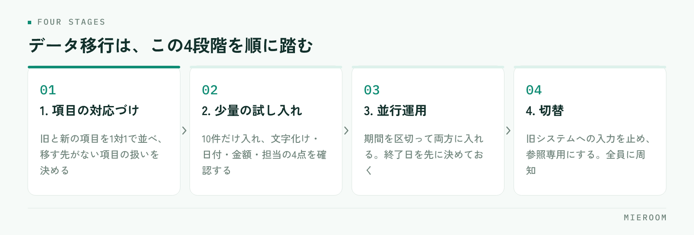

<!--META
{
  "title": "業務システムの乗り換え手順｜顧客・物件データの移行で失敗しない順番",
  "date": "2026-11-15",
  "category": "DX",
  "excerpt": "賃貸仲介の店舗が業務システムを乗り換えるときの、顧客データと物件データの移行手順を整理しました。移す前の仕分け、項目の対応づけ、試し入れ、並行運用から切替までの順番と、切替前のチェックリスト、よくある失敗の避け方までまとめています。",
  "hook": "顧客・物件データは、移す順番で決まる",
  "tags": ["データ移行", "システム乗り換え", "業務管理システム", "DX", "賃貸仲介"]
}
META-->

新しいシステムを決めたのに、データ移行が不安で踏み出せない。賃貸仲介の店舗で乗り換えが止まる理由は、ほとんどがここです。実際に詰まるのは機能の違いではなく、**どのデータを、どの順番で移すかを決めていないこと**にあります。順番が決まれば、移行は営業を止めずに進められます。

<h4>この記事の結論</h4>
データ移行は、<strong>全部を移さない前提で計画する</strong>のが成功の条件です。進行中の案件・当期の売上・過去の履歴を3つに仕分け、移すのは前の2つだけ。過去の履歴は旧システムの画面か書き出したファイルで参照できる状態にしておけば足ります。順番は、項目の対応づけ→少量の試し入れ→並行運用→切替です。

## 乗り換えが失敗するのは、移行の順番を決めていないとき

移行が失敗する店舗には、共通する入り方があります。新しいシステムの契約が決まった日に、旧システムから全データを書き出して一括で入れようとすることです。

この進め方は、2か所で止まります。1つは、書き出したファイルの項目が新しいシステムの項目と一致しないこと。もう1つは、入れている最中にも新しい反響と申込が発生し続けることです。結果として、入れ終わったときには中身が古くなっており、どちらが正しいのか分からない状態になります。

✓考え方

移行は「引っ越し」ではなく「開通」です。新しいシステムを今日から使える状態にすることが先で、過去のデータを運び込むのは後からでも間に合います。

順番を決める目的は、作業量を減らすことではありません。**どの時点のデータが正しいのかを、常に1か所に決めておく**ためです。これが決まっていれば、途中で止まっても復帰できます。

## 移す前に、今あるデータを3つに分ける

最初の作業は、データの棚卸しです。賃貸仲介のデータは、扱いの違いで3つに分かれます。

| 区分 | 中身 | 移行の扱い |
|---|---|---|
| 進行中 | 追客中の反響、来店予約、審査・契約待ちの申込、未入金の案件 | 必ず移す。移さないと業務が止まる |
| 当期 | 今期に入ってからの成約・売上・入金の記録 | 移す。集計の連続性のため必要 |
| 過去 | 前期以前の成約履歴、退去済みの入居者、取り下げ済みの物件 | 原則として移さない。参照できる形で保管 |

この仕分けをせずに始めると、作業量が数倍になります。とくに過去の成約履歴は件数が多く、項目の形も古いことが多いので、ここに手をつけると移行そのものが終わりません。

過去データは、旧システムからCSVやExcelで書き出して社内の共有フォルダに置き、ファイル名に期間を入れておけば実務では足ります。問い合わせがあったときに検索して開ける状態であれば十分です。紙とExcelが混在している店舗の進め方は、[紙とExcelが混在する店舗の移行手順](./kami-excel-konzai-ikou.html)でも整理しています。

!注意

旧システムの解約日は、過去データを書き出し終えてから決めてください。解約後に画面が開けなくなり、書き出していないデータが取れなくなる例があります。

## 顧客データと物件データで、詰まる場所は違う

移行作業の手が止まるのは、だいたい決まった場所です。先に知っておけば、作業前に手当てできます。

### 顧客データで詰まる場所

**同じ人が複数行に入っている**。電話で問い合わせた人が、後日ポータルサイトからも反響を入れると、別の行として記録されます。移行の前に、電話番号とメールアドレスで並べ替え、重複を1件にまとめてください。まとめるときは、新しい行の情報を残し、古い行のメモを追記する形が安全です。

**氏名や住所の表記が揃っていない**。全角と半角、姓名の間の空白の有無、番地のハイフンの形。人の目では同じでも、システムでは別の値です。移す前に書き出したファイル上で統一しておくと、入れた後の修正が減ります。

**個人情報の扱い**。移行のために書き出したファイルには、顧客の連絡先が入っています。作業用のパソコンのデスクトップに置いたまま忘れる、個人のメールで送る、といった扱いをしないでください。作業が終わったら削除する前提で、保管場所を決めてから書き出します。

### 物件データで詰まる場所

**取り下げ済みの物件が混ざっている**。募集を止めた物件が旧システムに残っていると、そのまま移して新しいシステムの一覧が埋まります。移すのは現在募集中のものだけに絞ってください。

**同じ物件が別名で複数ある**。「○○ハイツ」「〇〇ハイツ1号棟」のように、入力した人によって名前が違う状態です。部屋単位で見ると同じ建物なので、建物名を1つに決めてから移します。

**自社管理と業者間サイトから取り込んだ物件が混在している**。自社で管理している物件は手で入れる必要がありますが、業者間サイトから来る物件は連携や取り込みで入ります。両方を手作業で入れると二重になるので、どちらの経路で入るかを物件ごとに決めてから始めてください。

## 移行の順番：対応づけ→試し入れ→並行運用→切替

ここまでの準備ができたら、実際の移行は4段階で進めます。各段階で終わりの条件を決めておくのが要点です。

<figure class="fig"><figcaption>各段階で終わりの条件を決めておきます。並行運用は、開始する前に終了日を決めるのが要点です。</figcaption></figure>

**第1段階：項目の対応づけ**。旧システムの項目と新しいシステムの項目を、1対1で紙に並べます。移す先がない項目（旧システム独自の分類など）は、備考欄に入れるか、移さないかを決めます。ここで決めずに作業を始めると、入れながら悩むことになり、人によって入れ方が変わります。

**第2段階：少量の試し入れ**。進行中の案件から10件程度だけを入れ、画面で確認します。確認するのは、文字化けがないか、日付の形が合っているか、金額の桁が合っているか、担当者が正しく紐づいているかの4点です。ここで形の崩れが見つかれば、残りを入れる前に直せます。

**第3段階：並行運用**。期間を区切って、新旧の両方に入れます。目的は慣れることと、抜けを見つけることです。期間は、**開始する前に終了日を決めてください**。終わりを決めないと、二重入力が日常になります。

**第4段階：切替**。終了日が来たら、旧システムへの入力を止めます。止めた日を全員に周知し、旧システムは参照専用として扱います。入力できる状態で残しておくと、慣れた人が旧システムに入れ続けてしまいます。

## 切替の前に必ず確認するチェックリスト

並行運用を終えて切替に進む前に、次の項目を確認してください。1つでも残っていると、切替の後に手戻りが出ます。

- 進行中の案件の件数が、旧システムと新システムで一致しているか
- 未入金・未確認のADが、金額まで含めて移っているか
- 当期の確定売上の合計が、旧システムの集計と一致しているか
- 顧客の重複をまとめた結果、連絡先が消えていないか
- 募集中の物件の数と、募集条件（賃料・敷金・礼金）が合っているか
- 担当者の割り当てが、全件で正しい人に紐づいているか
- 反響の自動取込（フォーム・メール）の受け先が、新システムに切り替わっているか
- 旧システムからの過去データの書き出しが完了し、保管場所が決まっているか
- 旧システムを参照専用にする日付が、全員に伝わっているか

合計が一致しない場合は、原因を探す前に差の件数を確認してください。1〜2件なら入れ忘れ、多数なら対応づけの誤りです。差の大きさで原因の見当がつきます。

## よくある失敗と、その避け方

**繁忙期の直前に切替を置く**。入力に慣れる期間が取れないまま、いちばん忙しい時期に入ります。並行運用と切替は、落ち着いている時期に済ませてください。

**過去データを全部移そうとする**。移行作業そのものが本題になり、進行中の案件の移行が後回しになります。進行中と当期だけに絞ってください。

**対応づけを決める人を決めていない**。入れる人が複数いると、同じ項目に違う入れ方をします。1人が対応づけを決め、残りはそれに従う形にします。

**旧システムを入力できる状態で残す**。どちらが正しいのか分からなくなります。切替日を過ぎたら参照専用にしてください。

**試し入れを飛ばす**。文字化けや日付の崩れが、全件入れた後に見つかります。10件の確認で防げる手戻りです。

**自動取込の切り替えを忘れる**。フォームやメールからの反響が旧システムに届き続け、新システム側だけを見ている間に取りこぼします。切替日に必ず変更してください。

## 自分たちで進める場合と、ツールに任せる場合の分かれ目

一般論として、判断の基準は3つあります。

一つ目は、データの量と項目の揃い方です。進行中の案件が数十件で、顧客の連絡先や物件の情報が揃っているなら、手入力でも移せます。表記のゆれが多く、重複の判定に時間がかかる状態なら、取り込みの形に整える作業を任せたほうが早く終わります。

二つ目は、繁忙期までの残り時間です。準備に充てられる期間が十分にあるなら、自分たちで進めながら覚えるほうが後々の運用が安定します。時間が限られているなら、初期設定と取り込みを任せて、現場は使い方を覚えることに集中する判断が合理的です。

三つ目は、作業を担当できる人がいるかどうかです。棚卸しと対応づけは、店舗の業務を理解している人でないと決められません。その人が接客で埋まっているなら、移行は進みません。担当を確保できないなら、代行を含めて検討する段階です。

迷う場合は、移行の対象を進行中の案件だけに絞って、まず新しいシステムで日々の業務を回し始めてください。当期の売上と過去データは、業務が回り始めてから足せます。最初から完全な状態を目指すと、いつまでも切替日が来ません。

## よくある質問

移行の作業中も、営業は続けられますか？

続けられます。そのために並行運用の期間を置きます。期間中は新旧の両方に入れるため手間は増えますが、どちらかが止まっても業務は回ります。負担を抑えるには、並行運用の対象を進行中の案件に限り、過去データの移行は並行運用の外で進めてください。

旧システムからデータを書き出せない場合はどうすればいいですか？

まず提供元に、CSVやExcelでの書き出しに対応しているかを確認してください。対応していない場合は、画面を印刷するか、必要な項目だけを手で写す形になります。その場合はなおさら、移す範囲を進行中と当期に絞る判断が重要になります。全件を手で写すのは現実的ではありません。

並行運用はどのくらいの期間が適切ですか？

業務の数と入力する人の数で変わるため一律には言えませんが、期間を決めずに始めないことが重要です。目安としては、反響から申込までの一連の流れを全員が一度は経験できる長さが必要です。開始時に終了日を決め、その日までに慣れることを目標にしてください。

過去の成約履歴を見られなくなるのは不安です。

旧システムから書き出したファイルを、期間が分かる名前で共有フォルダに保管しておけば、検索して開けます。退去の立ち会いや再契約の相談で過去の情報が必要になる頻度は限られるため、実務ではこの形で足ります。頻繁に参照する範囲だけを新システムに入れる、という使い分けも可能です。

スタッフが新しい画面に慣れるか心配です。

最初に覚える操作を絞ってください。反響の登録と、申込の進捗の更新の2つだけで、日々の業務は回り始めます。売上の集計や分析の画面は、店長が後から覚えれば足ります。全機能を一度に教えると、使われない機能の説明に時間を取られて、必要な操作が定着しません。ツールの選び方そのものに迷いがある場合は、<a href="./fudosan-gyomu-tool-minaoshi.html">不動産の業務ツール見直し</a>も参考にしてください。

## まとめ：移行は、移すものを減らすほど早く終わる

システムの乗り換えで決め手になるのは、移行の技術ではなく範囲の決め方です。進行中の案件・当期の売上・過去の履歴に分け、移すのは前の2つだけ。顧客の重複と物件の表記ゆれを先に整え、項目の対応づけを1人が決める。10件で試してから全件を入れ、並行運用は終了日を決めて行い、切替日以降は旧システムを参照専用にする。この順番を守れば、営業を止めずに移せます。

逆に、全部を移そうとして繁忙期の直前に切替を置くと、どちらが正しいのか分からないまま忙しい時期に入ります。移行は、運び込む量を減らすほど早く終わります。

ミエルームなら、反響の受付から接客、申込、入金、確定売上までを1件のまま追えるので、移行の対象を進行中の案件に絞ってもその日から業務が回り始めます。Excelデータのインポートと初期設定の代行に対応しており、最短即日からの利用が可能です。フォームやメールからの反響の自動取込にも対応しているため、切替後に入口の転記が増えることもありません。他システムとの違いを確かめたい場合は[賃貸仲介の業務管理システム比較](../compare.html)をご覧ください。資料のご請求やデモアカウントの発行は、この下のボタンからお気軽にどうぞ。
