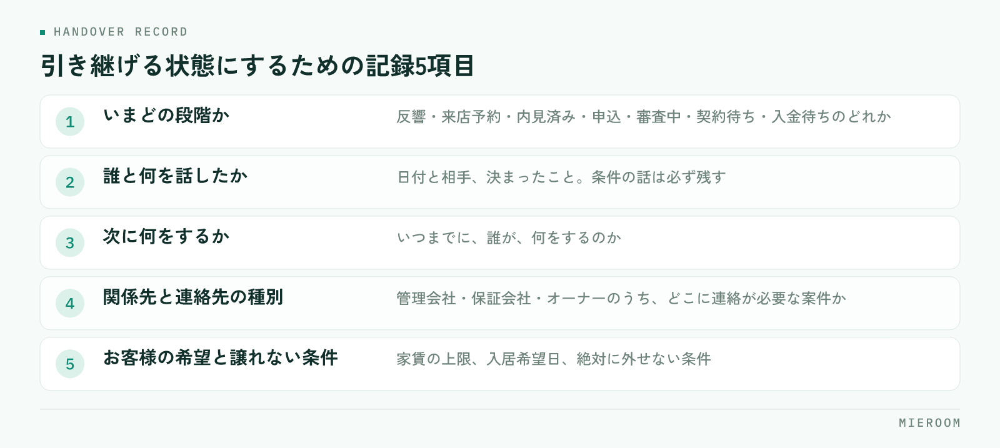

<!--META
{
  "title": "賃貸仲介の引き継ぎで困らない記録の残し方｜属人化を防ぐ5項目",
  "date": "2026-10-12",
  "category": "業務効率化",
  "excerpt": "賃貸仲介で担当が変わったときに経緯が分からなくなる問題を、記録に残す5項目と渡し方の手順から整理しました。引き継ぎが重くなる原因、休みの日に電話がかかる状態の直し方、退職時にまとめて引き継ぐときの進め方までまとめています。",
  "hook": "引き継げない案件は、記録していない案件",
  "tags": ["引き継ぎ", "属人化", "情報共有", "業務効率化", "賃貸仲介"]
}
META-->

担当が休んだ日に、その人の携帯だけが鳴る。退職の連絡を受けてから、慌てて案件を聞き取る。賃貸仲介の店舗で起きるこの2つは、同じ原因から来ています。**引き継げない案件とは、記録されていない案件のこと**です。引き継ぎの手順を整える前に、日々どこまで残しているかを見直す必要があります。

<h4>この記事の結論</h4>
引き継ぎが重いのは、渡し方が悪いからではなく<strong>渡せる形で記録が残っていないから</strong>です。案件ごとに「いまどの段階か」「誰と何を話したか」「次に何をするか」が書かれていれば、引き継ぎは読めば済む作業になります。

## 引き継ぎが重くなるのは、記録が頭の中にあるから

賃貸仲介の案件は、問い合わせから契約までに関わる相手が多い業務です。お客様、管理会社、保証会社、オーナー、ときには提携先の業者。それぞれと交わした会話のうち、紙や画面に残っているのはごく一部で、あとは担当者の記憶の中にあります。

この状態でも、担当がいる間は問題が起きません。聞けば答えが返ってくるからです。困るのは、その人が不在のときだけ。つまり**属人化は、普段は見えず、都合の悪いときにだけ表に出ます**。

そして引き継ぎの場面では、記憶から取り出す作業が必要になります。案件ごとに思い出して話し、受ける側がメモを取る。1件なら10分で済みますが、20件あれば半日以上かかります。退職までの期間が短いと、そもそも時間が取れません。

結果として、引き継いだつもりでも抜けが出ます。抜けが出たことに気づくのは、お客様から「前の担当者さんに伝えてあります」と言われたときです。

## 記録に残す5項目

案件ごとに残しておく項目を絞ります。多くすると書かれなくなるので、次の5つだけに限定するのが現実的です。

<figure class="fig"><figcaption>このどれかが空欄の案件は、いま引き継げない案件です。</figcaption></figure>

- **いまどの段階か**：反響・来店予約・内見済み・申込・審査中・契約待ち・入金待ちのどれか
- **誰と何を話したか**：日付と相手、決まったこと。言った言わないになりやすい条件の話は必ず
- **次に何をするか**：いつまでに、誰が、何をするのか
- **関係先と連絡先の種別**：管理会社・保証会社・オーナーのうち、どこに連絡が必要な案件か
- **お客様の希望と譲れない条件**：家賃の上限、入居希望日、絶対に外せない条件

この5つが埋まっていれば、引き継ぐ側が説明しなくても、受ける側が読んで動けます。逆に言えば、**この5つのどれかが空欄の案件は、いま引き継げない案件**です。

## 「次に何をするか」を書くだけで引き継ぎは変わる

5項目のなかで効き方がいちばん大きいのが、3つめの「次に何をするか」です。

段階と履歴だけが残っていると、受けた側は読んだあとで判断を迫られます。審査中と書いてあっても、結果を待てばいいのか、こちらから確認するのか、お客様に連絡する約束があるのかは分かりません。ここで判断を間違えると、止まるか、二重に連絡することになります。

書き方は短くて構いません。「明日10時に保証会社へ結果確認」「金曜までにお客様へ候補2件を送る」。日付と動作が入っていれば十分です。

✓記録は接客が終わった直後に書く

あとでまとめて書こうとすると、思い出す作業が入るぶん、かかる時間が増えます。来店対応や電話が終わった直後に、段階と次の動作だけでも入れておくほうが軽く済みます。記録が増えない店舗は、たいてい「落ち着いたら書く」運用になっています。

内見時に聞いた条件をどこまで残すかは[来店時のヒアリング項目](./raiten-hearing-koumoku.html)にも整理していますので、あわせてご覧ください。

## 休みの日に電話がかかる状態を直す手順

引き継ぎは退職時だけの話ではありません。休日や有給のたびに担当者へ連絡が入る店舗は、毎週小さな引き継ぎ失敗を起こしています。直す手順は4つです。

1. **休む人の案件を、前日に一覧にする**。段階と次の動作が入っているかを確認します
2. **空欄の案件だけを口で補う**。全件を説明する必要はありません
3. **連絡が来たときの一次対応者を決める**。誰が受けるかを決めておかないと、結局は本人の携帯が鳴ります
4. **休み明けに、対応した内容を記録へ戻す**。ここを飛ばすと記録と実態がずれます

このうち4番目が抜けがちです。休み中の対応が本人に口頭で伝えられるだけだと、記録は古いまま残り、次に別の人が見たときに誤った前提で動きます。

## 退職や異動でまとめて引き継ぐときの進め方

残り期間が決まっている引き継ぎでは、全件を均等に扱わないことが大事です。進め方を順に挙げます。

まず**案件を段階で3つに分ける**こと。契約・入金が目前のもの、審査や申込で動いているもの、追客中のものです。期日が近いものから引き継ぎます。

次に、**契約・入金が目前の案件だけは、受ける側と一緒に連絡を1回入れる**こと。担当が変わることをお客様と関係先に伝える機会になり、言い忘れが防げます。

追客中の案件は、1件ずつ説明しても覚えられません。希望条件と最後に接触した日が記録に残っていれば、受けた側が自分の順番で動けます。

✓個人の携帯でやり取りしている案件に注意

お客様と担当者が個人の携帯番号やSNSでつながっている案件は、記録の有無とは別に引き継ぎが難しくなります。店舗の連絡手段に寄せておくか、少なくとも「どの経路でやり取りしているか」を案件の記録に書いておいてください。退職後に連絡が取れなくなるのは、この形の案件です。

## 記録が残る形にするには、書く場所を1か所にする

項目を決めても、書く場所が分かれていると埋まりません。来店の記録は紙のカード、申込の進み方は管理表、お客様とのやり取りはメールの履歴。こうなると、1件を把握するために3か所を開くことになり、誰も全部は見なくなります。

✓整えるときの順番

先に項目を決め、次に書く場所を1か所にし、最後に「いつ書くか」を決めます。<strong>この順番を逆にすると定着しません</strong>。場所から決めると、何を書くかが人によってばらつきます。

申込から入金までの流れを1か所にまとめる考え方は[申込管理表の作り方](./moushikomi-kanrihyo-tsukurikata.html)で詳しく扱っています。紙とExcelが混在している状態から整える手順は[紙とExcelが混在した管理からの移行](./kami-excel-konzai-ikou.html)もあわせてご覧ください。

記録を書く時間が取れないという声が出ます。どうすればよいですか？

項目を減らすところから始めてください。5項目すべてを最初から求めると、書かれないまま終わります。まずは「いまどの段階か」と「次に何をするか」の2つだけに絞り、接客の直後に入れる運用を1か月続けます。この2つが埋まるだけで、不在時の一次対応はできるようになります。履歴や条件の記録は、そのあとに足していくほうが定着します。

引き継ぎの資料は別に作ったほうがよいですか？

日々の記録が埋まっているなら、引き継ぎ専用の資料を作る必要はありません。むしろ別に作ると、資料と記録のどちらが正しいかが分からなくなります。必要なのは、引き継ぐ案件の一覧と、そのうち空欄がある案件がどれかを示すことです。資料作りに時間をかけるより、空欄を埋める時間に充てたほうが抜けが減ります。

1人や少人数の店舗でも記録は必要ですか？

必要です。少人数の店舗ほど、担当者が1人しかいない状態になりやすく、体調を崩したときに業務が完全に止まります。また、人を増やす段階で記録がないと、新しく入った人が自分で動けるまでに時間がかかります。先に記録の形を作っておくほうが、増員したときの立ち上がりが早くなります。

## まとめ：引き継ぎは、日々の記録の結果に出る

引き継ぎの良し悪しは、渡すときの丁寧さよりも、それまでに何が残っていたかで決まります。段階・履歴・次の動作・関係先・希望条件の5つを案件ごとに残しておけば、休みの日も退職時も、読めば動ける状態になります。

属人化は能力の問題ではなく、記録の置き場所と書くタイミングの問題です。**書く場所を1か所にして、接客の直後に入れる**。この2つを決めるだけで、引き継ぎにかかる時間は変わります。

[ミエルーム](../index.html)なら、反響から来店・申込・入金までを案件ごとに1行で記録でき、接客の履歴と次の動作も同じ画面に残せるので、担当が休んだ日も退職するときも、画面を見た人がそのまま続けられます。引き継ぎのために案件を聞き取ってまとめる時間がなくなり、不在時の連絡を他のスタッフが受けられるようになります。デモアカウントの発行やご相談は、この下のボタンからお気軽にどうぞ。
