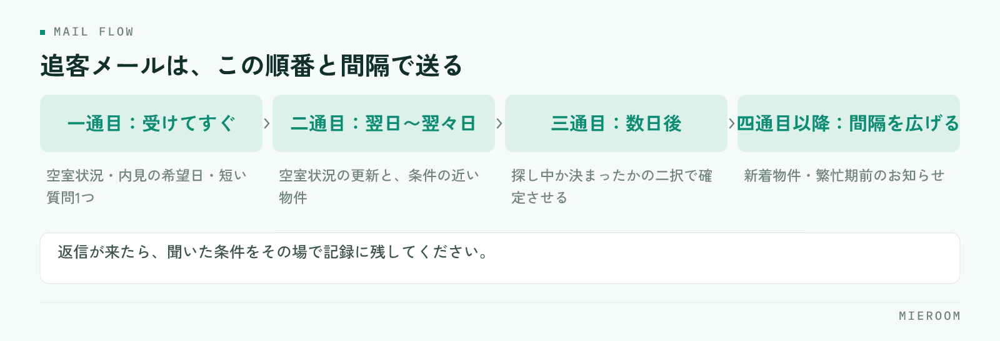

<!--META
{
  "title": "賃貸仲介の追客メール例文｜反響から来店予約につなげる送り方",
  "date": "2026-11-04",
  "category": "集客・広告",
  "excerpt": "賃貸仲介の反響対応で使える追客メールの例文を、一通目から三通目まで送る順番とあわせて整理しました。送るタイミングの目安、来店をお願いする一文の書き方、例文を使う前のチェックリスト、よくある失敗の避け方までまとめています。",
  "hook": "返信が来るかは一通目の中身で決まる",
  "tags": ["追客メール", "反響対応", "来店予約", "賃貸仲介", "集客"]
}
META-->

反響が来てメールを返したのに、そのまま返信が来ない——賃貸仲介の店舗でいちばん多い取りこぼしです。文面を作り込んでも返信率が変わらないことがあります。**追客メールで返信が来るかどうかは、文章のうまさではなく、一通目に何を入れたかと、二通目をいつ送るかで決まります**。この記事では、そのまま使える例文と、送る順番の型を整理します。

<h4>この記事の結論</h4>

反響への一通目に入れるのは、物件の空室状況・次に何をすればよいか・返信しやすい質問の3つだけです。<strong>長い自己紹介や複数の物件提案を一通目に詰め込むと、読む手間が増えて返信が止まります</strong>。二通目以降は間隔を決めて送り、送った内容を記録に残すことが条件になります。

## 追客メールで返信が来ないのは、文面より送る順番で決まる

反響に返信して終わり、という形になっている店舗は少なくありません。一通目を送ったあと、返信が来なければそのまま案件が止まります。

✓よくある流れ

ポータルサイトから問い合わせが入る → その日のうちに物件情報と挨拶を送る → 返信が来ない → 数日後に担当者が思い出して「その後いかがですか」と送る → さらに返信が来ない。この形だと、二通目が「催促」に見えてしまいます。

止まる理由は3つあります。1つ目は、一通目が長すぎて読まれていないこと。問い合わせた人は複数の店舗に同時に問い合わせていることが多く、最初に読むのは数行です。2つ目は、次に何をすればよいかが書かれていないこと。3つ目は、二通目を送るタイミングが担当者の記憶に任されていることです。

この3つは、文章力ではなく型で解決できます。一通目に入れる要素を決め、二通目以降の間隔を決め、送った記録を残す。この3つを店舗で揃えるだけで、取りこぼしは減ります。返信の速さが与える影響は[反響への返信速度と来店率](./lead-response-speed.html)でも扱っています。

## 反響直後の一通目に入れる3つの要素と例文

一通目は短くしてください。入れるのは次の3つだけです。

1. 問い合わせのあった物件が、いま空いているかどうか
2. 次に何をすればよいか（内見の希望日を聞く、など）
3. 返信しやすい短い質問を1つ

自己紹介、店舗の説明、他物件の提案は一通目に入れません。読む量が増えると返信が遅れます。

✓一通目の例文（空室の場合）

件名：【◯◯マンション◯◯号室】お問い合わせありがとうございます  ◯◯様  お問い合わせいただきありがとうございます。 ご覧いただいた◯◯マンション◯◯号室は、本日時点で空室です。  内見のご案内が可能ですので、ご希望の日にちをお知らせいただけますか。土日は枠が埋まりやすいため、第二希望までいただけると調整しやすくなります。  お引越しのご予定は、いつ頃をお考えでしょうか。  ◯◯店 ◯◯

空室でない場合は、そのことを先に書きます。隠して来店を促すと、来店後に信頼を失います。

✓一通目の例文（申込が入っている場合）

件名：【◯◯マンション◯◯号室】お問い合わせありがとうございます  ◯◯様  お問い合わせいただきありがとうございます。 ご覧いただいた◯◯マンション◯◯号室は、申込が入っており現在ご紹介ができない状況です。せっかくお問い合わせいただいたのに申し訳ございません。  同じ沿線で、間取りと家賃帯が近いお部屋をお探しできます。差し支えなければ、ご希望の最寄り駅とご入居の時期だけお教えいただけますか。  ◯◯店 ◯◯

申込が入っている物件は、代わりの物件を並べる前に条件だけ聞いてください。希望を聞かずに送った物件は、ほとんど見られません。物件の取り下げの扱いは[掲載物件の取り下げ](./keisai-bukken-torisage.html)に整理しています。

## 返信がないときの二通目・三通目の例文と、送る間隔

一通目に返信がない場合、二通目で送る内容を変えます。同じお願いを繰り返すと催促になります。

<figure class="fig"><figcaption>送る日を店舗で決めてください。担当者の記憶に任せると二通目が抜けます。</figcaption></figure>

二通目は「情報を足す」メールにしてください。空室の状況が変わった、同じ条件の物件が出た、内見の枠が埋まってきた——読む側に新しい情報があると、返信の理由が生まれます。

✓二通目の例文（翌日〜翌々日）

件名：【ご参考】◯◯駅周辺で条件の近いお部屋

◯◯様  先日お問い合わせいただいた◯◯マンションについて、本日時点ではまだ空室です。  あわせて、同じ◯◯駅で間取りと家賃帯が近いお部屋が募集に出ましたので、ご参考までにお知らせします。  ・◯◯アパート◯◯号室（徒歩◯分／◯DK） ・◯◯ハイツ◯◯号室（徒歩◯分／◯DK）  どちらも内見が可能です。気になるお部屋があれば、番号だけお返しいただければ空室状況をお調べします。  ◯◯店 ◯◯

三通目は、返信のハードルをさらに下げます。文章で答える必要のない聞き方にしてください。

✓三通目の例文（数日後）

件名：お部屋探しの状況について

◯◯様  その後のお部屋探しはいかがでしょうか。  もしお決まりでしたら、この後のご連絡は止めさせていただきます。お探し中でしたら、いまのご希望条件をお知らせいただければ、条件に合うお部屋だけをお送りします。  ・探し中（条件が変わった場合はお教えください） ・決まった  どちらかだけお返しいただければ十分です。  ◯◯店 ◯◯

送る間隔の目安を表にします。店舗で決めて、担当者の記憶に任せないことが大切です。

| 通数 | 送るタイミング | 中身 | 目的 |
|---|---|---|---|
| 一通目 | 反響を受けてすぐ | 空室状況・内見の希望日・短い質問1つ | 返信の入口を作る |
| 二通目 | 翌日〜翌々日 | 空室状況の更新・条件の近い物件 | 新しい情報で返信理由を作る |
| 三通目 | 一通目から数日後 | 探し中か決まったかの二択 | 状況を確定させる |
| 四通目以降 | 間隔を広げる | 新着物件・繁忙期前のお知らせ | 時期が来たときに思い出してもらう |

四通目以降に進む場合は間隔を広げてください。同じ頻度で送り続けると、迷惑に受け取られます。

## 条件に合う物件が無いとき、来店をお願いするときの文面

条件に合う物件がない時期もあります。そのときに「ありません」とだけ返すと、そこで終わります。

✓条件に合う物件が無いときの例文

◯◯様  いただいた条件で現在お出しできるお部屋を探しましたが、ご希望に合うものが見つかりませんでした。  条件のうち、優先順位が低いものが1つあれば、お探しできる範囲が広がります。家賃の上限・最寄り駅からの時間・築年数のうち、少し緩められるものはございますか。  また、募集に出た時点でお知らせすることもできますので、その形がご希望であればお教えください。  ◯◯店 ◯◯

来店をお願いするときは、来店で何ができるのかを書いてください。「ご来店ください」だけでは、行く理由が伝わりません。

✓来店をお願いするときの例文

◯◯様  ご希望の条件をお教えいただきありがとうございます。  メールでお送りできる物件のほかに、業者間のみで出ているお部屋や、募集準備中のお部屋もございます。ご来店いただければ、その場で空室を確認しながらお部屋を絞り込めますので、内見まで一度でお済みになります。  ◯日（◯）、◯日（◯）であれば枠がございます。ご都合のよい時間をお知らせください。  ◯◯店 ◯◯

来店の日程は、こちらから2つ提示してください。「ご都合のよい日をお知らせください」より返信が早くなります。来店前の準備は[来店前のヒアリング項目](./raiten-hearing-koumoku.html)にまとめています。

## 例文を使う前のチェックリスト

例文をそのまま使う前に、次を確認してください。

- 件名に物件名または駅名が入っているか（他店のメールと区別される）
- 一通目が画面をスクロールせずに読める長さか
- 空室状況を書いているか（「確認します」で止めていないか）
- 次にすることが1つだけ書かれているか
- 返信しやすい質問が1つだけ入っているか
- 署名に店舗名と担当者名が入っているか
- 物件の数字（家賃・面積・築年）を原稿から転記していないか（必ず元データを確認する）
- 送った日と内容を記録に残しているか
- 二通目を送る日が決まっているか
- お客様が「決まった」と返した場合の対応を決めてあるか

最後の2つは文面の話ではありませんが、取りこぼしに直結します。記録が担当者の受信箱にしかないと、休んだ日に誰も続きを送れません。

## よくある失敗とその避け方

**一通目に物件を何件も並べる** 条件を聞く前に送った物件は、ほとんど見られません。一通目は問い合わせのあった物件だけにして、条件を聞いてから提案してください。

**空室かどうかを書かずに来店を促す** 「詳しくはご来店ください」と書くと、空室でないことを隠していると受け取られます。申込が入っているなら、そう書いたうえで代わりの提案に進むほうが信頼されます。

**二通目のタイミングを担当者に任せる** 忙しい日に反響が重なると、二通目は必ず抜けます。送る日を店舗で決めて、記録を見れば次に送る相手が分かる状態にしてください。

**同じ文面を全員に送る** 件名と本文に物件名が入っていないメールは、他店のメールに埋もれます。差し込む項目を決めておけば、作る手間はほとんど変わりません。

**返信が来た後の記録を残さない** 返信内容が残っていないと、引き継いだ担当が同じ質問を繰り返します。聞いた条件はその場で記録に書いてください。反響の管理方法は[反響の管理方法](./hankyo-kanri-hoho.html)に整理しています。

## 自分で進める場合と、ツールに任せる場合の分かれ目

分かれ目は、反響の件数と、対応する人の数です。

自分で進めやすいのは、反響が1日に数件で、対応する担当が決まっている場合です。例文を店舗のフォルダに置き、二通目を送る日を手帳やカレンダーに入れる。この形でも回ります。文面を自分の言葉で調整できるぶん、返信の内容に合わせた対応がしやすくなります。

任せたほうが早いのは、反響が複数の媒体から入る場合、担当が複数いる場合、そして営業時間外の反響が多い場合です。媒体ごとに形式が違うと転記の手間と写し間違いが増え、担当が複数いると誰がどこまで送ったかが見えなくなります。

進め方としては、まず例文と送る間隔を店舗で決め、手で回してみる。件数が増えて記録が追いつかなくなった時点で、取り込みと送信を仕組みに任せる——この順番なら、何を任せたいかを自分の言葉で説明できる状態になります。

## よくある質問

追客メールは何通まで送ってよいのでしょうか。

通数の上限よりも、間隔と中身が大切です。三通目までは数日のうちに送り、その後は間隔を広げてください。四通目以降は、新しく出た物件や引越しの時期が近づいたタイミングなど、相手に関係のある情報があるときだけ送ります。「その後いかがですか」だけのメールを同じ頻度で繰り返すと、迷惑に受け取られます。配信を止める旨を伝えて終える形も用意しておいてください。

メールとLINE・SMSはどう使い分けますか。

最初の連絡は、相手が問い合わせてきた手段に合わせるのが基本です。ポータルサイト経由ならメール、電話での問い合わせならその場で希望の連絡手段を聞きます。やり取りが始まってからは、相手が返しやすい手段に寄せてください。物件の詳細や図面はメール、短いやり取りはLINEやSMSという分け方が多く見られます。自動追客の仕組みは<a href="./chintai-tsuikyaku-line-jidoka.html">LINEでの追客自動化</a>に整理しています。

返信が来ない反響は、どこまで追いかけるべきですか。

三通目で「探し中か決まったか」の二択を送り、返信がなければ一度区切ってください。そのうえで記録は消さずに残します。賃貸は時期が来ると動くため、繁忙期の前や、聞いていた入居時期の1〜2か月前に一度だけ連絡すると反応が返ることがあります。

例文を使うと、他店と同じような文面になりませんか。

構成を型にして、中身を物件と相手の条件に合わせるという分け方をしてください。件名の物件名、空室状況、聞く質問の1つ——この3か所が相手ごとに変われば、同じ型でも読み手には個別のメールとして届きます。型を固定して、変える場所を決めるほうが成果は安定します。

営業時間外に来た反響への一通目は、どうすればよいですか。

翌営業日の朝に送る形でも対応できますが、その間に他店が先に返していることがあります。空室状況の確認が必要ないあいさつと「明日、空室状況を確認してご連絡します」という一通を自動で送るだけでも、問い合わせた側は放置されていないと分かります。営業時間外の反響の扱いは<a href="./eigyo-jikangai-hankyo.html">営業時間外の反響対応</a>に整理しています。

## まとめ：文面を直す前に、送る順番を決める

追客メールで変わるのは、文章のうまさではありません。一通目に空室状況・次にすること・短い質問の3つだけを入れ、二通目は新しい情報を足し、三通目で探し中か決まったかを確定させる。この順番と間隔を店舗で決めておけば、担当が変わっても取りこぼしは起きません。

そのうえで、送った日と内容、返ってきた条件を記録に残してください。記録が担当者の受信箱にしかない状態が、いちばん多い取りこぼしの原因です。

ミエルームなら、フォーム自動取込・メール自動取込で各媒体の反響がそのまま反響管理に入るので、問い合わせの内容を記録用に打ち直す必要がありません。送った物件と反応、来店、申込までを一つの案件として追えるため、担当が休んだ日でも次に送る相手が店舗で分かります。LINE・SMS自動追客があるので、二通目以降のタイミングを担当者の記憶に頼らずに回せますし、接客・反響成績の可視化で、どの媒体の反響が来店につながっているかも見えるようになります。機能の詳細は[機能・事例](../features.html)に整理しています。資料のご請求やデモアカウントの発行は、この下のボタンからお気軽にどうぞ。
