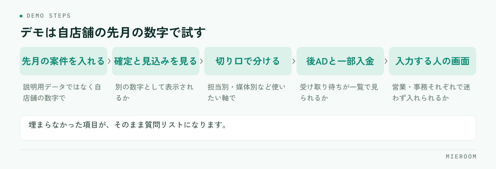

<!--META
{
  "title": "賃貸仲介の売上管理ソフトの選び方｜確定売上と見込みを分けて見られるか",
  "date": "2026-11-05",
  "category": "売上管理",
  "excerpt": "賃貸仲介の売上管理をソフトに移すときの選び方を、確認する順番で整理しました。確定売上と見込みが分かれて見えるか、後ADや一部入金をどう記録するか、デモで試す手順、乗り換え前のチェックリストとよくある失敗までまとめています。",
  "hook": "確定と見込みが分かれて見えるかで決まる",
  "tags": ["売上管理", "ソフト選び", "確定売上", "後AD", "賃貸仲介"]
}
META-->

売上管理をソフトに移したいが、どれを見ても機能が多くて比べられない——よく聞く状態です。機能の一覧を並べても判断はつきません。**賃貸仲介の売上管理ソフトは、機能の数ではなく、確定した売上と見込みが分かれて見えるかどうかで選びます**。この記事では、確認する順番と、デモで試すときの手順を整理します。

<h4>この記事の結論</h4>

売上管理ソフトは、自店舗が何を見たいかを決めてから比べてください。<strong>いちばん先に確認するのは、確定売上と見込みが混ざらずに表示されるかです</strong>。後ADと一部入金をどう記録するかで差が出るため、自店舗の先月の数字を実際に入れて確かめるのが確実です。

## 賃貸仲介の売上管理ソフトは、何を見たいかを決めてから選ぶ

ソフトを探し始める前に、店舗で何を見たいのかを書き出してください。ここが決まっていないと、どの製品も「できそう」に見えてしまいます。

賃貸仲介の店舗で見たい数字は、おおむね次のどれかです。今月いくら確定しているか、このあといくら入る見込みがあるか、担当ごとにどれだけ上がっているか、どの媒体の反響が売上につながったか、入金がまだ済んでいない案件はどれか。全部を一度に見ようとせず、まず店舗の判断に直結するものから順位をつけます。

順位が決まると、比べる軸が決まります。たとえば「今月の着地を早く知りたい」が一番なら、見込みの精度と更新のしやすさが軸になります。「担当の評価に使いたい」が一番なら、担当別に分けて見られるかが軸になります。軸がないまま機能表を眺めると、使わない機能の多さで選んでしまいます。

## 確定売上と見込みが分かれて見えるかを最初に確認する

賃貸仲介の売上は、契約してすぐ入金されるわけではありません。申込が入った段階、契約した段階、入金された段階——どこを売上として数えるかで、月の数字はまったく変わります。

✓混ざると起きること

申込が入った案件を売上に入れた状態で月末を迎え、キャンセルが出て数字が下がる。翌月に目標を立て直す。この繰り返しが起きると、売上の数字そのものが信用されなくなり、結局は担当者の手元のメモで判断するようになります。

ですから、ソフトを見るときにまず確認するのは、確定した売上と見込みが別の数字として表示されるかです。合計欄が1つしかなく、どちらも同じ列に足されていく形だと、月の途中の判断に使えません。

あわせて、見込みが確定に変わるきっかけが何かも確認してください。入金の記録を付けた時点で確定に移るのか、ステータスを手で変えるのか。手で変える形だと、変更が漏れたときに数字がずれます。確定と見込みの分け方そのものは<a href="./getsumatsu-uriage-shukei-jidoka.html">月末売上集計の自動化</a>にも整理しています。

## 分けて見たい切り口と、後AD・一部入金の扱い

見たい数字が決まったら、それをどの切り口で分けたいかを決めます。店舗別、担当別、媒体別、物件の管理会社別、月別——このうち店舗で実際に使うものだけを挙げてください。

### 後ADを案件ごとに記録できるか

賃貸仲介の売上で手間になりやすいのが、広告料（AD）の扱いです。契約時に確定している分と、あとから受け取る後ADが混ざると、その月の売上が実態と合わなくなります。

確認したいのは、後ADを案件ごとに記録できるか、そして受け取り待ちの状態が一覧で見られるかです。別の表で管理する形になると、月末に突き合わせる作業が残ります。後ADと入金の管理は<a href="./go-ad-nyukin-kanrihyo.html">後ADと入金の管理表</a>で扱っています。

### 一部入金・分割入金に対応できるか

入金が一度で揃わない案件もあります。一部だけ入った状態、分割で受け取る約束になっている状態を記録できないソフトだと、入金済みか未入金かの二択になり、実際の残額が分からなくなります。

自店舗で一部入金や分割が発生しているなら、ここは必ず確認してください。発生していなければ優先度は下がります。自店舗で起きていることだけを基準にすると、比較が速く終わります。

## 表計算ソフト・会計ソフト・業務管理システムの違い

売上管理の受け皿には、大きく3つの選択肢があります。どれが優れているかではなく、向いている状態が違います。

| 受け皿 | 向いている状態 | 確認しておくこと |
|---|---|---|
| 表計算ソフト（Excel・スプレッドシート） | 案件数が少なく、入力する人が1〜2人 | 同時に開いたときの動き。式が壊れたときに直せる人がいるか |
| 会計ソフト | 確定した売上を記録して決算に使う | 見込みや後AD待ちを管理する作りになっているか |
| 賃貸仲介向けの業務管理システム | 反響から申込・入金・後ADまで続けて見たい | 自店舗の切り口で分けられるか。既存データを持ち込めるか |

表計算ソフトは、始めるのがいちばん簡単です。案件が少ないうちは十分に回ります。限界が出るのは、入力する人が増えたとき、同じ案件を複数人が触るとき、そして集計の式を作った人が店舗を離れたときです。

会計ソフトは確定した数字を扱う道具なので、月の途中の着地を見る用途には向きません。両方を使い分けている店舗も多く、「見込みを見るのは業務管理システム、確定後の経理処理は会計ソフト」という形が現実的です。

## デモで確認する手順と、乗り換え前のチェックリスト

機能の説明を聞くだけでは判断できません。自店舗の先月の数字を実際に入れてみるのが、いちばん早い確認方法です。

<figure class="fig"><figcaption>止まった項目が、導入後に手作業として残る場所になります。</figcaption></figure>

!画面を見せてもらうだけで決めない

説明用のデータが入った画面は、どの製品もきれいに見えます。自店舗の案件、自店舗の後AD、自店舗の分割入金を入れたときに崩れないかを見てください。ここで止まる項目が、導入後に手作業として残る場所です。

### 乗り換える前に確認すること

- 先月の案件を数件入れて、確定売上と見込みが想定どおりに分かれたか
- 自店舗で使いたい切り口（担当別・媒体別など）で分けて見られたか
- 後ADの受け取り待ちが一覧で見られたか
- 一部入金・分割入金を記録できたか
- 入力する人（営業・事務）それぞれの画面で、迷わず入力できたか
- いま使っている管理表のデータを持ち込めるか、持ち込めるならどの形式か
- 入力のタイミングを誰がいつやるか、店舗で決められそうか
- 月の締めの作業が、いまより減る形になっているか
- 繁忙期と重ならない時期に切り替えられるか

このチェックリストは、デモの画面を開きながら順に埋めてください。埋まらなかった項目は、そのまま質問リストになります。

## よくある失敗とその避け方

**機能の多さで選ぶ**。使わない機能が多いソフトは、画面の項目も多くなり、入力する人の手が止まります。自店舗で使う機能が揃っているかだけを見てください。

**入力する人を決めずに導入する**。誰がいつ入力するかが決まっていないと、どのソフトでも数字は埋まりません。営業が申込時に入れるのか、事務がまとめて入れるのかを先に決めてください。

**既存の管理表をそのまま再現しようとする**。いまの表には、過去の都合で残った列が混ざっています。移す前に使っていない列を落とすと、入力の手間が減ります。

**繁忙期に切り替える**。入力の仕方が変わる時期は、どうしても手が止まります。案件が動く時期は避けて、締めが終わった直後に切り替えてください。

**確定と見込みの定義を決めずに使い始める**。どの時点を確定と呼ぶかが店舗で揃っていないと、ソフトを入れても数字は揃いません。申込時・契約時・入金時のどこを確定とするかを、先に決めておいてください。

**過去のデータを全部移そうとする**。移行の手間はデータ量で増えます。進行中の案件と、今期の確定分だけを移し、それ以前は元の表を保管しておく形でも運用は回ります。

## 自分たちで進める場合と、ツールに任せる場合の分かれ目

表計算ソフトで続けるか、専用のシステムに移すかの分かれ目は、案件数よりも「入力する人の数」と「締めにかかる時間」です。

自分たちで進めやすいのは、入力する人が1〜2人で、締めが数時間で終わっていて、式を直せる人が店舗にいる場合です。この条件なら、表の作りを整えるだけで十分に回ります。項目を足すのも自由にできるため、店舗のやり方に合わせやすい利点もあります。

ツールに任せたほうが早いのは、入力する人が増えて同じ案件を複数人が触る場合、後ADや分割入金のために別の表を併用している場合、そして締めが一日仕事になっている場合です。表を分けて運用すると、どちらが新しいか分からなくなる時間が必ず生まれます。

進め方としては、まず確定と見込みの定義を店舗で決め、いまの表でその形にしてみる。そこで入力が追いつかなくなった時点で移す——この順番なら、何を任せたいかを自分の言葉で説明できる状態で比較に入れます。

## よくある質問

表計算ソフトのままでも売上管理はできますか。

案件数が少なく、入力する人が1〜2人であれば十分に回ります。確定と見込みを別の列にして、入金の記録を付けた時点で確定に移す形にすれば、月の途中でも着地が見えます。限界が出るのは、同時に開いて編集するようになったとき、後ADや分割入金のために別の表を併用し始めたときです。

会計ソフトを使っていれば、売上管理ソフトは要りませんか。

用途が違うため、両方使う店舗が多いです。会計ソフトは確定した数字を扱う道具なので、申込中の案件や後ADの受け取り待ちを見る作りにはなっていないことが一般的です。月の途中の着地や担当別の成績を見たい場合は、業務側の管理と分けて考えてください。

いま使っている管理表のデータは移せますか。

多くの場合は移せます。ただし、1つのセルに複数の情報が入っている、同じ項目の書き方が担当者ごとに違うといった状態だと、整える作業が必要になります。移す範囲は進行中の案件と今期の確定分に絞り、それ以前は元の表を保管しておく形でも運用は回ります。ミエルームはExcelデータのインポートと初期設定の代行に対応しています。

無料で試せる期間はありますか。

ミエルームに無料のお試し期間はありません。そのかわりデモアカウントを発行しているので、実際の画面で自店舗の案件を入れて確かめていただけます。確定売上と見込みの分かれ方、後ADの受け取り待ち、一部入金の記録——この3つを先月の数字で試していただくと、導入後に手作業が残るかどうかが分かります。

切り替えにはどのくらい準備が必要ですか。

準備の中身は、確定と見込みの定義を店舗で決めること、入力する人とタイミングを決めること、移すデータの範囲を決めることの3つです。この3つが決まっていれば、設定そのものは短く済みます。ミエルームは最短即日でのスタートに対応していますが、入力の取り決めだけは先に揃えておいてください。

## まとめ：機能の数ではなく、数字が分かれて見えるかで選ぶ

賃貸仲介の売上管理ソフトを選ぶときに見るのは、機能の多さではありません。確定した売上と見込みが別の数字として見えるか、自店舗で使いたい切り口で分けられるか、後ADと一部入金を案件ごとに記録できるか——この3点です。

そして、説明用の画面ではなく自店舗の先月の数字で試してください。そこで止まった項目が、導入後に手作業として残る場所になります。切り替える時期は締めが終わった直後にし、繁忙期は避けてください。

ミエルームなら、申込から入金・後ADまでを案件ごとに1行で記録でき、確定売上と見込みが分かれて表示されるので、月の途中でも着地が見えます。一部入金・分割入金もそのまま記録できるため、後ADの受け取り待ちを別の表で管理する必要がなくなり、月末に突き合わせる作業もなくなります。接客・反響成績の可視化で担当別の数字も同じ画面で追えるので、締めの作業に時間を取られずに、翌月の動きを決められるようになります。他社のシステムとの違いは[比較ページ](../compare.html)に整理しています。デモアカウントの発行やご相談は、この下のボタンからお気軽にどうぞ。
